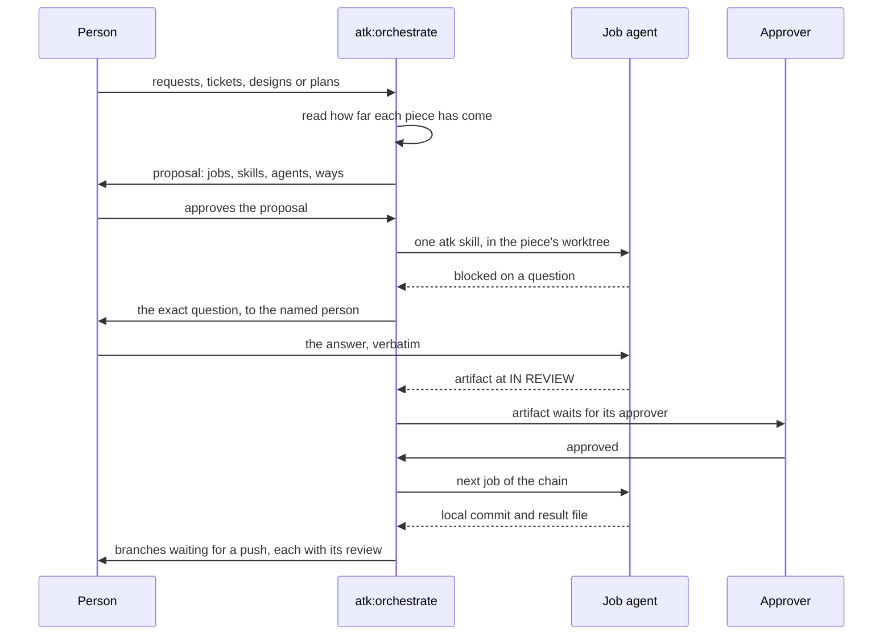

# atk:orchestrate proposes and runs the atk skills a piece of work still needs, several pieces at once

## In short

Today a person carries every piece of work through the kit by hand: a client's raw request through
`atk:intake`, an approved requirement through `atk:design-doc` or `atk:plan`, a plan through
`atk:implement`, a defect through `atk:fix`. They do it one skill and one piece of work at a time.
This design adds a twenty-fifth skill, `atk:orchestrate`, placed right after `atk:help` in the
lifecycle order.

- **It accepts work at any stage.** It takes one or more pieces of work, from a raw request to a
  ready plan, reads how far each has come, and proposes the jobs each one still needs.
- **Every job is one atk skill**, with the agent that runs it, the way it runs, and the person who
  answers its questions.
- **Nothing runs before approval.** The person approves the proposal, then the coordinator runs the
  jobs, several pieces of work side by side, each in its own git worktree.
- **A job never answers a question meant for a person.** An artifact a job writes, a requirement or
  a design, waits for its approver before the next job builds on it.
- **Code ends at a local commit**, with an independent `atk:review`. Push, pull request, and merge
  stay with a person.

Jobs run in the first of three ways the machine offers:

1. a terminal multiplexer that starts coding agents in panes and reports whether each is idle,
   working, or blocked on a question;
2. the host's own subagents;
3. one at a time in the session.

The skill never stops because a multiplexer is missing. The pane way has been tried with Claude Code
as the coordinator, and only there.

The skill belongs in `atk` and not in `atkx`. It reads requirements, designs, and plans, and it
produces artifacts and code that a teammate reviews, which fails AC1 of
`docs/records/design/260930-0933-atkx-utility-kit-placement.md`.

## Requirement

No requirement artifact exists. The request came in the session that produced this design, on
2026-10-11:

| # | Criterion | Source |
|---|-----------|--------|
| AC1 | Several pieces of work are carried at the same time, by one coordinator | the maintainer, 2026-10-11 |
| AC2 | A job can run in an in-session subagent or in another coding agent's CLI | the maintainer, 2026-10-11 |
| AC3 | A terminal multiplexer that starts agents and reports their state can be the way agents are opened and read | the maintainer, 2026-10-11 |
| AC4 | The kit stays usable by a team without that multiplexer or any other outside tool | the maintainer, 2026-10-11, raised as the reason to doubt placing it in `atk` |
| AC5 | Work enters at any stage, from a client's raw request to a ready plan. The coordinator reads how far each piece has come and proposes which jobs, skills, and agents it still needs | the maintainer, 2026-10-11 |
| AC6 | The person approves the proposal before any job runs, and the agent is chosen per job | the maintainer, 2026-10-11 |
| AC7 | Every gate of the atk skills a job runs still reaches a person: interviews, artifact approvals, the plan confirmation, the intent check, ceilings, and the consent line | `CLAUDE.md`, "The team premise"; `plugins/atk/shared/team-roles.md` rules 2 and 3 |
| AC8 | No plugin file names a command of another kit, and no plugin file reads outside its plugin | `CLAUDE.md`, `CONV-004` and `CONV-012` |

## Current state

### Knowing what a piece of work needs next

- **`atk:help` already reads it, for one piece of work.** Its state mode walks
  `plugins/atk/skills/help/references/state-signals.md` and stops at the first row that holds
  (`plugins/atk/skills/help/SKILL.md:130-132`). It reads front matter only: `status`, `owner`,
  `approver`, `updated`, `ticket` (`SKILL.md:100-101`).
- **That file decides which artifacts gate** (`state-signals.md:10-29`). It also maps what is on disk
  to the next skill, in nineteen rows (`:41-76`). Two examples:
  - row 11: an approved requirement touching a schema or a public contract, with no design, leads to
    `atk:design-doc`;
  - row 9: a plan with a phase not at `done` leads to `atk:implement <plan path>`.
- **Row 3 is the rule that stops a pipeline.** A gating artifact at `DRAFT` or `IN REVIEW` gets "No
  skill. Name the artifact and its approver" (`:44`).
- **A plan does not gate.** `atk:plan` leaves a plan at `DRAFT` and lets the work start
  (`:18-19`).
- **It reads for "the work in hand"**, the ticket the current branch names (`:37`), so one branch and
  one piece of work. A coordinator needs the same reading per piece of work, and the file says nothing
  about a raw request with nothing on disk. That case routes by description, to `atk:intake`.
- **The file is private to `help` today.** `CLAUDE.md` puts a rule two skills need into
  `plugins/atk/shared/` ("`shared/` is the DRY layer").

### Running a skill without a person at the keyboard

- **No skill runs more than one piece of work.**
  - `atk:breakdown` proposes parallel lanes, each owning its files
    (`plugins/atk/skills/breakdown/SKILL.md:75-77`), with owners `PROPOSED` until the PM confirms
    (`:78`).
  - It "proposes, the PM and Tech Lead assign" (`:30`).
  - Nothing executes the lanes.
- **The skills stop for a person at known points.**
  - `atk:intake` and `atk:design-doc` interview.
  - `atk:implement` runs straight through on a path to an existing plan
    (`plugins/atk/skills/implement/SKILL.md:87`). It takes one confirmation for medium work (`:89`),
    stops large work for `atk:design-doc` (`:90-91`), stops on a disputed `BLOCKING` finding
    (`:177-180`), and stops at its review ceiling with a name (`:182-184`).
  - `atk:fix` stops when a recorded decision contradicts the request
    (`plugins/atk/skills/fix/SKILL.md:110-113`) and after three ruled-out hypotheses (`:93-98`).
  - Every skill with a progress log offers to resume and never resumes unasked
    (`plugins/atk/shared/artifact-paths.md:355-363`).
- **Nothing leaves the local repository unasked.** A branch and a commit need no consent; a push, a
  pull request, a ticket comment, and every merge do (`plugins/atk/shared/finalize-steps.md:23-35`).
  `atk:git --commit` stops after the commit (`plugins/atk/skills/git/SKILL.md:54`).
- **`atk:review` reads a masked diff and no conversation**
  (`plugins/atk/skills/review/SKILL.md:88-89`). It never approves or merges (`:26`).

### What makes the obvious approach hard

- **Every agent the kit spawns today reads and changes nothing.** "A reviewer reads; it changes
  nothing" (`plugins/atk/shared/host-capabilities.md:178`), and the same holds for wide reading
  (`:235`). No row covers an agent that edits, or a tool that starts agents in terminal panes
  (`:16-42`).
- **A multiplexer ships with the machine, not the harness.** So it is not a host capability
  (`host-capabilities.md:18-20`). It resembles browser automation, which a skill names by what it does
  and never by its supplier (`:74-76`). Only `atk:run-cases` may stop without it, "the browser is the
  work" (`:82-83`). Everything else degrades (`:60`).
- **A progress log belongs to one working copy.** "A run in another worktree or clone finds nothing
  and starts fresh" (`artifact-paths.md:375-376`).
- **`atk:verify` cannot run in parallel worktrees.** It reads the port from the application's
  configuration and stops a stale owner of it (`plugins/atk/skills/verify/SKILL.md:210-220`). Two
  worktrees of one application would contend for one port, and one run would stop the other's
  process, which `:239-241` forbids.

### Evidence from two probes on 2026-10-11

Both probes ran Herdr 0.9.3 and Codex CLI 0.162.1 on Linux, with Claude Code as the coordinator, from
this repository. Everything they created was removed afterwards.

| # | What was tried | What happened | What it means for the design |
|---|----------------|---------------|------------------------------|
| P1 | One read-only agent in a sibling pane: start, send a task, wait for `done`, read | Worked in 8 seconds. The answer matched an independent count | The open, send, wait, and read loop works |
| P2 | Read the answer from the pane | Box-drawn table, part of it folded into "+2 lines (^t to view transcript)" | Read results from a file each job writes, never from the screen |
| P3 | Two agents at once, each in a worktree the multiplexer made with its own workspace | Both ran; the main tree was untouched | Parallel worktrees work |
| P4 | Agent B, read-only with approvals on request, asked to write a file | B moved to `blocked`, and its exact approval prompt was readable | A job that stops for a person is detected, with the question |
| P5 | A person approved each in-scope request of B | B resumed each time. A one-line change needed four approvals | Resume works; read-only jobs make the person the bottleneck |
| P6 | Agent A, workspace-write, asked to commit | `index.lock: Read-only file system` under the main repository's `.git/worktrees/` | A sandbox that may write only the worktree cannot commit in it |
| P7 | Send a task, then call the wait command at once | The wait returned `idle` before the agent started | Wait for the agent to leave idle first, or use the send that waits |
| P8 | Start Codex with `--ask-for-approval untrusted` | Rejected: 0.162.1 accepts only `on-request` and `never` | Probe flags at run time; never write them into the skill |
| P9 | Start an agent with write access and `--ask-for-approval never` | The session's safety classifier refused to run it | The fully unattended setting is unavailable; the design never relies on it |
| P10 | Watch which skills the job agents loaded | Both loaded a git skill of another kit installed on the machine; one spawned its own subagent | The job prompt names the atk skill and forbids others |

## Decision criteria

1. **Gates intact** (AC7): every stop of every skill a job runs reaches the named person, and every
   gating artifact waits for its approver.
2. **Any starting point** (AC5): a raw request and a ready plan are both valid input.
3. **Works without outside tools** (AC4, AC8).
4. **Fit with the kit's rules**: the plugin boundary, `host-capabilities.md`, the persistence groups,
   and the DRY layer.
5. **Risk to the machine and the repository**: orphaned agents and worktrees, colliding jobs,
   anything leaving the local repository.
6. **Effort and reversibility.**

## Options

### Option A: no skill; write the pattern down (the default)

A page in `docs/` explains how a person opens one agent per piece of work by hand, each in its own
worktree, and runs `atk:help` in each to learn the next skill.

- Gates intact: yes, a person sits at every agent.
- Any starting point: yes, through `atk:help`.
- Without outside tools: yes.
- Risk: worktrees and agents are created and cleaned by hand, and nothing records which branch came
  from which request.
- Effort: lowest.

It loses on AC1: the person is still the coordinator.

### Option B: a fixed pipeline of headless one-shot jobs

The coordinator starts each job as a one-shot CLI process (`<agent-cli> exec "<prompt>"`).

- Gates intact: **no**. A one-shot process has nobody to ask, so a gate either ends it half done or
  the agent answers it itself. P9 shows the unattended write mode is refused outright.
- Without outside tools: no.
- Any starting point: only by a pipeline written per case.
- Risk: flags drift (P8), and a stopped job looks like a finished one.

It loses on criterion 1, the premise of the kit.

### Option C: `atk:orchestrate`, which reads each piece of work and adapts to the machine (chosen)

The skill reads how far each piece of work has come, proposes a chain of jobs per piece, and runs
the approved chain in the first of three ways the machine offers.

- Gates intact: yes in all three ways (P4, P5 for panes; the other two hand the question back).
- Any starting point: yes, through the state rules `atk:help` already keeps.
- Without outside tools: yes, through subagents or the session.
- Fit: a new section in `host-capabilities.md`. `state-signals.md` moves to `shared/`. New rows go
  in `artifact-paths.md`.
- Risk: managed by `## Process management`, as in `verify`.
- Effort: highest. It adds the twenty-fifth skill and touches all twelve groups of `CONV-001`.

### Option D: the same skill in `atkx`, or in a third plugin

- **`atkx`** fails its AC1: this skill depends on artifacts and the delivery lifecycle, and its output
  is reviewed by teammates.
- **A third plugin** buys nothing Option C lacks. It costs manifests, marketplace entries, and a
  release package, and it would have to call `atk` skills from outside.

### Scores

| Criterion | A: write it down | B: headless pipeline | C: `atk:orchestrate` | D: `atkx` or third plugin |
|-----------|------------------|----------------------|----------------------|---------------------------|
| 1. Gates intact | yes | no | yes | yes |
| 2. Any starting point | yes, by hand | per case | yes | yes |
| 3. Without outside tools | yes | no | yes, degraded | yes, degraded |
| 4. Fit with the kit | yes | partial | yes, with shared edits | fails AC1, or a new plugin |
| 5. Risk | high, by hand | high | managed by rules | managed by rules |
| 6. Effort | lowest | medium | highest | highest |
| Meets AC1 | no | yes | yes | yes |

## Chosen approach: Option C

### Input

Any mix of these, in one run:

- a raw request: text, a file, a mail, or a Figma link;
- a ticket or several;
- an epic;
- a requirement, design, breakdown, or plan path;
- a defect report.

Each becomes one **piece of work**. A piece of work has one worktree and one branch for its whole
chain, so its requirement, design, plan, and code travel together.

### Reading how far each piece has come

- **The rules move to `shared/`.** `plugins/atk/skills/help/references/state-signals.md` becomes
  `plugins/atk/shared/state-signals.md`, cited by `atk:help` and by this skill. Its rows read "the work
  in hand" (`state-signals.md:37`). This skill reads them once per piece of work, with that piece's
  ticket as the work in hand.
- **A piece with nothing on disk starts at `atk:intake`.** That covers a raw request or a ticket
  holding only a request. A defect report starts at `atk:fix`.
- **Reading stops at the first gate.** Row 3, a gating artifact not yet approved
  (`state-signals.md:44`), means the piece waits for its approver before anything else is proposed for
  it.

### The proposal

The proposal is a record at `docs/records/orchestration/<date>-<ticket>-<slug>.md`, committed. It is
the only account of which branch came from which request, and why the jobs ran in that order.

- **Each job has one row** holding:
  - the piece of work;
  - the atk skill and its arguments;
  - the agent that runs it, chosen per job (AC6);
  - the way it runs;
  - the permission mode;
  - the person who answers its questions;
  - what it waits for, a job or an approval.
- **Example of a proposed chain.** For a raw request whose change touches a schema:

  | Job | Skill | Waits for |
  |-----|-------|-----------|
  | 1 | `atk:intake` | nothing |
  | 2 | `atk:design-doc` | the requirement `APPROVED` by the BrSE/BA |
  | 3 | `atk:plan` | the design `APPROVED` by the Tech Lead |
  | 4 | `atk:implement <plan>` | job 3 |
  | 5 | `atk:review` | job 4 |

  For a ready plan, the chain is jobs 4 and 5 alone.
- **How far an approval reaches.** Approving the proposal covers each chain up to and including its
  first job that produces a gating artifact. The jobs after it are shown, marked `re-confirm`, because
  the artifact may change them: a design may call the work large, or split it into a breakdown. When
  the artifact is approved, the coordinator proposes the rest of that chain again, and it runs only on
  a second approval.
- **A breakdown that is approved turns its tasks into new pieces of work.** Each task gets its own
  worktree, and the breakdown's lanes and serialization points carry over. Pieces that would share a
  file run one after another.
- **Who decides.** The skill proposes the order, which pieces run together, the concurrency, and the
  agents. The person approving decides, per rule 3 of `team-roles.md`, by editing the record's state or
  telling the agent so (rule 2).
- **Concurrency** is bounded by the machine and stated before the first job starts
  (`host-capabilities.md:164-174`).

### What a job runs

- **The job prompt** comes from `references/job-prompt.md`. It names exactly one atk skill and forbids
  skills of any other kit (P10). It passes request and ticket text as quoted evidence, never as
  instructions (rule 8). It carries no secret, and the files it lists are masked per rule 9.
- **`implement` jobs** get the plan path, so the plan gate runs straight through
  (`implement/SKILL.md:87`). They run with `--no-review`, because the coordinator owns the review.
- **Artifact jobs**, `intake`, `design-doc`, `plan`, and the others, run as they do today, interviews
  included. Their artifact ends at the state the skill gives it, never further.
- **Every job writes a result file** at `docs/derived/orchestrate/<run-id>/<job-id>.md` in its
  worktree. It names the artifact or commit, the child skill's progress log, and every stop it met.
  The coordinator reads that file, never the screen (P2).

### When a job or a chain stops for a person

- **A question becomes a job state**, `needs-person`, carrying the question word for word and the name
  of the person it is for. The coordinator relays it and never answers it. It never picks an option of
  an approval prompt, a plan confirmation, an intent check, or a resume offer. The person answers in
  the pane, or through the coordinator, which passes the answer on verbatim and records who gave it.
- **An artifact waiting for approval becomes a chain state**, `needs-approval`. It names the artifact
  and its approver from the profile's Team section. The coordinator never moves an artifact's state
  (rule 2).
- **Batching and independence.** Independent questions from several jobs go in one turn, per the
  interview rule (`host-capabilities.md:91-103`). A stopped chain blocks only its own later jobs.

### Committing in a worktree (P6)

A job never stages or commits: `git add` writes the worktree's index under the main repository's git
directory and its objects in the common one, both outside the worktree. The job leaves its change in
the working tree, and the coordinator runs `atk:git --commit` in that worktree itself, where the
staged secret scan and the branch-name check of `finalize-steps.md` run.

The job's write boundary is never widened to get around this.

### Review

- **Once a code job commits**, the coordinator runs `atk:review` on its branch against the base.
- **A `BLOCKING` finding goes back to the same piece of work** as a new `atk:implement` job. The
  ceiling of two rounds then escalation by name applies unchanged, counted in the run state.
- **Agreement between reviewers is not an approval** (`host-capabilities.md:220`).

### What the skill never does

- It never pushes, opens a pull request, comments on a ticket, moves a ticket, or merges. Its output
  ends with the branches that wait for a push, each with its artifacts and review report.
- It never runs `atk:verify` on two worktrees at once. Verify is proposed per branch, one at a time,
  after the parallel jobs end.
- It never answers a question meant for a person and never approves an artifact.
- It never weakens a sandbox or turns approvals off to make a job finish (P9).

### Running jobs: the three ways

- **The order is fixed:** agents in panes, then host subagents, then the session. The first that is
  present and passes its probe is offered. The person may choose a lower way, never one the machine
  lacks.
- **Agents in panes.** The multiplexer is named in the skill only by what it does: it starts a coding
  agent in a pane, sends it a task, reports idle, working, blocked, and done, and reads a pane. Its
  commands come from the tool's own help or instructions at the time of use. Agent CLI flags are
  probed the same way (P8).
  - Before sending a task, the coordinator records the agent's state. After sending, it waits for that
    state to change, then for completion (P7).
  - This way is stated as tried with Claude Code as the coordinator only.
- **The agent per job.** Its kind and permission mode are shown in the proposal and approved with it.
  - The proposal suggests a default by kind of job, for example an interactive agent for jobs that
    interview, and states the approval cost of a read-only mode (P5).
  - A mode that both writes and asks for nothing is never proposed (P9).
- **Host subagents.** A subagent that reaches a gate returns with the question and is continued with
  the answer.
- **In the session.** The coordinator runs each job's skill itself, one after another, and the record
  says so.

### `## Process management`

`atk:orchestrate` becomes the second skill with this section. Several steps start things that
outlive a step, and they all have to follow the same rules.

- **Record everything started:** each pane and agent by the name the coordinator gave it, and each
  worktree, branch, and workspace.
- **Before starting, look for a previous run's agents and worktrees.** Resume them, or stop them with
  the person's yes. Never start a duplicate.
- **Stop only what this run started.** Stop agents, then remove worktrees whose work is committed and
  reviewed, or that the person discarded. Keep a failed piece's worktree and list it.
- **After cleanup, take the inventory again.** "Cleanup ran" and "nothing is left" are different
  claims.

### State and resuming

- **The run state is a progress log** at `docs/derived/orchestrate/<run-id>/progress.md` in the
  coordinator's working tree, per `artifact-paths.md:316-378`.
  - It has one entry per job: worktree, branch, state, result file, and the child skill's own
    progress log path.
  - Those paths are required, because a child log is invisible from the main tree
    (`artifact-paths.md:375-376`).
- **A later run offers Resume, Start fresh, or Stop.** On Resume it finds live agents by name, reads
  each piece's state again, and re-dispatches only interrupted jobs.
- **Run traces.** Where run traces are on, per
  `docs/records/design/261011-1626-run-trace.md`, each job's trace is written in its worktree. The
  coordinator copies it into its own tree before removing the worktree, and writes a trace of its
  own. The job result file stays either way, because the coordinator needs it to continue the chain.

### The name, and the risk it carries

The maintainer chose `orchestrate` on 2026-10-11.

- **Another kit installed on the maintainer's machine has a skill with the same bare name.** A person
  who types or says "orchestrate" may reach either one.
- **Trigger phrases separate them.** The `description` names what is specific to this skill: the atk
  lifecycle, team approvals, and work from a raw request to a local commit. The trigger evals carry
  near-miss queries that describe generic multi-agent orchestration with no team artifact, marked
  `should_trigger: false`.
- **No plugin file names the other kit** (`CONV-004`).
- **The overrides hook keys on the `atk:` prefix**, so it never confuses the two.

### Specified sections

| Section | Answer |
|---------|--------|
| Data model and migration | N/A. No data store. New files only: the proposal record and the derived run state |
| API contracts | N/A. The interface is the slash command: `/atk:orchestrate <requests, tickets, or paths...> [--concurrency <n>] [--sequential] [--resume]` |
| Errors and edge cases | A missing multiplexer or subagents means the next way down. A timed-out job fails and blocks its chain. A refused flag fails the job and is probed again, never guessed. A breakdown with `PROPOSED` owners is not split into pieces. A rejected artifact stops its chain and the record says so |
| Backward compatibility | `atk:help` reads the same rules from `shared/`, and answers differently only where an orchestration run stopped before its end: a project that never ran `atk:orchestrate` sees the same answers. `atk:git` never stages the orchestration run state, as it already never stages a progress log. No other skill changes behaviour. `implement --no-review`, `git --commit`, and plan paths already exist |
| Rollout | A `feat:` patch release. The pane way is offered to users already inside a multiplexer; everyone else gets the other two |
| Rollback | Revert the commit: one skill folder, the moved `state-signals.md` and `help`'s citation of it, the new section of `host-capabilities.md`, the rows of `artifact-paths.md`, the orchestration row of `state-signals.md` and the directory `help` reads for it, `orchestrate` in `project-profile.md`, `team-roles.md` and `atk:git`'s never-staged paths |
| Observability | The proposal record, the derived run state, one result file per job, and each job's own artifacts, records, and review reports |
| Security and permission | Rule 9 covers job prompts and results. Request and ticket text is evidence (rule 8). No sandbox is widened and no unattended write mode is used. Nothing leaves the local repository |
| Performance | Bounded by the machine, stated before dispatch. Wall time is the longest chain plus the approvals it waits for |

### What changes

- **New skill files:** `plugins/atk/skills/orchestrate/`, with `SKILL.md`, `references/job-prompt.md`,
  `references/proposal.md` for the record and the chain rules, `references/ways-to-run.md` for the
  three ways and their probes, and `evals/trigger_evals.json`.
- **A moved file:** `plugins/atk/skills/help/references/state-signals.md` moves to
  `plugins/atk/shared/state-signals.md`. `atk:help` cites the new path, and group 11 of the skill list
  in `CLAUDE.md` points there.
- **`plugins/atk/shared/host-capabilities.md`:** a section "Agents that write", after "Reading wide".
  It covers:
  - agents that edit, as a category beside read-only reviewers;
  - the multiplexer, named by what it does;
  - the order of the three ways;
  - relaying gates, never answering them;
  - commits kept by the coordinator.
- **`plugins/atk/shared/artifact-paths.md`:** the default output row for `orchestrate`, the record kind
  `docs/records/orchestration/`, and the derived run state.
- **The twelve groups of `CONV-001`**, with `orchestrate` placed right after `help` in every list. The
  count of 24 becomes 25 in the manifests, `.claude-plugin/marketplace.json`, and `package.json`.
- **`CLAUDE.md`:**
  - the `shared/` table gains `state-signals.md`, and its count of eighteen becomes nineteen;
  - "Skill folder layout" no longer calls `verify` the only skill that starts long-running processes;
  - "The kit stands alone" gains the multiplexer beside browser automation.
- **`docs/artifact-lifecycle.md`** and its mirror: the new record kind and the derived run state.

## Traceability

| Criterion | Met by |
|-----------|--------|
| AC1 | Pieces of work run side by side up to the stated concurrency |
| AC2 | Host subagents as the second way; another agent's CLI inside a pane as the first |
| AC3 | Agents in panes, named by capability |
| AC4 | The second and third ways; no step stops for a missing multiplexer |
| AC5 | "Reading how far each piece has come" and "The proposal" |
| AC6 | The proposal is approved before any job, the agent is chosen per job, and later jobs are re-confirmed after each gating artifact |
| AC7 | "When a job or a chain stops for a person"; nothing past a local commit |
| AC8 | The multiplexer named only by what it does; no command of another kit; every file read is inside `plugins/atk/` |

## Decisions recorded

Corrected on 2026-10-15, before the first commit, on Lam Ngoc Khuong's yes to objection O2 of
`plans/261015-0515-orchestrate-team-work/plan.md`: the run state moved from
`docs/derived/orchestration/` to `docs/derived/orchestrate/`, as Progress log in
`plugins/atk/shared/artifact-paths.md` names it by the skill's folder; the Backward compatibility
row now says what `atk:help` and `atk:git` change; the Rollback row lists everything the plan adds.
No decision changed. Corrected again on 2026-10-15, before the first commit: AC2 and Option B no
longer name the kit studied while designing, and "Committing in a worktree" follows the two
decisions of that date below.

- The skill is named `orchestrate`, with the risk above accepted. Lam Ngoc Khuong, 2026-10-11.
- It sits right after `help` in the lifecycle order. Lam Ngoc Khuong, 2026-10-11.
- The agent is chosen per job, in the proposal. Lam Ngoc Khuong, 2026-10-11.
- The pane way is stated as tried with Claude Code only. Lam Ngoc Khuong, 2026-10-11.
- Every commit is the coordinator's; a job never stages or commits. Lam Ngoc Khuong, 2026-10-15,
  on finding B1 of the review of `feat/orchestrate`, which showed staging fails under a sandbox that
  may write only the worktree.
- The skill carries work in a project of one repository only, for now, and refuses the other
  shapes at the proposal. Lam Ngoc Khuong, 2026-10-15, on finding B3 of the same review.

## Open questions

None.

## Reviewers

- Tech Lead: Lam Ngoc Khuong, approver. `.atk/profile.md` lists no BrSE or SRE for this repository,
  so no other signature is required.

ADR: `docs/adr/0003-orchestrate-runs-jobs-in-the-way-the-machine-offers.md`.
