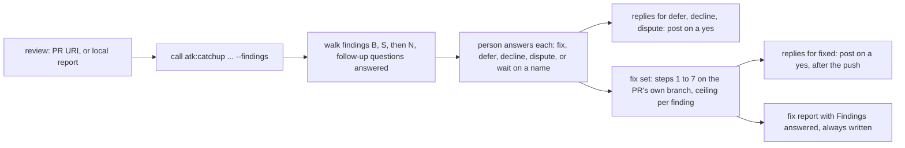

# A review's findings explained from the repository, and answered one by one by the author

## In short

On 2026-10-22 `atk:review` posted 35 findings on a client project's pull request: 3 `BLOCKING`,
14 `SHOULD FIX`, 18 `NIT`. All three `BLOCKING` findings held when checked. The next day the author
of the pull request opened an `atk:fix` session and wrote "I don't understand the issues, explain
each one". Fourteen question-and-answer turns later, every finding was understood, and each was then
decided in one or two turns. Four kinds of answer made the findings understandable:

- a scenario with named actors and states;
- whether the problem happens in practice, which needed the business spec and the deploy pipeline;
- why the code is the way it is, which needed a decision recorded in the plan;
- what the suggested fix really costs. Twice this differed from the finding's `Fix` line once the
  code was read.

The session also kept a decision file by hand, outside every kit path.

The kit already has an explainer, document mode of `atk:catchup`. It would have helped little, for
two reasons. Its fidelity rule allows only the review's own words on the page, so all four answers
above would come back as "the document does not say". And it cannot read a review that exists only
on the pull request. `atk:fix` has no path either: it takes one defect, not 35 findings that each
need a decision.

The design makes three decisions.

1. For a review report, document mode adds a labelled layer per finding, **What the repository
   says**. It is read from what the finding cites and from a fixed list of places one step away, and
   each line carries its own citation. The page still adds no finding, severity or verdict. This
   replaces one line of ADR 0007.
2. `/atk:catchup <pr-url> --findings` explains the `atk:review` posted on a pull request, read with
   the commands `atk:review` already uses to read a thread. A bare `<pr-url>` stays the diff brief.
3. `/atk:fix <pr-url | review report> --findings` is the triage. It walks the explained findings
   with their author, one at a time. It records each answer in the four kinds `atk:review` already
   reads back (fixed, deferred, declined, disputed), drafts the reply for each thread and posts it on
   a yes, and hands the findings marked "fix" to the existing steps 1 to 7. No new kind of artifact
   is added: the decisions go to the progress log while the run lasts, to the fix report at its end,
   and to the pull request thread, where the next review reads them.

Lam Ngoc Khuong decides, and answered the three open questions on 2026-10-24. The layer is for
review reports only, not security records. Its list of sources gains the definition one step away
from the cited lines. "Skip" is recorded as `declined`, and "wait" as `deferred` with the person and
the question as its place. A challenge on 2026-10-24 raised twelve objections. Eleven changed the design: among them,
the triage commits on the reviewed pull request's own branch, a `fixed` reply waits for the push,
a posted summary counts only from a known writer, and a credential finding gets no layer and no
reply. The twelfth, how a "wait" reply survives the next review, was settled by Lam Ngoc Khuong on
the same day: it is posted as `deferred`.

## Requirement

No requirement artifact exists. The criteria come from the "What the team expected" and "Proposed
change" sections of two feedback records written on 2026-10-23, `docs/derived/feedback/catchup-261023.md`
(B) and `docs/derived/feedback/fix-261023.md` (C). Those records are local and derived. The third
record of the set, `review-261023.md` (A), is planned in `plans/261023-1053-review-explain-triage/`,
whose phase 1 needs no decision. Its `--comment` line waits on decision 2 here.

| # | Criterion | Source |
|---|-----------|--------|
| AC1 | Each finding gets a concrete scenario with named actors and states | B, finding 1 |
| AC2 | Each finding says whether it happens in practice, citing where that comes from | B, finding 1 |
| AC3 | Each finding says why the code is the way it is, where a recorded decision explains it | B, finding 1 |
| AC4 | Each finding gives the cost of its suggested fix as the code shows it, and is flagged where that differs from the report's `Fix` | B, finding 1 |
| AC5 | The page still adds no finding, severity or verdict; each added claim carries its own citation, and "the repository does not say" where it does not | B, Proposed change |
| AC6 | The domain model every finding assumes is explained once, before the findings | B, Proposed change |
| AC7 | A review posted on a pull request can be explained by a person who has the pull request but not the reviewer's working tree, while `/atk:catchup <pr-url>` stays the diff brief | B, finding 2 |
| AC8 | A mode takes a review, posted or local, and walks its findings one at a time with the plain explanation | C, finding 1 |
| AC9 | Each finding gets a recorded decision, fix, skip with a reason, or wait on a named person, and each decision is one `gate` line | C, finding 1 |
| AC10 | A reply is drafted for each review comment, and posted only on consent | C, finding 1 |
| AC11 | The findings marked "fix" go to steps 1 to 7 as this run's defects, with the hypothesis ceiling counted per finding | C, finding 1 |
| AC12 | The decisions have a fixed shape and a kit path, replacing the hand-made file | C, finding 1 |
| AC13 | Given a pull request that carries a review, the skill says so and offers the triage | C, finding 2 |

Finding 3 of C asks for no change. AC9 says "skip" and "wait". The design maps them onto the answers
`atk:review` already reads: decline, and a deferral whose place is the person and the question.
Decision 3 explains why.

## Current state

**The explainer.** Document mode of `atk:catchup` is decided by
`docs/adr/0007-plain-explanation-of-a-document-is-a-catchup-mode.md` and specified in
`plugins/atk/skills/catchup/references/document-explainer.md`.

- The kind `review-report` is recognised only under `derived/reviews/` (`:41`). It reads "severity
  section, File, Issue, Fix, Author".
- A finding block holds seven fields: what happens, who, analogy, cost, conditions, fix, checked
  (`:108-114`).
- The Fidelity rule is "Every claim on the page is traceable to a place in the document ... 'the
  document does not say'" (`:131-133`). ADR 0007 says the same under Decision: "Every claim traces to
  a place in the document."
- Step 3 says "Document mode traces no code" (`plugins/atk/skills/catchup/SKILL.md:162`).
- A URL whose path holds `/pull/` is pull request mode, with no other test (`:96`).
- `SKILL.md` is 279 lines.

**A posted review is already machine-readable.** `atk:review` reads a pull request thread as an
earlier report (`plugins/atk/skills/review/references/report-format.md:44-58`):

- The summary is the newest comment that opens with `atk:review`.
- Its `
` block lists every finding by ID, title and `file:line` (`:341-349`).
- Each inline comment opens with its ID (`:327`).

The same read collects the author's answers in four kinds: "fixed, deferred to a place it names,
declined with a reason, or disputed" (`:61-63`). It writes them into each finding's `Author` line,
and the next posted summary answers them visibly (`:331-339`). The commands to read a thread and to
reply in it are `plugins/atk/shared/ticket-adapters.md:186-195`. A credential finding is posted with
no location (`report-format.md:351-356`).

**The fixer.** `atk:fix` takes an issue, a report path or a description
(`plugins/atk/skills/fix/SKILL.md:49-58`). Its workflow is built around one defect:

- Step 1 proves the cause (`:89`).
- Step 2 stops when a recorded decision contradicts the request, and presents the decision, the
  concern, the trade-off and two to four options (`:114-125`). This is the same work as AC3.
- The ceiling is three hypotheses.
- It writes a progress log at `docs/derived/fix/<run-id>/progress.md`
  (`plugins/atk/shared/artifact-paths.md:150`, `:357-400`).
- It writes one report at `docs/records/fixes/` from
  `plugins/atk/skills/fix/references/report-template.md`, with front matter `ticket` that already
  accepts `<record path>#<ID>` for a finding (`:19`).

`SKILL.md` is 293 lines. `atk:review` sends the author to `atk:fix` for rewriting
(`plugins/atk/skills/review/SKILL.md:26-27`). Neither `fix` nor `shared/review-fix-loop.md` names
`atk:catchup`.

**Consent.** Comments, issues and pushes are asked for every time
(`plugins/atk/shared/finalize-steps.md:22-37`). A reply in a pull request thread has no row of its
own there.

## Options

Three decisions, each scored on the same criteria:

- which acceptance criteria it meets;
- what it changes in a decision already `APPROVED`;
- whether it keeps the team premise, that a skill drafts and a person decides;
- cost: files touched, the `SKILL.md` line ceiling, a 26th skill;
- reach: who besides the author is helped.

### Decision 1: where the reading beyond the report lives

| | 1A. Keep the page to the report | 1B. A labelled repository layer on the page | 1C. Only the triage reads the repository |
|---|---|---|---|
| ACs | AC5 only | AC1 to AC6 | AC1 to AC6, but only inside `atk:fix --findings` |
| Approved decision changed | none | one line of ADR 0007, for `review-report` only | none |
| Team premise | kept | kept: no new finding, severity or verdict; the layer is labelled as the run's reading, not the reviewer's | kept |
| Cost | none | `document-explainer.md` Fidelity and Sections; a bounded step 3 in document mode | the reading moves into `fix`, which then writes explanations too, beside a `catchup` page that still says "the document does not say" |
| Reach | none | anyone handed the report: the author, a PM ordering the work, the Tech Lead settling a dispute | only the author who runs a fix |

**1A**, the default, is what failed on 2026-10-23: the reader's questions get "the document does not
say". **1C** keeps ADR 0007 intact, but it splits the explanation in two. Fix would write the useful
explanation, and catchup a weaker one of the same findings. A Tech Lead asked to rule on a disputed
`BLOCKING` finding needs "does it happen in practice" as much as the author does.

**Chosen: 1B.** What the reading may open is listed, not left open:

- the lines the finding cites;
- a record the finding's `Decision` line names (`report-format.md`, Decision);
- the plan or design the reviewed change names in its pull request body or its branch, only where
  the path resolves, symbolic links followed, inside the repository and under the plan or design
  directory `shared/artifact-paths.md` resolves; a path elsewhere is named on the page and not
  opened, since the pull request body is written by whoever opened it (O10);
- the reference documents under the docs root that describe what the cited code serves;
- a configuration file the finding names;
- the definition of what the cited lines use, one step away and no further: a table, a type, a
  function they call. On 2026-10-23 the cost of B1's fix depended on the schema of a lock table that
  the finding did not cite. (Added by the answer to open question 2.)

Nothing else is opened, and the table of `shared/secret-scan.md` keeps credential files unread here
as everywhere. Each line of the layer is cited as `path:line`. A question the list cannot settle is
written "the repository does not say" rather than guessed.

Three limits keep the layer true and keep it from leaking (O6, O11):

- **The revision.** The layer is read at the commit the review was made on: the head the summary or
  the report names, else the pull request's head when the run starts. Where the checkout is at
  another commit, the run says which, and asks to check that commit out or to go on. Going on
  stamps the layer `read at <sha>, not at the reviewed commit`, so a `path:line` that lands on
  different code is not read as the reviewer's.
- **Masking.** Everything the layer prints is masked by the rule of Masked values in
  `document-explainer.md`, rule 9 and the list in `skills/qa/references/test-run.md`, which now covers
  the repository's values as well as the document's. The `mask` mode of `shared/secret-scan.md` takes
  a git diff only, so it cannot mask a page (answered in review, see Answered). The layer describes what a value is for, and never quotes a configuration value.
- **Credential findings get no layer.** A finding that is a credential in the change keeps the
  report's own words only, so no `path:line` of the layer gives back the location the thread
  withholds (`report-format.md:351-356`).

The layer is for `review-report` only. A `security-record` does not get it, for two reasons. First,
`atk:security` already verifies each finding against the code, from entry point to impact, with a
verdict and a residual risk row, so the record answers "does it happen in practice" itself. Second,
a scenario with named actors and states, written for an unfixed vulnerability, can go into more
detail than the record does, which the Fidelity rule "No step-by-step exploit" forbids. A later run
that shows the need adds the kind as a row, per the table's own rule. (From the answer to open
question 1.)

### Decision 2: how a posted review reaches the explainer

| | 2A. A review URL is document mode | 2B. A flag on the pull request URL | 2C. Local reports only |
|---|---|---|---|
| ACs | AC7 on GitHub | AC7 on every host | not AC7 |
| Classification in step 1 | needs an exception: a URL holding `/pull/` is pull request mode today unless an anchor says otherwise | none: the URL is still a pull request; the flag picks what is read | none |
| Host | `#pullrequestreview-<id>` is GitHub's; GitLab and Backlog differ | the read is whatever `ticket-adapters.md` gives for the host | n/a |
| Typing | the reader copies an anchor from the browser | the reader types the URL they already have, plus one word | the reader needs the reviewer's file |

**Chosen: 2B**, `/atk:catchup <pr-url> --findings`. The run reads the newest summary that opens with
`atk:review`, its inline comments, and the author's answers, exactly as `report-format.md:44-64`
reads them, and explains that review as a `review-report`.

- The summary counts only when its writer is matched to a person in the Team section of
  `.atk/profile.md`, by the Host identifier, as `report-format.md:66-69` matches the writer of a
  ruling. A writer the run cannot match is named, and the person running the skill confirms the
  summary before anything of it is read as a finding. Without that, anyone who can comment on the
  pull request could post a summary that becomes the fix list of decision 3 (O9).
- A pull request with no such summary is said to have none, and the run offers the diff brief.
- A review written by a person rather than by `atk:review` is out of scope. Its findings carry no IDs
  to anchor a decision to.
- A credential finding stays without a location on the page, as on the thread.

The word `--findings` is shared with decision 3. `--review` was rejected for both: in `atk:plan` and
`atk:qa` it means "review this", which is the opposite of reading one.

### Decision 3: where the triage lives

| | 3A. A mode of `atk:fix` | 3B. A mode of `atk:review` | 3C. A skill of its own |
|---|---|---|---|
| ACs | all of AC8 to AC13 | AC8 to AC10, AC12; AC11 needs a hand-off to `fix` anyway | all |
| Role fit | the author runs it, and `review` already sends the author to `fix` (`review/SKILL.md:26-27`) | `review` is the reviewer's skill: "The reviewer is never the author" (`:32`); answering inside it puts both sides in one skill | clean |
| Where it ends | in fixes, the fix report and the review loop that `fix` already has | in decisions only; the code goes elsewhere | in a hand-off to `fix` |
| Cost | `fix/SKILL.md` is 293 lines against the 300 of `CONV-006`: it takes the two invocation lines and one pointer to a new `references/findings-mode.md`, which holds everything else, and the plan finds the other lines by tightening existing text, measured with `wc -l` (O8) | `review/SKILL.md` is 299 lines | the twelve groups of `CONV-001`, the count 25 to 26 in every manifest |
| Reuse | step 2 intent check is AC3's work; the progress log, the report, the ceiling exist | the thread read exists | none; re-cites all of the above |

**Chosen: 3A.** `--findings` turns the run into a triage followed by the usual workflow:

- **Explanation.** The run calls `atk:catchup <same input> --findings` itself, as `fix` already calls
  `atk:review`, and walks the page that call returns. It never looks for a page an earlier session
  wrote: a page is derived, held out of git and missing on another machine, and nothing ties it to
  one posted summary. The page's front matter carries the review it explains: the pull request URL
  and summary comment, or the report path, and the reviewed commit, so a resumed run can tell a page
  of an older review from this one's. Explaining stays in one skill, and the walk reads the page's
  finding blocks by the field names `document-explainer.md` gives, which the plan adds to the
  triggers of a change to that file (O2).
- **Follow-up questions.** During the walk the person may ask about a finding as often as they need.
  The answer comes from the same list of sources as the page, under the same limits, in the session.
  An answer worth keeping goes into that finding's entry in the progress log (O2).
- **Answers.** `atk:review` reads back only its own four kinds of answer, so the person's answer is
  one of those four: fix now, which becomes "fixed" once done; defer, to a place they name; decline,
  with a reason; dispute. A finding the person cannot answer yet is posted as `deferred`, its place
  being the question and the person who must answer it: "S1 deferred: waiting on <name> for <the
  question>". The next review reads it as deferred, one of its four kinds, and keeps the name in the
  finding's `Author` line. Each answer is a `gate` line. The run proposes an answer with its reason;
  the person decides it. The feedback's "skip" is recorded as `declined`, and its "wait" as that
  deferral, because a word outside the four would be read by the next review as no answer, and the
  finding would be raised again. (Confirmed by the answer to open question 3. How "wait" is posted
  was settled by the answer to O3: as `deferred`, with no change to `atk:review`.)
- **`NIT`s** are offered as one batch, with each one still answerable alone.
- **Replies.** Drafted per finding, opening with its ID, for the finding's existing thread or, for a
  local report, for the reviewer to receive. Posted only on a yes, and the consent table gains the row
  "Reply in a pull request thread: yes".
  - **When.** A reply for `deferred`, `declined` or `disputed` may be posted at the triage. A reply
    saying `fixed` is drafted only once that finding's fix is committed, and posted only after the
    branch is pushed, so the thread never says fixed while the fix is stuck at a ceiling or an
    escalation (O7).
  - **What it holds.** The person's answer and its reason, and the repository cited by path only.
    Nothing of the page's layer is quoted, since the thread may be read by people the page is kept
    from. Every draft is masked by the same rule before it is shown, and
    each one is shown before its yes, the `NIT` batch included (O12).
  - **A credential finding** gets no reply on the thread, since it has none and its location must
    not reach one. The person who owns the value hears it directly, as `report-format.md:351-356`
    says (O11).
- **The fix set** enters step 1 as this run's defects. Each finding's `Fix` line is a claim to check,
  never a step to carry out, per rule 8 of `shared/team-roles.md`. Each finding is proved or refuted as
  a defect is, step 3 makes its own minimal change, and the ceiling of three hypotheses counts per
  finding. A finding step 1 cannot reproduce goes back to the person as "not reproduced", which is
  their answer to give. Step 6 reviews the whole change once, as today (O9).
- **The pull request's own branch.** The fixes belong to the pull request under review. Under
  `--findings`, step 7 commits on that branch, after confirming it is the one checked out. It skips
  the branch rule of `finalize-steps.md`, opens no pull request, and never replaces the body the
  author wrote. Pushing is asked for as always. The fix report is committed, and is offered as a
  comment on the pull request on a yes. `finalize-steps.md` and step 7 of `fix` each gain the case
  (O5).
- **Records.** Decisions go to the progress log as one entry each, so a resumed session does not ask
  again. At the end they go to the fix report, in a new section "Findings answered": ID, answer,
  reason or place, reply posted or not. A credential finding's row names no file. Under `--findings`
  step 7 always writes the report, even when nothing was fixed, because a triage that ends with every
  finding declined, deferred or waiting is still a decision somebody needs to find. That report sits
  at `DRAFT`, with no change in it (O4, O11). No new artifact kind, no new path.

The record location the feedback asked about, `docs/records/` or `docs/derived/`, is therefore
neither. A decisions file of its own was rejected as a fourth copy of answers that the thread,
the progress log and the report already hold.

A pull request given to `atk:fix` without the flag, which carries an `atk:review` summary, gets one
question: run the triage, or treat the pull request as the defect report (AC13).

## The chosen approach in detail

- **Data model and migration.** `N/A`: no schema. Existing review reports and posted summaries are
  read as they are; nothing is rewritten.
- **Contracts, the invocations.**
  - `/atk:catchup <pr-url> --findings` and `/atk:catchup <review-report-path>`, the latter unchanged
    except for the new layer.
  - `/atk:fix <pr-url> --findings` and `/atk:fix <review-report-path> --findings`.
  - Each `argument-hint`, `## Invocation`, `README.md` and both `skills-overview.md` gain the flag,
    per the flag list in `CLAUDE.md`.
  - `--findings` with a bare description is refused in one line.
  - On `atk:fix`, `--findings` with `--investigate-only` stops after the answers and the proof of the
    fix set.
- **The page, decision 1.** Inside each finding block of a `review-report`, after the seven fields,
  three fields under a heading **What the repository says**:
  - a scenario with named actors and states;
  - whether it happens in practice;
  - why the code is this way.

  Then one more field, **What the fix costs**, flagged `differs from the report` where it does. Terms
  becomes **Terms and the model the findings assume**, each entry cited. The Fidelity section gains
  one rule: a line of this layer cites the repository, and never the reviewer's words as its source.
  The other kinds of record are unchanged.
- **Error and edge cases.**
  - A cited file missing at the commit the layer is read at: written as missing at that commit. It
    is never called removed unless `git log` names the commit that removed it (O6).
  - Every finding already answered: the triage lists them and asks only about the rest.
  - A finding whose answer is "fix" but whose `Decision` line names a recorded decision: step 2
    stops as today.
  - A review on a pull request the person cannot read: `ticket-adapters.md`'s outcome, never a guess.
  - A pull request carrying several `atk:review` summaries: the newest, as `report-format.md:48`.
- **Backward compatibility.** `/atk:catchup <pr-url>` and `/atk:fix <issue-url>` behave as today. A
  page written before the change has no layer and stays readable. One command does change with no
  flag: `/atk:catchup <review-report-path>` writes the new layer from the release on. It reads more,
  through agents, and cites the repository. The release notes and both `skills-overview.md` say so,
  in the paragraph on document mode, not only in the flag list (O1).
- **Rollout.** One release, through release-please. The two `--findings` modes change nothing until
  they are typed. The layer on a local report changes at the release, as above. Phase 1 of
  `plans/261023-1053-review-explain-triage/` can land before or after.
- **Rollback.** Reverting the commits takes the kit back. It does not take back the pull requests the
  kit already answered: replies posted as `fixed`, `deferred`, `declined` or `disputed` stay on their
  threads, and every later `atk:review` keeps reading them as answers. That is why a `fixed` reply
  waits for the push. A wrong reply is corrected by a new reply in the same thread, which the next
  review reads as the newer answer (O7).
- **Observability.** The run trace: one `gate` line per answer (AC9); `step 1` of `catchup` records
  `review-report, posted`; `fix` writes `step 1-1 findings mode: ran` before its usual steps.
- **Security and permission.**
  - The layer reads more of the repository than the page did. The list in decision 1 bounds it,
    the plan or design path is confined to the repository, and rule 9 of `shared/team-roles.md`
    holds for every file it opens.
  - What the layer and the replies print is masked by Masked values in `document-explainer.md`.
  - The page stays held out of git, per `document-explainer.md`.
  - A credential finding gets no layer and no reply, and its row in the fix report names no file.
  - A posted summary counts only from a writer matched in the Team section, or confirmed by the
    person running the skill.
  - A finding's `Fix` line is a claim to check, never an instruction.
  - Posting a reply crosses the consent line, row added above.
- **Performance.** A review of 35 findings with the layer reads widely. It goes to the reading-wide
  agent of `shared/host-capabilities.md`, one finding or a group per agent, each returning cited
  conclusions, never file bodies.

What the plan will touch, so the cost in decision 3 can be checked:

- `catchup`: `SKILL.md` (279 lines: the invocation line, the step 1 rule for the flag, and the
  bounded read of step 3), its `document-explainer.md` (the layer, Fidelity, Masked values, the
  page's front matter) and its trigger evals.
- `fix`: `SKILL.md`, within the budget in decision 3, a new `references/findings-mode.md`,
  `references/report-template.md` (Findings answered, the empty-set report) and its trigger evals.
- `review`: `SKILL.md` and `references/report-format.md`, the line that names the explainer.
- `plugins/atk/shared/finalize-steps.md`: the consent row, and the case of a fix on an existing pull
  request's branch.
- `help/SKILL.md`.
- `README.md`.
- Each of these with its `docs/vi/` mirror: `docs/skills-overview.md`, `docs/codebase-summary.md`,
  `docs/flow/skill-chain.md`, `docs/flow/skill-lifecycle.md`.
- The counts in `tests/verify.sh`.
- ADR 0007 and its design `docs/records/design/261016-0755-catchup-document-mode.md`, set to
  `SUPERSEDED` in the pull request that lands this design, as `docs/adr/0004-every-skill-leaves-a-run-trace.md`
  was by 0005.

## Open questions

None left open, and no objection is left open under Pre-review objections.

### Answered

The three questions were put to Lam Ngoc Khuong in the session of 2026-10-24 with a proposal for
each: 1, no, since the security record already answers the question and the layer could exceed its
detail; 2, add a sixth source, the definition one step away; 3, yes. The answer accepted the three
proposals in one line.

| Question | Answer | Answered by | Date | Relayed by |
|----------|--------|-------------|------|------------|
| 1. Does `security-record` get the repository layer too? The feedback says "arguably". This design scopes it to `review-report`, and adding a row later is the table's own rule. Blocks: decision 1, scope only. | "Hãy theo bạn đề xuất trên" (follow your proposal above): no | Lam Ngoc Khuong | 2026-10-24, answered | |
| 2. Is the list of what the layer may open in decision 1 the right one? The business spec the 2026-10-23 session needed sat in the project's reference documents, and the deploy pipeline in a CI configuration a finding named. Both are on the list. A source outside the repository, such as a client's spec on a wiki, is not on it. Blocks: decision 1. | The same line: add the definition one step away as a sixth source | Lam Ngoc Khuong | 2026-10-24, answered | |
| 3. AC9 asked for "skip" and "wait". This design maps them onto `declined` and an open question to a named person, so that `atk:review` reads them back. Is that what was meant? Blocks: decision 3. | The same line: yes | Lam Ngoc Khuong | 2026-10-24, answered | |
| Masking, raised while planning on 2026-10-24: the `mask` mode of `shared/secret-scan.md` masks a git diff only (`secret-scan.md:49-50`), not a page or a reply draft. Mask both by the rule of Masked values in `document-explainer.md` instead, and correct the wording here? | "Ok" | Lam Ngoc Khuong | 2026-10-24, answered | |
| O3. Post a "wait" as `deferred` naming the person and the question, or add a fifth kind to `report-format.md`? Proposed: the first, since it leaves `atk:review` unchanged | "Ok theo cách 1" (ok, the first way): `deferred` | Lam Ngoc Khuong | 2026-10-24, answered | |

## Pre-review objections

Raised by one agent per role over the draft; simulated perspectives, not a review and not an
approval.

| ID | Role | Section | Objection | Answer |
|----|------|---------|-----------|--------|
| O1 | BrSE/BA | Backward compatibility, Rollout | "Nothing changes until the flag is typed" is false: `/atk:catchup <review-report-path>` gets the new layer with no flag, and the reader docs would still describe a page confined to the document | Changed: Backward compatibility and Rollout name the change, and the release notes and both `skills-overview.md` describe it |
| O2 | BrSE/BA, TL | Decision 3, Explanation | `fix` looks for "an explanation page for this review", but no key ties a derived, untracked page to one posted summary: an author who declines the offer, works on another machine, or has a page from an older review walks without the right explanation, and the walk has no place for follow-up questions | Changed: `fix` calls `atk:catchup --findings` itself and walks the page that call returns; the page names the review and commit it explains; follow-up questions are answered from the same sources and kept in the progress log |
| O3 | BrSE/BA | Decision 3, Answers | A "wait" reply opens with its finding's ID, so it is tied, and `report-format.md:62-63` makes only an untied reply an open question, and to its author, not to the named person: the next review forces it into one of the four kinds or loses the name | Settled by Lam Ngoc Khuong, 2026-10-24: a "wait" is posted as `deferred`, its place the person and the question; `atk:review` is unchanged. Decision 3, Answers, edited to match |
| O4 | BrSE/BA | Decision 3, Records | A triage where nothing is fixed, or a session that stops before step 7, leaves the decisions only in the untracked progress log: the hand-made file comes back | Changed: under `--findings` step 7 always writes the fix report, at `DRAFT` when there is no change |
| O5 | BrSE/BA, TL | Decision 3, cost and reuse | Step 7 and `finalize-steps.md` assume no pull request exists yet: the fixes move to a new branch and a second pull request, or the author's body is replaced by the fix report (`fix/SKILL.md:218-220`, `finalize-steps.md:97-99`, `review-fix-loop.md:51`) | Changed: under `--findings` the fixes are committed on the pull request's own branch, no pull request is opened, the body is never replaced, and the report is offered as a comment; `finalize-steps.md` gains the case |
| O6 | TL | Decision 1, edge cases | The draft never says which revision the layer reads: on `main` or a stale branch every `path:line` lands on different code with a valid-looking citation, and a file the pull request adds is called removed | Changed: the layer reads at the reviewed commit, or is stamped with the commit it read; a missing file is called missing, never removed without the commit that removed it |
| O7 | TL | Decision 3, Replies; Rollback | A `fixed` reply can be posted before the fix exists and stay after a ceiling or an escalation; the next review closes the finding on it, and reverting the kit does not take posted replies back | Changed: a `fixed` reply waits for the commit and the push; Rollback says posted replies stay and are corrected by a newer reply |
| O8 | TL | Decision 3, cost row | "One invocation line" does not add up: `fix/SKILL.md` is 293 lines against the `BLOCKING` 300 of `CONV-006`, and the design itself asks for more than one line there; `catchup`'s cost was not scored | Changed: the cost row gives the budget, with all rules in `references/findings-mode.md`, and the touch list names what changes in `catchup/SKILL.md` |
| O9 | Security | Decision 2; Decision 3, fix set | Anyone who can comment on the pull request can post a summary opening with `atk:review`, and its `Fix` lines become the triage's defects | Changed: a summary counts only from a writer matched in the Team section, or confirmed by the person running the skill; a `Fix` line is a claim under rule 8, and step 3 makes its own change |
| O10 | Security | Decision 1, sources | The plan or design path is taken from the pull request body, written by whoever opened it, with no bound: a body can name any file to be read into the page | Changed: the path must resolve inside the repository, under the plan or design directory |
| O11 | Security | Decision 1, the page; Decision 3, Replies and Records | Masking covers only values the document shows, not the repository's, and a layer `path:line` or a reply or a committed fix report can give back the location a credential finding withholds | Changed: the layer and the replies are masked by Masked values in `document-explainer.md`; a credential finding gets no layer and no reply, and its report row names no file |
| O12 | Security | Decision 3, Replies | Nothing limits what a reply holds: a reply can carry business rules or pipeline details from the page onto a thread read by outsiders, and the `NIT` batch is approved as one | Changed: a reply holds the answer, its reason and paths only, quotes nothing of the layer, is masked, and each is shown before its yes |

Agents that ran, in parallel, no model asked for since the profile has no `Review agent model`
line: one for the TL, one for the BrSE/BA, one for the security lens, which applies because the
design reads more of the repository and posts to a pull request. Left out: SRE, since the design
touches no deployment, data or capacity, and QA, which does not sign a design. Fifteen objections
came back, five from each agent. None was dropped as unfounded. Three pairs about the same failure
were merged into O2, O5 and O11, leaving twelve.

ADR: `docs/adr/0010-review-findings-explained-from-the-repository-and-answered-in-fix.md`

Supersedes `docs/records/design/261016-0755-catchup-document-mode.md` in one decision, that every claim on the page traces to a place in the document, for a review report; every other decision there stands.
