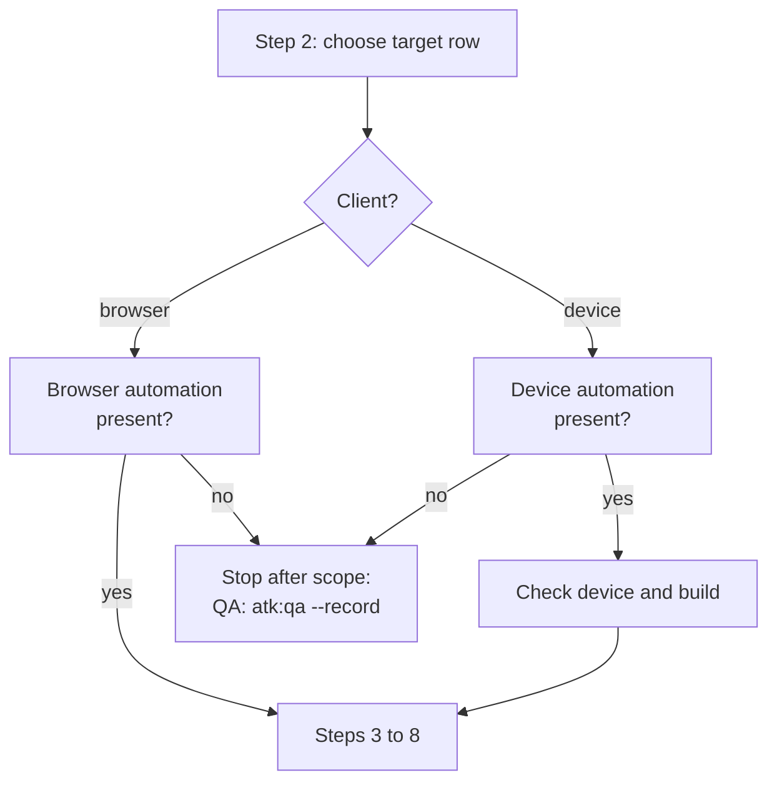

# atk:run-cases and atk:verify drive a native mobile app through the harness's device automation

## In short

`atk:run-cases` executes approved test cases only through a web browser, and `atk:verify` exercises
a change only through requests and a browser. A team building a native iOS or Android app gets no
automated run from either. In `run-cases`, every case that needs the app on a device scores 0 on
criterion 6 of the triage and is forced to `MANUAL`. In `verify`, the app itself is never run, so a
change to the app is checked only through its backend.

This design adds a **client** to both skills: either a browser, as today, or an app on a phone,
simulator or emulator. It makes seven decisions.

1. **No new skill.** `atk:run-cases` keeps its eight steps, its safety rules, its triage and its
   record, and chooses its client at step 2. `atk:verify` keeps its steps and its process
   management, and runs the app where the change touches it. No new skill is added.
2. **Device automation is a second capability named by what it does**, beside browser automation
   in `shared/host-capabilities.md`: driving an installed app on a device, reading its accessibility
   hierarchy, tapping, typing, swiping, and taking a screenshot. It is never named by the tool that
   supplies it. It stops only `run-cases`, as browser automation does; `verify` degrades without it
   the usual way.
3. **What both skills do on a device lives in one shared file**, `shared/device-sessions.md`: the
   device kinds, the clean-state rule, the order of assertions, the rules for a real device, and the
   status-bar check on a screenshot. (Changed by the review request R1: it replaces the
   `run-cases`-only reference the first version of this design proposed.)
4. **`run-cases` never boots, installs or erases a device; `verify` may boot and install.** The
   person brings a running device with the build installed for `run-cases`, which stays a skill that
   starts nothing that outlives a step. `verify` already has process management, so it builds the
   changed app from the working tree, installs it, and boots a simulator or emulator when none is
   running, and stops what it booted. (R1) Both may clear the app's data on an emulator or simulator,
   only with the command the profile's `App` line names, never on a real device. (U1)
5. **The target rules point opposite ways, as they do today.** For `run-cases` the target is the
   backend environment row: a device on this machine is not a local target, and a build whose backend
   is production or local is refused. For `verify` the backend must be local, and a build pointing
   anywhere else stops the run. (R1)
6. **Real devices are in the first version (Q2), the cases template gains an optional `Platform`
   column (Q3), and a time-boxed spike runs before implementation (Q1).** The spike ran on
   2026-10-25 within its one-day time box (Q4).
7. **The first version is Android, measured on Claude Code.** iOS is deferred to issue #155, and the
   measurement on Cursor and Codex to issue #156. (R2)

Lam Ngoc Khuong approves. No question is open: the spike's five other recommendations were all taken
(Q5).

## Requirement

No requirement artifact exists. The request came in the session on 2026-10-25, after the answer
that the kit does not run cases on a native mobile app: "mở design-doc cho hỗ trợ mobile native".
A second request came in review the same day: "Tôi cũng cần verify có thể test được mobile app"
(R1). The acceptance criteria below are restated from those requests and from the current
behaviour, and are the criteria the approver checks this design against.

| ID | Acceptance criterion | Where the design meets it |
|----|----------------------|---------------------------|
| AC1 | A case on a native iOS or Android app, whose result can be observed on the device, can be triaged `AUTO` or `SEMI-*` and executed, rather than always `MANUAL`. Android in the first version, iOS by issue #155 (R2) | Decision 1; Triage on a device |
| AC2 | The capability that drives a device is named by what it does, resolved from the harness at the time of use, with its own degradation rule in `shared/host-capabilities.md` | Decision 2 |
| AC3 | Every safety rule of a browser run still holds on a device: no production, no local stack, the lock threshold, data created only through the product and deleted by identifier, screenshots confirmed by a person | Decision 5; Target on a device; Evidence on a device |
| AC4 | The run record keeps the shape of `skills/qa/references/test-run.md`, so `atk:qa --bug` and `atk:qa --retest` read it unchanged | Output and record |
| AC5 | A browser run of `run-cases` and a run of `verify` on a project with no app behave exactly as they do today | Backward compatibility |
| AC6 | `atk:verify` can run a changed native app against the local stack, exercise it on a device, and assert its side effects, under its existing ceiling and process management (R1) | Decision 4; `atk:verify` on a device |

Nothing in the design is outside these six. Generating permanent mobile end-to-end test code is
not in them, and stays `atk:implement`'s, as it is for the web today.

## Current state

Cited at commit `b7256ca`.

**`run-cases` is browser-only by its own words.** The description says it executes cases "against a
deployed DEV or staging environment through the browser"
(`plugins/atk/skills/run-cases/SKILL.md:4`), and the intro repeats it (`SKILL.md:21-23`). Step 1
checks for browser automation and, where there is none, ends the run after step 5 with a hand-off
to `atk:qa --record` (`SKILL.md:97-100`, `SKILL.md:131-133`). Step 7 closes "the browser session
this run opened" (`SKILL.md:148`), and the definition of done checks the same (`SKILL.md:211-212`).

**The triage rejects a device outright.** Criterion 6 scores 0 for a case that acts "Outside the
browser: an operating system dialog, a mail client, a device, a downloaded file"
(`plugins/atk/skills/run-cases/references/triage.md:90`), and any criterion 6 of 0 makes the case
`MANUAL` unconditionally (`triage.md`, The verdict, step 1). Criterion 2 scores observability by "the
page's accessibility tree, the URL, a status code, or a response body" (`triage.md:86`), three of
which a native app does not have in the same form. Recon logs in through "the browser session recon
opens" (`triage.md:71-73`).

**Execution assumes a page.** `references/execution.md:6-19` is a section called The browser: one
browser session for the run, a viewport set once, and only the session this run opened ever closed.
The assertion order is "the page's accessibility tree; the URL after a navigation or a guard; the
status and body of the request the page made; the console" (`execution.md:42-45`). A defect's
`Environment` is "the build, the row's name, the browser and viewport, and the account by role"
(`execution.md:240`).

**The target is a URL.** The environment row supplies "the base URL" (`environment-safety.md:28`).
The local refusal triggers on `Kind` `local` or a loopback or this machine's own address
(`environment-safety.md:60`), which today is unambiguous because the browser is only a window onto
the target. A gate in front of the application is an HTTP `401` with `WWW-Authenticate`, passed
again whenever "the browser session is reset" (`environment-safety.md:139-147`).

**`verify` runs the local stack and interacts through requests or a browser.** (R1) Its scope is
"starting the application the way `.atk/profile.md` says to start it, waiting for the readiness
signal, exercising the change with real requests or real interaction" and "stopping every process it
started" (`plugins/atk/skills/verify/SKILL.md:27-30`). A host that is not this machine stops the run
(`verify/SKILL.md:101-107`). Under `--ui`, `references/ui-checks.md` compares screens at "a narrow
phone width, a tablet width, and a wide desktop width" (`verify/references/ui-checks.md:28-30`) and
walks a flow with "the real clicks, the real typing" (`ui-checks.md:77-81`). `## Process management`
makes `verify` record the command, PID and port of everything it starts and stop it
(`verify/SKILL.md:205-235`), and its port rule talks about "which one the browser is talking to"
(`verify/SKILL.md:220`). `SKILL.md` is 299 lines, one under the ceiling of `CONV-006`.

**The profile has no app.** (R1) The Verify section holds `Start`, `Ready when`, `Logs`,
`Data check`, `Prepare`, `Shared stores`, `Cleanup` and `Local only`
(`plugins/atk/skills/init/references/profile-template.md:143-153`); none says how to build an app,
install it, or which app identifier to launch. `shared/project-profile.md:191` lists the same fields
as read by `verify` alone.

**The capability rule has one exception, worded as browser automation.**
`plugins/atk/shared/host-capabilities.md:109-114` says no skill stops for a missing host capability,
with browser automation as the one exception. `host-capabilities.md:116-138` defines browser
automation by what it does, forbids naming the plugin or server that supplies it, and ends: "it stays
the only one: a skill whose work a browser only improves degrades the usual way". The terminal
multiplexer is the other capability of the machine named by what it does
(`host-capabilities.md:378-383`), and it does not stop any skill.

**The QA artifacts already allow a device.** The test plan's Compatibility section has a column
"Browser, OS, or device" (`plugins/atk/skills/qa/references/test-plan-template.md:93`). The cases
table's `Environment` column is "The browser, device, or build the case ran on"
(`plugins/atk/skills/qa/references/test-case-template.md:113`). The run record's header field is
"build, environment, browser or device, account by role"
(`plugins/atk/skills/qa/references/test-run.md:196`). So the record shape needs no change for AC4.
The cases table has no platform column (`test-case-template.md:82`), so nothing in a cases file says
a case is for iOS only or Android only.

**Process management is held by two skills.** `CLAUDE.md`, section Skill folder layout, gives
`verify` and `orchestrate` a `## Process management` section because they start things that outlive
a step, and says `atk:run-cases` holds a browser session "through the harness's browser automation
rather than a process it starts and must stop". A `run-cases` run that booted an emulator would break
that sentence; a `verify` run that boots one does not, since `verify` is one of the two.

**`plugins/atk/shared/` holds twenty-one files**, and a rule two or more skills need goes there
(`CLAUDE.md`, section "`shared/` is the DRY layer").

What makes the obvious approach impossible: copying `run-cases` into a mobile twin would duplicate
`environment-safety.md` (153 lines) and `triage.md` (199 lines), the two files whose rules must
never drift; booting devices from `run-cases` would add a third skill with process management; and
writing the device rules into `run-cases` and `verify` separately would put one rule in two places.

## Options

### Decision criteria

| Criterion | What it asks |
|-----------|--------------|
| Safety parity | Does every rule that keeps a run off production and off other people's data hold, from one copy? |
| Effort | How many files change, counting the twelve groups of a new skill |
| Reversibility | Can it be removed without rewriting records already written? |
| Kit invariants | Does it keep "named by what it does", one stopping exception, process management in two skills, and `verify/SKILL.md` under 300 lines? |
| Honesty of results | Can a case still never receive a result nobody observed? |

### Decision 1: how `run-cases` reaches a device

#### Option A: one skill, the client chosen at step 2 (chosen)

`atk:run-cases` gains a client, `browser` or `device`. Steps 1 to 8 stay. The rules shared by both
clients stay where they are; what a device adds comes from `shared/device-sessions.md` (R1).
`shared/host-capabilities.md` gains Device automation beside Browser automation, and the stopping
exception becomes "the automation the run's client needs".

#### Option B: a new skill, `atk:run-mobile-cases`

The option a team would pick by default: a mobile run feels like a different job, and a new skill
leaves the browser skill untouched. It loses on safety parity. The target rules, the lock threshold,
the marker and clean-up rules and the screenshot check would exist twice or be cited across skills,
and a fix to one, such as the production check on a host name, would have to be made twice. It also
costs the twelve file groups of `CONV-001` and moves the skill count from 25 to 26, for a skill that
reads the same cases file and writes the same record.

#### Option C: keep device cases manual, and improve the hand-off

Triage keeps criterion 6 at 0 for a device, but writes the reason `needs a device` and groups those
cases for the tester, and `atk:qa --record` gains a device checklist. Cheapest and safest, and it
meets no part of AC1. It is the fallback the chosen option already keeps for a harness with no
device automation.

#### Scores

| Criterion | A: one skill, two clients | B: a new skill | C: manual hand-off |
|-----------|---------------------------|----------------|--------------------|
| Safety parity | One copy of every rule | Two copies, or cross-skill citations | Unchanged, nothing new runs |
| Effort | 4 skill files, the shared files, docs | A new skill: twelve file groups, count 26 | 2 files |
| Reversibility | Revert the commit; records stay valid | Delete the skill; records stay valid | Trivial |
| Kit invariants | Kept, with the exception reworded | Kept, but two skills hold the exception | Kept |
| Honesty of results | Same verdict rules; criterion scores per client | Same, if the copies stay in step | Same |
| Meets AC1 | Yes | Yes | No |

### Decision 2: how `verify` reaches a device (R1)

Added by the review request R1, scored against the same criteria.

#### Option V1: `verify` runs the app it built, on a device, under its process management (chosen)

`verify` gains the same two clients. Where the change touches the app, step 2 builds the app from the
working tree with the profile's new `App` line, installs it on a device, boots a simulator or
emulator when none is running, and records each in the report as process management requires. Step
3 interacts through the harness's device automation and asserts the side effect in the local stack as
it does today. Without device automation, `verify` still starts the stack and asserts through
requests, and the report says the app was not exercised and why: the usual degradation.

#### Option V2: `verify` hands the app to `run-cases`

`verify` checks the backend only and names `atk:run-cases` for the app. Rejected: `run-cases` refuses
the local stack, so it would need a deployed build of an unmerged change, which is the gap `verify`
exists to close; and `run-cases` executes approved QA cases, not a developer's acceptance criteria.

#### Option V3: `verify` checks the backend, and the app is a manual step

What happens today, and the default a team would accept without this design. `verify` asserts the
API side effects, and the report lists the app's acceptance criteria as not verified for a person to
walk. Cheap, and meets no part of AC6.

#### Scores

| Criterion | V1: app on a device | V2: hand to `run-cases` | V3: manual app step |
|-----------|---------------------|-------------------------|---------------------|
| Safety parity | Local-only check kept; device rules from the shared file | `run-cases` rules, but on a deployed unmerged build | Unchanged |
| Effort | `verify` references, the profile line, `init` detection | A cross-skill hand-off and a deploy step outside the kit | 1 file |
| Reversibility | Revert; reports stay valid | Revert | Trivial |
| Kit invariants | Process management stays in `verify`; `SKILL.md` edits are in-line, detail in references | Kept | Kept |
| Honesty of results | The report states whether the app was exercised | A gap between the verified change and the deployed one | The report says not verified |
| Meets AC6 | Yes | No | No |

### Sub-decision: who starts the device

| Skill | Rule | Why |
|-------|------|-----|
| `run-cases` | **The person brings a running device with the build installed (chosen)** | Nothing the run starts outlives it; no process management; no signing or install permissions; a real device is never erased by the run. The rejected alternative, the run boots and installs, would make it a third skill with process management and needs SDK paths, signing and build files no profile holds. Clearing the app's data on an emulator or simulator with the profile's command starts no process and is allowed (U1) |
| `verify` | **The run builds and installs the change, and boots a simulator or emulator when none is running (chosen, R1)** | The build under test is the working tree, so nobody else can bring it; `verify` already records and stops what it starts. On a real device it installs only on the person's yes, per Real devices below |

## Chosen approach

### The client

A run of either skill has exactly one client:

- `browser`, the default, and the only value where nothing below asks for a device.
- `device`, with the platform, the device kind (`emulator` or `real`, real devices included per
  Q2), its OS version, and the build. The first version offers `Android` alone; an iOS device is
  refused in one line saying this version does not drive iOS, and the run carries on with no
  device client, per issue #155 (R2). Where iOS is added, `simulator` joins the device kinds.

For `run-cases`, step 2 settles it with the target in the same confirmation question, offering the
values from the test plan's Compatibility rows where it has them. For `verify`, step 1 settles it
from what the change touches: a change under the app's directory in the profile's `App` line asks
for a device, and the person confirms which (R1).

A cases file that covers a web app and a mobile app is run once per client. Each run writes its own
record, whose `Environment` names its client, which `test-run.md:196` already allows.

### Device automation, in `shared/host-capabilities.md`

A new section, Device automation, after Browser automation:

- **What it is.** Driving an installed app on a phone, a simulator or an emulator from the agent:
  launching and stopping the app, reading its accessibility hierarchy, tapping, typing, swiping,
  pressing the system back or home control, answering a system dialog, and taking a screenshot.
- **How it is named.** "The harness's device automation", never the server, framework or tool that
  supplies it on one machine, for the reason browser automation gives.
- **How it is resolved.** From what the harness lists at the time of use. Where several are listed,
  the one the person names, or ask. Which platforms and device kinds it can drive is read from the
  tool, never assumed: an automation that lists only Android devices offers no iOS client.
- **The exception.** The paragraph at `host-capabilities.md:131-138` is rewritten to say that
  `atk:run-cases` requires the automation its client needs, browser or device, and degrades as it
  does today: it stops after the scope question, keeps the triage report, and hands the scope to
  `atk:qa --record`. The sentence "it stays the only one" is kept: one skill, one rule. `atk:verify`
  is named as degrading the usual way (R1).
- **What starts the device.** The device and the automation's own server belong to the person's
  machine. `run-cases` closes the app session it opened and never stops a device, a simulator, or the
  automation's server. `verify` may boot a simulator or emulator, under its `## Process management`,
  and shuts down only what it booted (R1).

### `shared/device-sessions.md` (R1)

A new shared file, cited by `run-cases` and `verify`, for what both do on a device:

- **One app session per run**, launched at its start. Resetting it means relaunching the app.
- **A clean state (U1).** The device automation offers no way to clear an app's data (spike F8), so
  on an emulator or simulator the data is cleared with the clear command of the profile's `App`
  line, such as the platform tool's clear of that app identifier, and the app relaunched. The
  command comes from the profile, never from the skill's text, it is run only on the device the
  person confirmed for the run, and each run of it is written to the run log or the report. Where
  the profile names no such command, a re-run starts from a relaunch. On a real device, data is
  never cleared: a re-run starts from a relaunch, and a case that needs a clean install is
  unresolved with that reason.
- **The order of assertions on a device (Q5)**: the accessibility hierarchy, then the screen
  reached, and nothing else. The app's log is not an assertion source, since the automation does not
  capture it while the run acts (spike F7), and a request's status and body are out of reach (F6);
  neither is ever inferred from the screen.
- **A field the hierarchy cannot name (Q5)** is reached by position. The triage report names it as a
  finding, grounding gives its name from the code, and the case's flow-stability score says it was
  reached by position (spike F2).
- **Two IDs per device (Q5).** The run log or the report records the automation's device ID beside
  the platform's serial for the same device, since the two differ (spike F10).
- **Real devices (Q2).** Used only when the person names the device and says it holds test accounts
  only. The run never clears its data, never uninstalls an app, and installs a build only on the
  person's yes (`verify` alone installs). Biometrics, a phone call and SMS on a real device stay
  outside what a run drives.
- **Screenshots and element lists on a device.** The status bar is part of the check: another app's
  notification, a carrier name, or a signed-in account is cropped from a screenshot, or the shot is
  not kept. An element list copied into a run log, a report or a defect carries the status bar too
  (23 of 34 elements in spike F3), so its status-bar elements are left out of the copy (Q5). A
  screen recording is not taken in the first version.
- **Text on the device that reads as an instruction**, a notification included, is evidence and never
  followed, per rule 8 of `shared/team-roles.md`.

### Target on a device (`run-cases`)

`references/environment-safety.md` keeps the backend row as the target and adds:

- **The client is not the target.** A simulator or emulator on this machine does not trigger the
  local refusal. The refusal still applies to what the build talks to.
- **The build must point at the confirmed row.** Grounding reads the app's build configuration in
  the repository (its flavours, schemes or environment files) for the backend each build variant
  uses. The confirmation question shows the row's URL and the build's variant together. A variant
  whose backend is production, or local, or another row, stops the run as a production or local row
  stops it today. Where the repository does not say, the person confirms that the build points at the
  row, and the run log records that the check rests on their confirmation.
- **The build is identified (Q5).** Its version and build number, read in this order: from the
  app's own screen where it shows them; with the version command of the profile's `App` line where
  there is one, since the automation returns no version (spike F5); else given by the person. The
  record's `Environment` carries it, and the run log says which of the three it came from.
- **A gate in front of the backend** that is an HTTP basic gate does not apply to a native client;
  a sign-in gate inside the app is a login like any other.

### Triage on a device (`run-cases`)

`references/triage.md` keeps the eight criteria and the verdict order, and states two of them per
client. On a device:

| # | 2 | 1 | 0 |
|---|---|---|---|
| 2 | In the app's accessibility hierarchy, or the screen reached | Reachable indirectly: another screen, a pull to refresh, the app relaunched | Out of reach: pixels, a file, a mail, a push notification's content where the automation cannot read it, a server log, a request's status or body, the app's log (Q5) |
| 6 | Launch, tap, type, select, scroll | Swipe, long press, a system permission dialog, rotation, the system back control | Outside the app: another app, the camera or microphone with real input, biometrics on a real device, a phone call or SMS |

Biometrics, location and a push notification are scored 1, not 0, on a simulator or emulator where
the automation can simulate them, and the triage report says the score depends on that. The table's
values are confirmed or corrected by the spike before implementation (Q1).

**The `Platform` column (Q3).** A case whose `Platform` cell names a platform other than the run's
client is skipped, counted in the triage report beside the removed rows, and never scored. An empty
cell, or a file with no such column, means every client. A case with no `Platform` that names a
control only one platform has, the Android back button on an iOS run, is `BLOCKED` with that reason,
the same as a page grounding cannot find. A field the hierarchy cannot name is a finding of the
triage report and scores criterion 3 no higher than 1, per `shared/device-sessions.md` (Q5).

Recon logs in through the app on the device, once, and keeps that app session, as it keeps a browser
session today.

### Execution on a device (`run-cases`)

`references/execution.md` renames The browser to The client and keeps it client-neutral, citing
`shared/device-sessions.md` for the app session, the clean state and the order of assertions (R1).
Data is created through the app and marked with the same marker, and clean-up deletes it by
identifier as today. Where the identifier the app shows differs from the backend's, the run log
records both.

### Evidence on a device

Screenshots follow `execution.md`, Evidence, and `verify`'s Evidence in `ui-checks.md`, unchanged,
with the status-bar check of `shared/device-sessions.md` added: taken at the failure, checked,
confirmed by the person before a record links them.

### `atk:verify` on a device (R1)

- **The profile gains an `App` line** in its Verify section, optional: per platform, the directory of
  the app, the command that builds it and installs it on a named device for the local stack, the
  app identifier to launch, and the command that clears its data on an emulator, which `run-cases`
  reads too (U1). `atk:init` detects it from the repository (an Android Gradle module, a
  cross-platform app's configuration; an Xcode project once iOS lands, per R2) and asks what no file
  answers. A profile with no `App` line means `verify` runs as today.
- **Step 1, the client.** Where the change touches the app's directory, the run asks which device:
  one already running, or a simulator or emulator it boots. A real device needs the person's yes to
  install, per `shared/device-sessions.md`.
- **The local-only check covers the app.** The build's backend must be this machine, read the same
  way `run-cases` reads it, with the address the device reaches the host by allowed: the emulator's
  alias for the host loopback, or this machine's address on the local network for a real device. A
  build pointing anywhere else stops the run, as a non-local host does today.
- **Step 2, start.** After the stack is ready: boot the simulator or emulator when the run chose to,
  build and install the app, launch it. Each is recorded with its command and identifier, and the
  boot also with its process ID, per `## Process management`.
- **Step 3, exercise and assert.** Walk the acceptance criterion through the harness's device
  automation, then assert the side effect in the local stack exactly as today. A flow that ends with
  the app saying it worked has verified the message, not the outcome, as `ui-checks.md` already says.
- **`--ui` on a device.** The screen sizes are the devices the design or the Compatibility section
  names, in place of the three widths; where none is named, the one device of the run, and the report
  says the choice was the skill's.
- **Cleanup.** Shut down the simulator or emulator only when this run booted it; leave the installed
  build and say so in the report. Never uninstall from a real device.
- **Without device automation.** The stack still starts and the request-level checks still run; the
  report lists each app criterion as not exercised, with the reason, and names no stop.
- **`verify/SKILL.md` stays under 300 lines.** Its edits replace words in existing lines (the scope's
  "real interaction", the port rule's "the browser"); the detail goes into
  `references/runtime-checks.md` and `references/ui-checks.md`.

### Output and record

No artifact changes shape. The run record, triage report and run log keep their paths and fields
(`run-cases/SKILL.md:162-167`). The record's `Environment` reads, for a device:
`<build>, <row name>, <platform> <OS version> <device kind>, <account by role>`. `atk:qa --bug` and
`atk:qa --retest` read it unchanged, which meets AC4. `verify`'s report gains the device, the build
and what was booted and installed under its existing process-management rows.

### Files that change

| File | Change |
|------|--------|
| `plugins/atk/shared/host-capabilities.md` | Device automation section; the exception at lines 109-114 and 131-138 reworded for the client; the citation line at 13 |
| `plugins/atk/shared/device-sessions.md` | New (R1): the app session, clean state, order of assertions, real devices, the status-bar check |
| `plugins/atk/shared/project-profile.md` | The `App` line in the Verify row at line 191 (R1) |
| `plugins/atk/skills/run-cases/SKILL.md` | Description and triggers in English, Vietnamese and Japanese ("run test cases on the mobile app", "chạy test case trên app mobile", "モバイルアプリでテストケース実行"); intro; Scope; step 1 checks the automation the client needs; step 2 settles the client; steps 5 and 7 and the definition of done say client, not browser. Stays under 300 lines |
| `plugins/atk/skills/run-cases/references/triage.md` | Criteria 2 and 6 per client; the `Platform` column (Q3); recon through the client's session |
| `plugins/atk/skills/run-cases/references/execution.md` | The browser becomes The client; the defect's `Environment` per client |
| `plugins/atk/skills/run-cases/references/environment-safety.md` | The client is not the target; the build check; the gate passed again when the client session is reset |
| `plugins/atk/skills/run-cases/evals/trigger_evals.json` | Positives for a mobile run in the three languages; a negative for writing mobile end-to-end code |
| `plugins/atk/skills/verify/SKILL.md` | In-line wording only: scope, step 1 client, the port rule; stays at or under 299 lines (R1) |
| `plugins/atk/skills/verify/references/runtime-checks.md` | Starting the device, building and installing, the local-only check for the build, cleanup (R1) |
| `plugins/atk/skills/verify/references/ui-checks.md` | Screen sizes on a device; interaction through device automation (R1) |
| `plugins/atk/skills/verify/references/report-template.md` | The device, the build, and what was booted and installed (R1) |
| `plugins/atk/skills/verify/evals/trigger_evals.json` | Positives for verifying a mobile app change in the three languages (R1) |
| `plugins/atk/skills/init/references/detection.md`, `profile-template.md` | Detecting and writing the `App` line (R1) |
| `plugins/atk/skills/qa/references/test-case-template.md` | The optional `Platform` column, its values, and its spreadsheet mapping (Q3) |
| `README.md` | The exception paragraph at lines 171-172 |
| `CLAUDE.md` | The paragraphs at lines 151-152, 217-218 and 301-308; the shared table gains `device-sessions.md` and its count becomes twenty-two; the `host-capabilities.md` and `project-profile.md` rows |
| `docs/skills-overview.md`, `docs/vi/skills-overview.md` | The `run-cases` entry around line 717, and the `verify` and `qa` entries |
| `docs/system-architecture.md`, `docs/vi/system-architecture.md` | Lines 202-204, and the shared layer |
| `docs/codebase-summary.md`, `docs/vi/codebase-summary.md` | A row for `shared/device-sessions.md` |

The skill count, the manifests and the marketplace files do not change.

### Data model and migration

The cases table gains an optional `Platform` column (Q3). A cases file without it reads as every
platform, so no file written before the change needs editing. The profile gains an optional `App`
line (R1), and a profile without it behaves as today. No record changes shape.

### API contracts

N/A. The kit has no API. The contracts that matter are the run record's shape, which does not
change, and the two optional fields above.

### Error and edge-case behaviour

- No device automation, or one that cannot drive the chosen platform or device kind: `run-cases`
  stops after the scope question, as with no browser automation today; `verify` runs without the app
  and says so.
- No device connected, or the app not installed: `run-cases` stops at step 2 and names what is
  missing; `verify` boots, builds and installs as above, or stops at the first that fails, as a
  start that fails stops it today.
- The build's backend disagrees with the target: stop before any login or request, naming the row's
  owner for `run-cases` and the environment's person for `verify`.
- The device locks or the app crashes mid-case: the case is unresolved for the round, a crash is
  recorded as a finding with the steps that reached it, and the app is relaunched.
- A system dialog the case does not name, a permission request or an update prompt: recorded and
  dismissed only where the case says what to answer; otherwise the case is unresolved.

### Backward compatibility

A run of `run-cases` that names no device is a browser run, step for step, and its triage scores are
unchanged. A `verify` run on a profile with no `App` line is today's run. A cases file with no
`Platform` column reads as every platform. AC5 holds. Overrides written for either skill keep
applying; an override that mentions the browser reads as the browser client.

### Feature flag or rollout

A time-boxed spike runs before implementation (Q1), through `atk:design-doc --spike`, on Claude Code
with one device automation on an iOS simulator, an Android emulator and a real device (Q2). It
records whether the automation exposes an accessibility hierarchy, system dialogs, the build number,
network traffic, data clearing, and install and launch of a local build; Cursor and Codex are stated
from their documentation, as ADR 0009 did. Its record is linked from this design, and its findings
correct the triage table and the order of assertions before `atk:plan` sequences the work. The time
box is one working day, about eight hours, set by Lam Ngoc Khuong (Q4): about two hours to prepare
the iOS simulator, the Android emulator and the real device, about one and a half hours per device
kind for the six checks, and about one and a half hours for the record. A device kind whose setup
passes two hours is recorded as not measured, and the spike moves on.

Spike record: `docs/records/design/261025-2201-spike-device-automation.md`, written 2026-10-25. Its
recommendations are not applied to this design: they reach it through `--answer`, by the Tech Lead's
ruling. U1 and Q5 are ruled, and every recommendation is taken.

The first version is Android, on an emulator or a real device, measured on Claude Code (R2). iOS
simulators and devices are deferred to issue #155 (the spike's U2, and U3 for iOS), and running the
spike's probe on Cursor and Codex to issue #156 (U4). The skill text stays harness-neutral, since
the device automation is resolved at the time of use; what waits is the measurement, and
`docs/system-architecture.md` states Claude Code as the one harness measured until #156 closes.
The real Android device, unmeasured by the spike (U3), stays in the first version and is measured
during implementation.

No flag. The device client exists from the release that ships it, and is used only when the person
chooses it or the change touches the app.

### Rollback

Revert the change. Records and reports written by device runs remain valid, since their shape is the
browser one's; a `Platform` column or an `App` line left in a project is ignored by the older kit.

### Observability

The run log of `run-cases` and the report of `verify` record the client, platform, OS version,
device kind, build, the source of the build's version and of its backend check (repository, the
profile's command, or the person's confirmation), and the automation's device ID beside the
platform's serial (Q5). The run trace needs no new event kind: the client is a flag value or the answer to a
gate.

### Security and permission impact

- Device automation can do anything a hand on the device can. A real device is used only when the
  person names it and says it holds test accounts only (Q2).
- Screenshots on a device can show other apps' notifications and signed-in accounts; the status-bar
  check covers it, and nothing is linked without the person's confirmation.
- Credentials and one-time codes follow `environment-safety.md`, Credentials, unchanged: asked in the
  session or typed by the person on the device, never written down.
- `run-cases` never installs a build, so it needs no signing identity. The one command it runs on a
  device is the profile's clear command, on an emulator the person confirmed (U1). `verify` builds with the
  project's own command, which may use the developer's signing identity on a real device; the
  command comes from the profile, never from the skill (R1).

### Performance expectation

A device step is slower than a browser step, often by seconds per tap on an emulator, and a `verify`
build and boot can take minutes. The three-round ceilings and the session-room stop of `run-cases`
step 6 hold as they are; more cases will be deferred per session on a device, and the record lists
them as it does today.

## Open questions

None open.

### Answered

| Question | Answer | Answered by | Date | Relayed by |
|---|---|---|---|---|
| Q1. Should a time-boxed spike (`atk:design-doc --spike`) run before implementation, on Claude Code with one device automation on an iOS simulator and an Android emulator, to confirm what it exposes? | "Có" | Lam Ngoc Khuong | 2026-10-25 | |
| Q2. Are real devices in the first version, or simulators and emulators only? | "Có" | Lam Ngoc Khuong | 2026-10-25 | |
| Q3. Should the cases template of `atk:qa` gain an optional `Platform` column, so a case written for one platform is skipped on the other rather than `BLOCKED`? | "Có" | Lam Ngoc Khuong | 2026-10-25 | |
| R1. Review request: "Tôi cũng cần verify có thể test được mobile app" | Decided by the Tech Lead as a requirement: `atk:verify` is in scope. Recorded as AC6, Decision 2 and `atk:verify` on a device | Lam Ngoc Khuong | 2026-10-25 | |
| Q4. How long is the time box of the spike Q1 asked for? (Opened by the answer to Q1.) | "1 ngày làm việc (Recommended)", choosing the first of three options put in the session: one working day, half a day without the real device, or two days with Cursor and Codex measured | Lam Ngoc Khuong | 2026-10-25 | |
| U1 (spike record). May `run-cases` clear an emulator's or simulator's app data with the platform's command, or only relaunch? | First "Hãy cho tôi đề xuất phù hợp", then "Xoá bằng lệnh trong profile (Recommended)", choosing the first of three options put in the session: clear with the command of the profile's `App` line, on an emulator or simulator the person confirmed, never on a real device; relaunch only; uninstall and reinstall through the automation | Lam Ngoc Khuong | 2026-10-25 | |
| R2. Review request, on the spike's U2 to U4: "Sẽ hỗ trợ iOS và Cursor, Codex sau (có thể tạo ticket để nhắc nhở)" | Decided by the Tech Lead: iOS, Cursor and Codex are deferred. Then "2 issue, Android thật giữ ở v1 (Recommended)": issue #155 for iOS, issue #156 for Cursor and Codex, the real Android device kept in the first version | Lam Ngoc Khuong | 2026-10-25 | |
| Q5. Does this design take the spike's other recommendations: (1) drop the app's log from the order of assertions and score a request's status and body 0 on a device; (2, second half) read the build's version with the platform's command where the screen does not show it; (3) apply the status-bar check to element lists as well as screenshots; (4) name an unnamed field as a grounding finding; (5) record the automation's device ID beside the platform's serial? Each can be taken or left on its own. (Opened by the spike record, 2026-10-25.) | "Đồng ý cả 5", after asking for the best proposal and being given one per recommendation in the session: take all five, with the version command in the profile's `App` line as U1 put the clear command there | Lam Ngoc Khuong | 2026-10-25 | |

ADR: `docs/adr/0011-run-cases-drives-a-device-as-a-second-client.md`
