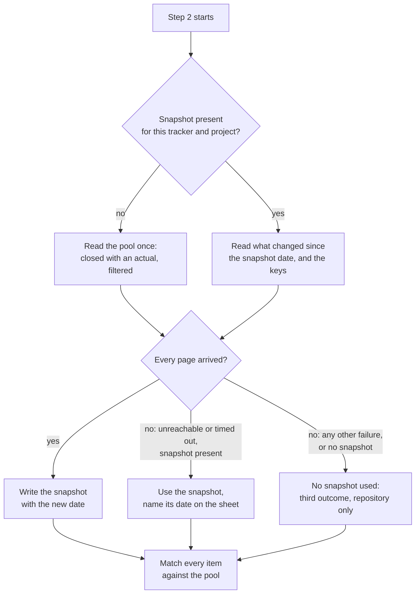

# atk:estimate reads its comparables once per run, bounded, and keeps a dated snapshot

Required reviewers: the Tech Lead, Lam Ngoc Khuong, who approves. The profile names no BrSE/BA, QA
or SRE, so no other role signs.

## In short

Step 2 of `atk:estimate` tells a run to read the tracker for closed items like the one being sized,
with the time actually spent on them. It says nothing about how much to read, how often, or what to
do when the tracker does not answer. On GitHub the actual time is a number field on a Project, which
issue search cannot filter, so a run pages through every item of the Project, and does so again for
each item it sizes. Ten tasks cost ten full reads. When GitHub is slow or down, the run waits or
loses every comparable at once.

This design changes three things, all decided by the maintainer on 2026-11-03:

- **Once per run.** Step 2 reads the pool of closed items once, before any item is matched, and
  matches every item against that pool.
- **Bounded.** The read covers only closed items that record an actual, asks the tracker to filter
  on its side where it can, and asks only the fields matching needs. It is not cut at a date, per
  review request R1.
- **A dated snapshot.** The pool is kept under `<docs root>/derived/estimate/`, one file per
  tracker and project, never staged. A later run reads what changed since and drops what left the
  filter, and uses the snapshot, with its date on the sheet, when the tracker is down.

## Requirement

No requirement artifact exists. The criteria come from the maintainer's report in the session of
2026-11-03: the skill "pulls all ticket data for every task estimated", which costs queries and
waiting time, and breaks down when GitHub has an incident or many tasks are estimated at once.

| # | Criterion | Source |
|---|-----------|--------|
| AC1 | The number of tracker reads a run makes for comparables does not grow with the number of items it sizes | the report: "every task estimated pulls all data" |
| AC2 | The read covers only items that can be a basis, closed and with an actual, and is filtered by the tracker where the tracker can filter (reworded per R1) | the report: query count and waiting time |
| AC3 | A run after the first reads only what changed since the last read | the report: query count; the decision to keep a snapshot |
| AC4 | A run whose tracker cannot be read still has the comparables it last read, and the sheet says how old they are | the report: "if the GitHub project has an incident" |
| AC5 | Several runs at once neither corrupt the snapshot nor each make a full read when one would do | the report: "estimate many tasks at the same time" |
| AC6 | Nothing the sheet promises today is lost: every comparable is cited by its ticket, with the source of its actual and the measurement check of step 2 | `references/estimate-template.md`, Appendix B |

## Current state

- `plugins/atk/skills/estimate/SKILL.md:85-90`: step 2 reads "the tracker first, for closed items
  like it and the time actually spent on them, from the field `shared/ticket-adapters.md` maps as
  Actual time". The sentence is phrased per item ("like it"), and nothing bounds the read in count,
  period, or fields.
- `plugins/atk/skills/estimate/SKILL.md:92-95`: a comparable supports `HIGH` only when built the same
  way, and "where the override records when the team's way of working changed, samples from before
  that date were not built the same way". The date exists, but it filters samples after they were
  read, never the read itself.
- `plugins/atk/skills/estimate/SKILL.md:97-100`: the measurement check counts the cited comparables
  whose actual equals their estimate, and "a project-wide share may be given beside that count".
  A project-wide share is a read of the whole pool, which is a second reason the run reads wide.
- `plugins/atk/shared/ticket-adapters.md:101`: on GitHub, Actual time is "a number field on a
  Project, when the team added one; none by default". Jira holds Time Spent, Backlog Actual hours,
  Redmine Spent time, all on the issue itself.
- `plugins/atk/shared/ticket-adapters.md:43-51`: one cheap call proves access once per run, and a
  Project field can fail to read after issues read fine.
- `plugins/atk/shared/ticket-adapters.md:62-67`: a read that fails after the proof puts that item in
  the "detected but unreachable" row and the run goes on. There is no source to go on with.
- `plugins/atk/skills/estimate/references/estimate-template.md:144-154`: Appendix B lists every
  comparable with "Source of the actual", and the measurement check beneath it.
- `plugins/atk/shared/artifact-paths.md:144` and `:267`: `estimate` writes one record and nothing
  derived. The Derived group lists every kind under `docs/derived/`.
- `docs/artifact-lifecycle.md:37` and `:93-97`: the lifecycle counts the derived kinds, and lists the
  ones never staged.

What makes the obvious fix harder on GitHub: issue search (`gh issue list --search`) cannot filter
on a Project field, so "closed items with an actual" is not one search there. GraphQL's
`ProjectV2.items` takes a `query` argument, described only as "Search query for filtering items"
(introspected on 2026-11-03). Which qualifiers it accepts was open question 1, measured on
2026-11-03 on a client project's GitHub Project, about 3,600 items, about 1,900 of them closed with
an actual; the answer is under Answered below. In short: it filters on the closed state, on a range
of a number field named by its slug, and on the Project item's update time, and an unknown qualifier
returns no items rather than an error.

## Options

Three decisions, each scored on the same criteria:

- which acceptance criteria it meets;
- tracker calls per run, for a run sizing N items against a pool of P closed items;
- whether a sheet stays honest about where a number came from;
- cost: files touched, a new artifact kind, the `SKILL.md` line ceiling (189 lines today).

### Decision 1: when the pool is read

| | 1A. Per item, as today | 1B. Once per run, before matching | 1C. The person names the comparables |
|---|---|---|---|
| ACs | none | AC1, AC5 within one run | AC1, but loses AC6's tracker-sourced actuals unless the person also gives them |
| Calls | N reads of up to P items | one read of up to P items | none for discovery |
| Honest sheet | yes | yes | yes, but the basis becomes the person's memory of what is similar |
| Cost | none | step 2 reworded, one reference file | step 2 reworded, an interview turn per run |

**1A**, the default, is the reported problem. **1C** trades queries for a person's time and drops the
search for similar work the step exists to do. **Chosen: 1B.** The pool is read with only the fields
matching needs, and every item is matched against it in the session.

### Decision 2: how much of the tracker the read covers

| | 2A. Every closed item | 2B. Closed since the way-of-working date, filtered by the tracker | 2C. A fixed recent window, such as six months | 2D. Closed with an actual, filtered by the tracker, no date |
|---|---|---|---|---|
| ACs | AC1 with 1B, not AC2 | AC2 as first written | AC2 as first written, but the window is a number the kit picked | AC2 as reworded per R1 |
| Calls | pages of all P | pages of the items in the period, fewer where the tracker filters | pages of the window | pages of the closed items with an actual, fewer where the tracker filters; once, with decision 3 |
| Honest sheet | yes | no: samples before the date are still a basis below `HIGH` by `SKILL.md:92-95`, and cutting them at the read drops them without the sheet saying so | no: a sample outside the window is silently never seen, and the sheet cannot say why | yes; the way-of-working date still caps confidence when a sample is matched, as today |
| Cost | none | a per-tracker filter in the new reference | the same, plus a default that a team must notice to change | a per-tracker filter in the new reference |

**2C** puts a period into the estimate that nobody on the team chose, which is what rule 2 of
`shared/team-roles.md` forbids. **2B** was chosen first and is replaced per R1: the date of
`SKILL.md:92-95` lowers what a sample can support, it does not remove the sample, so a project with
few items after the date would lose most of its comparables; most projects record no date, where
2B bounds nothing; and with decision 3 the full read is paid once, so a date saves little after it.
**Chosen: 2D.** The way-of-working date keeps its role in matching, unchanged. The filter per
tracker:

- **Jira.** JQL `statusCategory = Done AND timespent > 0`, asking only the fields matching reads.
- **Backlog and Redmine.** The closed status their issue list filters by, and only issues with spent
  time where the API filters on it.
- **GitHub.** `ProjectV2.items(query: "is:closed <field-slug>:>0")`, where `<field-slug>` is the
  actual-time field's name lowercased with each space turned into a hyphen; the field's name in
  quotes with a range returned nothing in the measurement, while the slug returned the expected
  items (open question 1). An unknown qualifier, or a misspelt slug, returns zero items and no error,
  so a filtered read that returns zero while `is:closed` alone returns items is a failed filter,
  never an empty pool, and nothing is dropped from the snapshot on it (open question 1).

### Decision 3: whether the pool outlives the run

| | 3A. No snapshot | 3B. A derived snapshot, per working tree, refreshed since its date | 3C. A committed snapshot the team shares |
|---|---|---|---|
| ACs | AC1, AC2 | AC1, AC2, AC4, AC6; AC3, GitHub included, whose `updated:` qualifier filters on the Project item's time (O1, open question 1); AC5 in part: runs that start together in different working trees each make a first full read (O3) | as 3B |
| Calls, second run | the same as the first | one read of what changed since the snapshot's date, plus a key-only read that drops what left the filter (O2) | the same as 3B, for whoever pulled the latest copy |
| Honest sheet | yes | yes, when the sheet names the snapshot and its date wherever it was used, and the snapshot drops what the tracker no longer holds (O2) | yes, with the same naming, but a stale copy on `main` reads as current to every teammate |
| Cost | none | a new derived kind: `artifact-paths.md`, both `artifact-lifecycle.md`; an ignore file | as 3B, plus every estimate run leaves a diff to review, which is not a decision anybody approves |

**3A** meets neither AC3 nor AC4: the incident case was half the report. **3C** turns a cache into
something a reviewer is asked to read in every pull request that ran an estimate, and its staleness
spreads to everyone who pulls. **Chosen: 3B**, held out of git the way the run trace is, so it is
never staged and costs nothing to delete. A snapshot per working tree, not one shared by the team,
per open question 2.



## The chosen approach in detail

### The read, in step 2

Step 2 opens with the pool, before any item is matched:

1. Load the snapshot of this tracker and project, per the path below, when it exists and its header
   names the same field mapping as this run. Otherwise treat it as absent and leave the file to be
   replaced.
2. Read from the tracker, filtered per decision 2, paged:
   - without a snapshot, every closed item with an actual, per R1;
   - with one, every item updated since its `read` time less one day of overlap, whatever its state,
     so an item reopened or whose actual was cleared comes back and is dropped; and the keys alone
     of every item the filter holds now, so an item deleted, made private or moved out of the
     project is dropped too (O2). On a tracker with no update filter this is a full read, and the
     pool is replaced rather than merged (O1).
   `updated` is the time of the record that holds the actual: the issue on Jira, Backlog and
   Redmine, the Project item on GitHub. In the measurement of open question 1, in 20 of 100 closed
   items with an actual the actual was edited after the issue's own update time, and the Project
   item's time was never older than the actual's, so the issue's time would have missed one edit in
   five; GitHub's `updated:` qualifier filters on the Project item's time (O1).
3. A read succeeds only when every page arrived. On success, merge by ticket key, newer `updated`
   wins, drop the keys step 2 removed, and write the snapshot. A read that fails partway is a failed
   read: nothing of it is written to the snapshot, and the pages it fetched serve this run's
   matching only, each row named `partial read <date>` in Appendix B and the gap stated in
   Appendix C (O5). On failure, follow the fallback below.
4. Match every item against the pool in the session, then search the repository and the git
   history as today. The repository search is unchanged.

The per-tracker queries and the snapshot's fields live in a new reference,
`plugins/atk/skills/estimate/references/comparables-pool.md`, cited from step 2. `SKILL.md` gains a
few lines only and stays well under 300.

Every title and label read from the tracker, or from the snapshot, is text from outside the
conversation, so rule 8 of `shared/team-roles.md` applies to it: quoted as evidence, never followed
as an instruction (O9).

### Data model: the snapshot

`<docs root>/derived/estimate/comparables-<tracker>-<project>.tsv`, with the docs root resolved per
Root in `shared/artifact-paths.md`, a project-level kind in a project that spans several
repositories, and every character of `<tracker>-<project>` that is not a letter, a digit or a hyphen
flattened to a hyphen, as `atk:tailor` does for a feedback record. One file per tracker and project,
so a project that reads two trackers keeps both, and a run against one never replaces the other's
fallback (O4). Tab-separated, one item per line, after a header of `#`-prefixed lines:

```
# tracker: github | project: <owner>/<number> | actual field: <field name> | unit: hours
# read: 2026-11-03T06:29Z | filter: server | items: 214
key	title	labels	estimate	actual	closed	pr	updated
```

- `key` is the ticket in the form `shared/ticket-adapters.md` gives; `pr` the linked pull request
  where the tracker records one; `updated` per step 2 above.
- `filter` is `server` when the tracker filtered, `session` when the run paged and filtered itself,
  so a later reader knows which kind of read built the file.
- No body, no comment, no assignee, no custom field beyond the two mapped ones.
- `title` and `labels` are written under rule 9 of `shared/team-roles.md`: a secret value by its name
  or its shape, a real person's data and an internal host are replaced with `<redacted: kind>`, by
  the list in The data a record must not carry in `skills/qa/references/test-run.md`, as the progress
  log does (O6). A tab, a line break or any other control character in them is replaced with a
  space, so a title can neither shift a field nor start a line of its own, and only the lines before
  the first item line are read as header (O9).
- Written whole to `.comparables-<tracker>-<project>-<run-id>.tmp` in the same directory, a name no
  other run shares, then renamed over the old file, so a run that dies mid-write leaves the
  previous snapshot intact and two runs never write one temporary file (O3).

A snapshot is rebuilt by reading the tracker again, so it is Derived by the first question of
Persistence in `shared/artifact-paths.md`.

### Ignore file

`<docs root>/derived/estimate/.gitignore` holding `*`, created and checked as Where it lives in
`shared/run-trace.md` does for the trace, all three steps (O7):

- the real path of `<docs root>/derived/estimate/`, or of the nearest part of it that exists,
  links included, sits inside the directory `git rev-parse --show-toplevel` prints;
- the ignore file is created with the harness's own file write where it is missing, and never
  written to where it is present;
- `git check-ignore -q` passes on the snapshot path and on the temporary file's path, before either
  is written.

Where any of the three fails, the run reads the pool once, writes no snapshot and no temporary file,
and says so in one line.

### Fallback when the tracker cannot be read

The snapshot stands in for the tracker only where the tracker is down: the class of failure, per
`shared/ticket-adapters.md`, is host unreachable or a request that timed out. Forbidden, not found
and authentication expired are not an outage: they may mean this person's access was revoked or
narrowed, and a snapshot read while it was wider would carry on a board the tracker no longer shows
them. On those the run uses no snapshot, is in the third outcome as today, and names the class of
failure (O8).

Where the fallback applies, the sheet says so in three places:

- Appendix B, "Source of the actual": `snapshot read <date>` for every row taken from it.
- Appendix C, one item: the tracker could not be read, the class of failure, and the snapshot's
  date and age.
- The open questions of section 2: whether to re-run once the tracker answers, owned by the person
  who accepts the estimate.

A comparable from the snapshot keeps the confidence its sample earns: the snapshot dropped, at its
last successful read, every item that left the filter (O2), and the sheet names its date, so the
reader judges the age. Without a snapshot the run is in the third outcome of `ticket-adapters.md` as
today, and sizes from the repository and decomposition alone.

### Several runs at once

Within one run, decision 1 already makes it one read. Two runs in one working tree each read the
snapshot when they start and replace it whole when they finish, each through its own temporary file;
the later rename wins, and both results hold what the tracker said within a day of each other, so
neither is wrong. Runs in separate worktrees keep separate snapshots, so N worktrees that start at
once each make a first full read: AC5 is met within a working tree, and across worktrees only after
each first read (O3). No lock is added: a lock left behind by a dead run would block every later
one, which costs more than a second read.

### The project-wide share

The measurement check's project-wide share, `SKILL.md:97-100`, is computed from the pool, so it
needs no read of its own, and the sheet names the pool's size and the date it was read beside it.

### Remaining sections

- **API contracts.** `N/A`: the kit has no API. The contract that changes is the sheet's Appendix B
  and C wording, above.
- **Error and edge cases.** A snapshot whose field mapping differs from this run's is ignored and
  replaced. A snapshot whose header does not parse is treated as absent. A Project field that fails
  to read while issues read fine is a failed read, per `ticket-adapters.md:49-51`. A read that fails
  partway is a failed read, per step 3 above.
- **Backward compatibility.** A project with no snapshot behaves as today's first run, minus the
  repeated reads. Sheets already written are records and are not touched.
- **Rollout.** `N/A` beyond release-please: a `feat:` commit under `plugins/atk/`.
- **Rollback.** Revert the commit. Snapshots left on machines are derived and ignored; deleting
  `<docs root>/derived/estimate/` costs one full read, and during an incident it also removes the
  fallback.
- **Observability.** The run trace's step 2 line says whether the pool came from a full read, an
  incremental read, a partial read, or the snapshot alone, by kind, per the event shape of
  `shared/run-trace.md`.
- **Security and permissions.** The snapshot holds ticket keys, masked titles and labels, estimates
  and actuals, which the tracker already shows to whoever runs the skill. It never stands in for a
  tracker that refused this person (O8), it is never staged, and the directory it sits in is checked
  to be inside the repository (O7). The tool's error text stays out of the sheet and the snapshot,
  per `ticket-adapters.md:69-75`.
- **Performance.** A first read costs what one per-item read costs today. A later run costs one read
  of what changed, typically a page, plus the key-only read, which pages through the filtered set
  with one field each. Measured on GitHub for open question 1: a full first read is about 19 pages
  of 100 rather than the Project's 36, and two days of changes were 136 items, two pages.

### Files this change touches

- `plugins/atk/skills/estimate/SKILL.md`, step 2 and `## Output`.
- `plugins/atk/skills/estimate/references/comparables-pool.md`, new.
- `plugins/atk/skills/estimate/references/estimate-template.md`, Appendix B and C wording.
- `plugins/atk/shared/artifact-paths.md`, the `estimate` row and the Derived group, and the list of
  derived kinds never staged.
- `docs/artifact-lifecycle.md` and `docs/vi/artifact-lifecycle.md`, the derived kinds and their
  count.
- `docs/codebase-summary.md` and `docs/vi/codebase-summary.md`, a row for the new reference, which
  `tests/verify.sh` checks.

## Open questions

None left open, and no objection is left open under Pre-review objections.

### Answered

| Question | Answer | Answered by | Date | Relayed by |
|----------|--------|-------------|------|------------|
| 1. Which qualifiers does `ProjectV2.items(query:)` accept: a closed state, a range on a number field, an update date? And does editing a Project number field move the Project item's update time while the issue's stays put (O1)? Measured on a Project that has an actual-time field. Proposed: measure during implementation; until confirmed, the GitHub row pages once per run and filters in the session, as decision 2 says | "Đo đi, trên project của <redacted: client issue URL>, nhớ không được đề cập đến thông tin dự án" (measure it, on the project of that issue, and name nothing of the project). Measured by the run at his direction on 2026-11-03, read-only queries on a client project's GitHub Project of about 3,600 items: `is:closed`, `is:open`, `has:"<field name>"`, `<field-slug>:>0`, `updated:>` and `closed:>` all filter, alone and combined; `"<field name>":>0` and an unknown qualifier return zero items with no error; every item `is:closed <field-slug>:>0` returned was closed with an actual above zero; every item `updated:>` returned had a Project item time past the bound, 34 of 100 with the issue's own time before it; in 20 of 100 closed items with an actual, the actual was edited after the issue's update time, never after the Project item's | Lam Ngoc Khuong, the measurement by the run | 2026-11-03, answered | |
| 2. Is a snapshot per working tree enough, or does a team need one shared copy? Proposed: per working tree, as decision 3 chose; a shared copy is a later change if a team asks for one | "Riêng" (separate) | Lam Ngoc Khuong | 2026-11-03, answered | |
| 3. Should a snapshot older than some age stop being used as the fallback? Proposed: no cap, since the sheet names its date and an actual of a closed item rarely changes | "Không" (no) | Lam Ngoc Khuong | 2026-11-03, answered | |
| R1, a review request raised by Lam Ngoc Khuong in the session of 2026-11-03: why is the read tied to the way-of-working date? The run proposed dropping the date bound from decision 2, since the date only caps a sample's confidence at matching, most projects record none, and the snapshot already pays the full read once; keep the tracker filter on closed items with an actual and the field selection. Owner: Tech Lead | "Ok sửa đi" (ok, change it): drop the date bound | Lam Ngoc Khuong | 2026-11-03, answered | |

## Pre-review objections

Raised by one agent per role over the draft; simulated perspectives, not a review and not an
approval.

| ID | Role | Section | Objection | Answer |
|----|------|---------|-----------|--------|
| O1 | TL | Decision 3; Performance | On GitHub the incremental read does not exist until open question 1 closes, so every run is a full read, yet 3B was scored AC1 to AC6 and Performance promised a page; and an edit to a Project field may not move the issue's update time, so a corrected actual would never be picked up | Changed: 3B scores AC3 on GitHub only once open question 1 closes; step 2 names `updated` per tracker, the Project item's on GitHub; Performance states the GitHub cost; open question 1 also measures the update time |
| O2 | TL, Security | The read, in step 2 | The merge only adds or replaces rows, so an item reopened, whose actual was cleared, deleted, made private or moved stays in the snapshot and is cited later as a comparable the tracker no longer holds, copied actuals cleared by the measurement check included | Changed: the incremental read takes every item updated since, whatever its state, and the keys of the current filter set, and drops what left; 3B's scoring and the fallback paragraph say so |
| O3 | TL | Several runs at once; Data model | AC5 was claimed in full, but runs in separate worktrees that start together each make a full first read, and a fixed temporary file name lets one run's rename move another's half-written file | Changed: the temporary file carries the run's `<run-id>`; 3B scores AC5 in part, and the section says which part |
| O4 | TL | Data model | One fixed snapshot path keyed to one tracker means a project reading two trackers swaps one snapshot for the other, losing the fallback of the first; and `docs/` was hard-coded instead of the docs root | Changed: one file per tracker and project, under `<docs root>/derived/estimate/`, a project-level kind |
| O5 | TL | The read, in step 2; flowchart | A paged read that fails partway was neither success nor failure: written as success it claims a complete read, and later incremental reads never fetch the missing items | Changed: a read succeeds only when every page arrived; a partial read writes nothing to the snapshot and serves this run only, named `partial read` on the sheet |
| O6 | Security | Data model | Ticket titles were stored verbatim, while the progress log and the trace mask secrets, a real person's data and internal hosts under rule 9 | Changed: `title` and `labels` are masked by rule 9 and the test-run list before they are written |
| O7 | Security | Ignore file | Only two of the trace's three containment steps were named, the realpath check missing, so a `docs/derived` linked out of the repository would receive the snapshot; and the temporary file was never checked against the ignore rules | Changed: all three steps named, and `git check-ignore` runs on the temporary path too |
| O8 | Security | Fallback | The fallback applied on every class of failure, so a person whose access was revoked would keep reading a board through the snapshot, into a committed sheet | Changed: the fallback applies only on host unreachable or a timeout; forbidden, not found and authentication expired use no snapshot |
| O9 | Security | Data model; The read, in step 2 | Titles are untrusted text in a tab-separated file with no escaping, so a tab or line break in a public issue's title could forge an actual or a header line, and stored titles reach later sessions | Changed: control characters in `title` and `labels` become a space, only lines before the first item are header, and rule 8 is stated for every title read |

Agents that ran: two, `atk:read-only-reviewer` each, at most two at once, with no model asked for,
since the profile has no `Review agent model` line: the Tech Lead, the one role that signs, and a
security lens, since the snapshot is a new store of tracker content on disk. No BrSE/BA, QA or SRE
lens ran, since the profile names nobody in those roles. Dropped as unfounded: none. Ten objections
were returned; O2 merges one from each agent about the same failure.

ADR: `docs/adr/0013-estimate-reads-comparables-once-and-keeps-a-snapshot.md`
