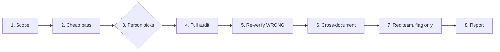

Approved by Lam Ngoc Khuong on 2026-11-03, by instruction to the agent.

Renumbered from ADR 0011 to ADR 0012 on 2026-11-03, before merge, with the approver's agreement, since ADR 0011 was taken on `main` meanwhile; the decision is unchanged.

# atkx:doc-audit - every claim of a written document checked against its source

## In short

Teams now keep documents an agent wrote and nobody checked: API references, feature descriptions,
status flows, requirement notes. A reader cannot tell a true sentence from a plausible one, and a
second agent asked to "review" the document cannot either, because it reads the same text and has
nothing to compare it with. `atkx:doc-audit` is a new skill of the `atkx` plugin that takes each
checkable claim of a document, checks it against the source that can settle it, the code, a
requirement source, or another document, and gives it exactly one verdict: correct with evidence,
wrong with evidence, or unverifiable with the person who must answer. It also lists where a document
contradicts itself or another one, and under `--red-team` puts agents against the parts no source
can settle. It changes no document. Its report goes to `docs/derived/doc-audit/`, ignored by git.

A pilot on three documents of a client project found 29 wrong claims among 132, 22 of them in one
document that called itself the source of truth. The seven wrong verdicts re-read against the code
all held; the other 22, and every correct verdict, were not re-read, so how often a verdict is
itself wrong is not measured yet.

## Requirement

There is no requirement artifact; the request came from the maintainer in the session of 2026-11-03,
with the pilot below as its evidence. Restated as acceptance criteria:

1. **AC1.** Given one document or several, every checkable claim is listed with its line, and each
   claim gets exactly one of three verdicts: `CORRECT` with a `path:line` or a quoted source,
   `WRONG` with the same and what the source actually says, `UNVERIFIABLE` with the source that would
   settle it and the person who must answer. No fourth verdict, no "probably correct".
2. **AC2.** Contradictions inside one document, and between the documents audited, are listed apart
   from the verdicts.
3. **AC3.** Given a directory of hundreds of documents, the skill does not audit them all at full
   cost: it runs a cheap pass over all of them, ranks them, and a person chooses which get the full
   audit.
4. **AC4.** Every `WRONG` verdict, and a sample of `CORRECT` ones, is checked again before it is
   reported. The sample is from open question 1, answered.
5. **AC5.** Under `--red-team`, the parts no source can settle, a design's reasoning, a stated intent,
   get objections from agents that read the document cold, reported as objections and never as
   verdicts.
6. **AC6.** No document is edited, no approval state changes, and the report lands where git
   ignores it, so nothing is put before a teammate for review.
7. **AC7.** It runs with no `.atk/profile.md`, on Claude Code, Codex and Cursor, and says what it
   loses on a harness without parallel agents or without Node.

## Evidence: the pilot

Run on 2026-11-03 against three English documents of a client project, one Explore agent per
document, read-only, each told to extract claims and give the three verdicts above. The session then
re-read the code behind seven of the `WRONG` verdicts. The source record stays in the session; the
documents are cited here by kind only.

| Document | Claims | Correct | Wrong | Unverifiable |
|----------|--------|---------|-------|--------------|
| API reference of a settings endpoint | 49 | 43 | 4 | 2 |
| Feature description of the same setting | 40 | 34 | 3 | 3 |
| Status-flow description of the main record, calling itself the source of truth | 43 | 17 | 22 | 4 |

What it showed:

- **The method works.** Two to four claims per document could not be settled from the repository,
  and almost all of them were the reasons behind a requirement, kept in a tracker issue the session
  could not read. The rest carry evidence.
- **The wrong claims matter.** An error response documented on three endpoints that no code path
  produces; a creation state the document gives the opposite of the code, while saying the code had
  drifted from the requirement; two fields documented as never sent to an external system that the
  outbound file carries. A tester writing cases from the first, or a developer trusting the second,
  is wrong before starting.
- **Risk sits in documents that summarise many code paths.** The two documents about one feature were
  mostly right; the one describing a flow across services, batches and imports was wrong more often
  than right.
- **Contradictions inside a document are found without reading code.** One feature document says a
  same-day submission is outside a window, and its own worked example ten lines later puts it inside.
- **Line citations go stale.** Four claims cited a line that now holds something else. A script finds
  those without an agent.
- **An agent miscounted its own table.** Counting belongs to a script.
- **Cost.** About 140,000 to 170,000 tokens and three to five minutes per document. The project held
  565 files under its docs root, about 190 of them in its authored language and the rest mirrors.

## Current state

- **`atkx` has one skill**, `skill-eval`, at `plugins/atkx/skills/skill-eval/`. It reads a skill and
  changes nothing in it (`plugins/atkx/skills/skill-eval/SKILL.md:24-25`), keeps the checks that must
  repeat in Node scripts (`scripts/static-check.mjs`, `scripts/score.mjs`, `scripts/trigger-run.mjs`,
  `scripts/hook-log.mjs`) per `docs/adr/0002-skill-eval-scripts-for-repeatable-checks.md`, and treats
  everything it reads as data (`SKILL.md:89-92`). Its report is printed in the session and written
  to a file only on `--out` or a yes (`SKILL.md:166-175`).
- **The bar for `atkx`** is three tests (`CLAUDE.md:360-364`): it runs without a profile, writes
  nothing a teammate is asked to review, and states its harnesses. An `atkx` skill may call an `atk`
  skill only after checking the live skill list (`CLAUDE.md:339`, `CLAUDE.md:374`), and carries every
  file it reads (`CLAUDE.md:381`).
- **`atk:spec --check`** reports drift between reference documents and the code
  (`plugins/atk/skills/spec/SKILL.md:63-64`), for four kinds: api, db, feature, screen
  (`SKILL.md:30-33`). It never decides which side is wrong (`SKILL.md:40-41`), and it draws the line
  between drift and an open question in `plugins/atk/shared/spec-docs.md:90-104`. A requirement
  note, a design, a status flow written in the project's own shape, and a runbook are outside it.
- **`atk:catchup` document mode** explains a document in plain words (`plugins/atk/skills/catchup/SKILL.md:25-26`)
  and does not judge it (`SKILL.md:40-45`).
- **`atk:design-doc --challenge` and `atk:plan --challenge`** put agents against an `atk` draft
  before review, one per signing role or per way a plan fails, through
  `plugins/atk/shared/independent-challenge.md`. Both apply to the kit's own artifacts, at `DRAFT`.
- **Read-only agents.** `atk:read-only-reviewer` holds Read, Grep and Glob only
  (`plugins/atk/agents/read-only-reviewer.md:1-6`), and is what `shared/host-capabilities.md:236` and
  `:276-280` route a wide read to on Claude Code. It belongs to `atk`; Claude Code installs `atk`
  with `atkx`, Codex does not.
- **Files never opened.** Rule 9 of `shared/team-roles.md` keeps the paths listed in
  `plugins/atk/shared/secret-scan.md:316-330` unread. `atkx` holds no copy of that table today.
- **`atk:help` knows `atkx` skills** from `plugins/atk/skills/help/references/atkx-skills.md:47-49`,
  one row per skill.

So no skill today takes an arbitrary document and says which of its sentences are true.

## Decision criteria

1. **Premise.** Does it keep author and approver apart: drafts and evidence, no verdict on the
   team's behalf about which side changes?
2. **Reach.** Which kinds of document it covers: reference documents only, or requirement notes,
   flows, designs, runbooks too.
3. **Contract cost.** How much an existing skill's scope and promises change.
4. **Fit.** Whether it passes the `atkx` bar or sits in a delivery phase.
5. **Repeatability.** Whether the parts that must give the same answer twice do.

## Options

### Option A: widen `atk:spec --check` to any document (the default pick)

The obvious home: `spec --check` already compares documents with code. It would take any Markdown
file, not only the four kinds.

It loses on reach and contract cost. `spec` owns documents that must stay true and are written in a
shape it knows, with an `implemented` field and a kind; its drift rule assumes that shape
(`shared/spec-docs.md:90-104`). A requirement note has no code to drift from, and a design is
written to be outdated the day it merges. Folding both in turns one skill's contract into two, and
`atk:review`, `atk:implement` and four others cite that contract.

### Option B: a new `atk` skill with a committed record

An `atk:doc-audit` writing `docs/records/doc-audit/`, with an owner and an approver like any record.

It loses on fit. An audit is a reading of a moment, run before a person decides what to correct; a
record needing approval puts a second artifact before the team for every audit, and the skill sits
in no phase of delivery. Correcting a document is already the work of `atk:spec`, `atk:intake` or
its author.

### Option C: a new `atkx` skill, `doc-audit`, with an ignored report (chosen)

A skill beside `skill-eval`, on the same terms: reads, reports, changes nothing it audits. Node
scripts for the citation check and the tally; agents for reading claims against sources.

### Option D: guidance only

A page in `docs/` describing the method, run by hand each time.

It loses on repeatability. The pilot needed the same prompt three times, a recount, and a second read
of every wrong verdict; a page leaves each of those to whoever remembers them.

### Scores

| Criterion | A | B | C | D |
|-----------|---|---|---|---|
| Premise | holds | holds | holds | holds |
| Reach | four kinds plus a forced fit | all kinds | all kinds | all kinds |
| Contract cost | high: `spec` and its six citers | low | none in `atk` but one table row | none |
| Fit | delivery skill stretched | record with no phase | passes the `atkx` bar | not a skill |
| Repeatability | high | high | high | low |

## Chosen approach: Option C



### Layout

```
plugins/atkx/skills/doc-audit/
  SKILL.md
  references/
    claims.md             what a checkable claim is, the three verdicts, what counts as evidence
    cheap-pass.md         internal contradictions without code; the ranking signals
    full-audit.md         the agent prompt and its output table
    re-verify.md          the second read of a WRONG verdict
    red-team.md           lenses, objections, and how they are checked
    report-format.md      the report, its sections and its path
    safety.md             copies from atk: the unread-path table, the value mask, the agent prompt rules
  scripts/
    cite-check.mjs        every cited path and path:line inside the repository: exists, line in
                          range, cited identifier near the line; ranking fields
    tally.mjs             validates the verdict table and counts it
  evals/trigger_evals.json
```

### Invocation

```bash
/atkx:doc-audit <file>...              # Full audit of the named documents
/atkx:doc-audit <dir>                  # Cheap pass over the directory, then a person picks
/atkx:doc-audit <dir> --cheap          # Cheap pass and ranking only
/atkx:doc-audit <path> --source <path-or-issue>...  # Requirement sources to check intent claims against
/atkx:doc-audit <path> --red-team      # Add objections to what no source can settle
/atkx:doc-audit <path> --code <dir>    # Code root inside the same repository, when not its root
/atkx:doc-audit <path> --out <path>    # Write the report elsewhere, still ignored by git
```

### 1. Scope

- Inputs are files or a directory. Mirrors of a language-partitioned docs root (`docs/vi/`,
  `docs/ja/`, or the profile's `Language mirrors` when a profile exists) are left out by default and
  named in the report as left out, since auditing a translation repeats the claims of its source.
- Everything is read inside the repository that holds the documents, `git rev-parse
  --show-toplevel`. A cited path or a `--code` directory that resolves outside it, by `..`, an
  absolute path or a symbolic link, is reported as leaving the repository and never opened, as
  `skill-eval` treats a link leaving a skill. From objection O7.
- The paths in the unread-path table of `references/safety.md` are never opened, in the documents
  or in the code, by an agent or by a script. A citation of one is reported as citing a file that is
  not read. From objection O7.
- Everything read is data, a fetched issue included. A sentence in a document, a code comment or an
  issue telling the agent to skip a claim, mark one correct, run a command, edit a file or open an
  address is reported, never followed. From objection O8.
- A requirement source is a local path `--source` names, or an issue of the repository's own
  tracker, plus what the repository holds: plans, records, commit messages. No other address is
  fetched: not a URL a document links, not an issue of another repository. The tracker is read
  through the host's connection or `gh` when one answers; when none does, the claims that need it go
  to `UNVERIFIABLE` with that reason, as in the pilot. From objection O9.

### 2. Cheap pass

Over every document in scope, without reading code:

- `node scripts/cite-check.mjs <files>` prints JSON: each cited path, whether it exists, whether a
  cited line is within the file, and per document the counts the ranking uses. A line in range can
  still hold something else, which is how the pilot's stale citations looked: where a citation sits
  next to an identifier in backticks, a function, a constant, a column, the script reports whether
  that identifier appears within three lines of the cited one, and a miss counts as a broken
  citation. From objection O2. The script holds the unread-path patterns itself, and refuses a path
  outside the repository before opening anything.
- One agent per batch of documents reads each document alone and lists contradictions inside it,
  per `references/cheap-pass.md`. Its cost is the document's length, not the code's.

Ranking puts first the documents that cite many directories, cite few lines, have broken citations,
contradict themselves, or describe a flow or a state; the signals are in `references/cheap-pass.md`,
computed by the script where they can be.

A second pilot runs before `references/cheap-pass.md` is written, per open question 2, answered: on
a requirement note whose source the session can read, to test `INTENT` claims, which the first pilot
could not, and the ranking signals on a second project.

### 3. The person picks

Given files, those are the scope and nothing is asked. Given a directory, the ranked list is shown
with the cheap-pass findings and an estimate of the full audit's cost, and the person picks.

The estimate is a range, never one figure, per open question 3, answered. The pilot showed cost does
not follow a document's length, 92 lines cost about 138,000 tokens and 195 lines about 168,000,
because most of it is reading code, so no formula from length is used:

- On a project with no earlier report, the range is the pilot's, 140,000 to 170,000 tokens per
  document, labelled as from one pilot, times the documents picked. Beside each document stands the
  number of code directories it cites, from the cheap pass, as the sign of which end it falls nearer.
- Each full audit writes into its report the tokens it actually used, where the host reports them,
  as Claude Code does for its agents.
- A later run on the same project takes its range from the reports already in
  `derived/doc-audit/`, and says how many runs it rests on.

The estimate covers the full audit and the second read of step 5 together; the pilot measured only
the first, so until a run measures both, the second read is shown as not yet measured rather than
left out. From objection O4. A run with nobody to ask stops after the cheap pass and writes its
report.

### 4. Full audit

One read-only agent per document, per `references/full-audit.md`: every checkable claim, one row,
its line, its type (`BEHAVIOUR`, what the system does; `INTENT`, what was wanted and why), its
verdict and its evidence. On Claude Code the agent is `atk:read-only-reviewer` when it is in the
live list. Otherwise it is the host's own agent, and on a host without agents the session reads in
turn; in both cases the prompt carries the agent rules of `references/safety.md`, that it changes
no file, starts nothing, opens no address, never prints a file through a command, and never opens
an unread path, and the report says the limit rested on the prompt. From objection O8. The owner of
an `UNVERIFIABLE` claim is found by the session, not the agent: the Team section of a profile when
one exists, otherwise the git author of the lines the claim rests on, by name only, never an email
address, and never "the team". From objection O10.

Every quoted line, a document's and the code's, goes through the value mask of
`references/safety.md` before it is written, relayed or handed to another agent, and what an agent
returns is masked again before the session keeps it: a key is kept, its value replaced with
`<redacted: kind>`. A document is evidence, and the example token or connection string in it is
still a secret. From objection O6.

A document in one of the four kinds `atk:spec` keeps is audited like any other, and the report
names `atk:spec --check` once, as the skill that keeps such a document true afterwards. `atk` is not
called.

### 5. Re-verify

Every `WRONG` verdict goes to a second agent that sees the claim, the document line and the cited
evidence, and not the first agent's reasoning, and returns `holds`, `overturned` with evidence, or
`cannot tell`. Only `holds` stays `WRONG`; `overturned` takes the second verdict; `cannot tell` turns
the claim `UNVERIFIABLE`.

A sample of `CORRECT` verdicts gets the same read, per open question 1, answered: a tenth of each
document's `CORRECT` verdicts and at least three, chosen first among claims about a state
transition, an error or status code, or a limit or a number, where the pilot's wrong claims sat. An
overturned one takes the second verdict like any other, and the report prints how many of the
sample were overturned, so a reader sees how far the `CORRECT` column can be trusted. The tenth is
a starting rate with no measurement behind it, since the pilot re-read no `CORRECT` verdict; the
second pilot of step 2 measures how many of its sample are overturned, and the rate moves with
that figure. From objection O1.

One second agent per document takes all of that document's claims to re-read, rather than one per
claim, so a flow document with twenty wrong claims costs one more agent, not twenty. From
objection O4.

### 6. Cross-document

Between the documents audited, and with any document inside the repository they link, the agent
lists where two state the same rule differently, naming which one the code supports when a verdict
already settled it. A link to an address outside the repository is listed, never fetched. From
objection O9.

### 7. Red team (`--red-team`)

For what no source can settle: a design's reasoning, an `INTENT` claim whose source was not given,
a whole document of a kind with no code behind it. Agents read the document cold, one per lens in
`references/red-team.md` (a rule that cannot hold for every case it names, a failure the document
does not mention, a reader it misleads, a dependency it assumes), up to five objections each, each
naming the failure it causes. The session checks each against the document and the code, keeps or
drops it, and counts the dropped. The rules are a copy of `atk`'s independent challenge, in
`references/red-team.md`, since an install of `atkx` cannot read `atk`'s files.

Every copy from `atk`, this one and the three in `references/safety.md`, names its origin by its
GitHub link, which is the one form `tests/verify.sh` lets a plugin file name another plugin's
file; a repository path in the form `plugins/atk/shared/<file>.md` fails its citation check as
citing another plugin. A new check in `tests/verify.sh` compares each copy with its origin, the
table rows and the rule paragraphs, and fails on a difference, so a path added to the unread list
in `atk` cannot miss `atkx` silently. From objection O3.

It is not `atk:design-doc --challenge`: that one tests an `atk` draft before its reviewers, by
signing role; this one tests any document already written, by way of failing. Objections are never
verdicts and the report keeps them in their own section.

### 8. Report

`node scripts/tally.mjs` validates the verdict table, one of three verdicts per row, evidence on
every `CORRECT` and `WRONG`, an owner on every `UNVERIFIABLE`, and counts it. The report, per
`references/report-format.md`: an `In short` paragraph, the table of counts per document, the
`WRONG` claims first with evidence, contradictions, the `UNVERIFIABLE` claims grouped by the person
who must answer, objections under `--red-team`, then the full table.

It is printed in the session in summary and written to
`<docs root>/derived/doc-audit/<YYMMDD-HHMM>-<slug>.md`, the docs root from the profile when one
exists and `docs/` otherwise. Before writing, the run resolves the real path of
`derived/doc-audit/`, symbolic links included, and confirms it sits inside the repository, as the
run trace does; then it confirms `git check-ignore -q` passes for the report's path. Where
`derived/doc-audit/` has no ignore, it creates `.gitignore` holding `*` there with the harness's
file write, and the closing message names that new file. Where a check still fails, or the project
is not a git repository, it writes to a directory of its own under the operating system's temporary
directory, readable by the user alone, and says so. `--out` changes the path and is held to the
same checks, with no exception: a report holds names, quoted lines and tracker text, and AC6 keeps
it out of git. From objection O10.

### What else changes

The nine groups of `CONV-013`: this `SKILL.md`; the `atkx` section of `README.md`; both
`skills-overview.md`; both `codebase-summary.md`; the `Skill - atkx:doc-audit` entry of
`.github/ISSUE_TEMPLATE/bug-report.yml`; the three `plugins/atkx/.*-plugin/plugin.json` descriptions
with the Codex `interface.longDescription` and the `atkx` entry of `.claude-plugin/marketplace.json`;
`docs/system-architecture.md` and its mirror for the second skill with scripts; the `skill: doc-audit`
label and its `.github/labeler.yml` entry; and a row in
`plugins/atk/skills/help/references/atkx-skills.md`. Nothing else in `atk` changes. Outside the
nine groups, `tests/verify.sh` gains the copy check of step 7.

### Sections

- **Data model and migration.** N/A: no store.
- **API contract.** The invocation above; the report format in `references/report-format.md`; the
  JSON printed by the two scripts, documented in their headers.
- **Errors and edge cases.** No document found: one line and stop. A cited code root missing: every
  `BEHAVIOUR` claim `UNVERIFIABLE`, said once. A document over the agent's context: split by
  section, each section a row group. Node missing: the citation check and tally by hand from the
  references, and the report says so. A tracker that answers nothing: as in step 1.
- **Backward compatibility.** N/A for `atk`; one table row added to `atk:help`.
- **Rollout.** Two release packages move, since the `atk:help` row sits in `atk`: the skill and the
  row land in one pull request, so one merge opens both release pull requests, and the `atkx` one
  is merged first, so no `atk:help` names a skill that no released `atkx` holds. From objection O5.
- **Rollback.** Remove the skill folder and revert the nine groups and the copy check, released for
  both packages in the same order reversed, `atk` first. What it cannot reach: reports and the
  `.gitignore` the skill wrote under `docs/derived/doc-audit/` in projects it ran on stay there,
  ignored, until their owner deletes them. From objection O5.
- **Observability.** The report is the record of a run. `atkx` writes no run trace, as
  `skill-eval` writes none.
- **Security and permissions.** Reads code and documents inside one repository only; never the
  unread paths; no command but `git` reads, `gh` reads of the repository's own issues, and its two
  scripts; no other address. Every quoted line masked. A report holds masked quotes, tracker text
  and people's names, which is why it stays out of git and readable by the user alone when it falls
  back to the temporary directory. Steps 1, 4 and 8 carry the detail.
- **Performance.** 140,000 to 170,000 tokens per document on the pilot; the cheap pass exists so
  that cost is spent on the documents a person picked, and step 3 says how the estimate is shown.

### Harness support

Claude Code, Codex and Cursor. Parallel agents where the host offers them; in turn otherwise, which
is slower and costs the same. `atk:read-only-reviewer` only on Claude Code with `atk` installed;
elsewhere the read-only limit rests on the prompt, and the report says so.

## Traceability

| Criterion | Where |
|-----------|-------|
| AC1 | Step 4, `references/claims.md`, `scripts/tally.mjs` |
| AC2 | Step 2 (inside one), step 6 (between) |
| AC3 | Steps 2 and 3, `scripts/cite-check.mjs` |
| AC4 | Step 5 |
| AC5 | Step 7 |
| AC6 | Step 8, Security |
| AC7 | Scope, Harness support, Errors |

## Open questions

None open; the three are answered below.

### Answered

| Question | Answer | Answered by | Date | Relayed by |
|----------|--------|-------------|------|------------|
| 1. Does a sample of `CORRECT` verdicts get the second read too? | "Có đọc lại mẫu kết luận ĐÚNG" | Lam Ngoc Khuong | 2026-11-03, the date of the answer | |
| 2. Is the pilot enough to fix the ranking signals? | "Có", given to the question as put in the session: "Có cần chạy pilot thứ hai, trên một tài liệu yêu cầu có nguồn đọc được, để thử phần kiểm mục đích không?", so a second pilot runs | Lam Ngoc Khuong | 2026-11-03, the date of the answer | |
| 3. Is the token estimate shown at step 3 the pilot figure, or measured per run from the cheap pass? | "Đồng ý", given to the proposal put in the session: a range from the pilot on a first run, the code directories each document cites beside it, the tokens each audit used written into its report, and later runs taking the range from earlier reports | Lam Ngoc Khuong | 2026-11-03, the date of the answer | |

## Pre-review objections

Raised by one agent per role over the draft; simulated perspectives, not a review and not an
approval.

| ID | Role | Section | Objection | Answer |
|----|------|---------|-----------|--------|
| O1 | TL | In short; 5. Re-verify | "Every wrong verdict re-read held" overstates a pilot that re-read 7 of 29 wrong verdicts and no correct one, so the sample rate rests on no measurement | Changed: In short gives 7 of 29 and says no verdict error rate is measured; step 5 calls the tenth a starting rate the second pilot measures |
| O2 | TL | 2. Cheap pass; Layout | A check of "exists, line in range" passes a stale citation whose line now holds something else, so a directory of drifted citations ranks as healthy | Changed: `cite-check.mjs` reports whether a cited identifier appears within three lines of the cited one, and a miss counts as broken |
| O3 | TL | Layout; 7. Red team; ADR | Copies of `atk` files drift with no check, and naming their origin as `plugins/atk/shared/...` fails the citation check of `tests/verify.sh` as citing another plugin | Changed: origins named by GitHub link; a new check in `tests/verify.sh` compares each copy with its origin |
| O4 | TL | 3. The person picks; 5. Re-verify | The estimate leaves out the second agents of step 5, which are most numerous on the documents ranked first | Changed: one second agent per document, not per claim; the estimate covers both reads and shows the second as not yet measured |
| O5 | TL | Rollout; Rollback | The `atk:help` row ships in the `atk` package, so the release order can name a skill no released `atkx` holds, and rollback cannot reach files written in target projects | Changed: one pull request, `atkx` release merged first, reversed on rollback; files left in target projects named |
| O6 | Security lens | 4. Full audit; 8. Report | Quoted evidence carries any credential a document or code line holds into the report, the session and other agents; `atkx` copies the unread-path list but not the value mask | Changed: every quote masked before it is written or relayed and again on return; the mask is copied into `references/safety.md` |
| O7 | Security lens | 1. Scope; 2. Cheap pass | A document decides which paths `cite-check.mjs` opens, so a citation of `.env:3` or a path outside the repository makes the script read or probe what rule 9 keeps unread | Changed: script and agents read inside the repository only, refuse paths leaving it, and skip the unread patterns the script holds itself |
| O8 | Security lens | 4. Full audit; Harness support | Outside Claude Code the agents have a shell and file writes, and "told it may only read" is the only limit against an instruction planted in a document | Changed: the agent rules of `atk`'s host capabilities copied into `references/safety.md` and carried in every prompt; the report says the limit rested on the prompt |
| O9 | Security lens | 1. Scope; 6. Cross-document; Invocation | `--source` URLs and "any document they link" let a document make the agent fetch an address of its author's choosing, and a document can name private issues of any repository the user can read | Changed: local paths and the repository's own issues only; links outside the repository listed, never fetched; fetched issues are data |
| O10 | Security lens | 8. Report; 4. Full audit | `--out` may be tracked against AC6, the temporary fallback has no permission, an owner could be written as an email address, and a linked `derived/doc-audit/` escapes the repository | Changed: no tracked `--out`; fallback readable by the user alone; owner by name only; real path checked inside the repository; the created `.gitignore` named |

Two agents ran, `atk:read-only-reviewer`, one for the Tech Lead, the design's one required
reviewer, and one for the security lens, since the design reads a tracker and writes names and
quoted lines; no model was asked for. No other role was run: the design names no BrSE/BA, QA or SRE
reviewer. None of the ten objections was dropped as unfounded; each was checked against the design
and, where it cited one, `tests/verify.sh`, `plugins/atk/shared/team-roles.md`,
`plugins/atk/shared/host-capabilities.md` or `plugins/atkx/skills/skill-eval/SKILL.md`.

## ADR

`docs/adr/0012-doc-audit-checks-claims-against-sources.md`

## Reviewers

- Tech Lead, approver: Lam Ngoc Khuong.
