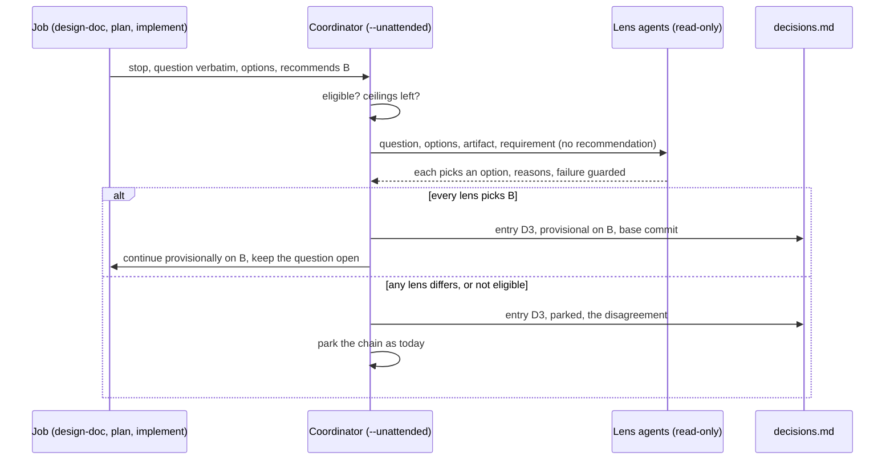

Approved by Lam Ngoc Khuong on 2026-11-08, by instruction to the agent.

# An unattended run of atk:orchestrate passes eligible gates provisionally and hands them to a person in one decision queue

Requirement: `docs/records/requirements/261105-0310-auto-run-with-batched-decisions.md`, `APPROVED`
on 2026-11-05. Required reviewer: the Tech Lead, Lam Ngoc Khuong, who approves. The BrSE/BA check
that the design still serves the requirement falls to the same person, since the profile holds no
BrSE/BA row; no SRE row exists either, and nothing here touches deployment or data.

## In short

`atk:orchestrate` already carries pieces of work through the kit in worktrees, relays each gate to its
person, and parks a chain whose person is away. What it cannot do is build anything while nobody is
there to answer. This design adds `--unattended` to it. Under that flag, a gate of a short, fixed
list is not waited for: the job's skill names the option it recommends, two or three read-only lens
agents pick an option cold without seeing that recommendation, and only when every one of them picks
the same option does the chain go on, on that option, provisionally. The question stays open in the
artifact, under the name of the person who owns it, and becomes one entry of a decision queue the
person reads when they come back. Every other gate parks its chain exactly as today.

Nothing a person owns is decided. No artifact reaches `APPROVED` during the run, nothing crosses the
consent line, and a rejected entry costs local rework only: the branch built on it is kept as
evidence, and a new proposal record carries the chain again from the rejected gate, on the person's
option, once that record is approved.

## Requirement

The acceptance criteria this design is checked against, from the requirement, section 3, with the
six answers of its section 6 treated as settled:

| AC | Restated | Served by |
|----|----------|-----------|
| 1.1 | An eligible gate is recorded and the run goes on without a person | Chosen approach, "A gate under `--unattended`", steps 1 to 5 |
| 1.2 | An ineligible gate stops its own chain only | "A gate under `--unattended`", step 1; `parked` as today |
| 1.3 | No artifact ends the run `APPROVED` that did not start it so | "The close", status check |
| 1.4 | Nothing crosses the consent line | Unchanged rule of `atk:orchestrate`, re-checked at the close |
| 2.1 | One lens agent per owning role reads the options cold and recommends | "The lens agents" |
| 2.2 | A disagreement is recorded and never continued on | "A gate under `--unattended`", step 4 |
| 2.3 | A lens agent is named as an agent with its lens, its answer a recommendation | "Wording", and every shape below |
| 3.1 | One queue entry per provisional gate with the listed fields | "The decision queue" |
| 3.2 | An accepted entry names the person and time, and the trace's `gate` line names them | "Answering the queue", accept |
| 3.3 | A rejected entry's work is identified and not carried forward until redone | "Answering the queue", reject |
| 3.4 | An unanswered entry reads as unanswered, its work as provisional | "The decision queue", state; "The close" |

Every criterion maps to a section. Nothing in the design serves no criterion, apart from the
ceilings, which answer question 6, and the permission-prompt rule, which question 2 lists as never
eligible and which needs a mechanism to stay true while nobody watches.

## Current state

How a gate is handled today, and why the obvious approach, "let the coordinator answer", is not open:

- **A gate is relayed, never answered.** The calling skill never answers one, never picks an option
  of one, and never moves an artifact's state: `plugins/atk/shared/host-capabilities.md:413`. This
  is the one rule the mode has to change, and question 1 placed the change in `orchestrate` for
  that reason.
- **The approval is the approver's act.** No skill moves a state on its own:
  `plugins/atk/shared/team-roles.md:41`, rule 2. Rule 3 at line 58 forbids recording a decision the
  team has not made.
- **A person not in the session.** Rule 5 already lets a run record the case as an open question
  carrying that person's name and go on "with what does not depend on it":
  `plugins/atk/shared/team-roles.md:68`. The mode goes one step further, on what does depend on it,
  provisionally, and rule 5 needs a clause saying so.
- **How a gate reaches the coordinator.** A job writes each stop as a `stop:` line of its result
  file, word for word, with the person it is for:
  `plugins/atk/skills/orchestrate/references/job-prompt.md:67`. A subagent returns at
  `needs-person`, and the coordinator continues that same agent with the answer verbatim:
  `plugins/atk/skills/orchestrate/references/ways-to-run.md:117`. A stop carries no recommended
  option today, so the coordinator has nothing to compare a lens agent's pick against.
- **Parking.** A question for a person not in the session parks its chain, its agent stopped so it
  holds no slot, and the other chains go on:
  `plugins/atk/skills/orchestrate/references/proposal.md:255`. That is AC 1.2 already, for every gate.
- **How far an approval reaches.** Approving a proposal record covers each chain up to its first job
  that produces a gating artifact; the jobs after it are `re-confirm` and run only under a new,
  approved record: `plugins/atk/skills/orchestrate/references/proposal.md:142`. Under the mode, that
  reach is what eligible gate (c) of question 2 changes, within the depth ceiling of question 6.
- **Which artifacts gate.** A plan does not; a requirement, a design and a breakdown do:
  `plugins/atk/shared/state-signals.md:19`.
- **The cold reader.** Agents that read a draft with nothing of the conversation, return at most
  five objections each, and are spawned as `atk:read-only-reviewer`:
  `plugins/atk/shared/independent-challenge.md:22`. The role lenses and their questions for a
  design are `plugins/atk/skills/design-doc/references/role-challenge.md:19`.
- **Where `atk:implement` stops by itself.** A job given a plan path runs its gate straight
  through, but a fix job of `orchestrate` is given a description, so its plan gate scores it: medium
  sends an `atk:plan --inline` confirmation to the person as a gate, large escalates:
  `plugins/atk/skills/orchestrate/references/proposal.md:137`,
  `plugins/atk/skills/implement/SKILL.md:87`. The medium confirmation is gate (b) of question 2.
- **Nothing leaves the repository.** No job pushes, comments or merges, and offers are declined for
  the close: `plugins/atk/skills/orchestrate/references/job-prompt.md:46`. AC 1.4 already holds.
- **The trace.** Six event kinds and no others; a `gate` line records who was asked, the wait, and
  `answered`, `unanswered` or `refused`: `plugins/atk/shared/run-trace.md:181`.
- **The ceiling of `SKILL.md`.** `plugins/atk/skills/orchestrate/SKILL.md` is 298 lines against a
  limit of under 300, per `CLAUDE.md`, "Skill folder layout". The mode cannot live there; it gets a
  reference file, and `SKILL.md` gains at most one line net.
- **Permission prompts.** A subagent's prompts reach the person in the harness, unseen by the
  coordinator, so a subagent job has no timeout:
  `plugins/atk/skills/orchestrate/references/ways-to-run.md:127`. With nobody at the harness, such a
  job would wait forever.

## Options

Question 1 settled where the mode lives, a flag on `atk:orchestrate`. What is left to choose is where
the provisional pass happens and who carries its rule.

Criteria, in the order they weigh: **rule integrity**, nothing recorded as decided that a person did
not decide; **reach**, how many files and skills change; **reversibility**, what a rejection or a
rollback of the feature costs; **observability**, whether a reader can tell afterwards what was
provisional; **portability**, whether it behaves the same on panes, subagents and the session, and on
Claude Code, Cursor and Codex; **cost**, the agents it spawns.

### A. The coordinator passes the gate; the job's skill records it open (chosen)

The job stops at a gate as today, with one more field: the option its skill recommends. The
coordinator, under `--unattended`, looks the gate up in a fixed eligibility table, spawns the lens
agents, compares, and on agreement continues the job with a fixed provisional instruction rather than
an answer. The job's skill writes the question in its artifact as open, under its owner's name, with
the provisional option beside it. The queue, the ceilings and the rejection path live in one new
reference file of `orchestrate`; the shared change is one bullet in `host-capabilities.md`, one clause
in rule 5, one field of the job's `stop:` line, and one value of the trace's `gate` line.



- Rule integrity: high. No skill picks on its own; the job only names the option it already
  recommends in its prose, and the coordinator passes on a fixed sentence, never an answer.
- Reach: one new reference, small edits to five existing files, the flag surface.
- Reversibility: high. Removing the flag removes the mode; the rest of the kit never reads the queue.
- Observability: the queue, the open question in the artifact, and the trace line.
- Portability: the same on every way, since the coordinator does the work in its own turn; the
  permission-prompt limit below is per way, and stated in the proposal.
- Cost: up to three lens agents per eligible gate, at most eight gates: 24 agents in the worst case,
  stated before the run.

### B. Each gating skill grows a provisional flag

`atk:design-doc`, `atk:plan` and `atk:implement` each take a `--provisional` flag under which the
skill picks its own recommended option and logs it; the coordinator only collects the logs into the
queue.

- Rule integrity: low. A person could run `/atk:design-doc --provisional` outside any orchestration,
  and the skill would carry itself past its own gate with nobody's check; that is a skill deciding on
  its own, which `CLAUDE.md`, "The team premise", calls a regression.
- Reach: three `SKILL.md` files, each near its line ceiling, plus every flag-surface file per skill.
- Lens agents would have to be spawned by the job, which a subagent cannot do on Claude Code, or
  skipped, which breaks AC 2.1.
- Loses on rule integrity alone.

### C. Park everything, and only gather the queue (the default the team would pick)

Keep every gate parking its chain, as today, and add only a report at the close listing the parked
questions in one place.

- Rule integrity: highest; nothing changes.
- Reach: the smallest.
- It fails AC 1.1 outright: nothing is built while the person is away, which is the need the
  requirement exists for. It is the honest baseline, and what a team gets today with `--resume`. It
  loses because it does not meet the requirement.

### D. Let the lens agents' majority choose

As A, but continue on the option most lens agents pick.

- Question 3 already rejected it: a majority among agents on one model means little, and siding with
  one lens treats an agent as the role. Listed so the ADR records it.

| Criterion | A | B | C | D |
|-----------|---|---|---|---|
| Rule integrity | high | low | highest | medium |
| Reach | medium | large | small | medium |
| Reversibility | high | medium | high | high |
| Observability | high | medium | high | high |
| Portability | high | low (subagents cannot spawn) | high | high |
| Meets every AC | yes | no (2.1) | no (1.1) | no (2.2, Q3) |

## Chosen approach

Option A. The Tech Lead owns this choice; the comparison above is the case for it.

### The flag and what it changes at the proposal

`/atk:orchestrate <inputs> --unattended`. It combines with `--concurrency` and `--sequential`, and is
refused with `--resume`, which takes no inputs: a resumed run keeps the mode its run state records.

The proposal record, written and approved exactly as today, adds four things under `--unattended`:

1. **A `Mode: unattended` line** under the title, and a section **Provisional gates** stating the
   eligibility table below, the two ceilings, the lens agents per gate and the worst-case count of
   agents, so the approver approves the mode with the cost in view, per the parallel-agents policy of
   `plugins/atk/shared/host-capabilities.md`.
2. **Reach.** Each chain's jobs past its first gating artifact are marked `provisional` in place of
   `re-confirm`, up to the depth ceiling, below. Jobs past that ceiling stay `re-confirm`.
3. **Pieces refused for the mode.** A piece whose requirement is not `APPROVED`, including any that
   starts at `atk:intake`, is not carried unattended: question 2 keeps scope with a person. It is
   listed as waiting on its requirement's approver, and the rest of the run goes on.
4. **Permission prompts.** Question 2 makes every permission prompt ineligible, and nobody is there
   to answer one. The proposal therefore states, per job, whether its way can raise one: a pane job
   in a mode that asks before writing in its worktree will wait on its first write until its timeout
   fails it; a subagent job has no timeout and is offered under `--unattended` only where the
   approver confirms, in the record, that the harness lets that subagent write in the worktree
   without asking, and is otherwise offered as a pane job or left out. The classifier mode of
   `plugins/atk/shared/host-capabilities.md` stays available on the same terms as today. A commit
   the coordinator would ask about, because the repository runs a hook or a filter on `git add`,
   parks its chain, and the proposal says so beforehand.

The approval of this record is the person handing the task over. It is never provisional, and the
run starts nothing before it, as today.

### Eligibility

One table, in the new reference file, keyed by skill and gate kind. The coordinator looks the gate
up; one it cannot place is not eligible.

| Eligible | Gate | Recorded where the job's skill records it |
|----------|------|-------------------------------------------|
| (a) | An interview question or an option choice inside a draft, `atk:design-doc` or `atk:plan`, whose options change no user story, acceptance criterion or out-of-scope item of the requirement | The artifact's `## Open questions`, as open |
| (b) | The medium-level `atk:plan --inline` confirmation of `atk:implement`'s plan gate, in a fix job | The implementation record, as an open question |
| (c) | The wait for a gating artifact's approval, the chain building on it while it stays `DRAFT` or `IN REVIEW` | The artifact stays at its state; the queue entry carries it |

Never eligible, and the chain parks as today: moving any approval state; scope, priority, pricing,
deadline, compliance; a requirement not `APPROVED`; residual risk in `atk:security`; the review-loop
escalation and a disputed `BLOCKING` finding; `atk:fix`'s check that a behaviour was intended; a
large plan-gate score; a permission prompt; a commit the coordinator asks about; every action past
the consent line.

For (a), "changes no story, criterion or out-of-scope item" is read by the lens agents, not by the
coordinator: each is asked it as its first question, and any `yes` makes the gate ineligible, so the
coordinator never judges scope.

For (c), the job's skill recommends nothing, so the recommendation compared against is the one the
approved proposal already carries: "build on the draft as written". The lens agents are asked whether
they would build on it as written.

### A gate under `--unattended`

When a job stops:

1. **Look up.** Not in the table: park, as today, and write a queue entry at state `parked` with the
   reason `not eligible`. Ceilings reached: the same, reason `ceiling`.
2. **The skill's recommendation.** The `stop:` line must carry `recommends: <option>`, the option the
   skill's own text recommends. None given: park, reason `no recommendation`. The coordinator never
   supplies one, apart from the fixed one of (c).
3. **Lens agents.** Spawn them, below. One that dies twice is not run, and the gate parks, reason
   `lens not run`: a missing lens is not agreement.
4. **Compare.** Every lens picks the skill's option, and none answers `yes` to the scope question:
   go on. Anything else: park, with each lens's pick and reasons in the entry. No majority, no
   tie-break.
5. **Go on.** Write the entry at state `provisional`, then continue the job with this sentence and
   nothing else, verbatim:
   `Unanswered. Continue provisionally on option <option>, decision queue entry <run-id> D<n>. Record
   the question as open for <owner>, with the line "Provisional: option <option>, recommended by the
   <lenses> lens agents, decision queue <run-id> D<n>". This is not an answer.`
   For (c), no job is continued: the next job of the chain, marked `provisional`, starts.

### The lens agents

- **Which.** The roles that own the gate: the person the `stop:` line names, mapped to their role
  through the Team section, and for (c) the roles of the artifact's approvers as
  `plugins/atk/skills/design-doc/references/role-challenge.md` lists them for a design. At most three;
  where more apply, the owning role first, then the role-challenge order, and the entry names the
  ones left out.
- **What each gets.** Per What each agent gets in `plugins/atk/shared/independent-challenge.md`: the
  question verbatim, the options, the artifact in the worktree by absolute path, the requirement,
  its role's questions, rule 9's list; nothing of the job's reasoning and **not the skill's
  recommendation**, so its pick is its own. Spawned as `atk:read-only-reviewer` on Claude Code, with
  the `Review agent model` line.
- **What each returns.** The scope answer, `yes` or `no` with the item it would change; one option;
  up to three reasons, each with its evidence, `path:line` or a line of the artifact; the failure the
  option guards against. A return without a named failure counts as no pick.

### Wording

A lens agent is written as "the Tech Lead lens agent", never as the person or as "the Tech Lead". Its
answer is a "recommendation". A provisional gate is "passed provisionally", never "decided",
"approved" or "answered". This holds in the queue, the proposal records, the artifacts, the trace and
the closing message.

### The ceilings

- **Depth.** A chain builds on at most one gating artifact that is not `APPROVED`. `atk:implement` may
  run on a draft design and a draft plan, since a plan does not gate; not on a draft design and a
  draft breakdown together. A job that would cross a second one is `re-confirm`.
- **Count.** At most 8 entries at `provisional` per run. The ninth eligible gate parks, reason
  `ceiling`. Parked entries do not count.
- The job timeout of `atk:orchestrate` is unchanged.

### The decision queue

`<docs root>/derived/orchestrate/<run-id>/decisions.md`, beside `progress.md`, kept out of git by the
run state's existing ignore file. One entry per gate met, provisional or parked, so the person reads
every stop of the run in one place.

```
## D3 | provisional | r1-2 design-doc step 3 | for: Lam Ngoc Khuong (Tech Lead)
question: <verbatim, masked per rule 9>
options: A <one line> | B <one line>
skill recommends: B
lens agents: Tech Lead lens agent: B, <reasons, evidence>, guards <failure> | QA lens agent: B, ...
continued on: B | base: <commit before the gate> | built on it: <commits>, <files>
depends on: D1 | rejected costs: r1-3, r1-4 redone from <base> on the chosen option
answer: unanswered
```

- **State.** `provisional`, `parked`, `accepted`, `rejected`, `void`. `void` is an entry built on a
  rejected one: never asked, its work going with its parent's.
- **`built on it`** grows as later jobs of the chain commit, so it is complete at the close.
- **Order.** Entries are numbered as met. The queue is asked in dependency order, a parent before what
  depends on it.
- **The run state.** Each provisional or parked entry also adds one `<time> waiting:` line to
  `progress.md` naming the person, as the close does for a parked chain today, so `atk:help` routes
  back to `--resume`.

### Answering the queue

`/atk:orchestrate --resume` on a run with unanswered entries asks them first, all independent ones
in one turn, each verbatim with its lens recommendations, before it resumes anything. The person may
answer some and leave the rest; who is answering is established as rule 2 of
`plugins/atk/shared/team-roles.md` establishes an approver, and an entry for someone else is relayed
to them, not answered by the person present.

- **Accept.** The entry gets `answer: accepted by <name>, <YYYY-MM-DD HH:MM>`. For (a), the answer is
  recorded where its skill records answers, `atk:design-doc <path> --answer` or
  `atk:plan <path> --answer`, as a job or in the session, with the provisional line kept above the
  answer. For (b), the next proposal record carries it. For (c), the entry is accepted only once the
  artifact is `APPROVED` by its approver, and only where the approved file's content equals the
  commit the chain built on; an approval with changes is put to the person as a choice, accept or
  reject.
- **Reject.** The entry gets `answer: rejected by <name>, option <their option>, <time>`. Every
  entry depending on it becomes `void`. The branch keeps its commits as evidence and is never deleted
  by the run; the worktree is removed per the cleanup rule once its files are copied out; and the
  coordinator writes a new proposal record with a `Follows:` line, for the chain from the rejected
  gate onward, on the person's option, from the entry's `base` commit on a new branch. It runs once
  that record is `APPROVED`, as step 6 does today.
- **The durable account.** The next proposal record carries a section **Decision queue** listing every
  entry of the run: its gate, the option continued on, the lens recommendations in one line, and who
  accepted or rejected it, or `unanswered`.

### The close

Before the closing message, the coordinator re-reads the `status` of every artifact the run touched
against the value it recorded at the job's start, and reports any that became `APPROVED` without an
accepted (c) entry as a failure of the run, by path. The closing message lists the queue first:
counts by state, then every `provisional` entry with its person, and that the work built on each is
provisional until it is answered. The rest is the close of step 7 as today.

### Data model and migration

Two new shapes, both files of the run state under `docs/derived/`, never committed: the entries of
`decisions.md` above, and the `stop:` line's optional field below. No migration: a run state without
a `decisions.md` is a run that was not unattended, and a result file whose stop line lacks
`recommends:` is read as today.

### API contract

The contracts here are the shapes skills and agents exchange.

- **Result file, `stop:` line.** `stop: <kind> | for: <person> | recommends: <option or none> | <the
  question, word for word>`. The field is written by every job under `--unattended`, `none` where the
  skill recommends nothing; outside the mode it is left out, and the coordinator reads the line as
  today. `job-prompt.md` item 6 says so.
- **Job prompt, item 6.** Gains, under `--unattended` only, the field above and the sentence the job
  will be continued with, so the job knows a provisional continuation is not an answer.
- **Trace `gate` line.** One more outcome beside `answered`, `unanswered` and `refused`:
  `provisional, queued as <run-id> D<n>`, its wait `none`. The coordinator's trace writes it; the
  job's own trace writes its gate `unanswered`, with `continued provisionally per <run-id> D<n>`. The
  later acceptance or rejection is a `gate` line of the `--resume` run, naming the person, per
  "Answers that arrive in a later session" in `plugins/atk/shared/run-trace.md`. No seventh event
  kind.
- **Lens agent prompt and return.** As "The lens agents" above.
- **Proposal record.** The `Mode:` line, the Provisional gates section, the `provisional` value of
  the Approval column, and the Decision queue section of a follow-up record.

### Error and edge cases

- A job that ignores the provisional sentence and writes an answer as given: the coordinator reads the
  artifact after the job, as evidence, and an answered question that no person answered is reported
  in the closing message by path and line, and the entry is marked `parked`, reason `recorded as
  answered`.
- A lens agent that returns two options, or none: no pick; the gate parks.
- The ninth eligible gate, a second unapproved gating artifact, an approver editing the artifact
  mid-run: park, `re-confirm`, and the (c) content check respectively.
- The person comes back mid-run and answers in the session: the gate is answered as today, and from
  then on the run is attended, every later gate asked of them directly. When that person says they
  are no longer present, the run goes back to unattended for the gates after that, and the run state
  records both switches with the time and who said so. (From open question 3.)
- A rejection whose `base` commit is gone from every branch: the coordinator asks the person for the
  base, never picks one.
- A run interrupted between writing the entry and continuing the job: `--resume` finds the entry at
  `provisional` with no commit after `base`, and continues the job with the same sentence.

### Backward compatibility

Without the flag, nothing changes: the eligibility table is never read, no lens agent is spawned, the
`stop:` line has no new field, and no `decisions.md` is written. A run state written before this
change resumes as an attended run. The one shared edit read by every skill, the clause of rule 5, is
scoped to `--unattended` by name.

### Rollout

The flag, behind nothing else. It is documented as new in the `README.md` invocation block and both
`skills-overview.md` files. The `description:` of `atk:orchestrate` gains the English trigger
"run this unattended", and its `evals/trigger_evals.json` gains one positive for the mode in each of
English, Vietnamese and Japanese, the description staying under 1,024 characters; triggers stay
English only, per `CLAUDE.md`, "Trigger phrases are English". (From open question 2.) The first real use is a trial on a small two-piece run in this
repository, with the trace and the queue read afterwards; the plan schedules it.

### Rollback

Remove the flag's line and the reference file, revert the clause of rule 5, the bullet of
`host-capabilities.md`, item 6 of the job prompt and the trace value. Nothing on disk in a user's
project depends on it beyond `docs/derived/`, which is safe to delete. Provisional branches a run left
are ordinary unpushed branches.

### Observability

The queue itself; the open questions with their `Provisional:` line in each artifact; the `gate`
lines of both traces; and the status check of the close. `atk:tailor --feedback orchestrate --runs`
can count provisional against parked gates from the traces without a new event kind.

### Security and permission impact

No new trust boundary. Lens agents are read-only, given rule 9's list, and see only the worktree. The
mode removes no consent: nothing is pushed or sent, and every permission prompt stays the person's,
which is why the proposal must state per job whether one can arise. The one widening risk is a
person approving the subagent way while their harness writes without asking; the record names that
confirmation and who gave it.

### Performance expectation

Per eligible gate, up to three lens agents in parallel under the machine's cap. Worst case per run:
eight provisional gates, 24 lens agents, plus those spent on gates that end parked, at most three per
parked gate. The proposal states the worst case before the run. A gate costs the wall time of its
slowest lens agent, and the chain waits only for that.

### Files the implementation touches

| File | Change |
|------|--------|
| `plugins/atk/skills/orchestrate/references/unattended.md` | New: eligibility, the gate procedure, lens agents, ceilings, queue, answering, the close |
| `plugins/atk/skills/orchestrate/SKILL.md` | `argument-hint`, one `## Invocation` line, one clause in step 2 and in State and resuming pointing at the new file; net growth at most one line |
| `plugins/atk/skills/orchestrate/references/proposal.md` | The `provisional` Approval value, the Mode line, the two sections |
| `plugins/atk/skills/orchestrate/references/job-prompt.md` | Item 6 and the `stop:` line shape |
| `plugins/atk/skills/orchestrate/references/ways-to-run.md` | The subagent condition under `--unattended` |
| `plugins/atk/shared/host-capabilities.md` | A bullet after "A gate is relayed, never answered": a gate passed provisionally under `atk:orchestrate --unattended` |
| `plugins/atk/shared/team-roles.md` | One clause in rule 5 |
| `plugins/atk/shared/run-trace.md` | The `provisional` outcome of a `gate` line |
| `plugins/atk/skills/design-doc/references/answer-mode.md`, `plugins/atk/skills/plan/` answer reference | Check, and if needed one line: a `Provisional:` line is kept above the answer |
| `plugins/atk/skills/orchestrate/SKILL.md` `description:`, `plugins/atk/skills/orchestrate/evals/trigger_evals.json` | The trigger "run this unattended", and three positives, English, Vietnamese, Japanese (from open question 2) |
| `README.md`, `docs/skills-overview.md`, `docs/vi/skills-overview.md` | The flag |
| `docs/codebase-summary.md`, `docs/vi/codebase-summary.md` | A row for the new reference and for ADR 0016, which `tests/verify.sh` requires |
| `docs/system-architecture.md`, `docs/flow/skill-chain.md` and their `docs/vi/` mirrors | The mode and the provisional edge |
| `docs/adr/0016-unattended-run-passes-gates-provisionally.md` | The ADR |
| `docs/vi/records/design/261108-1246-orchestrate-unattended-run.md` | The Vietnamese copy of this design, written by its author in the same pull request |

`docs/artifact-lifecycle.md` does not change, per question 5. The skill count stays 25.

## Open questions

None open. The three questions the design was written with are answered below.

### Answered

| Question | Answer | Answered by | Date | Relayed by |
|----------|--------|-------------|------|------------|
| 1. Should a subagent job be offered at all under `--unattended`, or only panes and the session? The design offers it on the approver's confirmation that the harness lets it write in the worktree unasked. | "Theo bạn đề xuất" (rendering: as you proposed). The design stands; no section changed. | Lam Ngoc Khuong | 2026-11-08, given | |
| 2. Should the `description:` of `atk:orchestrate` gain a trigger phrase for the mode, with trigger eval positives in English, Vietnamese and Japanese? | "Bạn đề xuất, description hình như chỉ còn tiếng anh thì phải" (rendering: you propose; the description is English only now, I think). To the proposal put back, one English trigger "run this unattended" and one positive per language in the evals: "Chấp nhận" (rendering: accepted). Changed: Rollout, Files the implementation touches. | Lam Ngoc Khuong | 2026-11-08, given | |
| 3. When the person returns mid-run and answers a gate in the session, should the run stay unattended for later gates by default? | "Có, nhưng nếu tôi bảo tôi không còn thường trực thì phải tiếp tục auto" (rendering: yes, but if I say I am no longer present it must continue automatically). To the reading put back, attended from the answer on, unattended again once the person says they are no longer present: "Đúng" (rendering: correct). Changed: Error and edge cases. | Lam Ngoc Khuong | 2026-11-08, given | |

## ADR

[ADR 0016](../../adr/0016-unattended-run-passes-gates-provisionally.md), `APPROVED`.
