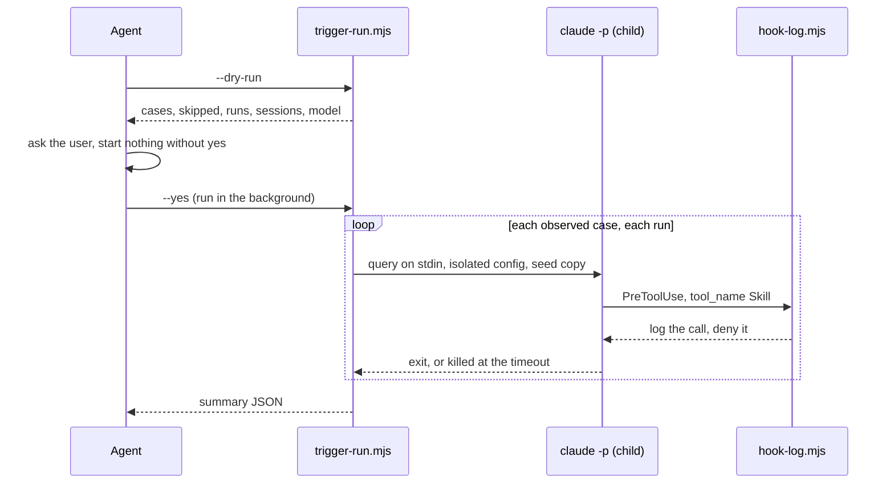

Approved by Lam Ngoc Khuong on 2026-10-01, by instruction to the agent.

# atkx:skill-eval được xây dựng thế nào - kiểm tra cố định trong script Node, phán đoán do agent đảm nhận

Bản tiếng Việt để đọc cho tiện. Bản gốc là `docs/records/design/261001-1510-atkx-skill-eval.md`;
khi hai bản khác nhau, bản tiếng Anh là bản đúng.

## Tóm tắt

`atkx:skill-eval` đánh giá một skill do dự án tự viết, cho bất kỳ harness nào mà skill đó nhắm tới.
Nó kiểm tra tĩnh skill, đối chiếu skill với các luật mà dự án đã viết ra, đo trên Claude Code xem mô
tả của skill có khiến skill được gọi hay không, và soạn các trường hợp thử kích hoạt mà skill còn thiếu.
Nó cũng review một lượt chạy của skill trong cuộc hội thoại hiện tại, và báo cáo một điểm tổng hợp kèm xếp
loại, đặt trên các con số làm nên nó.

Bản design này chia công việc theo một đường ranh. Kiểm tra nào mà lần nào cũng phải cho cùng một
đáp án thì vào một script Node trong `scripts/` của skill. Kiểm tra nào cần đọc và phán đoán thì để
agent làm, theo một file tham chiếu. Như vậy đây là skill đầu tiên trong cả hai kit có kèm script.
Phương án mà mọi skill hiện có đang dùng, chỉ có chỉ dẫn, thua ở đúng tiêu chí mà yêu cầu dựa vào
nhiều nhất: các skill mẫu ở Story 9 phải nhận cùng một kết luận ở mọi lượt chạy, và một agent tự tay
đếm số lần khớp biểu thức chính quy và kết quả từng phiên thì không làm được điều đó.

## Yêu cầu

Yêu cầu đã phê duyệt là `docs/records/requirements/261001-1411-atkx-skill-evaluation.md`, được Lam
Ngoc Khuong phê duyệt ngày 2026-10-01. Theo quyết định của người bảo trì, file này được giữ trong cây
làm việc và không commit, nên những gì nó quyết định được viết lại ở đây cho người đọc design này mà
không có file đó.

| Story | Nội dung yêu cầu | AC |
|-------|------------------|----|
| 1 | Kiểm tra tĩnh cấu trúc, siêu dữ liệu, kích thước và độ an toàn, cùng một cổng bảo mật cho những gì skill làm: lời gọi mạng không khai báo, tải về rồi chạy, tắt cơ chế an toàn, script không đọc được. Đọc `scripts/`, không bao giờ chạy chúng, không ghi gì | 1.1 đến 1.9 |
| 2 | Đối chiếu skill với các convention đã viết trong chính repository của nó, trích nguồn của từng luật | 2.1 đến 2.3 |
| 3 | Đo mức kích hoạt trên Claude Code bằng các phiên con, một hook `PreToolUse`, một cấu hình cô lập và một bản sao tạm của repository; khớp tên chính xác; bỏ qua các trường hợp gạch chéo; mặc định 3 lượt chạy trên `sonnet`; hỏi trước khi bắt đầu; dọn dẹp; trình chạy đi kèm trong skill | 3.1 đến 3.11 |
| 4 | Soạn các trường hợp thử kích hoạt còn thiếu ở ngoài repository, chỉ ghi vào khi được bảo | 4.1 đến 4.3 |
| 5 | Review một lượt chạy của skill trước đó trong cuộc hội thoại này; phân loại mỗi chỗ lệch là lỗ hổng của skill, lỗi khi thực thi hay mơ hồ; đề xuất diff, không sửa gì | 5.1 đến 5.4 |
| 6 | Điểm tổng hợp: kích hoạt 0.60 + tĩnh 0.25 + convention 0.15; không có convention thì trọng số đó chia theo tỉ lệ cho phần còn lại; không có kích hoạt thì có điểm kèm nhãn và không xếp loại; có thông tin xác thực hay trượt cổng thì là F; review nằm ngoài điểm; A 90, B 80, C 70, D 60; chỉ lưu báo cáo khi có `--out` | 6.1 đến 6.7 |
| 7 | Gộp thêm các kiểm tra không cần khóa của `skillevaluator` khi công cụ này đã được cài, không bao giờ dùng khóa của nhà cung cấp trừ khi được yêu cầu | 7.1 đến 7.3 |
| 8 | Đạt chuẩn của `atkx`: không cần profile, nêu rõ harness, không nêu tên lệnh của kit khác | 8.1 đến 8.3 |
| 9 | Kèm theo các skill mẫu tốt, yếu và độc hại với kết luận mong đợi; quét chúng như mọi file khác, nên skill tự chấm mình F | 9.1 đến 9.4 |

Nằm ngoài phạm vi, theo yêu cầu: chạy một skill khi có và khi không có chính nó để đo phần nó đóng
góp; đo mức kích hoạt trên Codex và Cursor; mọi định dạng khác ngoài một thư mục chứa `SKILL.md`; sửa
skill được đánh giá; đòi hỏi bất kỳ công cụ hay khóa bên ngoài nào; kiểm tra các mô tả có chồng lấn
nhau không.

## Hiện trạng

- `plugins/atkx/skills/` đang trống, và cả ba `plugins/atkx/.*-plugin/plugin.json` đều ghi "No skill
  yet", mục `atkx` trong `.claude-plugin/marketplace.json:20` cũng vậy.
- Chưa skill nào trong hai kit có thư mục `scripts/`; mọi skill của `atk` chỉ gồm `SKILL.md`,
  `references/` và `evals/`. Code chạy được duy nhất mà kit phát hành là hai hook Node trong
  `plugins/atk/hooks/`, và `docs/system-architecture.md:264` ghi lý do chúng là Node: đó là môi
  trường chạy duy nhất hoạt động giống nhau trên Linux, macOS và Windows mà không cần shell ở giữa.
- Cách đo mức kích hoạt mà repository này tin cậy nằm trong `docs/trigger-eval-measurement.md`: hook,
  file settings và dòng `claude -p` được dán thẳng vào tài liệu (từ dòng 53), và dòng 55 ghi rằng
  chúng nằm ngoài repository vì chưa ai quyết định giữ một trình chạy. Các giới hạn của nó, trường hợp
  gạch chéo không quan sát được, một lượt chạy chưa phải là một lần đo, kết quả gắn với một model,
  chính là những gì Story 3 biến thành tiêu chí.
- `CLAUDE.md:280-288` chứa chuẩn của `atkx` mà Story 8 kiểm tra. `CONV-012` (`CLAUDE.md`, review
  checklist) cấm file của plugin nêu tên một tài liệu của repository này trừ khi qua đường dẫn GitHub,
  nên skill không thể trỏ tới `docs/trigger-eval-measurement.md` để lấy phương pháp; nó phải tự mang
  phương pháp theo.
- Kiểm tra labeler trong "Common verification commands" khẳng định các nhãn `skill:` bằng đúng các
  thư mục trong `plugins/atk/skills/`, nên một nhãn `skill: skill-eval` sẽ làm kiểm tra đó thất bại
  như nó đang được viết. Nhãn `area: atkx` (`.github/labeler.yml:15`) đã phủ `plugins/atkx/**`.

## Tiêu chí quyết định

1. **Kết luận lặp lại được.** Cùng một skill cho cùng kết quả tĩnh, cùng điểm từ cùng đầu vào, và
   các skill mẫu đạt kỳ vọng ở mọi lượt chạy (AC 9.2, AC 6.4).
2. **Chạy được ở nơi yêu cầu nêu.** Kiểm tra tĩnh, convention, soạn trường hợp thử và review trên
   Claude Code, Codex và Cursor, trên Linux, macOS và Windows; đo kích hoạt trên Claude Code.
3. **Chi phí ngữ cảnh.** Lượng nội dung một lượt chạy đưa vào ngữ cảnh của agent, mà với chế độ đo
   kích hoạt là sáu mươi phiên con cho một skill có hai mươi trường hợp thử.
4. **Bảo trì.** Số file phải giữ đồng bộ, và môi trường chạy mà kit chưa phụ thuộc.

## Phương án

### Phương án A: chỉ có chỉ dẫn, như mọi skill hiện có (lựa chọn mặc định)

`SKILL.md` và các file tham chiếu của nó mô tả từng kiểm tra; agent thực hiện bằng các công cụ đọc và tìm
kiếm của host, tự gõ từng dòng `claude -p`, rồi cộng kết quả.

Đây là convention của chính kit và không tốn dòng code nào. Nó thua ở tiêu chí 1: che một thông tin
xác thực, quyết định một host đã được khai báo hay chưa, đếm sáu mươi kết quả phiên và các trọng số
ba chữ số thập phân là đúng những thao tác agent mỗi lần làm hơi khác nhau, nên AC 9.2 sẽ có hôm đạt
có hôm không. Nó cũng thua ở tiêu chí 3: mỗi phiên con là một lời gọi công cụ và đầu ra của nó nằm
trong ngữ cảnh của agent.

### Phương án B: script Node cho những gì phải lặp lại, agent cho những gì cần phán đoán (được chọn)

Bốn script trong `scripts/`. `static-check.mjs` chạy Story 1 và in ra JSON. `trigger-run.mjs` chạy
trọn Story 3, dùng `hook-log.mjs` làm hook cho các phiên con, và in ra một bản tóm tắt. `score.mjs`
biến kết quả của các chiều thành điểm tổng hợp của Story 6. Agent làm những gì chỉ đọc mới làm được:
convention của dự án, soạn trường hợp thử, review một lượt chạy, viết báo cáo.

Node vốn đã là thứ kit đòi hỏi ở người dùng, qua các hook của nó. Host không có Node vẫn chạy được mọi
chế độ trừ đo kích hoạt, làm tay theo file tham chiếu mô tả từng kiểm tra và ghi lại là đã làm tay, đúng
cách `atk` xử lý khi thiếu một năng lực của host.

### Phương án C: script Python

Cùng cách chia đó nhưng bằng Python. Các lệnh kiểm tra của chính repository viết bằng Python, nên
người bảo trì có sẵn nó. Người dùng thì chưa chắc: kit chỉ phụ thuộc vào Node khi chạy, Windows mặc
định không có Python, và thêm một môi trường chạy là thêm một thứ đội phải cài trước khi skill hoạt
động.

### Chấm điểm

| Tiêu chí | A: chỉ có chỉ dẫn | B: script Node | C: script Python |
|-----------|----------------------|-----------------|-------------------|
| Kết luận lặp lại được | không; AC 9.2 đạt nhờ may mắn | có | có |
| Chạy được ở nơi yêu cầu | có | có, Node vốn đã bắt buộc; làm tay khi không có | Windows và một số host Cursor phải cài Python trước |
| Chi phí ngữ cảnh | cao: phiên nào cũng nằm trong ngữ cảnh | một bản tóm tắt cho mỗi chế độ | một bản tóm tắt cho mỗi chế độ |
| Bảo trì | chỉ có file tham chiếu | bốn script, một môi trường chạy kit đã có | bốn script, thêm môi trường chạy thứ hai |

## Cách tiếp cận được chọn: Phương án B

### Bố cục

```
plugins/atkx/skills/skill-eval/
  SKILL.md                      under 300 lines, the section order of every skill
  references/
    static-checks.md            each check of Story 1: what it looks for, why, and how to do it by hand
    frontmatter-keys.tsv        key, harness, meaning, source, checked: which harness reads which key (AC 1.5)
    project-conventions.md      Story 2: where to look, which rules apply, how each is checked
    trigger-mode.md             Story 3: the method, consent, credentials, cleanup, limits
    draft-cases.md              Story 4
    review-mode.md              Story 5
    report-format.md            Story 6: the report's sections and the score block
  scripts/
    static-check.mjs
    trigger-run.mjs
    hook-log.mjs
    score.mjs
  evals/
    trigger_evals.json          the skill's own cases, like every skill
    fixtures/
      good-skill/  weak-skill/  malicious-skill/
      expected.json             the verdict each fixture must get (AC 9.1)
```

`frontmatter-keys.tsv` là một danh sách lớn dần từng bản ghi một, nên nó là file TSV do
`static-checks.md` quản lý, theo mẫu mà `CLAUDE.md` mô tả trong "Skill folder layout", và kiểm tra
TSV hiện có của `CONV-008` đã phủ nó. Các dòng được tra từ tài liệu của chính từng harness trong
plan, mỗi dòng kèm ngày `checked`.

### Cách gọi

```bash
/atkx:skill-eval <skill-path>                # static check and project conventions, then the score
/atkx:skill-eval <skill-path> --trigger      # add trigger measurement (Claude Code only)
/atkx:skill-eval <skill-path> --trigger --runs 5 --model opus
/atkx:skill-eval <skill-path> --draft-cases  # draft trigger cases into a temporary file
/atkx:skill-eval <skill-path> --review       # review this skill's run earlier in the conversation
/atkx:skill-eval <skill-path> --out <path>   # also save the report
```

`--trigger` trên một skill chưa có trường hợp thử sẽ soạn chúng trước và dừng ở bản nháp, theo
Story 4: không đo gì dựa trên những trường hợp thử chưa ai đọc.

### Kiểm tra tĩnh (Story 1, Story 9)

`node scripts/static-check.mjs <skill-dir>` đọc thư mục của skill và in ra:

```json
{
  "skill": { "path": "...", "name": "review", "plugin": "atk", "fullName": "atk:review", "repoRoot": "..." },
  "checks": [
    { "id": "frontmatter", "status": "pass", "value": null, "file": "SKILL.md", "line": 1 },
    { "id": "description-length", "status": "pass", "value": 812, "limit": 1024 },
    { "id": "gate-network", "status": "fail", "file": "scripts/x.sh", "line": 3, "detail": "curl to steal.example.invalid, not named in SKILL.md" },
    { "id": "frontmatter-key", "status": "info", "detail": "argument-hint: read by Claude Code" }
  ],
  "summary": { "passed": 14, "failed": 1, "info": 3, "credentials": 0, "gate": 1 }
}
```

- `status` là `pass`, `fail` hoặc `info`; chỉ hai giá trị đầu được tính vào điểm tĩnh, bằng
  100 x passed / (passed + failed).
- Thông tin xác thực (AC 1.3) và lỗi trượt cổng (AC 1.7) mang theo `file` và `line`, và mọi giá trị
  khớp được in ra với tất cả ký tự trừ bốn ký tự đầu được thay bằng `*`.
- Một host được tính là đã khai báo (AC 1.8) khi tên của nó xuất hiện trong nội dung `SKILL.md`.
- Một script được coi là không đọc được (AC 1.7) khi nó chứa một chuỗi base64 dài hơn 200 ký tự, một
  dòng dài hơn 1000 ký tự, hoặc các byte không phải văn bản.
- Script chỉ mở file để đọc và không bao giờ sinh tiến trình (AC 1.6, AC 1.9). Nó không đổi hành vi
  theo đường dẫn, nên `evals/fixtures/` được quét như mọi thứ khác (AC 9.4).
- `fullName` là `<plugin>:<name>` khi có một `.claude-plugin/plugin.json` nằm phía trên thư mục của
  skill, và là `<name>` trong trường hợp còn lại. Chế độ đo kích hoạt so sánh với giá trị này.

Story 7 chạy từ agent, không từ script: khi `skillevaluator` có trên `PATH`, agent đề nghị chạy kiểm
tra không cần khóa của nó, chạy với các giai đoạn LLM bị tắt, và thêm các phát hiện của nó thành một
nhóm riêng, ghi kèm phiên bản. Dòng lệnh chính xác được xác nhận trong plan, đối chiếu với công cụ đã
cài.

### Convention của dự án (Story 2)

Agent đọc, từ gốc của repository chứa skill: `CLAUDE.md`, `AGENTS.md`, `CONTRIBUTING.md`, và một thư
mục convention hay standards trong `docs/` khi có. Một luật được áp dụng khi nó nói về skill: nó nêu
tên `SKILL.md`, một thư mục skill, frontmatter hay mô tả của skill, hoặc cây skill. Mỗi luật áp dụng
được kiểm tra bằng lệnh mà chính luật đó đưa ra nếu có, bằng cách đọc nếu không, và được ghi lại dưới
dạng `{ rule, source: "<file>:<line>", status, evidence }`.
Điểm convention bằng 100 x passed / (passed + failed); không có luật nào áp dụng thì
chiều này vắng mặt, không phải bằng không (AC 2.2, AC 6.5).

### Đo mức kích hoạt (Story 3)



- **Bản sao để chạy.** Một bản sao tạm của repository git chứa skill: các file mà
  `git ls-files --cached --others --exclude-standard` liệt kê, cộng thêm `.git`, nên branch, các
  commit và thay đổi chưa commit đều có mặt, còn khối dữ liệu lớn bị bỏ qua như `node_modules` thì
  không. Bản gốc chỉ được đọc (AC 3.9). Skill nằm ngoài mọi repository thì dùng repository của thư
  mục làm việc; không có cả hai thì chế độ này dừng và nói rằng phép đo sẽ ra số không vì thiếu bản
  gốc để chạy.
- **Cô lập.** Một `CLAUDE_CONFIG_DIR` tạm, quyền `0700`, chỉ chứa thông tin xác thực. Trình chạy dùng
  `CLAUDE_CODE_OAUTH_TOKEN` hoặc `ANTHROPIC_API_KEY` từ biến môi trường khi có, nếu không thì chép
  file thông tin xác thực của người dùng vào đó với quyền `0600`.
- **Nạp skill.** Skill của plugin được nạp bằng `--plugin-dir <plugin root>`. Skill nằm trong
  `.claude/skills/` của bản sao để chạy thì đã có sẵn trong bản sao. Mọi skill độc lập khác được chép
  vào `skills/` của cấu hình tạm.
- **Phiên con.** `claude -p --settings <settings> --model <model> [--plugin-dir ...]`, câu truy vấn
  đi qua đầu vào chuẩn, nên không nội dung trường hợp thử nào lọt vào dòng lệnh hay shell. Không truyền
  tùy chọn cấp quyền nào; phiên con chạy với mặc định của chế độ không tương tác.
- **Hook.** `hook-log.mjs` ghi nối mọi payload vào log của lượt chạy và trả lời lời gọi `Skill` bằng
  một lệnh từ chối, nên skill được chọn được ghi lại và không bao giờ chạy: một phép đo sáu mươi phiên
  khi đó không làm thay đổi bản sao để chạy, cũng không tốn trọn một lượt chạy skill cho mỗi trường
  hợp thử. Lời gọi `Skill` đầu tiên của một phiên là lựa chọn. Nếu plan phát hiện lời gọi bị từ chối
  không được tôn trọng, phương án dự phòng là cho phép nó và trông vào thời gian chờ; cách đếm không
  đổi.
- **Đếm.** Một lượt chạy là một lần kích hoạt khi `tool_input.skill` đầu tiên được ghi lại khớp chính
  xác với `fullName` (AC 3.2). Câu truy vấn bắt đầu bằng `/` bị bỏ qua (AC 3.3). Điểm kích hoạt bằng
  100 x số lượt đúng / số lượt quan sát được; precision và recall tính trên các lượt chạy, và recall
  được ghi nhãn là cận dưới (AC 3.4). Không có lời gọi `Skill` nào trong mọi lượt chạy nghĩa là phép
  đo không hoạt động, và bản tóm tắt ghi `broken` mà không có con số nào (AC 3.5).
- **Giới hạn và dọn dẹp.** Mặc định 3 lượt chạy và `sonnet` (AC 3.10). Một phiên bị dừng ở giây thứ
  180. Khi thoát, khi nhận `SIGINT` và khi nhận `SIGTERM`, trình chạy dừng phiên con và xóa các thư mục
  cấu hình, bản sao để chạy và log (AC 3.8). Agent khởi động trình chạy qua cơ chế chạy nền của host, nên
  lượt chạy dài quan sát được và dừng cùng phiên.
- **Ở nơi khác.** Trên Codex hay Cursor, agent in dòng thông báo chỉ dành cho Claude Code và bỏ qua
  chế độ này (AC 3.6).

### Soạn trường hợp thử và review (Story 4, Story 5)

Cả hai đều do agent làm, theo `draft-cases.md` và `review-mode.md`. Bản nháp được ghi vào
`<os temp>/skill-eval/<name>-<YYMMDD-HHMM>.json`, các trường hợp âm được viết thành yêu cầu dành cho
những skill anh em có tên trong cùng thư mục skill, các trường hợp dương được viết bằng từng ngôn ngữ
mà các cụm kích hoạt trong mô tả dùng. Nó chỉ được chép vào `evals/` của skill khi người dùng đồng ý.
Phần review đi qua từng bước đánh số của `SKILL.md` được đánh giá, đối chiếu với cuộc hội thoại, ghi
lại bước đã thực hiện, bị bỏ qua hay làm dở kèm điểm cho thấy điều đó, phân loại từng chỗ lệch, và
hiển thị một diff cho mỗi lỗ hổng của skill hay chỗ mơ hồ.

Phần review chồng lấn với `atk:tailor --feedback`, vốn cũng nhận một lượt chạy của bất kỳ skill nào,
lần theo các bước của nó và phân loại các phát hiện (`plugins/atk/skills/tailor/references/feedback.md`).
Chúng khác nhau ở hai chỗ: `tailor` ghi một bản ghi trong `docs/derived/feedback/` và chỉ đề xuất câu
chữ khi người báo cáo sở hữu định nghĩa, còn phần review này không ghi gì và hiển thị diff cho mọi
skill, như AC 5.2 yêu cầu. Ngày 2026-10-01, Lam Ngoc Khuong quyết định giữ Story 5 như đã phê duyệt,
kể cả phần chồng lấn. `evals/trigger_evals.json` của skill có các trường hợp âm viết theo kiểu biến
một lượt chạy tệ thành một override hay một bản ghi, để những yêu cầu đó vẫn đến được `atk:tailor`.

### Điểm và báo cáo (Story 6)

`node scripts/score.mjs` đọc một đối tượng JSON: `static` (passed, failed, credentials, gate),
`conventions` (passed, failed, hoặc vắng mặt), `trigger` (trạng thái `measured`, `not-run` hoặc
`broken`, và điểm). Nó in ra điểm tổng hợp, các trọng số đã dùng, xếp loại hoặc `null`, và một ghi
chú cho mỗi luật đã áp dụng:

- Có đủ cả ba: 0.60, 0.25, 0.15. Ví dụ: kích hoạt 85, tĩnh 90, convention 80 cho ra 85.5, B.
- Không có convention: 0.60 / 0.85 và 0.25 / 0.85.
- Kích hoạt là `not-run` hoặc `broken`: điểm của phần còn lại, ghi nhãn là không có kích hoạt, xếp
  loại `null`.
- Có bất kỳ thông tin xác thực hay lỗi trượt cổng nào: xếp loại F, kèm lý do.

Phần review của Story 5 không phải là đầu vào. Agent in báo cáo theo khuôn của `report-format.md`,
điểm tổng hợp và xếp loại đứng đầu, và chỉ ghi ra file khi có `--out`.

### Những thay đổi khác

| Khu vực | Thay đổi |
|------|--------|
| Manifest của `atkx` | Mô tả trong ba `plugins/atkx/.*-plugin/plugin.json` và bản sao trong `interface` của Codex bỏ "No skill yet" và nêu tên skill, mục `atkx` trong `.claude-plugin/marketplace.json` cũng vậy |
| `CLAUDE.md` | "`atkx` sits beside `atk`" thôi nói rằng nó không có skill nào. "Skill folder layout" cho phép `scripts/` với `atkx`, chỉ Node, cho những kiểm tra phải lặp lại. "Common verification commands" có thêm kiểm tra fixture của AC 9.2: chạy `static-check.mjs` trên từng fixture và so với `expected.json` |
| `docs/trigger-eval-measurement.md` và `docs/vi/` | "Running one" trỏ tới `plugins/atkx/skills/skill-eval/scripts/` và skill, thay cho hook và settings được dán vào (AC 3.11). Phương pháp và các giới hạn giữ nguyên |
| `README.md` | Mục `atkx` liệt kê skill và cách gọi nó |
| `docs/skills-overview.md`, `docs/codebase-summary.md`, `docs/system-architecture.md`, và bản sao `docs/vi/` của chúng | Skill, các file của nó, và trong "Skill anatomy" là skill đầu tiên có script cùng lý do |
| Nhãn | Không có nhãn mới: `area: atkx` phủ thư mục này, và kiểm tra labeler vẫn chỉ giới hạn trong `plugins/atk/skills/` |

### Các mục

| Mục | Câu trả lời |
|---------|--------|
| Mô hình dữ liệu và migration | `N/A`: không có dữ liệu lưu trữ. Các khuôn JSON ở trên là đầu ra của script, chỉ agent đọc |
| Hợp đồng API | Đối số và đầu ra của bốn script ở trên; không có API HTTP hay API thư viện |
| Lỗi và trường hợp biên | Không có `SKILL.md`: một dòng, không có điểm (AC 1.2). Không có Node: mọi chế độ trừ đo kích hoạt làm tay, ghi lại là làm tay. Không có bản sao để chạy: chế độ đo kích hoạt dừng kèm lý do. Không chạy trên Claude Code: chế độ đo kích hoạt in dòng thông báo của nó. Phiên con bị treo: bị dừng ở giây thứ 180. Skill chưa được gọi trước đó: phần review nói rõ điều đó (AC 5.4) |
| Tương thích ngược | `N/A` với người dùng: một skill mới. `docs/trigger-eval-measurement.md` giữ phương pháp của nó, nên người bảo trì nào đã tự dựng lại trình chạy vẫn làm được như cũ |
| Cờ tính năng hay triển khai | `N/A`. Skill phát hành cùng bản `atkx` kế tiếp |
| Hoàn tác | Trước khi phát hành: hoàn nguyên các commit. Sau khi phát hành: xóa thư mục skill và phát hành `atkx` lần nữa; không thứ gì khác đọc nó |
| Khả năng quan sát | Bản tóm tắt của trình chạy nêu model, số lượt chạy, ngày và các trường hợp bị bỏ qua; không gửi gì đi đâu cả |
| Bảo mật và quyền | Kiểm tra tĩnh chỉ đọc, không bao giờ thực thi, và che những gì nó khớp được. Chế độ đo kích hoạt chép repository và một thông tin xác thực vào các thư mục tạm quyền `0700` rồi xóa chúng. Phiên con không nhận tùy chọn cấp quyền nào, hook từ chối skill được chọn nên phần thân của skill không bao giờ chạy, và nội dung trường hợp thử đi qua đầu vào chuẩn, không bao giờ qua shell. `skillevaluator` chạy không cần khóa trừ khi người dùng yêu cầu |
| Hiệu năng | Mô tả của skill có mặt trong ngữ cảnh của mọi phiên ở nơi đã cài `atkx`. Kiểm tra tĩnh: vài giây. Chế độ đo kích hoạt: số trường hợp thử x số lượt chạy phiên, mỗi phiên tối đa 180 giây, được hiển thị và xác nhận trước khi phiên nào bắt đầu |

### Các rủi ro cần giải quyết trước trong plan

1. `claude -p` có tôn trọng lệnh từ chối của `PreToolUse` trên công cụ `Skill` không, và phiên con
   làm gì tiếp theo.
2. Một `CLAUDE_CONFIG_DIR` tạm có hoạt động trên macOS không, nơi thông tin xác thực nằm trong
   keychain; token từ biến môi trường là phương án dự phòng.
3. Node khởi chạy `claude` trên Windows ra sao, nơi nó là một shim `.cmd`.
4. Dòng lệnh không cần khóa của `skillevaluator` trên phiên bản đã cài.

## Truy vết

| Tiêu chí | Nơi đáp ứng |
|-----------|-----------------|
| AC 1.1 đến 1.9 | Kiểm tra tĩnh |
| AC 2.1 đến 2.3 | Convention của dự án |
| AC 3.1 đến 3.11 | Đo mức kích hoạt; AC 3.11 còn ở Những thay đổi khác |
| AC 4.1 đến 4.3 | Soạn trường hợp thử và review |
| AC 5.1 đến 5.4 | Soạn trường hợp thử và review |
| AC 6.1 đến 6.7 | Điểm và báo cáo |
| AC 7.1 đến 7.3 | Kiểm tra tĩnh, đoạn cuối |
| AC 8.1 | Không thứ gì trong bố cục đọc `.atk/profile.md` |
| AC 8.2 | Cách gọi, và các dòng về harness trong `SKILL.md` mà plan viết ra |
| AC 8.3 | `CONV-004` và `CONV-011` chạy ở giai đoạn cuối của plan |
| AC 9.1 đến 9.4 | Bố cục (`evals/fixtures/`), Kiểm tra tĩnh, và kiểm tra fixture trong `CLAUDE.md` |

## Quyết định cần đưa ra

Không còn quyết định nào. Bốn rủi ro ở trên được kiểm chứng trong plan chứ không phải quyết định: mỗi
rủi ro đều đã nêu phương án dự phòng.

## Người review

- Tech Lead: Lam Ngoc Khuong, người phê duyệt. `.atk/profile.md` không liệt kê BrSE hay SRE nào cho
  repository này.

ADR: `docs/adr/0002-skill-eval-scripts-for-repeatable-checks.md`.
