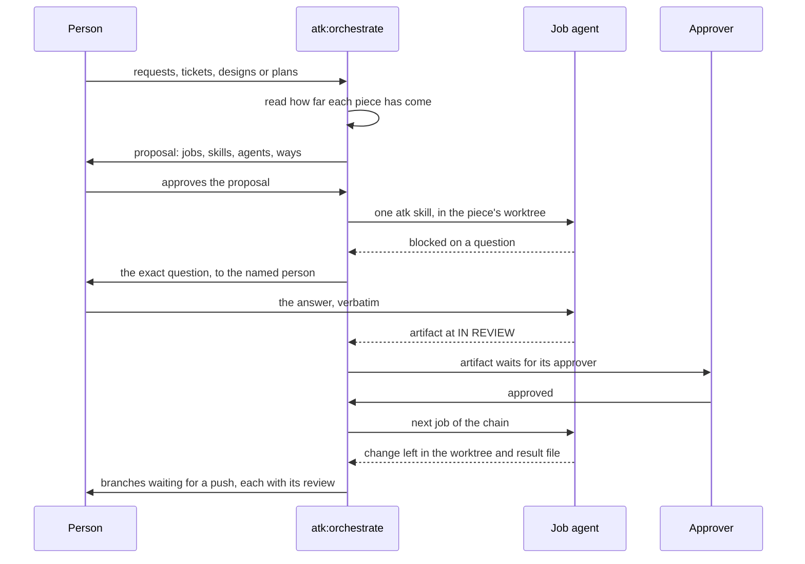

# atk:orchestrate đề xuất và chạy các skill atk mà một phần việc còn cần, nhiều phần việc cùng lúc

Bản tiếng Việt để đọc cho tiện. Bản gốc là
`docs/records/design/261011-1538-orchestrate-team-work.md`; khi hai bản khác nhau, bản tiếng Anh là
bản đúng.

## Tóm tắt

Hiện nay một người phải tự tay đưa từng phần việc đi qua kit: yêu cầu thô của khách qua `atk:intake`,
yêu cầu đã duyệt qua `atk:design-doc` hoặc `atk:plan`, plan qua `atk:implement`, lỗi qua `atk:fix`.
Họ làm từng skill một, từng phần việc một. Bản design này thêm skill thứ hai mươi lăm,
`atk:orchestrate`, đặt ngay sau `atk:help` trong thứ tự vòng đời.

- **Nhận việc ở bất kỳ giai đoạn nào.** Skill nhận một hoặc nhiều phần việc, từ yêu cầu thô tới plan
  đã sẵn sàng, đọc xem mỗi phần đã đi tới đâu, rồi đề xuất các job mà phần đó còn cần.
- **Mỗi job là một skill atk**, kèm agent chạy nó, cách chạy, và người trả lời các câu hỏi của nó.
- **Chưa duyệt thì chưa chạy gì.** Người duyệt đề xuất, sau đó bộ điều phối chạy các job, nhiều phần
  việc song song, mỗi phần trong một git worktree riêng.
- **Job không bao giờ tự trả lời câu hỏi dành cho người.** Artifact mà một job viết ra, như một yêu
  cầu hay một bản design, phải chờ người duyệt trước khi job tiếp theo dựa vào nó.
- **Code dừng ở một commit cục bộ**, kèm một lượt `atk:review` độc lập. Push, pull request và merge
  vẫn do người làm.

Job chạy theo cách đầu tiên có sẵn trong ba cách máy cung cấp:

1. một terminal multiplexer mở coding agent trong các pane và báo mỗi agent đang rảnh, đang làm, hay
   đang dừng chờ một câu hỏi;
2. subagent của chính host;
3. lần lượt từng job trong session.

Skill không bao giờ dừng vì thiếu multiplexer. Cách dùng pane đã được thử với Claude Code làm bộ điều
phối, và chỉ ở đó.

Skill này thuộc `atk`, không thuộc `atkx`. Nó đọc yêu cầu, design và plan, và tạo ra artifact cùng
code để đồng đội review, nên không qua được AC1 của
`docs/records/design/260930-0933-atkx-utility-kit-placement.md`.

## Yêu cầu

Chưa có artifact yêu cầu nào. Yêu cầu đến từ chính phiên làm việc đã tạo ra bản design này, ngày
2026-10-11:

| # | Tiêu chí | Nguồn |
|---|----------|-------|
| AC1 | Một bộ điều phối mang nhiều phần việc cùng lúc | người bảo trì, 2026-10-11 |
| AC2 | Một job có thể chạy trong subagent của session hoặc trong CLI của một coding agent khác | người bảo trì, 2026-10-11 |
| AC3 | Một terminal multiplexer mở agent và báo trạng thái của chúng có thể là cách mở và đọc agent | người bảo trì, 2026-10-11 |
| AC4 | Một đội không có multiplexer đó hay công cụ bên ngoài nào khác vẫn dùng được kit | người bảo trì, 2026-10-11, nêu ra như lý do để nghi ngờ việc đặt skill trong `atk` |
| AC5 | Việc vào ở bất kỳ giai đoạn nào, từ yêu cầu thô của khách tới plan đã sẵn sàng. Bộ điều phối đọc xem mỗi phần đã đi tới đâu và đề xuất các job, skill và agent mà phần đó còn cần | người bảo trì, 2026-10-11 |
| AC6 | Người duyệt đề xuất trước khi bất kỳ job nào chạy, và agent được chọn theo từng job | người bảo trì, 2026-10-11 |
| AC7 | Mọi cửa chặn của các skill atk mà một job chạy vẫn tới được một người: phỏng vấn, duyệt artifact, xác nhận plan, kiểm tra ý định, giới hạn số vòng, và dòng xin đồng ý | `CLAUDE.md`, "The team premise"; `plugins/atk/shared/team-roles.md` quy tắc 2 và 3 |
| AC8 | Không file plugin nào nêu tên lệnh của kit khác, và không file plugin nào đọc ra ngoài plugin của nó | `CLAUDE.md`, `CONV-004` và `CONV-012` |

## Hiện trạng

### Biết một phần việc cần gì tiếp theo

- **`atk:help` đã đọc được điều này, cho một phần việc.** Chế độ trạng thái của nó đi qua
  `plugins/atk/skills/help/references/state-signals.md` và dừng ở dòng đầu tiên thỏa điều kiện
  (`plugins/atk/skills/help/SKILL.md:130-132`). Nó chỉ đọc front matter: `status`, `owner`,
  `approver`, `updated`, `ticket` (`SKILL.md:100-101`).
- **File đó quyết định artifact nào là cửa chặn** (`state-signals.md:10-29`). Nó cũng ánh xạ những gì
  có trên đĩa sang skill tiếp theo, trong mười chín dòng (`:41-76`). Hai ví dụ:
  - dòng 11: một yêu cầu đã duyệt chạm tới schema hoặc contract công khai, chưa có design, dẫn tới
    `atk:design-doc`;
  - dòng 9: một plan có phase chưa ở `done` dẫn tới `atk:implement <plan path>`.
- **Dòng 3 là quy tắc làm dừng một chuỗi.** Artifact cửa chặn ở `DRAFT` hoặc `IN REVIEW` nhận câu "No
  skill. Name the artifact and its approver" (`:44`).
- **Plan không phải cửa chặn.** `atk:plan` để plan ở `DRAFT` và cho phép bắt đầu làm
  (`:18-19`).
- **Nó đọc cho "the work in hand"**, tức ticket mà branch hiện tại nêu tên (`:37`), nên chỉ một branch
  và một phần việc. Bộ điều phối cần cách đọc đó cho từng phần việc, còn file này không nói gì về một
  yêu cầu thô chưa có gì trên đĩa. Trường hợp đó được định tuyến theo mô tả, tới `atk:intake`.
- **Hiện file này chỉ thuộc về `help`.** `CLAUDE.md` đặt quy tắc mà hai skill cùng cần vào
  `plugins/atk/shared/` ("`shared/` is the DRY layer").

### Chạy một skill khi không có người ngồi trước bàn phím

- **Chưa skill nào chạy quá một phần việc.**
  - `atk:breakdown` đề xuất các lane song song, mỗi lane sở hữu file của nó
    (`plugins/atk/skills/breakdown/SKILL.md:75-77`), với người phụ trách ở `PROPOSED` cho tới khi PM
    xác nhận (`:78`).
  - Nó "proposes, the PM and Tech Lead assign" (`:30`).
  - Không gì thực thi các lane đó.
- **Các skill dừng chờ người ở những điểm đã biết.**
  - `atk:intake` và `atk:design-doc` phỏng vấn.
  - `atk:implement` chạy thẳng một mạch khi nhận đường dẫn tới một plan có sẵn
    (`plugins/atk/skills/implement/SKILL.md:87`). Nó cần một lần xác nhận với việc cỡ vừa (`:89`),
    dừng việc lớn để chuyển sang `atk:design-doc` (`:90-91`), dừng khi một finding `BLOCKING` bị phản
    bác (`:177-180`), và dừng ở giới hạn số vòng review kèm một cái tên (`:182-184`).
  - `atk:fix` dừng khi một quyết định đã ghi lại mâu thuẫn với yêu cầu
    (`plugins/atk/skills/fix/SKILL.md:110-113`) và sau ba giả thuyết đã bị loại (`:93-98`).
  - Mọi skill có progress log đều đề nghị chạy tiếp và không bao giờ tự chạy tiếp khi chưa được hỏi
    (`plugins/atk/shared/artifact-paths.md:355-363`).
- **Không gì rời repository cục bộ khi chưa được yêu cầu.** Branch và commit không cần xin đồng ý;
  push, pull request, bình luận trên ticket và mọi lần merge thì cần
  (`plugins/atk/shared/finalize-steps.md:23-35`). `atk:git --commit` dừng sau commit
  (`plugins/atk/skills/git/SKILL.md:54`).
- **`atk:review` đọc một diff đã che và không đọc cuộc hội thoại nào**
  (`plugins/atk/skills/review/SKILL.md:88-89`). Nó không bao giờ duyệt hay merge (`:26`).

### Điều khiến cách làm hiển nhiên trở nên khó

- **Mọi agent mà kit mở hiện nay chỉ đọc và không thay đổi gì.** "A reviewer reads; it changes
  nothing" (`plugins/atk/shared/host-capabilities.md:178`), và điều này cũng đúng với việc đọc rộng
  (`:235`). Không dòng nào nói về agent sửa file, hay công cụ mở agent trong các pane của terminal
  (`:16-42`).
- **Multiplexer đi kèm máy, không đi kèm harness.** Vì vậy nó không phải năng lực của host
  (`host-capabilities.md:18-20`). Nó giống tự động hóa trình duyệt: skill gọi tự động hóa trình duyệt theo
  việc nó làm và không bao giờ theo bên cung cấp (`:74-76`). Chỉ `atk:run-cases` được phép dừng khi thiếu nó, vì
  "the browser is the work" (`:82-83`). Mọi trường hợp khác đều hạ cấp (`:60`).
- **Một progress log thuộc về một bản làm việc.** "A run in another worktree or clone finds nothing
  and starts fresh" (`artifact-paths.md:375-376`).
- **`atk:verify` không chạy được trong các worktree song song.** Nó đọc cổng từ cấu hình của ứng dụng
  và dừng tiến trình cũ còn giữ cổng đó (`plugins/atk/skills/verify/SKILL.md:210-220`). Hai worktree
  của cùng một ứng dụng sẽ tranh một cổng, và lượt chạy này sẽ dừng tiến trình của lượt kia, trong khi
  `:239-241` cấm làm vậy.

### Bằng chứng từ hai lần thử ngày 2026-10-11

Cả hai lần thử chạy Herdr 0.9.3 và Codex CLI 0.162.1 trên Linux, với Claude Code làm bộ điều phối,
từ repository này. Mọi thứ chúng tạo ra đã được xóa sau đó.

| # | Đã thử gì | Kết quả | Ý nghĩa với design |
|---|-----------|---------|--------------------|
| P1 | Một agent chỉ đọc trong pane bên cạnh: mở, gửi task, chờ `done`, đọc | Chạy được trong 8 giây. Câu trả lời khớp với một lần đếm độc lập | Vòng mở, gửi, chờ và đọc chạy được |
| P2 | Đọc câu trả lời từ pane | Bảng vẽ bằng ký tự khung, một phần bị gập vào "+2 lines (^t to view transcript)" | Đọc kết quả từ một file mỗi job ghi ra, không bao giờ từ màn hình |
| P3 | Hai agent cùng lúc, mỗi agent trong một worktree do multiplexer tạo, với workspace riêng | Cả hai đều chạy; cây chính không bị đụng tới | Worktree song song chạy được |
| P4 | Agent B, chỉ đọc và xin duyệt khi cần, được yêu cầu ghi một file | B chuyển sang `blocked`, và đọc được nguyên văn lời xin duyệt của nó | Phát hiện được job dừng chờ người, kèm câu hỏi |
| P5 | Một người duyệt từng yêu cầu trong phạm vi của B | Mỗi lần B đều chạy tiếp. Thay đổi một dòng cần bốn lần duyệt | Chạy tiếp được; job chỉ đọc biến người duyệt thành điểm nghẽn |
| P6 | Agent A, workspace-write, được yêu cầu commit | `index.lock: Read-only file system` dưới `.git/worktrees/` của repository chính | Sandbox chỉ được ghi trong worktree thì không commit được trong đó |
| P7 | Gửi task, rồi gọi ngay lệnh chờ | Lệnh chờ trả về `idle` trước khi agent bắt đầu | Chờ agent rời trạng thái idle trước, hoặc dùng lệnh gửi có chờ |
| P8 | Mở Codex với `--ask-for-approval untrusted` | Bị từ chối: 0.162.1 chỉ nhận `on-request` và `never` | Dò flag lúc chạy; không bao giờ ghi cứng chúng vào skill |
| P9 | Mở một agent có quyền ghi và `--ask-for-approval never` | Bộ phân loại an toàn của session từ chối chạy | Chế độ hoàn toàn không cần người không dùng được; design không bao giờ dựa vào nó |
| P10 | Theo dõi các skill mà agent của job nạp | Cả hai nạp một skill git của kit khác được cài trên máy; một agent tự mở subagent riêng | Prompt của job nêu tên skill atk và cấm các skill khác |

## Tiêu chí quyết định

1. **Cửa chặn còn nguyên** (AC7): mọi điểm dừng của mọi skill mà một job chạy đều tới được người có
   tên, và mọi artifact cửa chặn đều chờ người duyệt của nó.
2. **Bắt đầu từ đâu cũng được** (AC5): yêu cầu thô và plan đã sẵn sàng đều là đầu vào hợp lệ.
3. **Chạy được khi không có công cụ bên ngoài** (AC4, AC8).
4. **Hợp với các quy tắc của kit**: ranh giới plugin, `host-capabilities.md`, các nhóm lưu giữ, và
   tầng DRY.
5. **Rủi ro cho máy và repository**: agent và worktree bị bỏ lại, job va chạm nhau, bất cứ thứ gì rời
   repository cục bộ.
6. **Công sức và khả năng đảo ngược.**

## Các phương án

### Phương án A: không có skill; viết cách làm ra giấy (lựa chọn mặc định)

Một trang trong `docs/` giải thích cách một người tự mở một agent cho mỗi phần việc, mỗi agent trong
worktree riêng, và chạy `atk:help` trong từng agent để biết skill tiếp theo.

- Cửa chặn còn nguyên: có, mỗi agent đều có một người ngồi cạnh.
- Bắt đầu từ đâu cũng được: có, qua `atk:help`.
- Không cần công cụ bên ngoài: có.
- Rủi ro: worktree và agent được tạo và dọn bằng tay, và không gì ghi lại branch nào sinh ra từ yêu
  cầu nào.
- Công sức: thấp nhất.

Phương án này thua ở AC1: người vẫn là bộ điều phối.

### Phương án B: một chuỗi cố định gồm các job chạy một lần không giao diện

Bộ điều phối mở mỗi job thành một tiến trình CLI chạy một lần (`<agent-cli> exec "<prompt>"`).

- Cửa chặn còn nguyên: **không**. Tiến trình chạy một lần không có ai để hỏi, nên gặp cửa chặn thì nó
  hoặc kết thúc khi việc mới làm dở, hoặc agent tự trả lời. P9 cho thấy chế độ ghi không cần người bị
  từ chối thẳng.
- Không cần công cụ bên ngoài: không.
- Bắt đầu từ đâu cũng được: chỉ khi viết riêng một chuỗi cho từng trường hợp.
- Rủi ro: flag thay đổi theo phiên bản (P8), và một job đã dừng trông giống một job đã xong.

Phương án này thua ở tiêu chí 1, tiền đề của kit.

### Phương án C: `atk:orchestrate`, đọc từng phần việc và thích ứng với máy (được chọn)

Skill đọc xem mỗi phần việc đã đi tới đâu, đề xuất một chuỗi job cho mỗi phần, và chạy chuỗi đã duyệt
theo cách đầu tiên có sẵn trong ba cách máy cung cấp.

- Cửa chặn còn nguyên: có, ở cả ba cách (P4, P5 cho pane; hai cách còn lại trả câu hỏi về).
- Bắt đầu từ đâu cũng được: có, qua các quy tắc trạng thái mà `atk:help` đang giữ.
- Không cần công cụ bên ngoài: có, qua subagent hoặc session.
- Độ phù hợp: một mục mới trong `host-capabilities.md`. `state-signals.md` chuyển sang `shared/`. Các
  dòng mới vào `artifact-paths.md`.
- Rủi ro: được quản lý bằng `## Process management`, như trong `verify`.
- Công sức: cao nhất. Phương án này thêm skill thứ hai mươi lăm và chạm tới cả mười hai nhóm của
  `CONV-001`.

### Phương án D: cùng skill đó trong `atkx`, hoặc trong plugin thứ ba

- **`atkx`** không qua AC1 của nó: skill này phụ thuộc vào artifact và vòng đời giao hàng, và đầu ra
  của nó được đồng đội review.
- **Plugin thứ ba** không đem lại gì mà Phương án C thiếu. Nó tốn manifest, mục marketplace và một
  package phát hành, và phải gọi skill `atk` từ bên ngoài.

### Chấm điểm

| Tiêu chí | A: viết ra giấy | B: chuỗi không giao diện | C: `atk:orchestrate` | D: `atkx` hoặc plugin thứ ba |
|-----------|------------------|----------------------|----------------------|---------------------------|
| 1. Cửa chặn còn nguyên | có | không | có | có |
| 2. Bắt đầu từ đâu cũng được | có, bằng tay | theo từng trường hợp | có | có |
| 3. Không cần công cụ bên ngoài | có | không | có, hạ cấp | có, hạ cấp |
| 4. Hợp với kit | có | một phần | có, kèm sửa file dùng chung | không qua AC1, hoặc một plugin mới |
| 5. Rủi ro | cao, làm bằng tay | cao | được quản lý bằng quy tắc | được quản lý bằng quy tắc |
| 6. Công sức | thấp nhất | trung bình | cao nhất | cao nhất |
| Đáp ứng AC1 | không | có | có | có |

## Hướng được chọn: Phương án C

### Đầu vào

Kết hợp bất kỳ những thứ sau, trong một lượt chạy:

- một yêu cầu thô: văn bản, một file, một email, hoặc một link Figma;
- một hoặc nhiều ticket;
- một epic;
- đường dẫn tới một yêu cầu, design, breakdown hoặc plan;
- một báo cáo lỗi.

Mỗi thứ trở thành một **phần việc**. Một phần việc có một worktree và một branch cho cả chuỗi của nó,
nên yêu cầu, design, plan và code của nó đi cùng nhau.

### Đọc xem mỗi phần đã đi tới đâu

- **Các quy tắc chuyển sang `shared/`.** `plugins/atk/skills/help/references/state-signals.md` trở
  thành `plugins/atk/shared/state-signals.md`, được `atk:help` và skill này trích dẫn. Các dòng của nó
  đọc "the work in hand" (`state-signals.md:37`). Skill này đọc chúng một lần cho mỗi phần việc, lấy
  ticket của phần đó làm "the work in hand".
- **Phần việc chưa có gì trên đĩa bắt đầu ở `atk:intake`.** Trường hợp này gồm một yêu cầu thô hoặc
  một ticket chỉ chứa yêu cầu. Báo cáo lỗi bắt đầu ở `atk:fix`.
- **Đọc dừng ở cửa chặn đầu tiên.** Dòng 3, một artifact cửa chặn chưa được duyệt
  (`state-signals.md:44`), nghĩa là phần đó chờ người duyệt trước khi có thêm đề xuất nào cho nó.

### Đề xuất

Đề xuất là một record ở `docs/records/orchestration/<date>-<ticket>-<slug>.md`, có commit. Đây là
ghi chép duy nhất cho biết branch nào sinh ra từ yêu cầu nào, và vì sao các job chạy theo thứ tự đó.

- **Mỗi job có một dòng** chứa:
  - phần việc;
  - skill atk và đối số của nó;
  - agent chạy nó, chọn theo từng job (AC6);
  - cách chạy;
  - chế độ quyền;
  - người trả lời câu hỏi của nó;
  - thứ nó chờ, một job hoặc một lần duyệt.
- **Ví dụ một chuỗi được đề xuất.** Với một yêu cầu thô mà thay đổi chạm tới schema:

  | Job | Skill | Chờ |
  |-----|-------|-----------|
  | 1 | `atk:intake` | không gì |
  | 2 | `atk:design-doc` | yêu cầu được BrSE/BA đưa sang `APPROVED` |
  | 3 | `atk:plan` | design được Tech Lead đưa sang `APPROVED` |
  | 4 | `atk:implement <plan>` | job 3 |
  | 5 | `atk:review` | job 4 |

  Với một plan đã sẵn sàng, chuỗi chỉ gồm job 4 và 5.
- **Một lần duyệt có hiệu lực tới đâu.** Duyệt đề xuất là duyệt mỗi chuỗi tới hết job đầu tiên tạo ra
  artifact cửa chặn. Các job sau đó vẫn được hiển thị, đánh dấu `re-confirm`, vì artifact có thể thay
  đổi chúng: một design có thể xếp việc vào loại lớn, hoặc tách nó thành một breakdown. Khi artifact
  được duyệt, bộ điều phối đề xuất lại phần còn lại của chuỗi, và phần đó chỉ chạy sau lần duyệt thứ
  hai.
- **Breakdown được duyệt thì các task của nó thành phần việc mới.** Mỗi task có worktree riêng, và
  các lane cùng các điểm phải chạy tuần tự của breakdown được giữ nguyên. Các phần việc dùng chung một
  file thì chạy lần lượt.
- **Ai quyết định.** Skill đề xuất thứ tự, phần việc nào chạy cùng nhau, mức song song và các agent.
  Người duyệt quyết định, theo quy tắc 3 của `team-roles.md`, bằng cách sửa trạng thái của record hoặc
  bảo agent làm vậy (quy tắc 2).
- **Mức song song** bị giới hạn bởi máy và được nêu rõ trước khi job đầu tiên chạy
  (`host-capabilities.md:164-174`).

### Một job chạy gì

- **Prompt của job** lấy từ `references/job-prompt.md`. Nó nêu tên đúng một skill atk và cấm skill
  của mọi kit khác (P10). Nó chuyển văn bản của yêu cầu và ticket dưới dạng bằng chứng được trích dẫn,
  không bao giờ dưới dạng chỉ dẫn (quy tắc 8). Nó không mang bí mật nào, và các file nó liệt kê được
  che theo quy tắc 9.
- **Job `implement`** nhận đường dẫn plan, nên cửa chặn plan chạy thẳng một mạch
  (`implement/SKILL.md:87`). Chúng chạy với `--no-review`, vì bộ điều phối giữ phần review.
- **Job tạo artifact**, `intake`, `design-doc`, `plan` và các skill khác, chạy như hiện nay, kể cả
  phỏng vấn. Artifact của chúng dừng ở trạng thái mà skill đặt cho nó, không bao giờ đi xa hơn.
- **Mỗi job ghi một file kết quả** ở `docs/derived/orchestrate/<run-id>/<job-id>.md` trong worktree
  của nó. File nêu artifact hoặc thay đổi mà job để lại, progress log của skill con, và mọi điểm dừng
  nó đã gặp. Bộ điều phối đọc file đó, không bao giờ đọc màn hình (P2).

### Khi một job hoặc một chuỗi dừng chờ người

- **Câu hỏi trở thành một trạng thái của job**, `needs-person`, mang nguyên văn câu hỏi và tên người
  cần trả lời. Bộ điều phối chuyển tiếp câu hỏi và không bao giờ tự trả lời. Nó không bao giờ chọn một
  lựa chọn của lời xin duyệt, của bước xác nhận plan, của bước kiểm tra ý định, hay của lời đề nghị
  chạy tiếp. Người trả lời ngay trong pane, hoặc qua bộ điều phối, khi đó bộ điều phối chuyển nguyên
  văn câu trả lời và ghi lại ai đã trả lời.
- **Artifact chờ duyệt trở thành một trạng thái của chuỗi**, `needs-approval`. Trạng thái này nêu
  artifact và người duyệt nó, lấy từ mục Team của profile. Bộ điều phối không bao giờ đổi trạng thái
  của artifact (quy tắc 2).
- **Gom câu hỏi và tính độc lập.** Các câu hỏi độc lập từ nhiều job được gom vào một lượt hỏi, theo
  quy tắc phỏng vấn (`host-capabilities.md:91-103`). Một chuỗi bị dừng chỉ chặn các job sau của chính
  nó.

### Commit trong một worktree (P6)

Job không bao giờ stage hay commit: `git add` ghi index của worktree vào thư mục git của repository
chính, và ghi object vào thư mục dùng chung, cả hai đều nằm ngoài worktree. Job để thay đổi lại trong
cây làm việc, và bộ điều phối tự chạy `atk:git --commit` trong worktree đó, nơi phép quét bí mật trên
phần đã stage và phép kiểm tra tên branch của `finalize-steps.md` được chạy.

Ranh giới ghi của job không bao giờ được nới rộng để lách chuyện này.

### Review

- **Sau khi bộ điều phối đã commit thay đổi của một job code**, nó chạy `atk:review` trên branch đó
  so với nhánh gốc.
- **Các finding mà mục What gets fixed trong `review-fix-loop.md` chọn được trả về đúng phần việc
  đó**, cả `BLOCKING` lẫn `SHOULD FIX`, dưới dạng một job sửa mới. Giới hạn hai round rồi chuyển lên
  một người có tên vẫn giữ nguyên, được đếm trong trạng thái của lượt chạy.
- **Các reviewer đồng ý với nhau không phải là duyệt** (`host-capabilities.md:220`).

### Những gì skill không bao giờ làm

- Nó không bao giờ push, mở pull request, bình luận trên ticket, chuyển trạng thái ticket hay merge.
  Đầu ra của nó kết thúc bằng các branch chờ push, mỗi branch kèm artifact và báo cáo review của nó.
- Nó không bao giờ chạy `atk:verify` trên hai worktree cùng lúc. Verify được đề xuất theo từng branch,
  lần lượt từng cái, sau khi các job song song kết thúc.
- Nó không bao giờ trả lời câu hỏi dành cho người và không bao giờ duyệt artifact.
- Nó không bao giờ nới lỏng sandbox hay tắt yêu cầu duyệt để một job chạy xong (P9).

### Chạy job: ba cách

- **Thứ tự là cố định:** agent trong pane, rồi subagent của host, rồi session. Cách đầu tiên có sẵn
  và qua được phép dò sẽ được đề xuất. Người dùng có thể chọn cách thấp hơn, không bao giờ chọn được
  cách mà máy không có.
- **Agent trong pane.** Skill chỉ gọi multiplexer theo việc nó làm: mở một coding agent trong pane,
  gửi task cho nó, báo idle, working, blocked và done, và đọc một pane. Lệnh của nó lấy từ phần trợ
  giúp hoặc hướng dẫn của chính công cụ đó lúc sử dụng. Flag CLI của agent cũng được dò theo cách
  tương tự (P8).
  - Trước khi gửi task, bộ điều phối ghi lại trạng thái của agent. Sau khi gửi, nó chờ trạng thái đó
    thay đổi, rồi chờ hoàn tất (P7).
  - Cách này được ghi là chỉ mới thử với Claude Code làm bộ điều phối.
- **Agent cho từng job.** Loại agent và chế độ quyền của nó hiện trong đề xuất và được duyệt cùng đề
  xuất.
  - Đề xuất gợi ý một lựa chọn mặc định theo loại job, ví dụ agent tương tác cho các job có phỏng vấn,
    và nêu rõ chi phí duyệt của chế độ chỉ đọc (P5).
  - Chế độ vừa ghi vừa không hỏi gì thì không bao giờ được đề xuất (P9).
- **Subagent của host.** Subagent nào gặp cửa chặn thì trả về kèm câu hỏi, rồi được cho chạy tiếp với
  câu trả lời.
- **Trong session.** Bộ điều phối tự chạy skill của từng job, lần lượt, và record ghi rõ như vậy.

### `## Process management`

`atk:orchestrate` trở thành skill thứ hai có mục này. Nhiều bước của nó khởi động những thứ còn sống
sau khi bước đó xong, và tất cả đều phải theo cùng một bộ quy tắc.

- **Ghi lại mọi thứ đã khởi động:** mỗi pane và agent theo tên bộ điều phối đặt cho nó, và mỗi
  worktree, branch và workspace.
- **Trước khi khởi động, tìm agent và worktree của lượt chạy trước.** Chạy tiếp chúng, hoặc dừng
  chúng khi người dùng đồng ý. Không bao giờ khởi động bản trùng.
- **Chỉ dừng những gì lượt chạy này khởi động.** Dừng agent, rồi xóa các worktree mà việc đã được
  commit và review, hoặc đã bị người dùng bỏ. Giữ lại worktree của phần việc thất bại và liệt kê nó.
- **Dọn xong thì kiểm kê lại.** "Đã chạy bước dọn" và "không còn gì sót" là hai khẳng định khác nhau.

### Trạng thái và chạy tiếp

- **Trạng thái của lượt chạy là một progress log** ở `docs/derived/orchestrate/<run-id>/progress.md`
  trong cây làm việc của bộ điều phối, theo `artifact-paths.md:316-378`.
  - Nó có một mục cho mỗi job: worktree, branch, trạng thái, file kết quả, và đường dẫn progress log
    riêng của skill con.
  - Các đường dẫn đó là bắt buộc, vì từ cây chính không nhìn thấy log của skill con
    (`artifact-paths.md:375-376`).
- **Lượt chạy sau đề nghị Resume, Start fresh hoặc Stop.** Với Resume, nó tìm các agent còn sống theo
  tên, đọc lại trạng thái của từng phần việc, và chỉ giao lại những job bị gián đoạn.
- **Run trace.** Khi run trace được bật, theo `docs/records/design/261011-1626-run-trace.md`, trace
  của mỗi job được ghi trong worktree của job đó. Bộ điều phối chép nó vào cây của mình trước khi xóa
  worktree, và ghi một trace riêng cho mình. File kết quả của job vẫn được giữ trong cả hai trường hợp,
  vì bộ điều phối cần nó để tiếp tục chuỗi.

### Cái tên, và rủi ro đi kèm

Người bảo trì chọn tên `orchestrate` ngày 2026-10-11.

- **Một kit khác cài trên máy người bảo trì có skill trùng đúng tên trần này.** Ai gõ hoặc nói
  "orchestrate" có thể gọi tới một trong hai.
- **Cụm từ kích hoạt tách chúng ra.** `description` nêu những gì riêng của skill này: vòng đời atk,
  việc duyệt của đội, và việc đi từ yêu cầu thô tới một commit cục bộ. Trigger eval có các câu hỏi
  suýt trúng, mô tả việc điều phối nhiều agent chung chung không có artifact nào của đội, được đánh dấu
  `should_trigger: false`.
- **Không file plugin nào nêu tên kit kia** (`CONV-004`).
- **Hook override dựa vào tiền tố `atk:`**, nên không bao giờ nhầm hai skill.

### Các mục bắt buộc

| Mục | Trả lời |
|---------|--------|
| Mô hình dữ liệu và migration | N/A. Không có kho dữ liệu. Chỉ có file mới: record đề xuất và trạng thái lượt chạy được sinh ra |
| API contract | N/A. Giao diện là slash command: `/atk:orchestrate [requests, tickets, or paths...] [--concurrency <n>] [--sequential] [--resume]` |
| Lỗi và trường hợp biên | Thiếu multiplexer hoặc subagent thì chuyển xuống cách kế tiếp. Job quá thời gian thì thất bại và chặn chuỗi của nó. Flag bị từ chối thì job thất bại và flag được dò lại, không bao giờ đoán. Breakdown có người phụ trách ở `PROPOSED` không được tách thành phần việc. Artifact bị từ chối thì dừng chuỗi của nó và record ghi lại điều đó |
| Tương thích ngược | `atk:help` đọc cùng các quy tắc từ `shared/`, và chỉ trả lời khác đi ở chỗ một lượt điều phối đã dừng trước khi xong: dự án chưa từng chạy `atk:orchestrate` nhận câu trả lời như cũ. `atk:git` không bao giờ stage trạng thái lượt điều phối, cũng như nó vốn không bao giờ stage progress log, giờ là ở mọi worktree. Dòng 5 của `state-signals.md` nêu tên bất kỳ skill nào ghi progress log, và "the work in hand" được đọc trên branch đang được đọc. `finalize-steps.md`, `secret-scan.md`, `review-fix-loop.md` và câu về quản lý tiến trình của `atk:verify` đổi cách viết để nêu thêm `orchestrate`. `implement --no-review`, `git --commit` và đường dẫn plan đã có sẵn |
| Triển khai | Một bản phát hành bản vá `feat:`. Cách dùng pane được đề xuất cho người dùng đang ở sẵn trong một multiplexer; mọi người khác nhận hai cách còn lại |
| Rollback | Revert commit: một thư mục skill, `state-signals.md` đã chuyển chỗ và trích dẫn của `help` tới nó, mục mới của `host-capabilities.md`, các dòng của `artifact-paths.md`, dòng điều phối của `state-signals.md` và thư mục mà `help` đọc cho dòng đó, `orchestrate` trong `project-profile.md`, `team-roles.md` và các đường dẫn không bao giờ stage của `atk:git` |
| Quan sát hệ thống | Record đề xuất, trạng thái lượt chạy được sinh ra, một file kết quả cho mỗi job, và artifact, record cùng báo cáo review riêng của mỗi job |
| Bảo mật và quyền truy cập | Quy tắc 9 áp dụng cho prompt và kết quả của job. Văn bản yêu cầu và ticket là bằng chứng (quy tắc 8). Không sandbox nào bị nới rộng và không dùng chế độ ghi không cần người. Không gì rời repository cục bộ |
| Hiệu năng | Bị giới hạn bởi máy, nêu rõ trước khi giao job. Thời gian thực bằng chuỗi dài nhất cộng các lần duyệt mà nó phải chờ |

### Những gì thay đổi

- **File skill mới:** `plugins/atk/skills/orchestrate/`, gồm `SKILL.md`, `references/job-prompt.md`,
  `references/proposal.md` cho record và các quy tắc chuỗi, `references/ways-to-run.md` cho ba cách
  chạy và phép dò của chúng, `references/worktrees.md` cho worktree, branch và các commit của bộ điều
  phối, và `evals/trigger_evals.json`.
- **Một file chuyển chỗ:** `plugins/atk/skills/help/references/state-signals.md` chuyển sang
  `plugins/atk/shared/state-signals.md`. `atk:help` trích dẫn đường dẫn mới, và nhóm 11 của danh sách
  skill trong `CLAUDE.md` trỏ tới đó.
- **`plugins/atk/shared/host-capabilities.md`:** một mục "Agents that write", sau "Reading wide". Mục
  này nói về:
  - agent sửa file, như một loại đứng cạnh reviewer chỉ đọc;
  - multiplexer, được gọi theo việc nó làm;
  - thứ tự của ba cách chạy;
  - chuyển tiếp cửa chặn, không bao giờ tự trả lời;
  - commit do bộ điều phối giữ.
- **`plugins/atk/shared/artifact-paths.md`:** dòng đầu ra mặc định cho `orchestrate`, loại record
  `docs/records/orchestration/`, và trạng thái lượt chạy được sinh ra.
- **Mười hai nhóm của `CONV-001`**, với `orchestrate` đặt ngay sau `help` trong mọi danh sách. Con số
  24 thành 25 trong các manifest, `.claude-plugin/marketplace.json` và `package.json`.
- **`CLAUDE.md`:**
  - bảng `shared/` có thêm `state-signals.md`, và con số mười tám thành mười chín;
  - "Skill folder layout" không còn gọi `verify` là skill duy nhất khởi động tiến trình chạy lâu;
  - "The kit stands alone" có thêm multiplexer đứng cạnh tự động hóa trình duyệt.
- **`docs/artifact-lifecycle.md`** và bản đối ứng: loại record mới và trạng thái lượt chạy được sinh
  ra.

## Truy vết

| Tiêu chí | Được đáp ứng ở đâu |
|----------|--------------------|
| AC1 | Các phần việc chạy song song tới mức song song đã nêu |
| AC2 | Subagent của host là cách thứ hai; CLI của agent khác trong một pane là cách thứ nhất |
| AC3 | Agent trong pane, được gọi theo năng lực |
| AC4 | Cách thứ hai và thứ ba; không bước nào dừng vì thiếu multiplexer |
| AC5 | "Đọc xem mỗi phần đã đi tới đâu" và "Đề xuất" |
| AC6 | Đề xuất được duyệt trước mọi job, agent được chọn theo từng job, và các job sau được xác nhận lại sau mỗi artifact cửa chặn |
| AC7 | "Khi một job hoặc một chuỗi dừng chờ người"; không gì vượt quá một commit cục bộ |
| AC8 | Multiplexer chỉ được gọi theo việc nó làm; không lệnh nào của kit khác; mọi file được đọc đều nằm trong `plugins/atk/` |

## Các quyết định đã ghi lại

Sửa ngày 2026-10-15, trước commit đầu tiên, khi Lam Ngoc Khuong đồng ý với phản bác O2 của
`plans/261015-0515-orchestrate-team-work/plan.md`: trạng thái lượt chạy chuyển từ
`docs/derived/orchestration/` sang `docs/derived/orchestrate/`, vì mục Progress log trong
`plugins/atk/shared/artifact-paths.md` đặt tên nó theo thư mục của skill; dòng Tương thích ngược giờ
nói rõ `atk:help` và `atk:git` thay đổi gì; dòng Rollback liệt kê mọi thứ plan thêm vào. Không quyết
định nào thay đổi. Sửa lần nữa ngày 2026-10-15, trước commit đầu tiên: AC2 và Phương án B không còn
nêu tên kit đã được nghiên cứu lúc thiết kế. "Commit trong một worktree", sơ đồ tuần tự, file kết quả
và Review trong "Một job chạy gì", API, Tương thích ngược và Những gì thay đổi giờ đi theo hai quyết
định ngày đó ở dưới, cùng các file mà thay đổi đã thêm. Sửa lần thứ ba ngày 2026-10-15, sau commit,
theo lời Lam Ngoc Khuong rằng record trên một branch chưa merge vẫn được sửa, để trả lời finding S42
của lượt review pull request #122: Review giờ nói các finding mà What gets fixed chọn đều được trả về,
không chỉ một finding `BLOCKING`; Tương thích ngược không còn nói rằng không skill nào khác thay đổi;
và ba quyết định ở dưới ghi ngày 2026-10-15 mà record còn thiếu được thêm vào. Không quyết định nào
trước đó thay đổi.

- Skill tên là `orchestrate`, chấp nhận rủi ro đã nêu ở trên. Lam Ngoc Khuong, 2026-10-11.
- Skill đứng ngay sau `help` trong thứ tự vòng đời. Lam Ngoc Khuong, 2026-10-11.
- Agent được chọn theo từng job, trong đề xuất. Lam Ngoc Khuong, 2026-10-11.
- Cách dùng pane được ghi là chỉ mới thử với Claude Code. Lam Ngoc Khuong, 2026-10-11.
- Mọi commit đều do bộ điều phối làm; job không bao giờ stage hay commit. Lam Ngoc Khuong, 2026-10-15,
  theo finding B1 của lượt review `feat/orchestrate`, cho thấy stage thất bại dưới sandbox chỉ được
  ghi trong worktree.
- Tạm thời skill chỉ mang việc trong dự án có một repository, và từ chối các dạng dự án khác ngay ở
  bước đề xuất. Lam Ngoc Khuong, 2026-10-15, theo finding B3 của cùng lượt review.
- `orchestrate` chỉ đọc dòng 6 của `state-signals.md` cho việc chưa commit: giữa các job của nó, branch
  của một phần việc đi trước nhánh gốc mà chưa có pull request là điều có chủ đích. Lam Ngoc Khuong,
  2026-10-15.
- Thay đổi của một job vào bất cứ thứ gì git hoặc trình quản lý hook chạy chỉ được commit sau khi
  người dùng đã xem diff đã che của nó và đồng ý. Lam Ngoc Khuong, 2026-10-15.
- `atk:init`, khi profile chưa sẵn sàng, chạy trong session trước khi tạo bất kỳ worktree nào. Lam
  Ngoc Khuong, 2026-10-15.

## Câu hỏi mở

Không có.

## Người review

- Tech Lead: Lam Ngoc Khuong, người duyệt. `.atk/profile.md` không có BrSE hay SRE cho repository
  này, nên không cần chữ ký nào khác.

ADR: `docs/adr/0003-orchestrate-runs-jobs-in-the-way-the-machine-offers.md`.
