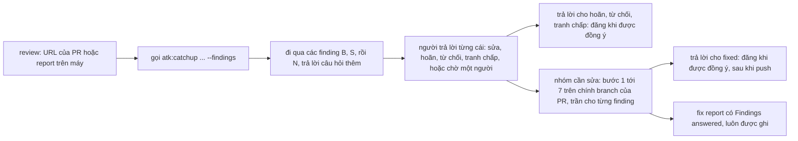

# Finding của một review được giải thích từ repository, và được người viết trả lời lần lượt từng cái

Bản tiếng Việt để đọc cho tiện. Bản gốc là `docs/records/design/261023-1609-review-findings-explained-and-answered.md`; khi hai bản khác nhau, bản
tiếng Anh là bản đúng.

## Tóm tắt

Ngày 2026-10-22, `atk:review` đăng 35 finding lên pull request của một dự án khách hàng: 3 `BLOCKING`,
14 `SHOULD FIX`, 18 `NIT`. Khi kiểm lại, cả ba finding `BLOCKING` đều đúng. Hôm sau, người viết pull
request mở một phiên `atk:fix` và viết rằng mình không hiểu các vấn đề, nhờ giải thích từng cái. Sau mười bốn
lượt hỏi đáp, mọi finding đều đã được hiểu, và sau đó mỗi finding được quyết trong một hoặc hai lượt.
Có bốn kiểu câu trả lời giúp người đó hiểu được các finding:

- một kịch bản có nhân vật và trạng thái được gọi tên;
- vấn đề có xảy ra trong thực tế không, điều này cần tới đặc tả nghiệp vụ và pipeline deploy;
- vì sao code lại được viết như vậy, điều này cần tới một quyết định được ghi trong plan;
- cách sửa được đề xuất thật ra tốn bao nhiêu. Hai lần, con số này khác với dòng `Fix` của finding
  sau khi đọc code.

Phiên đó còn tự tay giữ một file quyết định, nằm ngoài mọi path của kit.

Kit đã có một công cụ giải thích, là chế độ tài liệu của `atk:catchup`. Nó sẽ giúp được rất ít, vì hai
lý do. Quy tắc trung thành với nguồn của nó chỉ cho phép đúng lời của review xuất hiện trên trang, nên
cả bốn câu trả lời trên đều sẽ quay về thành "the document does not say". Và nó không đọc được một
review chỉ có trên pull request. `atk:fix` cũng không có đường nào: skill này nhận một lỗi, không nhận
35 finding mà finding nào cũng cần một quyết định.

Bản design này đưa ra ba quyết định.

1. Với review report, chế độ tài liệu thêm cho mỗi finding một lớp có nhãn, **What the repository
   says**. Lớp này được đọc từ những gì finding trích và từ một danh sách cố định các chỗ cách đó một
   bước, và dòng nào cũng mang trích dẫn của riêng nó. Trang vẫn không thêm finding, mức độ hay phán
   quyết nào. Quyết định này thay một dòng của ADR 0007.
2. `/atk:catchup <pr-url> --findings` giải thích review `atk:review` đã đăng trên một pull request,
   đọc bằng chính các lệnh mà `atk:review` vẫn dùng để đọc luồng bình luận. `<pr-url>` không kèm cờ vẫn là
   brief về diff.
3. `/atk:fix <pr-url | review report> --findings` là bước phân loại. Nó cùng người viết đi qua từng
   finding đã được giải thích, mỗi lần một cái. Nó ghi mỗi câu trả lời bằng một trong bốn loại mà
   `atk:review` vốn đọc lại (fixed, deferred, declined, disputed), soạn nháp câu trả lời cho từng
   luồng bình luận và đăng khi được đồng ý, rồi chuyển các finding được đánh dấu "sửa" sang các bước 1 tới 7
   hiện có. Không thêm loại artifact mới nào: các quyết định nằm trong progress log khi lần chạy còn
   diễn ra, trong fix report khi nó kết thúc, và trên luồng bình luận của pull request, nơi review sau đọc
   chúng.

Lam Ngoc Khuong là người quyết định, và đã trả lời ba câu hỏi mở ngày 2026-10-24. Lớp này chỉ dành cho
review report, không dành cho security record. Danh sách nguồn của nó có thêm định nghĩa cách các dòng
được trích một bước. "Skip" được ghi là `declined`, còn "wait" được ghi là `deferred`, với chỗ hoãn tới
là người và câu hỏi. Một lượt challenge ngày 2026-10-24 đưa ra mười hai phản bác. Mười một phản bác làm thay đổi design, trong đó có:
bước phân loại commit lên chính branch của pull request được review, câu trả lời `fixed` chờ tới khi
push, một bản tóm tắt đã đăng chỉ được tính khi người viết nó là người đã biết, và finding về credential
không có lớp này cũng không có câu trả lời. Phản bác thứ mười hai, về việc câu trả lời "wait" sống sót
qua review sau ra sao, được Lam Ngoc Khuong quyết ngay trong ngày: nó được đăng dưới dạng `deferred`.

## Yêu cầu

Chưa có artifact yêu cầu. Các tiêu chí lấy từ mục "What the team expected" và "Proposed change" của hai
feedback record viết ngày 2026-10-23, `docs/derived/feedback/catchup-261023.md`
(B) và `docs/derived/feedback/fix-261023.md` (C). Hai record này nằm trên máy và là bản dẫn xuất.
Record thứ ba của bộ, `review-261023.md` (A), đã có plan trong `plans/261023-1053-review-explain-triage/`,
và giai đoạn 1 của plan đó không cần quyết định nào. Dòng `--comment` của nó chờ quyết định 2 ở đây.

| # | Tiêu chí | Nguồn |
|---|-----------|--------|
| AC1 | Mỗi finding có một kịch bản cụ thể, nhân vật và trạng thái được gọi tên | B, finding 1 |
| AC2 | Mỗi finding nói nó có xảy ra trong thực tế không, kèm trích dẫn nguồn của nhận định đó | B, finding 1 |
| AC3 | Mỗi finding nói vì sao code lại như vậy, ở chỗ có một quyết định được ghi lại giải thích điều đó | B, finding 1 |
| AC4 | Mỗi finding nêu chi phí của cách sửa được đề xuất theo những gì code cho thấy, và được đánh dấu khi chi phí đó khác với `Fix` của report | B, finding 1 |
| AC5 | Trang vẫn không thêm finding, mức độ hay phán quyết nào; mỗi nhận định thêm vào mang trích dẫn riêng, và ghi "the repository does not say" ở chỗ repository không nói | B, Proposed change |
| AC6 | Mô hình nghiệp vụ mà mọi finding ngầm định được giải thích một lần, trước các finding | B, Proposed change |
| AC7 | Người có pull request nhưng không có working tree của reviewer vẫn giải thích được một review đã đăng trên pull request, trong khi `/atk:catchup <pr-url>` vẫn là brief về diff | B, finding 2 |
| AC8 | Một mode nhận một review, đã đăng hay nằm trên máy, và đi qua từng finding một kèm phần giải thích dễ hiểu | C, finding 1 |
| AC9 | Mỗi finding có một quyết định được ghi lại, sửa, bỏ qua kèm lý do, hoặc chờ một người được nêu tên, và mỗi quyết định là một dòng `gate` | C, finding 1 |
| AC10 | Mỗi comment review có một câu trả lời được soạn nháp, và chỉ được đăng khi được đồng ý | C, finding 1 |
| AC11 | Các finding được đánh dấu "sửa" đi vào các bước 1 tới 7 như lỗi của lần chạy này, trần giả thuyết được đếm riêng cho từng finding | C, finding 1 |
| AC12 | Các quyết định có dạng cố định và một path của kit, thay cho file làm tay | C, finding 1 |
| AC13 | Khi nhận một pull request có mang review, skill nói ra điều đó và đề nghị chạy bước phân loại | C, finding 2 |

Finding 3 của C không yêu cầu thay đổi gì. AC9 nói "skip" và "wait". Design này quy chúng về những câu
trả lời mà `atk:review` vốn đọc được: từ chối, và một lần hoãn có chỗ hoãn tới là người và câu hỏi.
Quyết định 3 giải thích lý do.

## Hiện trạng

**Công cụ giải thích.** Chế độ tài liệu của `atk:catchup` được quyết trong
`docs/adr/0007-plain-explanation-of-a-document-is-a-catchup-mode.md` và đặc tả trong
`plugins/atk/skills/catchup/references/document-explainer.md`.

- Loại `review-report` chỉ được nhận ra dưới `derived/reviews/` (`:41`). Nó đọc "severity
  section, File, Issue, Fix, Author".
- Một khối finding có bảy trường: chuyện gì xảy ra, ai, ví dụ đời thường, hậu quả, điều kiện, cách
  sửa, đã kiểm chứng chưa (`:108-114`).
- Quy tắc Fidelity là "Every claim on the page is traceable to a place in the document ... 'the
  document does not say'" (`:131-133`). ADR 0007 nói điều tương tự trong phần Decision: "Every claim
  traces to a place in the document."
- Bước 3 ghi "Document mode traces no code" (`plugins/atk/skills/catchup/SKILL.md:162`).
- URL có path chứa `/pull/` là pull request mode, không có phép thử nào khác (`:96`).
- `SKILL.md` dài 279 dòng.

**Review đã đăng vốn đã đọc được bằng máy.** `atk:review` đọc luồng bình luận của pull request như một report
trước đó (`plugins/atk/skills/review/references/report-format.md:44-58`):

- Bản tóm tắt là comment mới nhất mở đầu bằng `atk:review`.
- Khối `
` của nó liệt kê mọi finding theo ID, tiêu đề và `file:line` (`:341-349`).
- Mỗi comment gắn vào dòng code mở đầu bằng ID của nó (`:327`).

Cũng lần đọc đó gom câu trả lời của người viết theo bốn loại: "fixed, deferred to a place it names,
declined with a reason, or disputed" (`:61-63`). Nó ghi các câu trả lời vào dòng `Author` của từng
finding, và bản tóm tắt đăng lần sau trả lời chúng công khai (`:331-339`). Các lệnh đọc luồng bình luận và trả
lời trong luồng bình luận nằm ở `plugins/atk/shared/ticket-adapters.md:186-195`. Finding về credential được đăng
không kèm vị trí (`report-format.md:351-356`).

**Công cụ sửa.** `atk:fix` nhận một issue, một path tới report hoặc một đoạn mô tả
(`plugins/atk/skills/fix/SKILL.md:49-58`). Workflow của nó được dựng quanh một lỗi:

- Bước 1 chứng minh nguyên nhân (`:89`).
- Bước 2 dừng lại khi một quyết định đã ghi mâu thuẫn với yêu cầu, và trình ra quyết định, mối lo,
  sự đánh đổi và hai tới bốn phương án (`:114-125`). AC3 cũng đòi đúng như vậy.
- Trần là ba giả thuyết.
- Nó ghi progress log tại `docs/derived/fix/<run-id>/progress.md`
  (`plugins/atk/shared/artifact-paths.md:150`, `:357-400`).
- Nó ghi một report tại `docs/records/fixes/` từ
  `plugins/atk/skills/fix/references/report-template.md`, với trường `ticket` trong front matter vốn
  đã nhận `<record path>#<ID>` cho một finding (`:19`).

`SKILL.md` dài 293 dòng. `atk:review` gửi người viết sang `atk:fix` để viết lại
(`plugins/atk/skills/review/SKILL.md:26-27`). Cả `fix` lẫn `shared/review-fix-loop.md` đều không nhắc
tới `atk:catchup`.

**Đồng ý.** Comment, issue và push đều phải hỏi mỗi lần
(`plugins/atk/shared/finalize-steps.md:22-37`). Ở đó, trả lời trong một luồng bình luận của pull request chưa
có dòng riêng.

## Các phương án

Ba quyết định, mỗi quyết định chấm theo cùng các tiêu chí:

- đáp ứng tiêu chí nghiệm thu nào;
- thay đổi gì trong một quyết định đã `APPROVED`;
- có giữ tiền đề về team không, tức skill soạn nháp còn người quyết định;
- chi phí: số file phải sửa, trần số dòng của `SKILL.md`, skill thứ 26;
- phạm vi giúp được: ngoài người viết còn ai được lợi.

### Quyết định 1: phần đọc vượt ra ngoài report nằm ở đâu

| | 1A. Giữ trang trong phạm vi report | 1B. Một lớp repository có nhãn trên trang | 1C. Chỉ bước phân loại đọc repository |
|---|---|---|---|
| AC | chỉ AC5 | AC1 tới AC6 | AC1 tới AC6, nhưng chỉ bên trong `atk:fix --findings` |
| Quyết định đã duyệt bị đổi | không | một dòng của ADR 0007, chỉ cho `review-report` | không |
| Tiền đề về team | giữ | giữ: không có finding, mức độ hay phán quyết mới; lớp này được dán nhãn là phần lần chạy tự đọc ra, không phải của reviewer | giữ |
| Chi phí | không | Fidelity và Sections của `document-explainer.md`; một bước 3 có giới hạn trong chế độ tài liệu | phần đọc chuyển vào `fix`, skill này khi đó cũng viết phần giải thích, bên cạnh một trang `catchup` vẫn ghi "the document does not say" |
| Phạm vi giúp được | không ai | bất kỳ ai được đưa report: người viết, PM sắp thứ tự công việc, Tech Lead phân xử một tranh chấp | chỉ người viết chạy fix |

**1A**, phương án mặc định, chính là cách đã thất bại ngày 2026-10-23: câu hỏi của người đọc nhận lại
"the document does not say". **1C** giữ nguyên ADR 0007, nhưng tách phần giải thích làm hai. Fix sẽ
viết phần giải thích có ích, còn catchup viết một bản yếu hơn cho cùng các finding đó. Tech Lead được
nhờ phân xử một finding `BLOCKING` đang bị tranh chấp cũng cần biết "nó có xảy ra trong thực tế không"
không kém gì người viết.

**Chọn: 1B.** Những gì phần đọc được mở là một danh sách, không để ngỏ:

- các dòng mà finding trích;
- một record mà dòng `Decision` của finding nêu tên (`report-format.md`, Decision);
- plan hay design mà thay đổi được review nêu tên trong phần thân pull request hoặc trong branch của
  nó, chỉ khi path đó, sau khi lần theo các liên kết tượng trưng, nằm trong repository và dưới thư mục plan hay
  design mà `shared/artifact-paths.md` xác định; path ở chỗ khác được nêu tên trên trang và không được
  mở, vì phần thân pull request do người mở pull request viết (O10);
- các tài liệu tham chiếu dưới docs root mô tả phần nghiệp vụ do code được trích phục vụ;
- một file cấu hình mà finding nêu tên;
- định nghĩa của những gì các dòng được trích dùng tới, cách một bước và không xa hơn: một bảng, một
  type, một hàm mà chúng gọi. Ngày 2026-10-23, chi phí của cách sửa B1 phụ thuộc vào schema của một
  bảng khoá mà finding không trích. (Thêm vào theo câu trả lời cho câu hỏi mở 2.)

Ngoài ra không mở gì khác, và bảng của `shared/secret-scan.md` vẫn giữ các file credential không bị
đọc ở đây như ở mọi nơi. Mỗi dòng của lớp này được trích dưới dạng `path:line`. Câu hỏi nào danh sách
không giải quyết được thì ghi "the repository does not say", không đoán.

Ba giới hạn giữ cho lớp này đúng và không làm lộ thông tin (O6, O11):

- **Bản sửa đổi.** Lớp này được đọc tại commit mà review đã được thực hiện trên đó: head mà bản tóm
  tắt hay report nêu, nếu không có thì head của pull request lúc lần chạy bắt đầu. Khi bản làm việc đang ở
  commit khác, lần chạy nói đó là commit nào, và hỏi có chuyển sang commit đó không hay cứ tiếp tục. Nếu
  tiếp tục, lớp này được đóng dấu `read at <sha>, not at the reviewed commit`, để một `path:line` rơi
  vào code khác không bị đọc nhầm là của reviewer.
- **Che giá trị.** Mọi thứ lớp này in ra đều được che theo quy tắc của mục Masked values trong
  `document-explainer.md`, tức rule 9 và danh sách trong `skills/qa/references/test-run.md`; quy tắc
  này nay bao cả giá trị của repository lẫn giá trị của tài liệu. Mode `mask` của
  `shared/secret-scan.md` chỉ nhận một git diff nên không che được một trang (đã trả lời trong lúc
  review, xem mục Đã trả lời).
  Lớp này mô tả một giá trị dùng để làm gì, và không bao giờ trích một giá trị cấu hình.
- **Finding về credential không có lớp này.** Finding là một credential trong thay đổi chỉ giữ đúng
  lời của report, để không `path:line` nào của lớp này làm lộ lại vị trí mà luồng bình luận cố tình giấu
  (`report-format.md:351-356`).

Lớp này chỉ dành cho `review-report`. `security-record` không có nó, vì hai lý do. Thứ nhất,
`atk:security` vốn đã kiểm từng finding với code, từ điểm vào tới hậu quả, kèm một phán quyết và một
dòng rủi ro còn lại, nên record tự trả lời câu "nó có xảy ra trong thực tế không". Thứ hai, một kịch
bản có nhân vật và trạng thái được gọi tên, viết cho một lỗ hổng chưa sửa, có thể đi vào chi tiết sâu
hơn chính record, và quy tắc Fidelity "No step-by-step exploit" cấm điều đó. Lần chạy nào sau này cho thấy
cần thì thêm loại đó thành một dòng, theo đúng quy tắc của bảng. (Theo câu trả lời cho câu hỏi mở 1.)

### Quyết định 2: review đã đăng tới được công cụ giải thích bằng cách nào

| | 2A. URL của review là chế độ tài liệu | 2B. Một cờ trên URL của pull request | 2C. Chỉ report trên máy |
|---|---|---|---|
| AC | AC7 trên GitHub | AC7 trên mọi host | không đạt AC7 |
| Nhận diện đầu vào ở bước 1 | cần một ngoại lệ: hiện nay URL chứa `/pull/` là pull request mode trừ khi một anchor nói khác | không cần: URL vẫn là pull request; cờ chọn thứ được đọc | không cần |
| Host | `#pullrequestreview-<id>` là của GitHub; GitLab và Backlog khác | phần đọc là bất cứ thứ gì `ticket-adapters.md` đưa ra cho host đó | n/a |
| Cách gõ | người đọc chép một anchor từ trình duyệt | người đọc gõ URL họ đã có, thêm một từ | người đọc cần file của reviewer |

**Chọn: 2B**, `/atk:catchup <pr-url> --findings`. Lần chạy đọc bản tóm tắt mới nhất mở đầu bằng
`atk:review`, các comment gắn vào dòng code của nó và các câu trả lời của người viết, đúng như cách
`report-format.md:44-64` đọc chúng, rồi giải thích review đó như một `review-report`.

- Bản tóm tắt chỉ được tính khi người viết nó khớp với một người trong phần Team của
  `.atk/profile.md`, theo `Host identifier`, giống cách `report-format.md:66-69` đối chiếu người viết
  một phán quyết. Người viết mà lần chạy không đối chiếu được thì được nêu tên, và người đang chạy
  skill xác nhận bản tóm tắt trước khi bất cứ phần nào của nó được đọc là finding. Không có bước này,
  ai bình luận được trên pull request cũng có thể đăng một bản tóm tắt rồi biến nó thành danh sách cần
  sửa của quyết định 3 (O9).
- Pull request không có bản tóm tắt như vậy thì lần chạy nói là không có, và đề nghị brief về diff.
- Review do một người viết, không phải do `atk:review`, nằm ngoài phạm vi. Các finding của nó không
  có ID để gắn một quyết định vào.
- Finding về credential vẫn không có vị trí trên trang, giống trên luồng bình luận.

Từ `--findings` dùng chung với quyết định 3. `--review` bị loại cho cả hai: trong `atk:plan` và
`atk:qa` nó có nghĩa là "review cái này", ngược hẳn với việc đọc một review.

### Quyết định 3: bước phân loại nằm ở đâu

| | 3A. Một mode của `atk:fix` | 3B. Một mode của `atk:review` | 3C. Một skill riêng |
|---|---|---|---|
| AC | toàn bộ AC8 tới AC13 | AC8 tới AC10, AC12; AC11 dù sao cũng cần chuyển sang `fix` | toàn bộ |
| Hợp vai trò | người viết chạy nó, và `review` vốn đã gửi người viết sang `fix` (`review/SKILL.md:26-27`) | `review` là skill của reviewer: "The reviewer is never the author" (`:32`); trả lời bên trong nó đặt cả hai phía vào một skill | gọn |
| Kết thúc ở đâu | ở các bản sửa, fix report và vòng review mà `fix` đã có | chỉ ở các quyết định; code đi chỗ khác | ở một lần chuyển sang `fix` |
| Chi phí | `fix/SKILL.md` dài 293 dòng so với trần 300 của `CONV-006`: nó nhận hai dòng invocation và một con trỏ tới file mới `references/findings-mode.md`, file này giữ mọi thứ còn lại, và plan tìm chỗ cho các dòng khác bằng cách viết gọn phần chữ hiện có, đo bằng `wc -l` (O8) | `review/SKILL.md` dài 299 dòng | mười hai nhóm của `CONV-001`, con số 25 thành 26 trong mọi manifest |
| Tái sử dụng | bước kiểm tra ý định ở bước 2 chính là việc của AC3; progress log, report, trần giả thuyết đều đã có | phần đọc luồng bình luận đã có | không có; phải trích lại tất cả những thứ trên |

**Chọn: 3A.** `--findings` biến lần chạy thành một bước phân loại, sau đó là workflow thường lệ:

- **Giải thích.** Lần chạy tự gọi `atk:catchup <same input> --findings`, giống như `fix` vốn đã gọi
  `atk:review`, và đi qua trang mà lần gọi đó trả về. Nó không bao giờ tìm một trang do phiên trước
  viết: trang là bản dẫn xuất, nằm ngoài git và không có trên máy khác, và không có gì gắn nó với một
  bản tóm tắt đã đăng cụ thể. Front matter của trang ghi review mà nó giải thích: URL của pull request
  và comment tóm tắt, hoặc path của report, cùng commit đã được review, để một lần chạy tiếp tục phân
  biệt được trang của một review cũ với trang của review này. Phần giải thích vẫn nằm trong một skill,
  và bước đi qua đọc các khối finding của trang theo tên trường mà `document-explainer.md` đặt; plan
  thêm điều này vào danh sách những gì phải kiểm khi file đó thay đổi (O2).
- **Câu hỏi thêm.** Trong lúc đi qua, người đó hỏi về một finding bao nhiêu lần tuỳ ý. Câu trả lời lấy
  từ cùng danh sách nguồn với trang, trong cùng các giới hạn, ngay trong phiên. Câu trả lời nào đáng
  giữ thì được ghi vào mục của finding đó trong progress log (O2).
- **Câu trả lời.** `atk:review` chỉ đọc lại bốn loại câu trả lời của chính nó, nên câu trả lời của
  người đó phải là một trong bốn: sửa ngay, thành "fixed" khi xong; hoãn, tới một chỗ họ nêu tên; từ
  chối, kèm lý do; tranh chấp. Finding mà người đó chưa trả lời được thì được đăng dưới dạng
  `deferred`, chỗ hoãn tới là câu hỏi và người phải trả lời nó: "S1 deferred: waiting on <name> for
  <the question>". Review sau đọc nó là deferred, một trong bốn loại của nó, và giữ tên người trong
  dòng `Author` của finding. Mỗi câu trả lời là một dòng `gate`. Lần chạy đề xuất một câu trả lời kèm
  lý do; người đó quyết định. "Skip" của feedback được ghi là `declined`, còn "wait" được ghi là lần
  hoãn đó, vì một từ nằm ngoài bốn loại sẽ bị review sau đọc thành chưa có câu trả lời, và finding sẽ
  bị nêu lại. (Được xác nhận qua câu trả lời cho câu hỏi mở 3. Cách đăng "wait" được quyết qua câu trả
  lời cho O3: dưới dạng `deferred`, không đổi gì ở `atk:review`.)
- **Các `NIT`** được đưa ra thành một nhóm, nhưng vẫn trả lời riêng từng cái được.
- **Câu trả lời trên luồng bình luận.** Soạn nháp cho từng finding, mở đầu bằng ID của nó, cho luồng bình luận sẵn có
  của finding hoặc, với report trên máy, để gửi cho reviewer. Chỉ đăng khi được đồng ý, và bảng đồng
  ý có thêm dòng "Reply in a pull request thread: yes".
  - **Khi nào.** Câu trả lời cho `deferred`, `declined` hay `disputed` có thể đăng ngay ở bước phân
    loại. Câu trả lời nói `fixed` chỉ được soạn khi bản sửa của finding đó đã được commit, và chỉ được
    đăng sau khi branch đã push, để luồng bình luận không bao giờ nói đã sửa trong khi bản sửa còn kẹt ở trần
    giả thuyết hay đang chờ chuyển lên người khác (O7).
  - **Chứa gì.** Câu trả lời của người đó và lý do, còn repository chỉ được trích bằng path. Không
    trích phần nào của lớp trên trang, vì luồng bình luận có thể được đọc bởi những người mà trang không cho
    xem. Mọi bản nháp đều được che theo cùng quy tắc đó trước khi hiện ra, và từng
    bản được hiện ra trước khi được đồng ý, kể cả nhóm `NIT` (O12).
  - **Finding về credential** không có câu trả lời nào trên luồng bình luận, vì nó không có luồng bình luận nào, và vị trí
    của nó không được lọt lên đó. Người sở hữu giá trị đó được báo trực tiếp, như
    `report-format.md:351-356` nói (O11).
- **Nhóm cần sửa** đi vào bước 1 như các lỗi của lần chạy này. Dòng `Fix` của mỗi finding là một
  nhận định cần kiểm, không bao giờ là một bước để làm theo, theo rule 8 của `shared/team-roles.md`.
  Mỗi finding được chứng minh hay bác bỏ giống một lỗi, bước 3 tự đưa ra thay đổi tối thiểu của nó, và
  trần ba giả thuyết được đếm riêng cho từng finding. Finding mà bước 1 không tái hiện được thì quay
  lại với người đó dưới dạng "not reproduced", và người đó là người trả lời. Bước 6 review toàn bộ thay
  đổi một lần, như hiện nay (O9).
- **Chính branch của pull request.** Các bản sửa thuộc về pull request đang được review. Với
  `--findings`, bước 7 commit lên branch đó, sau khi xác nhận đó là branch đang mở trong bản làm việc. Nó bỏ
  qua quy tắc branch của `finalize-steps.md`, không mở pull request nào, và không bao giờ thay phần
  thân mà người viết đã soạn. Push vẫn phải hỏi như mọi khi. Fix report được commit, và được đề nghị
  đăng thành comment trên pull request nếu được đồng ý. `finalize-steps.md` và bước 7 của `fix` mỗi
  nơi có thêm trường hợp này (O5).
- **Ghi lại.** Mỗi quyết định là một mục trong progress log, để phiên tiếp tục không hỏi lại. Khi kết
  thúc, chúng đi vào fix report, trong một mục mới "Findings answered": ID, câu trả lời, lý do hoặc chỗ
  hoãn tới, đã đăng câu trả lời hay chưa. Dòng của finding về credential không nêu tên file nào. Với
  `--findings`, bước 7 luôn ghi report, kể cả khi không sửa gì, vì một lượt phân loại kết thúc với mọi
  finding bị từ chối, hoãn hoặc đang chờ vẫn là một quyết định mà ai đó cần tìm thấy. Report đó ở
  trạng thái `DRAFT`, không có thay đổi nào (O4, O11). Không có loại artifact mới, không có path mới.

Vì vậy, chỗ ghi record mà feedback hỏi, `docs/records/` hay `docs/derived/`, không phải chỗ nào trong
hai. Một file quyết định riêng đã bị loại vì nó là bản sao thứ tư của những câu trả lời mà luồng bình luận,
progress log và report đã giữ.

Pull request được đưa cho `atk:fix` không kèm cờ, mà có mang một bản tóm tắt `atk:review`, sẽ nhận một
câu hỏi: chạy bước phân loại, hay coi pull request là báo cáo lỗi (AC13).

## Chi tiết cách tiếp cận được chọn

- **Mô hình dữ liệu và migration.** `N/A`: không có schema. Các review report và bản tóm tắt đã đăng
  được đọc nguyên trạng; không gì bị viết lại.
- **Hợp đồng, các cách gọi.**
  - `/atk:catchup <pr-url> --findings` và `/atk:catchup <review-report-path>`, cách sau không đổi gì
    ngoài lớp mới.
  - `/atk:fix <pr-url> --findings` và `/atk:fix <review-report-path> --findings`.
  - Mỗi `argument-hint`, `## Invocation`, `README.md` và cả hai `skills-overview.md` có thêm cờ này,
    theo danh sách cho cờ trong `CLAUDE.md`.
  - `--findings` đi với một đoạn mô tả trơn thì bị từ chối bằng một dòng.
  - Trên `atk:fix`, `--findings` cùng `--investigate-only` dừng sau các câu trả lời và phần chứng minh
    cho nhóm cần sửa.
- **Trang, quyết định 1.** Trong mỗi khối finding của một `review-report`, sau bảy trường, có ba
  trường dưới tiêu đề **What the repository says**:
  - một kịch bản có nhân vật và trạng thái được gọi tên;
  - nó có xảy ra trong thực tế không;
  - vì sao code như vậy.

  Sau đó thêm một trường, **What the fix costs**, đánh dấu `differs from the report` ở chỗ khác. Mục
  Terms trở thành **Terms and the model the findings assume**, mỗi mục có trích dẫn. Phần Fidelity có
  thêm một quy tắc: một dòng của lớp này trích repository, và không bao giờ lấy lời của reviewer làm
  nguồn. Các loại record khác không đổi.
- **Lỗi và trường hợp biên.**
  - File được trích không có ở commit mà lớp này được đọc: ghi là không có ở commit đó. Không bao giờ
    gọi là đã bị xoá, trừ khi `git log` nêu được commit đã xoá nó (O6).
  - Mọi finding đều đã được trả lời: bước phân loại liệt kê chúng và chỉ hỏi về phần còn lại.
  - Một finding được trả lời "sửa" nhưng dòng `Decision` của nó nêu tên một quyết định đã ghi: bước 2
    dừng như hiện nay.
  - Review trên một pull request mà người đó không đọc được: theo kết quả của `ticket-adapters.md`,
    không bao giờ đoán.
  - Pull request có nhiều bản tóm tắt `atk:review`: lấy bản mới nhất, như `report-format.md:48`.
- **Tương thích ngược.** `/atk:catchup <pr-url>` và `/atk:fix <issue-url>` chạy như hiện nay. Trang
  viết trước thay đổi này không có lớp mới và vẫn đọc được. Có một lệnh thay đổi mà không cần cờ:
  `/atk:catchup <review-report-path>` ghi lớp mới kể từ bản phát hành này. Nó đọc nhiều hơn, qua
  agent, và trích repository. Ghi chú phát hành và cả hai `skills-overview.md` nói rõ điều đó, trong đoạn
  về chế độ tài liệu, không chỉ trong danh sách cờ (O1).
- **Triển khai.** Một bản phát hành, qua release-please. Hai mode `--findings` không đổi gì cho tới
  khi được gõ. Lớp mới trên report trên máy thay đổi từ bản phát hành, như trên. Phase 1 của
  `plans/261023-1053-review-explain-triage/` có thể vào trước hay sau đều được.
- **Quay lui.** Hoàn tác các commit thì kit quay về như cũ. Nhưng hoàn tác không lấy lại được các pull
  request mà kit đã trả lời: câu trả lời đã đăng dưới dạng `fixed`, `deferred`, `declined` hay
  `disputed` vẫn nằm trên luồng bình luận, và mọi `atk:review` về sau vẫn đọc chúng là câu trả lời. Đó là lý do
  câu trả lời `fixed` phải chờ tới khi push. Câu trả lời sai được sửa bằng một câu trả lời mới trong
  cùng luồng bình luận, và review sau đọc nó là câu trả lời mới hơn (O7).
- **Khả năng quan sát.** Run trace: mỗi câu trả lời một dòng `gate` (AC9); `step 1` của `catchup` ghi
  `review-report, posted`; `fix` ghi `step 1-1 findings mode: ran` trước các bước thường lệ.
- **Bảo mật và quyền.**
  - Lớp này đọc repository nhiều hơn trang trước đây. Danh sách ở quyết định 1 giới hạn phạm vi đó,
    path của plan hay design bị giữ trong repository, và rule 9 của `shared/team-roles.md` áp cho mọi
    file nó mở.
  - Những gì lớp này và các câu trả lời in ra đều được che theo mục Masked values trong `document-explainer.md`.
  - Trang vẫn nằm ngoài git, theo `document-explainer.md`.
  - Finding về credential không có lớp này, không có câu trả lời, và dòng của nó trong fix report
    không nêu tên file nào.
  - Bản tóm tắt đã đăng chỉ được tính khi người viết khớp với phần Team, hoặc được người đang chạy
    skill xác nhận.
  - Dòng `Fix` của một finding là một nhận định cần kiểm, không bao giờ là mệnh lệnh.
  - Đăng câu trả lời phải vượt qua ranh giới đồng ý, với dòng đã thêm ở trên.
- **Hiệu năng.** Một review 35 finding có lớp mới phải đọc rộng. Phần đọc được giao cho agent đọc rộng
  của `shared/host-capabilities.md`, mỗi agent một finding hoặc một nhóm, mỗi agent trả về kết luận có
  trích dẫn, không bao giờ trả về nội dung file.

Những gì plan sẽ chạm tới, để kiểm được chi phí ở quyết định 3:

- `catchup`: `SKILL.md` (279 dòng: dòng invocation, quy tắc ở bước 1 cho cờ, và phần đọc có giới hạn
  của bước 3), `document-explainer.md` của nó (lớp mới, Fidelity, Masked values, front matter của
  trang) và các trigger eval của nó.
- `fix`: `SKILL.md`, trong ngân sách ở quyết định 3, một file mới `references/findings-mode.md`,
  `references/report-template.md` (Findings answered, report khi không có gì để sửa) và các trigger
  eval của nó.
- `review`: `SKILL.md` và `references/report-format.md`, dòng nêu tên công cụ giải thích.
- `plugins/atk/shared/finalize-steps.md`: dòng đồng ý, và trường hợp sửa trên branch của một pull
  request đã có.
- `help/SKILL.md`.
- `README.md`.
- Từng file sau cùng bản sao `docs/vi/` của nó: `docs/skills-overview.md`, `docs/codebase-summary.md`,
  `docs/flow/skill-chain.md`, `docs/flow/skill-lifecycle.md`.
- Các con số đếm trong `tests/verify.sh`.
- ADR 0007 và design của nó `docs/records/design/261016-0755-catchup-document-mode.md`, chuyển sang
  `SUPERSEDED` trong pull request đưa design này vào, giống `docs/adr/0004-every-skill-leaves-a-run-trace.md`
  đã được chuyển bởi 0005.

## Câu hỏi mở

Không còn câu nào để ngỏ, và không còn phản bác nào để ngỏ trong mục Pre-review objections.

### Đã trả lời

Ba câu hỏi được đặt cho Lam Ngoc Khuong trong phiên ngày 2026-10-24, mỗi câu kèm một đề xuất: câu 1,
không, vì security record đã tự trả lời câu hỏi đó và lớp này có thể chi tiết hơn record; câu 2, thêm
nguồn thứ sáu là định nghĩa cách một bước; câu 3, có. Câu trả lời chấp nhận cả ba đề xuất trong một
dòng.

| Câu hỏi | Câu trả lời | Người trả lời | Ngày | Người chuyển lời |
|----------|--------|-------------|------|------------|
| 1. `security-record` có nhận lớp repository không? Feedback nói "arguably". Design này giới hạn lớp đó cho `review-report`, và thêm một dòng sau này là quy tắc của chính bảng. Chặn: quyết định 1, chỉ về phạm vi. | "Hãy theo bạn đề xuất trên" (theo đề xuất ở trên): không | Lam Ngoc Khuong | 2026-10-24, answered | |
| 2. Danh sách những gì lớp này được mở ở quyết định 1 đã đúng chưa? Đặc tả nghiệp vụ mà phiên 2026-10-23 cần nằm trong các tài liệu tham chiếu của dự án, còn pipeline deploy nằm trong một cấu hình CI mà một finding nêu tên. Cả hai đều có trong danh sách. Nguồn nằm ngoài repository, như đặc tả của khách hàng trên một wiki, thì không có. Chặn: quyết định 1. | Cùng dòng đó: thêm định nghĩa cách một bước làm nguồn thứ sáu | Lam Ngoc Khuong | 2026-10-24, answered | |
| 3. AC9 yêu cầu "skip" và "wait". Design này quy chúng về `declined` và một câu hỏi mở gửi một người được nêu tên, để `atk:review` đọc lại được. Đó có đúng là ý muốn không? Chặn: quyết định 3. | Cùng dòng đó: đúng | Lam Ngoc Khuong | 2026-10-24, answered | |
| Che giá trị, nêu ra khi lập plan ngày 2026-10-24: mode `mask` của `shared/secret-scan.md` chỉ che một git diff (`secret-scan.md:49-50`), không che được trang hay bản nháp câu trả lời. Che cả hai theo quy tắc của mục Masked values trong `document-explainer.md`, và sửa câu chữ ở đây? | "Ok" | Lam Ngoc Khuong | 2026-10-24, answered | |
| O3. Đăng "wait" dưới dạng `deferred` nêu tên người và câu hỏi, hay thêm loại thứ năm vào `report-format.md`? Đề xuất: cách thứ nhất, vì nó giữ nguyên `atk:review` | "Ok theo cách 1" (đồng ý cách thứ nhất): `deferred` | Lam Ngoc Khuong | 2026-10-24, answered | |

## Pre-review objections

Mỗi vai trò một agent đưa ra trên bản nháp; đây là góc nhìn mô phỏng, không phải một lần review và
không phải một lần duyệt.

| ID | Vai trò | Mục | Phản bác | Trả lời |
|----|------|---------|-----------|--------|
| O1 | BrSE/BA | Tương thích ngược, Triển khai | Câu "không đổi gì cho tới khi gõ cờ" là sai: `/atk:catchup <review-report-path>` có lớp mới mà không cần cờ, trong khi tài liệu cho người đọc vẫn mô tả một trang chỉ giới hạn trong tài liệu | Changed: Tương thích ngược và Triển khai nêu rõ thay đổi, ghi chú phát hành và cả hai `skills-overview.md` mô tả nó |
| O2 | BrSE/BA, TL | Quyết định 3, Giải thích | `fix` đi tìm "một trang giải thích cho review này", nhưng không có khoá nào gắn một trang dẫn xuất, không được theo dõi trong git, với một bản tóm tắt đã đăng cụ thể: người viết từ chối lời đề nghị, làm trên máy khác, hay có trang của một review cũ sẽ đi qua mà không có đúng phần giải thích, và bước đi qua không có chỗ cho câu hỏi thêm | Changed: `fix` tự gọi `atk:catchup --findings` và đi qua trang mà lần gọi đó trả về; trang nêu review và commit mà nó giải thích; câu hỏi thêm được trả lời từ cùng các nguồn và giữ trong progress log |
| O3 | BrSE/BA | Quyết định 3, Câu trả lời | Câu trả lời "wait" mở đầu bằng ID của finding nên đã được gắn với finding, mà `report-format.md:62-63` chỉ coi câu trả lời chưa gắn là câu hỏi mở, và gửi cho người viết nó chứ không gửi cho người được nêu tên: review sau sẽ ép nó vào một trong bốn loại hoặc làm mất cái tên | Settled by Lam Ngoc Khuong, 2026-10-24: "wait" được đăng dưới dạng `deferred`, chỗ hoãn tới là người và câu hỏi; `atk:review` không đổi. Quyết định 3, Câu trả lời, đã sửa cho khớp |
| O4 | BrSE/BA | Quyết định 3, Ghi lại | Một lượt phân loại không sửa gì, hoặc một phiên dừng trước bước 7, để các quyết định chỉ nằm trong progress log không được theo dõi trong git: file làm tay lại quay về | Changed: với `--findings`, bước 7 luôn ghi fix report, ở `DRAFT` khi không có thay đổi |
| O5 | BrSE/BA, TL | Quyết định 3, chi phí và tái sử dụng | Bước 7 và `finalize-steps.md` giả định chưa có pull request nào: các bản sửa chuyển sang một branch mới và một pull request thứ hai, hoặc phần thân do người viết soạn bị fix report thay mất (`fix/SKILL.md:218-220`, `finalize-steps.md:97-99`, `review-fix-loop.md:51`) | Changed: với `--findings`, các bản sửa được commit lên chính branch của pull request, không mở pull request nào, phần thân không bao giờ bị thay, và report được đề nghị đăng thành comment; `finalize-steps.md` có thêm trường hợp này |
| O6 | TL | Quyết định 1, trường hợp biên | Bản nháp không hề nói lớp này đọc ở bản sửa đổi nào: trên `main` hay một branch cũ, mọi `path:line` rơi vào code khác mà trích dẫn trông vẫn hợp lệ, và một file mà pull request thêm vào bị gọi là đã xoá | Changed: lớp này đọc tại commit đã được review, hoặc được đóng dấu commit mà nó đã đọc; file không có được gọi là không có, không bao giờ là đã xoá khi chưa có commit đã xoá nó |
| O7 | TL | Quyết định 3, Câu trả lời trên luồng bình luận; Quay lui | Câu trả lời `fixed` có thể được đăng trước khi bản sửa tồn tại và vẫn còn đó sau khi chạm trần hay phải chuyển lên người khác; review sau đóng finding dựa vào nó, và hoàn tác kit không lấy lại được các câu trả lời đã đăng | Changed: câu trả lời `fixed` chờ commit và push; Quay lui nói các câu trả lời đã đăng vẫn còn và được sửa bằng một câu trả lời mới hơn |
| O8 | TL | Quyết định 3, dòng chi phí | "Một dòng invocation" không khớp: `fix/SKILL.md` dài 293 dòng so với trần `BLOCKING` 300 của `CONV-006`, và chính design đòi nhiều hơn một dòng ở đó; chi phí của `catchup` chưa được chấm | Changed: dòng chi phí nêu ngân sách, mọi quy tắc nằm trong `references/findings-mode.md`, và danh sách những gì bị chạm tới nêu những gì đổi trong `catchup/SKILL.md` |
| O9 | Security | Quyết định 2; Quyết định 3, nhóm cần sửa | Ai bình luận được trên pull request cũng có thể đăng một bản tóm tắt mở đầu bằng `atk:review`, và các dòng `Fix` của nó trở thành lỗi của bước phân loại | Changed: bản tóm tắt chỉ được tính khi người viết khớp với phần Team, hoặc được người đang chạy skill xác nhận; dòng `Fix` là một nhận định theo rule 8, và bước 3 tự đưa ra thay đổi của nó |
| O10 | Security | Quyết định 1, nguồn | Path của plan hay design lấy từ phần thân pull request, do người mở pull request viết, mà không có giới hạn: phần thân có thể nêu bất kỳ file nào để nó bị đọc vào trang | Changed: path phải nằm trong repository, dưới thư mục plan hay design |
| O11 | Security | Quyết định 1, trang; Quyết định 3, Câu trả lời trên luồng bình luận và Ghi lại | Việc che chỉ bao các giá trị mà tài liệu hiển thị, không bao giá trị của repository, và một `path:line` của lớp này, một câu trả lời hay một fix report đã commit có thể làm lộ lại vị trí mà finding về credential cố tình giấu | Changed: lớp này và các câu trả lời được che theo mục Masked values trong `document-explainer.md`; finding về credential không có lớp này, không có câu trả lời, và dòng của nó trong report không nêu tên file nào |
| O12 | Security | Quyết định 3, Câu trả lời trên luồng bình luận | Không có gì giới hạn nội dung một câu trả lời: nó có thể mang quy tắc nghiệp vụ hay chi tiết pipeline từ trang lên một luồng bình luận mà người ngoài đọc được, và nhóm `NIT` được duyệt gộp một lần | Changed: câu trả lời chỉ chứa câu trả lời, lý do và các path, không trích phần nào của lớp, được che, và từng câu được hiện ra trước khi được đồng ý |

Các agent đã chạy song song, không yêu cầu model nào vì profile không có dòng `Review agent model`:
một cho TL, một cho BrSE/BA, một cho lens bảo mật, lens này được áp dụng vì design đọc repository nhiều
hơn và đăng lên pull request. Không chạy: SRE, vì design không chạm tới deploy, dữ liệu hay năng lực hệ
thống, và QA, vì QA không ký duyệt design. Có mười lăm phản bác trả về, mỗi agent năm cái. Không phản
bác nào bị bỏ vì thiếu căn cứ. Ba cặp phản bác về cùng một lỗi được gộp thành O2, O5 và O11, còn lại
mười hai.

ADR: `docs/adr/0010-review-findings-explained-from-the-repository-and-answered-in-fix.md`

Thay thế `docs/records/design/261016-0755-catchup-document-mode.md` ở một quyết định, rằng mọi điều trang nói đều truy được về một chỗ trong tài liệu, với review report; mọi quyết định khác ở đó vẫn giữ nguyên.
