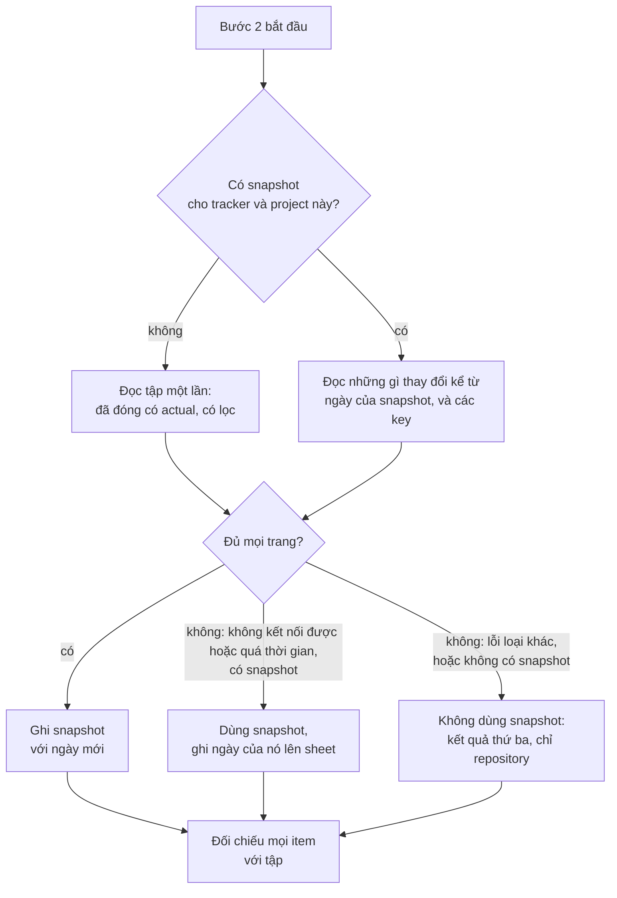

# atk:estimate đọc dữ liệu đối chiếu một lần mỗi lần chạy, có giới hạn, và giữ một snapshot có ngày

Người review bắt buộc: Tech Lead, Lam Ngoc Khuong, cũng là người duyệt. Profile không có BrSE/BA, QA
hay SRE, nên không vai nào khác ký.

## Tóm tắt

Bước 2 của `atk:estimate` bảo lần chạy đọc tracker để tìm các item đã đóng giống item đang ước lượng,
cùng thời gian thực tế đã bỏ ra cho chúng. Nó không nói đọc bao nhiêu, đọc mấy lần, hay làm gì khi
tracker không trả lời. Trên GitHub, actual time là một number field trên Project, mà issue search không
lọc được, nên lần chạy phân trang qua mọi item của Project, và làm lại việc đó cho từng item nó ước
lượng. Mười task tốn mười lần đọc toàn bộ. Khi GitHub chậm hay sập, lần chạy phải chờ, hoặc mất toàn bộ
dữ liệu đối chiếu cùng lúc.

Design này thay đổi ba điều, cả ba do maintainer quyết ngày 2026-11-03:

- **Một lần mỗi lần chạy.** Bước 2 đọc tập item đã đóng một lần, trước khi đối chiếu item nào, và đối
  chiếu mọi item với tập đó.
- **Có giới hạn.** Lần đọc chỉ gồm các item đã đóng có ghi actual, nhờ tracker lọc ở phía nó khi
  tracker lọc được, và chỉ xin các field mà việc đối chiếu cần. Lần đọc không bị cắt theo ngày, theo
  yêu cầu review R1.
- **Một snapshot có ngày.** Tập này được giữ dưới `<docs root>/derived/estimate/`, mỗi tracker và
  project một file, không bao giờ được stage. Lần chạy sau đọc những gì thay đổi kể từ đó và bỏ những
  gì đã ra khỏi bộ lọc, và dùng snapshot, kèm ngày của nó trên sheet, khi tracker sập.

## Yêu cầu

Không có artifact yêu cầu nào. Các tiêu chí lấy từ báo cáo của maintainer trong phiên ngày 2026-11-03:
skill "cào dữ liệu từ tất cả ticket cho mỗi task được ước lượng", tốn số lần query và thời gian chờ, và
không trụ được khi GitHub gặp sự cố hoặc khi ước lượng nhiều task cùng lúc.

| # | Tiêu chí | Nguồn |
|---|----------|-------|
| AC1 | Số lần đọc tracker để lấy dữ liệu đối chiếu không tăng theo số item được ước lượng | báo cáo: "mỗi lần estimate cho một task thì đều lấy all dữ liệu" |
| AC2 | Lần đọc chỉ gồm các item có thể làm căn cứ, đã đóng và có actual, và do tracker lọc khi tracker lọc được (viết lại theo R1) | báo cáo: số lần query và thời gian chờ |
| AC3 | Từ lần chạy thứ hai, chỉ đọc những gì thay đổi kể từ lần đọc trước | báo cáo: số lần query; quyết định giữ snapshot |
| AC4 | Lần chạy không đọc được tracker vẫn có dữ liệu đối chiếu nó đọc lần cuối, và sheet nói dữ liệu đó cũ bao nhiêu | báo cáo: "nếu github project bị sự cố" |
| AC5 | Nhiều lần chạy cùng lúc không làm hỏng snapshot, và không phải lần nào cũng đọc toàn bộ khi một lần là đủ | báo cáo: "estimate nhiều task cùng lúc" |
| AC6 | Không mất điều gì sheet đang cam kết: mọi item đối chiếu được trích theo ticket, kèm nguồn của actual và phép kiểm tra đo lường của bước 2 | `references/estimate-template.md`, Appendix B |

## Hiện trạng

- `plugins/atk/skills/estimate/SKILL.md:85-90`: bước 2 đọc "the tracker first, for closed items like
  it and the time actually spent on them, from the field `shared/ticket-adapters.md` maps as Actual
  time". Câu này viết theo từng item ("like it"), và không có gì giới hạn lần đọc về số lượng, khoảng
  thời gian hay các field.
- `plugins/atk/skills/estimate/SKILL.md:92-95`: một item đối chiếu chỉ đỡ được `HIGH` khi được làm
  theo cùng cách, và "where the override records when the team's way of working changed, samples from
  before that date were not built the same way". Ngày đó đã có, nhưng nó lọc mẫu sau khi đọc, chứ chưa
  bao giờ lọc chính lần đọc.
- `plugins/atk/skills/estimate/SKILL.md:97-100`: phép kiểm tra đo lường đếm các item đối chiếu được
  trích có actual bằng đúng estimate, và "a project-wide share may be given beside that count". Một
  tỉ lệ toàn dự án là một lần đọc cả tập, và đó là lý do thứ hai khiến lần chạy đọc rộng.
- `plugins/atk/shared/ticket-adapters.md:101`: trên GitHub, Actual time là "a number field on a
  Project, when the team added one; none by default". Jira giữ Time Spent, Backlog giữ Actual hours,
  Redmine giữ Spent time, tất cả nằm ngay trên issue.
- `plugins/atk/shared/ticket-adapters.md:43-51`: một lệnh rẻ chứng minh quyền truy cập, một lần mỗi
  lần chạy, và một field của Project vẫn có thể đọc thất bại sau khi issue đã đọc được.
- `plugins/atk/shared/ticket-adapters.md:62-67`: một lần đọc thất bại sau phép chứng minh đưa item đó
  vào dòng "detected but unreachable" và lần chạy đi tiếp. Không có nguồn nào để đi tiếp với nó.
- `plugins/atk/skills/estimate/references/estimate-template.md:144-154`: Appendix B liệt kê mọi item
  đối chiếu cùng "Source of the actual", và phép kiểm tra đo lường bên dưới.
- `plugins/atk/shared/artifact-paths.md:144` và `:267`: `estimate` viết một record và không có gì
  derived. Nhóm Derived liệt kê mọi loại nằm dưới `docs/derived/`.
- `docs/artifact-lifecycle.md:37` và `:93-97`: tài liệu vòng đời đếm các loại derived, và liệt kê các
  loại không bao giờ được stage.

Điều làm cách sửa hiển nhiên khó hơn trên GitHub: issue search (`gh issue list --search`) không lọc
được theo field của Project, nên "các item đã đóng có actual" không phải là một lần search ở đó.
`ProjectV2.items` của GraphQL nhận tham số `query`, chỉ được mô tả là "Search query for filtering
items" (introspect ngày 2026-11-03). Nó nhận những qualifier nào là câu hỏi mở 1, đã được đo ngày
2026-11-03 trên GitHub Project của một dự án khách hàng, khoảng 3.600 item, trong đó khoảng 1.900 đã
đóng và có actual; câu trả lời nằm ở mục Đã trả lời bên dưới. Tóm lại: nó lọc được theo trạng thái
đóng, theo khoảng giá trị của một number field gọi bằng slug, và theo thời điểm cập nhật của item
trong Project, còn một qualifier lạ thì trả về không item nào chứ không báo lỗi.

## Các phương án

Ba quyết định, mỗi quyết định được chấm trên cùng các tiêu chí:

- đáp ứng những tiêu chí chấp nhận nào;
- số lần gọi tracker mỗi lần chạy, với một lần chạy ước lượng N item trên một tập P item đã đóng;
- sheet có còn trung thực về nguồn gốc của một con số không;
- chi phí: số file đụng tới, một loại artifact mới, giới hạn số dòng của `SKILL.md` (hiện 189 dòng).

### Quyết định 1: tập đối chiếu được đọc khi nào

| | 1A. Theo từng item, như hiện nay | 1B. Một lần mỗi lần chạy, trước khi đối chiếu | 1C. Người dùng chỉ ra các item đối chiếu |
|---|---|---|---|
| AC | không có | AC1, AC5 trong một lần chạy | AC1, nhưng mất các actual lấy từ tracker của AC6 trừ khi người dùng đưa luôn |
| Số lần gọi | N lần đọc tới P item | một lần đọc tới P item | không có cho việc tìm kiếm |
| Sheet trung thực | có | có | có, nhưng căn cứ trở thành trí nhớ của người đó về việc gì giống việc gì |
| Chi phí | không có | viết lại bước 2, một file reference | viết lại bước 2, một lượt phỏng vấn mỗi lần chạy |

**1A**, mặc định, chính là vấn đề được báo. **1C** đổi query lấy thời gian của một người, và bỏ việc
tìm việc tương tự mà bước này sinh ra để làm. **Chọn: 1B.** Tập đối chiếu được đọc chỉ với các field
cần cho việc đối chiếu, và mọi item được đối chiếu với nó trong phiên.

### Quyết định 2: lần đọc phủ bao nhiêu phần tracker

| | 2A. Mọi item đã đóng | 2B. Đóng sau ngày thay đổi cách làm việc, do tracker lọc | 2C. Một khoảng gần đây cố định, ví dụ sáu tháng | 2D. Đã đóng và có actual, do tracker lọc, không theo ngày |
|---|---|---|---|---|
| AC | AC1 khi đi cùng 1B, không có AC2 | AC2 theo cách viết ban đầu | AC2 theo cách viết ban đầu, nhưng khoảng thời gian là con số kit tự chọn | AC2 theo cách viết lại ở R1 |
| Số lần gọi | các trang của cả P | các trang của item trong khoảng đó, ít hơn khi tracker lọc | các trang của khoảng đó | các trang của item đã đóng có actual, ít hơn khi tracker lọc; một lần, nhờ quyết định 3 |
| Sheet trung thực | có | không: theo `SKILL.md:92-95`, mẫu trước ngày đó vẫn là căn cứ ở mức dưới `HIGH`, và cắt chúng từ lúc đọc là bỏ chúng mà sheet không nói | không: một mẫu ngoài khoảng đó âm thầm không bao giờ được thấy, và sheet không nói được vì sao | có; ngày thay đổi cách làm việc vẫn giới hạn confidence khi đối chiếu một mẫu, như hiện nay |
| Chi phí | không có | một bộ lọc theo từng tracker trong reference mới | như vậy, cộng một giá trị mặc định mà đội phải để ý mới đổi | một bộ lọc theo từng tracker trong reference mới |

**2C** đưa vào estimate một khoảng thời gian không ai trong đội chọn, là điều rule 2 của
`shared/team-roles.md` cấm. **2B** được chọn lúc đầu và bị thay theo R1: ngày ở `SKILL.md:92-95` hạ mức
mà một mẫu đỡ được, chứ không loại mẫu đó, nên một dự án có ít item sau ngày đó sẽ mất gần hết dữ liệu
đối chiếu; phần lớn dự án không ghi ngày nào, khi đó 2B không giới hạn được gì; và có quyết định 3 thì
lần đọc toàn bộ chỉ tốn một lần, nên mốc ngày tiết kiệm được rất ít sau đó. **Chọn: 2D.** Ngày thay
đổi cách làm việc giữ nguyên vai trò của nó khi đối chiếu. Bộ lọc theo từng tracker:

- **Jira.** JQL `statusCategory = Done AND timespent > 0`, chỉ xin các field mà việc đối chiếu đọc.
- **Backlog và Redmine.** Trạng thái đóng mà danh sách issue của chúng lọc được, và chỉ những issue có
  spent time khi API lọc được theo nó.
- **GitHub.** `ProjectV2.items(query: "is:closed <field-slug>:>0")`, trong đó `<field-slug>` là tên
  field actual time viết thường, mỗi khoảng trắng thành một dấu gạch nối; trong phép đo, tên field đặt
  trong ngoặc kép kèm khoảng giá trị không trả về gì, còn slug trả về đúng các item mong đợi (câu hỏi
  mở 1). Một qualifier lạ, hay một slug viết sai, trả về không item nào và không báo lỗi, nên một lần
  đọc có lọc trả về không trong khi chỉ `is:closed` vẫn trả về item là một bộ lọc hỏng, không bao giờ
  là một tập rỗng, và không gì bị bỏ khỏi snapshot vì nó (câu hỏi mở 1).

### Quyết định 3: tập đối chiếu có sống lâu hơn lần chạy không

| | 3A. Không có snapshot | 3B. Một snapshot derived, theo từng working tree, làm mới kể từ ngày của nó | 3C. Một snapshot được commit, cả đội dùng chung |
|---|---|---|---|
| AC | AC1, AC2 | AC1, AC2, AC4, AC6; AC3, kể cả GitHub, nơi qualifier `updated:` lọc theo thời điểm của item trong Project (O1, câu hỏi mở 1); AC5 một phần: các lần chạy bắt đầu cùng lúc ở các working tree khác nhau mỗi lần đọc toàn bộ lần đầu (O3) | như 3B |
| Số lần gọi, lần chạy thứ hai | như lần đầu | một lần đọc những gì thay đổi kể từ ngày của snapshot, cộng một lần đọc chỉ lấy key để bỏ những gì đã ra khỏi bộ lọc (O2); trên GitHub khi câu hỏi mở 1 chưa đóng, một lần đọc toàn bộ | như 3B, với ai đã pull bản mới nhất |
| Sheet trung thực | có | có, khi sheet ghi tên snapshot và ngày của nó ở mọi chỗ đã dùng, và snapshot bỏ những gì tracker không còn giữ (O2) | có, với cùng cách ghi, nhưng một bản cũ trên `main` trông như bản hiện hành với mọi người trong đội |
| Chi phí | không có | một loại derived mới: `artifact-paths.md`, cả hai `artifact-lifecycle.md`; một ignore file | như 3B, cộng thêm mỗi lần chạy estimate để lại một diff cần review, mà không phải là quyết định ai phê duyệt |

**3A** không đáp ứng cả AC3 lẫn AC4: trường hợp sự cố là một nửa báo cáo. **3C** biến một bộ nhớ đệm
thành thứ người review phải đọc trong mỗi pull request có chạy estimate, và độ cũ của nó lan tới mọi
người pull về. **Chọn: 3B**, được giữ ngoài git theo cách run trace được giữ, nên không bao giờ được
stage và xóa đi không tốn gì. Mỗi working tree một snapshot, không phải một bản dùng chung cả đội, theo câu hỏi mở 2.



## Chi tiết phương án được chọn

### Lần đọc, trong bước 2

Bước 2 mở đầu bằng tập đối chiếu, trước khi đối chiếu item nào:

1. Nạp snapshot của tracker và project này, theo đường dẫn bên dưới, khi nó tồn tại và header của nó
   ghi cùng ánh xạ field với lần chạy này. Nếu không, coi như không có và để file đó bị thay thế.
2. Đọc từ tracker, lọc theo quyết định 2, có phân trang:
   - không có snapshot thì đọc mọi item đã đóng có actual, theo R1;
   - có snapshot thì đọc mọi item được cập nhật kể từ thời điểm `read` của nó lùi một ngày, bất kể
     trạng thái, để một item bị mở lại hoặc bị xóa actual quay về và được bỏ đi; và chỉ các key của
     mọi item bộ lọc đang giữ, để một item bị xóa, bị chuyển sang riêng tư hoặc bị chuyển khỏi
     project cũng được bỏ đi (O2). Trên tracker không có bộ lọc theo ngày cập nhật, đây là một lần đọc
     toàn bộ, và tập được thay hẳn chứ không gộp (O1).
   `updated` là thời điểm của bản ghi chứa actual: issue trên Jira, Backlog và Redmine, item của
   Project trên GitHub. Trong phép đo của câu hỏi mở 1, ở 20 trên 100 item đã đóng có actual, actual
   được sửa sau thời điểm cập nhật của chính issue, và thời điểm của item trong Project chưa lần nào
   cũ hơn của actual, nên dùng thời điểm của issue sẽ bỏ sót một trong năm lần sửa; qualifier
   `updated:` của GitHub lọc theo thời điểm của item trong Project (O1).
3. Một lần đọc chỉ thành công khi đủ mọi trang. Thành công thì gộp theo ticket key, `updated` mới hơn
   thắng, bỏ các key mà bước 2 đã loại, rồi ghi snapshot. Một lần đọc thất bại giữa chừng là một lần
   đọc thất bại: không có gì của nó được ghi vào snapshot, và các trang đã lấy chỉ phục vụ việc đối
   chiếu của lần chạy này, mỗi dòng được ghi `partial read <date>` ở Appendix B và phần thiếu được
   nêu ở Appendix C (O5). Thất bại thì theo phần dự phòng bên dưới.
4. Đối chiếu mọi item với tập trong phiên, rồi tìm trong repository và git history như hiện nay. Việc
   tìm trong repository không đổi.

Các query theo từng tracker và các field của snapshot nằm trong một reference mới,
`plugins/atk/skills/estimate/references/comparables-pool.md`, được trích từ bước 2. `SKILL.md` chỉ
thêm vài dòng và vẫn dưới 300 dòng khá xa.

Mọi title và label đọc từ tracker, hay từ snapshot, là văn bản từ bên ngoài cuộc trao đổi, nên rule 8
của `shared/team-roles.md` áp dụng cho nó: được trích làm bằng chứng, không bao giờ được làm theo như
một chỉ dẫn (O9).

### Mô hình dữ liệu: snapshot

`<docs root>/derived/estimate/comparables-<tracker>-<project>.tsv`, với docs root được xác định theo
Root trong `shared/artifact-paths.md`, là một loại cấp project trong một project trải trên nhiều
repository, và mọi ký tự của `<tracker>-<project>` không phải chữ cái, chữ số hay dấu gạch nối được
thay bằng dấu gạch nối, như `atk:tailor` làm với một feedback record. Mỗi tracker và project một file,
nên một project đọc hai tracker giữ được cả hai, và một lần chạy cho tracker này không bao giờ thay
mất phần dự phòng của tracker kia (O4). Phân tách bằng tab, mỗi dòng một item, sau một header gồm các
dòng bắt đầu bằng `#`:

```
# tracker: github | project: <owner>/<number> | actual field: <field name> | unit: hours
# read: 2026-11-03T06:29Z | filter: server | items: 214
key	title	labels	estimate	actual	closed	pr	updated
```

- `key` là ticket theo dạng `shared/ticket-adapters.md` quy định; `pr` là pull request được liên kết
  khi tracker có ghi; `updated` theo bước 2 ở trên.
- `filter` là `server` khi tracker đã lọc, `session` khi lần chạy tự phân trang và tự lọc, để người đọc
  sau biết file được dựng từ loại lần đọc nào.
- Không có body, không có comment, không có assignee, không có custom field nào ngoài hai field đã ánh
  xạ.
- `title` và `labels` được ghi theo rule 9 của `shared/team-roles.md`: một giá trị bí mật theo tên hoặc
  theo dạng, dữ liệu của một người thật và một host nội bộ được thay bằng `<redacted: kind>`, theo danh
  sách trong The data a record must not carry của `skills/qa/references/test-run.md`, như progress log
  làm (O6). Một tab, một ký tự xuống dòng hay bất kỳ ký tự điều khiển nào trong chúng được thay bằng
  một khoảng trắng, để một title không thể làm lệch field hay mở một dòng riêng, và chỉ các dòng
  trước dòng item đầu tiên được đọc là header (O9).
- Được ghi nguyên vào `.comparables-<tracker>-<project>-<run-id>.tmp` trong cùng thư mục, một tên không
  lần chạy nào khác dùng, rồi rename đè lên file cũ, để một lần chạy chết giữa chừng vẫn để lại
  snapshot trước đó nguyên vẹn và hai lần chạy không bao giờ ghi chung một file tạm (O3).

Một snapshot được dựng lại bằng cách đọc tracker lần nữa, nên nó là Derived theo câu hỏi đầu tiên của
Persistence trong `shared/artifact-paths.md`.

### Ignore file

`<docs root>/derived/estimate/.gitignore` chứa `*`, được tạo và kiểm tra như Where it lives trong
`shared/run-trace.md` làm với trace, đủ cả ba bước (O7):

- đường dẫn thật của `<docs root>/derived/estimate/`, hoặc của phần gần nhất của nó đã tồn tại, tính
  cả liên kết, nằm trong thư mục mà `git rev-parse --show-toplevel` in ra;
- ignore file được tạo bằng thao tác ghi file của chính harness khi nó chưa có, và không bao giờ bị
  ghi đè khi nó đã có;
- `git check-ignore -q` qua trên đường dẫn snapshot và trên đường dẫn file tạm, trước khi ghi một
  trong hai.

Khi một trong ba bước thất bại, lần chạy đọc tập một lần, không ghi snapshot hay file tạm nào, và nói
điều đó trong một dòng.

### Dự phòng khi không đọc được tracker

Snapshot chỉ thay cho tracker khi tracker sập: loại lỗi, theo `shared/ticket-adapters.md`, là không
kết nối được host hoặc một request quá thời gian. Forbidden, not found và đăng nhập hết hạn không phải
sự cố: chúng có thể nghĩa là quyền của người này đã bị thu hồi hoặc thu hẹp, và một snapshot đọc khi
quyền còn rộng hơn sẽ tiếp tục cho họ thấy một board mà tracker không còn cho thấy nữa. Với các lỗi
đó, lần chạy không dùng snapshot, ở kết quả thứ ba như hiện nay, và nêu loại lỗi (O8).

Khi dự phòng được áp dụng, sheet nói điều đó ở ba chỗ:

- Appendix B, "Source of the actual": `snapshot read <date>` cho mọi dòng lấy từ snapshot.
- Appendix C, một mục: không đọc được tracker, loại lỗi, cùng ngày và tuổi của snapshot.
- Các câu hỏi mở ở mục 2: có chạy lại khi tracker trả lời hay không, do người chấp nhận estimate quyết.

Một item đối chiếu lấy từ snapshot giữ mức confidence mà mẫu của nó đáng được: ở lần đọc thành công
gần nhất, snapshot đã bỏ mọi item ra khỏi bộ lọc (O2), và sheet ghi ngày của nó, nên người đọc tự đánh
giá độ cũ. Không có snapshot thì lần chạy ở kết quả thứ ba của `ticket-adapters.md` như hiện nay, và
chỉ ước lượng từ repository và phân rã.

### Nhiều lần chạy cùng lúc

Trong một lần chạy, quyết định 1 đã biến nó thành một lần đọc. Hai lần chạy trong cùng một working tree
mỗi lần đọc snapshot khi bắt đầu và thay nguyên file khi kết thúc, mỗi lần qua file tạm riêng của nó;
lần rename sau thắng, và cả hai kết quả đều chứa những gì tracker nói trong vòng một ngày của nhau, nên
không bên nào sai. Các lần chạy ở các worktree khác nhau giữ snapshot riêng, nên N worktree bắt đầu
cùng lúc thì mỗi cái đọc toàn bộ lần đầu: AC5 đạt trong một working tree, và giữa các worktree chỉ sau
lần đọc đầu của từng cái (O3). Không thêm khóa: một khóa bị bỏ lại bởi một lần chạy đã chết sẽ chặn
mọi lần chạy sau, tốn hơn một lần đọc thứ hai.

### Tỉ lệ toàn dự án

Tỉ lệ toàn dự án của phép kiểm tra đo lường, `SKILL.md:97-100`, được tính từ tập đối chiếu, nên không
cần lần đọc riêng, và sheet ghi kích thước của tập và ngày đọc nó bên cạnh.

### Các mục còn lại

- **API contract.** `N/A`: kit không có API. Contract thay đổi là cách viết Appendix B và C của sheet,
  như trên.
- **Lỗi và trường hợp biên.** Một snapshot có ánh xạ field khác với lần chạy này bị bỏ qua và thay thế.
  Một snapshot có header không parse được bị coi như không có. Một field của Project đọc thất bại trong
  khi issue đọc được là một lần đọc thất bại, theo `ticket-adapters.md:49-51`. Một lần đọc thất bại
  giữa chừng là một lần đọc thất bại, theo bước 3 ở trên.
- **Tương thích ngược.** Dự án chưa có snapshot hoạt động như lần chạy đầu tiên hiện nay, trừ các lần
  đọc lặp lại. Các sheet đã viết là record và không bị đụng tới.
- **Rollout.** `N/A` ngoài release-please: một commit `feat:` dưới `plugins/atk/`.
- **Rollback.** Revert commit. Snapshot còn lại trên các máy là derived và được ignore; xóa
  `<docs root>/derived/estimate/` tốn một lần đọc toàn bộ, và trong lúc có sự cố thì mất luôn phần dự
  phòng.
- **Quan sát.** Dòng step 2 của run trace nói tập đến từ một lần đọc toàn bộ, một lần đọc tăng dần,
  một lần đọc dở dang, hay chỉ từ snapshot, theo loại, đúng hình dạng sự kiện của
  `shared/run-trace.md`.
- **Bảo mật và quyền.** Snapshot chứa ticket key, title và label đã che, estimate và actual, là những
  thứ tracker vốn đã cho người chạy skill thấy. Nó không bao giờ thay cho một tracker đã từ chối người
  này (O8), không bao giờ được stage, và thư mục chứa nó được kiểm tra là nằm trong repository (O7).
  Nội dung lỗi của công cụ không vào sheet và snapshot, theo `ticket-adapters.md:69-75`.
- **Hiệu năng.** Lần đọc đầu tốn bằng một lần đọc theo từng item hiện nay. Một lần chạy sau tốn một lần
  đọc những gì đã thay đổi, thường là một trang, cộng lần đọc chỉ lấy key, phân trang qua tập đã lọc
  với một field mỗi item. Đo trên GitHub cho câu hỏi mở 1: lần đọc toàn bộ đầu tiên khoảng 19 trang
  100 item thay vì 36 trang của cả Project, và hai ngày thay đổi là 136 item, hai trang.

### Các file thay đổi này đụng tới

- `plugins/atk/skills/estimate/SKILL.md`, bước 2 và `## Output`.
- `plugins/atk/skills/estimate/references/comparables-pool.md`, mới.
- `plugins/atk/skills/estimate/references/estimate-template.md`, cách viết Appendix B và C.
- `plugins/atk/shared/artifact-paths.md`, dòng `estimate` và nhóm Derived, cùng danh sách các loại
  derived không bao giờ được stage.
- `docs/artifact-lifecycle.md` và `docs/vi/artifact-lifecycle.md`, các loại derived và số lượng của
  chúng.
- `docs/codebase-summary.md` và `docs/vi/codebase-summary.md`, một dòng cho reference mới, mà
  `tests/verify.sh` kiểm tra.

## Câu hỏi mở

Không còn câu hỏi nào mở, và không còn phản biện nào mở trong Pre-review objections.

### Đã trả lời

| Câu hỏi | Câu trả lời | Người trả lời | Ngày | Người chuyển lời |
|---------|-------------|---------------|------|------------------|
| 1. `ProjectV2.items(query:)` nhận những qualifier nào: trạng thái đóng, khoảng giá trị trên một number field, ngày cập nhật? Và sửa một number field của Project có làm đổi thời điểm cập nhật của item trong Project trong khi của issue thì không (O1)? Đo trên một Project có field actual time. Đề xuất: đo trong lúc triển khai; tới khi xác nhận, dòng GitHub phân trang một lần mỗi lần chạy và lọc trong phiên, như quyết định 2 nói | "Đo đi, trên project của <redacted: client issue URL>, nhớ không được đề cập đến thông tin dự án". Lần chạy đo theo chỉ dẫn của anh ngày 2026-11-03, chỉ bằng truy vấn đọc, trên GitHub Project của một dự án khách hàng khoảng 3.600 item: `is:closed`, `is:open`, `has:"<field name>"`, `<field-slug>:>0`, `updated:>` và `closed:>` đều lọc được, riêng lẻ và kết hợp; `"<field name>":>0` và một qualifier lạ trả về không item nào mà không báo lỗi; mọi item `is:closed <field-slug>:>0` trả về đều đã đóng với actual lớn hơn không; mọi item `updated:>` trả về đều có thời điểm của item trong Project sau mốc, 34 trên 100 có thời điểm của chính issue trước mốc; ở 20 trên 100 item đã đóng có actual, actual được sửa sau thời điểm cập nhật của issue, chưa lần nào sau thời điểm của item trong Project | Lam Ngoc Khuong, phép đo do lần chạy thực hiện | 2026-11-03, đã trả lời | |
| 2. Snapshot theo từng working tree đã đủ chưa, hay đội cần một bản dùng chung? Đề xuất: theo từng working tree, như quyết định 3 đã chọn; một bản dùng chung là thay đổi sau này nếu có đội yêu cầu | "Riêng" | Lam Ngoc Khuong | 2026-11-03, đã trả lời | |
| 3. Một snapshot cũ quá một tuổi nào đó có nên thôi được dùng làm dự phòng không? Đề xuất: không giới hạn, vì sheet ghi ngày của nó và actual của một item đã đóng hiếm khi đổi | "Không" | Lam Ngoc Khuong | 2026-11-03, đã trả lời | |
| R1, yêu cầu review do Lam Ngoc Khuong nêu trong phiên ngày 2026-11-03: vì sao lần đọc gắn với ngày thay đổi cách làm việc? Lần chạy đề xuất bỏ mốc ngày khỏi quyết định 2, vì ngày đó chỉ giới hạn confidence của mẫu khi đối chiếu, phần lớn dự án không ghi ngày, và snapshot đã khiến lần đọc toàn bộ chỉ tốn một lần; giữ bộ lọc của tracker trên item đã đóng có actual và việc chỉ chọn các field cần. Người quyết: Tech Lead | "Ok sửa đi": bỏ mốc ngày | Lam Ngoc Khuong | 2026-11-03, đã trả lời | |

## Pre-review objections

Do mỗi vai một agent nêu trên bản nháp; là góc nhìn mô phỏng, không phải review và không phải phê
duyệt.

| ID | Vai | Mục | Phản biện | Trả lời |
|----|-----|-----|-----------|---------|
| O1 | TL | Quyết định 3; Hiệu năng | Trên GitHub, lần đọc tăng dần chưa tồn tại khi câu hỏi mở 1 chưa đóng, nên mỗi lần chạy là một lần đọc toàn bộ, vậy mà 3B được chấm AC1 tới AC6 và phần Hiệu năng hứa một trang; và sửa một field của Project có thể không làm đổi thời điểm cập nhật của issue, nên một actual đã sửa sẽ không bao giờ được lấy | Đã sửa: 3B chỉ đạt AC3 trên GitHub khi câu hỏi mở 1 đã đóng; bước 2 nêu `updated` theo từng tracker, của item trong Project trên GitHub; phần Hiệu năng nêu chi phí trên GitHub; câu hỏi mở 1 đo luôn thời điểm cập nhật |
| O2 | TL, Security | Lần đọc, trong bước 2 | Việc gộp chỉ thêm hoặc thay dòng, nên một item bị mở lại, bị xóa actual, bị xóa, bị chuyển sang riêng tư hay bị chuyển đi vẫn nằm trong snapshot và về sau bị trích như một item đối chiếu mà tracker không còn giữ, kể cả các actual sao chép đã bị xóa sau phép kiểm tra đo lường | Đã sửa: lần đọc tăng dần lấy mọi item cập nhật kể từ đó, bất kể trạng thái, và các key của tập đang lọc, rồi bỏ những gì đã ra khỏi; phần chấm điểm của 3B và đoạn về dự phòng nói điều đó |
| O3 | TL | Nhiều lần chạy cùng lúc; Mô hình dữ liệu | AC5 được nhận là đạt trọn, nhưng các lần chạy ở worktree khác nhau bắt đầu cùng lúc mỗi cái đọc toàn bộ lần đầu, và một tên file tạm cố định khiến lần rename của lần chạy này di chuyển file đang ghi dở của lần chạy kia | Đã sửa: file tạm mang `<run-id>` của lần chạy; 3B chỉ đạt một phần AC5, và mục đó nói phần nào |
| O4 | TL | Mô hình dữ liệu | Một đường dẫn snapshot cố định gắn với một tracker khiến một project đọc hai tracker đổi qua đổi lại snapshot, làm mất phần dự phòng của tracker đầu; và `docs/` bị viết cứng thay vì docs root | Đã sửa: mỗi tracker và project một file, dưới `<docs root>/derived/estimate/`, là một loại cấp project |
| O5 | TL | Lần đọc, trong bước 2; sơ đồ | Một lần đọc phân trang thất bại giữa chừng không phải thành công cũng không phải thất bại: ghi như thành công thì nó nhận là đã đọc đủ, và các lần đọc tăng dần sau không bao giờ lấy các item còn thiếu | Đã sửa: một lần đọc chỉ thành công khi đủ mọi trang; lần đọc dở dang không ghi gì vào snapshot và chỉ phục vụ lần chạy này, được ghi `partial read` trên sheet |
| O6 | Security | Mô hình dữ liệu | Title của ticket được lưu nguyên văn, trong khi progress log và trace che giá trị bí mật, dữ liệu của người thật và host nội bộ theo rule 9 | Đã sửa: `title` và `labels` được che theo rule 9 và danh sách của test-run trước khi ghi |
| O7 | Security | Ignore file | Chỉ hai trong ba bước kiểm tra phạm vi của trace được nêu, thiếu bước realpath, nên một `docs/derived` liên kết ra ngoài repository sẽ nhận snapshot; và file tạm không bao giờ được kiểm tra với quy tắc ignore | Đã sửa: nêu đủ ba bước, và `git check-ignore` chạy cả trên đường dẫn file tạm |
| O8 | Security | Dự phòng | Dự phòng áp dụng cho mọi loại lỗi, nên một người đã bị thu hồi quyền vẫn đọc tiếp được board qua snapshot, vào một sheet được commit | Đã sửa: dự phòng chỉ áp dụng khi không kết nối được host hoặc quá thời gian; forbidden, not found và đăng nhập hết hạn không dùng snapshot |
| O9 | Security | Mô hình dữ liệu; Lần đọc, trong bước 2 | Title là văn bản không đáng tin trong một file phân tách bằng tab mà không có quy tắc escape, nên một tab hay ký tự xuống dòng trong title của một issue công khai có thể giả một actual hay một dòng header, và các title đã lưu đi vào những phiên sau | Đã sửa: ký tự điều khiển trong `title` và `labels` thành khoảng trắng, chỉ các dòng trước item đầu tiên là header, và rule 8 được nêu cho mọi title đọc vào |

Agent đã chạy: hai, mỗi agent là `atk:read-only-reviewer`, tối đa hai cùng lúc, không chỉ định model,
vì profile không có dòng `Review agent model`: Tech Lead, vai duy nhất ký, và một lens bảo mật, vì
snapshot là một nơi lưu mới trên đĩa cho nội dung tracker. Không có lens BrSE/BA, QA hay SRE, vì
profile không có ai giữ các vai đó. Bị loại vì không có căn cứ: không có. Có mười phản biện được trả
về; O2 gộp một phản biện của mỗi agent về cùng một lỗi.

ADR: `docs/adr/0013-estimate-reads-comparables-once-and-keeps-a-snapshot.md`
