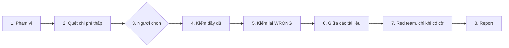

Approved by Lam Ngoc Khuong on 2026-11-03, by instruction to the agent.

Đánh lại số từ ADR 0011 thành ADR 0012 ngày 2026-11-03, trước khi merge, có sự đồng ý của người duyệt, vì trong lúc đó `main` đã dùng số ADR 0011; quyết định giữ nguyên.

# atkx:doc-audit - mọi nhận định của một tài liệu đã viết được kiểm với nguồn của nó

Bản tiếng Việt để đọc cho tiện. Bản gốc là `docs/records/design/261103-1035-atkx-doc-audit.md`; khi hai bản khác nhau, bản
tiếng Anh là bản đúng.

## Tóm tắt

Các team giờ giữ những tài liệu do agent viết mà chưa ai kiểm: tài liệu tham chiếu API, mô tả tính
năng, luồng trạng thái, ghi chú yêu cầu. Người đọc không phân biệt được câu đúng với câu chỉ nghe có
lý, và một agent thứ hai được nhờ "review" tài liệu cũng không phân biệt được, vì nó đọc cùng đoạn văn
đó và không có gì để so. `atkx:doc-audit` là skill mới của plugin `atkx`. Nó lấy từng nhận định kiểm
được của một tài liệu, kiểm với nguồn quyết được nhận định đó (code, một nguồn yêu cầu hay một tài
liệu khác), và cho nó đúng một kết luận: đúng kèm bằng chứng, sai kèm bằng chứng, hoặc không kiểm được
kèm người phải trả lời. Skill còn liệt kê những chỗ một tài liệu tự mâu thuẫn hay mâu thuẫn với tài
liệu khác, và với `--red-team` thì đưa agent vào phản bác những phần không nguồn nào quyết được. Skill
không sửa tài liệu nào. Report của nó nằm ở `docs/derived/doc-audit/`, chỗ git bỏ qua.

Một lượt chạy thử trên ba tài liệu của một dự án khách hàng tìm ra 29 nhận định sai trong 132, 22 cái
trong đó nằm ở một tài liệu tự nhận là nguồn chuẩn. Bảy kết luận sai được đọc lại với code đều đứng
vững; 22 kết luận sai còn lại và mọi kết luận đúng chưa được đọc lại, nên tỉ lệ một kết luận tự nó bị
sai vẫn chưa được đo.

## Yêu cầu

Chưa có artifact yêu cầu; yêu cầu đến từ người bảo trì trong phiên ngày 2026-11-03, với lượt chạy thử
dưới đây làm bằng chứng. Viết lại thành tiêu chí chấp nhận:

1. **AC1.** Với một hay nhiều tài liệu, mọi nhận định kiểm được đều được liệt kê kèm dòng của nó, và
   mỗi nhận định nhận đúng một trong ba kết luận: `CORRECT` kèm một `path:line` hoặc một nguồn được
   trích, `WRONG` kèm như vậy cùng điều nguồn thật sự nói, `UNVERIFIABLE` kèm nguồn sẽ quyết được nó
   và người phải trả lời. Không có kết luận thứ tư, không có "có lẽ đúng".
2. **AC2.** Mâu thuẫn bên trong một tài liệu, và giữa các tài liệu được kiểm, được liệt kê riêng,
   tách khỏi các kết luận.
3. **AC3.** Với một thư mục hàng trăm tài liệu, skill không kiểm tất cả với chi phí đầy đủ: nó chạy
   một lượt quét chi phí thấp qua toàn bộ, xếp hạng chúng, rồi một người chọn tài liệu nào được kiểm
   đầy đủ.
4. **AC4.** Mọi kết luận `WRONG`, và một mẫu các kết luận `CORRECT`, được kiểm lại trước khi đưa vào
   report. Mẫu đó lấy từ câu hỏi mở 1, đã trả lời.
5. **AC5.** Với `--red-team`, những phần không nguồn nào quyết được, như lập luận của một design hay
   một ý định được nêu ra, nhận phản bác từ các agent đọc tài liệu mà không biết gì trước về nó, và
   được báo dưới dạng phản bác, không bao giờ dưới dạng kết luận.
6. **AC6.** Không tài liệu nào bị sửa, không trạng thái duyệt nào thay đổi, và report nằm ở chỗ git
   bỏ qua, nên không có gì được đưa tới một đồng đội để review.
7. **AC7.** Skill chạy được khi không có `.atk/profile.md`, trên Claude Code, Codex và Cursor, và nói
   rõ nó mất gì trên harness không có agent song song hoặc không có Node.

## Bằng chứng: lượt chạy thử

Lượt chạy thử chạy ngày 2026-11-03 trên ba tài liệu tiếng Anh của một dự án khách hàng, mỗi tài liệu một
agent Explore chỉ đọc, mỗi agent được dặn rút ra các nhận định và cho ba kết luận ở trên. Sau đó phiên
đọc lại phần code đằng sau bảy kết luận `WRONG`. Record nguồn nằm lại trong phiên; ở đây các tài liệu
chỉ được nêu theo loại.

| Tài liệu | Nhận định | Đúng | Sai | Không kiểm được |
|----------|--------|---------|-------|--------------|
| Tài liệu tham chiếu API của một endpoint cài đặt | 49 | 43 | 4 | 2 |
| Mô tả tính năng của chính cài đặt đó | 40 | 34 | 3 | 3 |
| Mô tả luồng trạng thái của record chính, tự nhận là nguồn chuẩn | 43 | 17 | 22 | 4 |

Những gì lượt chạy thử cho thấy:

- **Phương pháp dùng được.** Mỗi tài liệu có hai tới bốn nhận định không quyết được từ repository, và
  gần như tất cả là lý do đằng sau một yêu cầu, nằm trong một issue trên tracker mà phiên không đọc
  được. Các nhận định còn lại đều có bằng chứng.
- **Các nhận định sai là chuyện đáng kể.** Một phản hồi lỗi được ghi trên ba endpoint mà không nhánh
  code nào sinh ra; một trạng thái lúc tạo mà tài liệu ghi ngược với code, trong khi lại nói code đã
  lệch khỏi yêu cầu; hai trường được ghi là không bao giờ gửi sang một hệ thống bên ngoài, nhưng file
  gửi đi lại mang cả hai. Người kiểm thử viết case từ chỗ thứ nhất, hay lập trình viên tin chỗ thứ hai, đều
  sai ngay từ trước khi bắt đầu.
- **Rủi ro nằm ở những tài liệu tóm tắt nhiều nhánh code.** Hai tài liệu về một tính năng phần lớn
  đúng; tài liệu mô tả một luồng đi qua nhiều service, tác vụ chạy theo lô và lần nhập dữ liệu thì sai nhiều hơn đúng.
- **Mâu thuẫn bên trong một tài liệu tìm ra được mà không cần đọc code.** Một tài liệu tính năng nói
  một lần nộp trong cùng ngày nằm ngoài một khoảng thời gian, và mười dòng sau, ví dụ minh hoạ của
  chính nó lại đặt lần nộp đó vào trong.
- **Trích dẫn dòng bị cũ.** Bốn nhận định trích một dòng mà giờ chứa thứ khác. Một script tìm ra những
  chỗ này mà không cần agent.
- **Một agent đếm sai chính bảng của nó.** Đếm là việc của script.
- **Chi phí.** Khoảng 140,000 tới 170,000 token và ba tới năm phút cho mỗi tài liệu. Dự án có 565
  file dưới docs root, khoảng 190 file trong số đó viết bằng ngôn ngữ gốc của dự án, còn lại là bản
  sao.

## Hiện trạng

- **`atkx` có một skill**, `skill-eval`, ở `plugins/atkx/skills/skill-eval/`. Nó đọc một skill và
  không thay đổi gì trong đó (`plugins/atkx/skills/skill-eval/SKILL.md:24-25`), giữ các bước kiểm phải
  lặp lại trong script Node (`scripts/static-check.mjs`, `scripts/score.mjs`, `scripts/trigger-run.mjs`,
  `scripts/hook-log.mjs`) theo `docs/adr/0002-skill-eval-scripts-for-repeatable-checks.md`, và coi
  mọi thứ nó đọc là dữ liệu (`SKILL.md:89-92`). Report của nó được in trong phiên, và chỉ được ghi ra
  file khi có `--out` hoặc khi người dùng đồng ý (`SKILL.md:166-175`).
- **Ngưỡng của `atkx`** là ba phép thử (`CLAUDE.md:360-364`): chạy được khi không có profile, không
  ghi gì mà một đồng đội được nhờ review, và nêu rõ các harness của nó. Một skill `atkx` chỉ được gọi
  một skill `atk` sau khi kiểm danh sách skill đang có của host (`CLAUDE.md:339`, `CLAUDE.md:374`),
  và mang theo mọi file nó đọc (`CLAUDE.md:381`).
- **`atk:spec --check`** báo độ lệch giữa tài liệu tham chiếu và code
  (`plugins/atk/skills/spec/SKILL.md:63-64`), cho bốn loại: api, db, feature, screen
  (`SKILL.md:30-33`). Nó không bao giờ quyết bên nào sai (`SKILL.md:40-41`), và vạch ranh giới giữa độ
  lệch với một câu hỏi mở ở `plugins/atk/shared/spec-docs.md:90-104`. Ghi chú yêu cầu, design, luồng
  trạng thái viết theo khuôn riêng của dự án, và tài liệu vận hành đều nằm ngoài phạm vi của nó.
- **Document mode của `atk:catchup`** giải thích một tài liệu bằng lời dễ hiểu
  (`plugins/atk/skills/catchup/SKILL.md:25-26`) và không đánh giá nó (`SKILL.md:40-45`).
- **`atk:design-doc --challenge` và `atk:plan --challenge`** đưa agent vào phản bác một bản nháp của
  `atk` trước khi review, mỗi vai trò ký duyệt hay mỗi cách một plan thất bại một agent, qua
  `plugins/atk/shared/independent-challenge.md`. Cả hai áp dụng cho artifact của chính kit, ở
  `DRAFT`.
- **Agent chỉ đọc.** `atk:read-only-reviewer` chỉ có Read, Grep và Glob
  (`plugins/atk/agents/read-only-reviewer.md:1-6`), và là nơi `shared/host-capabilities.md:236` và
  `:276-280` giao một lần đọc rộng tới trên Claude Code. Agent này thuộc `atk`; Claude Code cài `atk`
  cùng `atkx`, còn Codex thì không.
- **File không bao giờ được mở.** Rule 9 của `shared/team-roles.md` giữ các path liệt kê ở
  `plugins/atk/shared/secret-scan.md:316-330` không bị đọc. Hiện `atkx` không có bản sao nào của bảng
  đó.
- **`atk:help` biết các skill `atkx`** qua `plugins/atk/skills/help/references/atkx-skills.md:47-49`,
  mỗi skill một dòng.

Vậy hiện chưa có skill nào nhận một tài liệu bất kỳ rồi nói câu nào trong đó đúng.

## Tiêu chí quyết định

1. **Tiền đề.** Phương án có giữ người viết và người duyệt tách biệt không: soạn nháp và đưa bằng
   chứng, không thay team kết luận bên nào phải đổi?
2. **Phạm vi.** Phương án phủ những loại tài liệu nào: chỉ tài liệu tham chiếu, hay cả ghi chú yêu
   cầu, luồng, design và runbook.
3. **Chi phí hợp đồng.** Phạm vi và cam kết của một skill hiện có phải thay đổi bao nhiêu.
4. **Độ phù hợp.** Phương án có vượt ngưỡng của `atkx` không, hay nằm trong một giai đoạn delivery.
5. **Tính lặp lại.** Những phần phải cho cùng một câu trả lời ở hai lần chạy có làm được vậy không.

## Các phương án

### Phương án A: mở rộng `atk:spec --check` cho mọi tài liệu (lựa chọn mặc định)

Chỗ hiển nhiên nhất: `spec --check` vốn đã so tài liệu với code. Nó sẽ nhận mọi file Markdown, không
chỉ bốn loại.

Phương án này thua ở phạm vi và chi phí hợp đồng. `spec` sở hữu những tài liệu phải luôn đúng và được
viết theo một khuôn nó biết, có trường `implemented` và một loại; quy tắc độ lệch của nó giả định khuôn
đó (`shared/spec-docs.md:90-104`). Một ghi chú yêu cầu không có code nào để lệch khỏi, còn một design
được viết ra để lỗi thời ngay ngày nó được merge. Gộp cả hai vào sẽ biến hợp đồng của một skill thành
hai, trong khi `atk:review`, `atk:implement` và bốn skill khác đều trích hợp đồng đó.

### Phương án B: một skill `atk` mới với record được commit

Một skill `atk:doc-audit` ghi vào `docs/records/doc-audit/`, có người chịu trách nhiệm và người duyệt như mọi record.

Phương án này thua ở độ phù hợp. Một lượt kiểm là bản đọc tại một thời điểm, chạy trước khi một người
quyết cần sửa gì; một record cần duyệt sẽ đặt thêm một artifact trước team cho mỗi lượt kiểm, và skill
không nằm trong giai đoạn delivery nào. Sửa một tài liệu vốn đã là việc của `atk:spec`, `atk:intake`
hoặc người viết tài liệu đó.

### Phương án C: một skill `atkx` mới, `doc-audit`, với report git bỏ qua (được chọn)

Một skill đặt cạnh `skill-eval`, theo cùng điều kiện: đọc, báo cáo, không thay đổi gì trong thứ nó
kiểm. Script Node lo bước kiểm trích dẫn và bước đếm; agent lo phần đọc nhận định đối chiếu với nguồn.

### Phương án D: chỉ có chỉ dẫn

Một trang trong `docs/` mô tả phương pháp, mỗi lần chạy làm tay.

Phương án này thua ở tính lặp lại. Lượt chạy thử cần cùng một prompt ba lần, một lần đếm lại, và một lần
đọc lại mọi kết luận sai; với một trang, ai nhớ ra thì làm, ai quên thì bỏ sót.

### Chấm điểm

| Tiêu chí | A | B | C | D |
|-----------|---|---|---|---|
| Tiền đề | giữ được | giữ được | giữ được | giữ được |
| Phạm vi | bốn loại, thêm những loại phải ép cho vừa | mọi loại | mọi loại | mọi loại |
| Chi phí hợp đồng | cao: `spec` và sáu skill trích nó | thấp | không có gì trong `atk`, trừ một dòng bảng | không có |
| Độ phù hợp | một skill delivery bị dùng quá phạm vi | record không thuộc giai đoạn nào | vượt ngưỡng `atkx` | không phải một skill |
| Tính lặp lại | cao | cao | cao | thấp |

## Cách tiếp cận được chọn: Phương án C



### Bố cục

```
plugins/atkx/skills/doc-audit/
  SKILL.md
  references/
    claims.md             what a checkable claim is, the three verdicts, what counts as evidence
    cheap-pass.md         internal contradictions without code; the ranking signals
    full-audit.md         the agent prompt and its output table
    re-verify.md          the second read of a WRONG verdict
    red-team.md           lenses, objections, and how they are checked
    report-format.md      the report, its sections and its path
    safety.md             copies from atk: the unread-path table, the value mask, the agent prompt rules
  scripts/
    cite-check.mjs        every cited path and path:line inside the repository: exists, line in
                          range, cited identifier near the line; ranking fields
    tally.mjs             validates the verdict table and counts it
  evals/trigger_evals.json
```

### Cách gọi

```bash
/atkx:doc-audit <file>...              # Full audit of the named documents
/atkx:doc-audit <dir>                  # Cheap pass over the directory, then a person picks
/atkx:doc-audit <dir> --cheap          # Cheap pass and ranking only
/atkx:doc-audit <path> --source <path-or-issue>...  # Requirement sources to check intent claims against
/atkx:doc-audit <path> --red-team      # Add objections to what no source can settle
/atkx:doc-audit <path> --code <dir>    # Code root inside the same repository, when not its root
/atkx:doc-audit <path> --out <path>    # Write the report elsewhere, still ignored by git
```

### 1. Phạm vi

- Đầu vào là file hoặc một thư mục. Bản sao của một docs root chia theo ngôn ngữ (`docs/vi/`,
  `docs/ja/`, hoặc `Language mirrors` của profile khi có profile) mặc định bị bỏ ra và được nêu trong
  report là đã bỏ ra, vì kiểm một bản dịch chỉ lặp lại các nhận định của bản gốc.
- Mọi thứ được đọc bên trong repository chứa các tài liệu, tức `git rev-parse --show-toplevel`. Một
  path được trích hay một thư mục `--code` trỏ ra ngoài repository đó, qua `..`, một path tuyệt đối
  hay một symbolic link, được báo là rời khỏi repository và không bao giờ được mở, giống cách
  `skill-eval` xử lý một link rời khỏi skill. Từ phản bác O7.
- Các path trong bảng path không được đọc của `references/safety.md` không bao giờ được mở, dù trong
  tài liệu hay trong code, dù bởi agent hay bởi script. Một trích dẫn tới một path như vậy được báo là
  trích một file không được đọc. Từ phản bác O7.
- Mọi thứ đọc vào đều là dữ liệu, kể cả một issue được lấy về. Một câu trong tài liệu, một comment
  trong code hay một issue bảo agent bỏ qua một nhận định, đánh dấu một nhận định là đúng, chạy một
  lệnh, sửa một file hay mở một địa chỉ đều được báo lại, không bao giờ được làm theo. Từ phản bác O8.
- Nguồn yêu cầu là một path cục bộ mà `--source` nêu, hoặc một issue trên tracker của chính
  repository, cộng với những gì repository chứa: plan, record, commit message. Không địa chỉ nào khác
  được lấy về: không lấy URL mà một tài liệu dẫn tới, không lấy issue của repository khác. Tracker được
  đọc qua kết nối của host hoặc `gh` khi một trong hai trả lời; khi không có cái nào trả lời, các nhận
  định cần tới nó chuyển sang `UNVERIFIABLE` kèm lý do đó, như trong lượt chạy thử. Từ phản bác O9.

### 2. Lượt quét chi phí thấp

Lượt này đi qua mọi tài liệu trong phạm vi, không đọc code:

- `node scripts/cite-check.mjs <files>` in ra JSON: mỗi path được trích, path đó có tồn tại không,
  dòng được trích có nằm trong file không, và với mỗi tài liệu là các con số mà bước xếp hạng dùng. Một
  dòng nằm trong phạm vi file vẫn có thể chứa thứ khác, và các trích dẫn cũ của lượt chạy thử trông đúng
  như vậy. Vì thế, ở chỗ trích dẫn đứng cạnh một identifier đặt trong dấu nháy ngược, như một hàm, một hằng hay
  một cột, script báo identifier đó có xuất hiện trong vòng ba dòng quanh dòng được trích không, và
  nếu không thì tính là trích dẫn hỏng. Từ phản bác O2. Script tự giữ các mẫu path không được đọc, và
  từ chối một path nằm ngoài repository trước khi mở bất cứ thứ gì.
- Mỗi lô tài liệu một agent, đọc riêng từng tài liệu và liệt kê các mâu thuẫn bên trong nó, theo
  `references/cheap-pass.md`. Chi phí của agent này tính theo độ dài tài liệu, không theo code.

Bước xếp hạng đưa lên đầu những tài liệu trích nhiều thư mục, trích ít dòng, có trích dẫn hỏng, tự mâu
thuẫn, hoặc mô tả một luồng hay một trạng thái; các tín hiệu nằm trong `references/cheap-pass.md`, và
script tính những tín hiệu nào tính được.

Một lượt chạy thử thứ hai chạy trước khi viết `references/cheap-pass.md`, theo câu hỏi mở 2, đã trả lời.
Lượt này chạy trên một ghi chú yêu cầu có nguồn mà phiên đọc được, để thử các nhận định `INTENT`, điều
lượt chạy thử đầu không làm được, và để thử các tín hiệu xếp hạng trên một dự án thứ hai.

### 3. Người chọn

Khi đầu vào là file, phạm vi chính là các file đó và không hỏi gì. Khi đầu vào là một thư mục, danh
sách đã xếp hạng được hiện ra cùng các phát hiện của lượt quét chi phí thấp và một ước lượng chi phí
của lượt kiểm đầy đủ, rồi người đó chọn.

Ước lượng là một khoảng, không bao giờ là một con số, theo câu hỏi mở 3, đã trả lời. Lượt chạy thử cho
thấy chi phí không đi theo độ dài tài liệu: 92 dòng tốn khoảng 138,000 token, còn 195 dòng tốn khoảng
168,000, vì phần lớn chi phí là đọc code. Vì vậy không dùng công thức nào tính từ độ dài:

- Trên một dự án chưa có report nào trước đó, khoảng ước lượng là của lượt chạy thử, 140,000 tới 170,000
  token cho mỗi tài liệu, ghi rõ là lấy từ một lượt chạy thử, nhân với số tài liệu được chọn. Cạnh mỗi tài
  liệu là số thư mục code mà nó trích, lấy từ lượt quét chi phí thấp, làm dấu hiệu cho thấy nó gần đầu
  nào của khoảng hơn.
- Mỗi lượt kiểm đầy đủ ghi vào report số token nó thật sự dùng, ở nơi host báo con số này, như Claude
  Code báo cho các agent của nó.
- Lần chạy sau trên cùng dự án lấy khoảng ước lượng từ các report đã có trong `derived/doc-audit/`, và
  nói khoảng đó dựa trên bao nhiêu lần chạy.

Ước lượng gồm cả lượt kiểm đầy đủ lẫn lần đọc thứ hai ở bước 5. Lượt chạy thử chỉ đo được phần đầu, nên
cho tới khi một lần chạy đo được cả hai, lần đọc thứ hai được hiện là chưa đo, chứ không bị bỏ đi. Từ
phản bác O4. Một lần chạy không có ai để hỏi thì dừng sau lượt quét chi phí thấp và ghi report.

### 4. Kiểm đầy đủ

Mỗi tài liệu một agent chỉ đọc, theo `references/full-audit.md`: mỗi nhận định kiểm được là một hàng,
gồm dòng của nó trong tài liệu, loại của nó (`BEHAVIOUR`, hệ thống làm gì; `INTENT`, điều người ta
muốn và lý do), kết luận và bằng chứng. Trên Claude Code, agent là `atk:read-only-reviewer` khi nó có
trong danh sách đang có của host. Nếu không, đó là agent riêng của host, còn trên host không có agent
thì phiên tự đọc lần lượt. Ở cả hai trường hợp, prompt mang theo các quy tắc agent của
`references/safety.md`: không đổi file nào, không khởi chạy gì, không mở địa chỉ nào, không bao giờ in
một file qua một lệnh, không bao giờ mở một path không được đọc; và report nói rõ giới hạn đó chỉ dựa
vào prompt. Từ phản bác O8. Người chịu trách nhiệm cho một nhận định `UNVERIFIABLE` do phiên tìm,
không phải agent: phần Team của profile khi có profile, nếu không thì git author của những dòng mà
nhận định dựa vào. Người đó chỉ được ghi bằng tên, không bao giờ bằng địa chỉ email, và không bao giờ
ghi chung chung là cả team. Từ phản bác O10.

Mọi dòng được trích, của tài liệu hay của code, đều đi qua quy tắc che giá trị của
`references/safety.md` trước khi được ghi ra, chuyển đi hay giao cho agent khác, và những gì agent trả
về được che lần nữa trước khi phiên giữ lại: khoá được giữ, giá trị được thay bằng
`<redacted: kind>`. Tài liệu là bằng chứng, nhưng token mẫu hay chuỗi kết nối trong đó vẫn là bí mật.
Từ phản bác O6.

Một tài liệu thuộc một trong bốn loại mà `atk:spec` quản lý được kiểm như mọi tài liệu khác, và report
nêu `atk:spec --check` một lần, là skill giữ cho tài liệu đó đúng về sau. `atk` không được gọi.

### 5. Kiểm lại

Mọi kết luận `WRONG` được chuyển cho một agent thứ hai. Agent này thấy nhận định, dòng trong tài liệu
và bằng chứng được trích, không thấy lập luận của agent thứ nhất, và trả về `holds`, `overturned` kèm
bằng chứng, hoặc `cannot tell`. Chỉ `holds` giữ nguyên `WRONG`; `overturned` lấy kết luận thứ hai;
`cannot tell` chuyển nhận định sang `UNVERIFIABLE`.

Một mẫu kết luận `CORRECT` cũng được đọc như vậy, theo câu hỏi mở 1, đã trả lời: một phần mười số kết
luận `CORRECT` của mỗi tài liệu và ít nhất ba, ưu tiên những nhận định về một lần chuyển trạng thái,
một mã lỗi hay mã trạng thái, hoặc một giới hạn hay một con số, vì các nhận định sai của lượt chạy thử nằm
ở đó. Kết luận nào bị lật thì lấy kết luận thứ hai như mọi trường hợp khác, và report in ra có bao
nhiêu kết luận trong mẫu bị lật, để người đọc thấy cột `CORRECT` tin được tới đâu. Một phần mười là tỉ
lệ khởi đầu, chưa có phép đo nào đứng sau, vì lượt chạy thử chưa đọc lại kết luận `CORRECT` nào; lượt
chạy thử thứ hai ở bước 2 đo xem bao nhiêu kết luận trong mẫu của nó bị lật, và tỉ lệ sẽ thay đổi theo
con số đó. Từ phản bác O1.

Mỗi tài liệu chỉ có một agent thứ hai, nhận mọi nhận định cần đọc lại của tài liệu đó, thay vì mỗi
nhận định một agent, nên một tài liệu về luồng có hai mươi nhận định sai chỉ tốn thêm một agent, không
phải hai mươi. Từ phản bác O4.

### 6. Giữa các tài liệu

Giữa các tài liệu được kiểm, và với mọi tài liệu bên trong repository mà chúng dẫn tới, agent liệt kê
những chỗ hai tài liệu nêu cùng một quy tắc theo hai cách khác nhau, và nói code ủng hộ bên nào khi một
kết luận đã quyết điều đó. Một link tới địa chỉ ngoài repository được liệt kê, không bao giờ được lấy
về. Từ phản bác O9.

### 7. Red team (`--red-team`)

Bước này dành cho những gì không nguồn nào quyết được: lập luận của một design, một nhận định `INTENT`
không được cung cấp nguồn, cả một tài liệu thuộc loại không có code đằng sau. Các agent đọc tài liệu mà
không biết gì trước về nó, mỗi agent theo một góc nhìn trong `references/red-team.md`. Có bốn góc nhìn: (một quy tắc không thể
đúng với mọi trường hợp nó nêu, một lỗi tài liệu không nhắc tới, một người đọc bị tài liệu dẫn sai, một
phụ thuộc mà tài liệu ngầm giả định). Mỗi agent đưa tối đa năm phản bác, mỗi phản bác nêu lỗi mà nó gây ra.
Phiên kiểm từng phản bác với tài liệu và code, giữ hoặc bỏ, và đếm số bị bỏ. Các quy tắc là bản sao
phần independent challenge của `atk`, đặt trong `references/red-team.md`, vì một bản cài `atkx` không
đọc được file của `atk`.

Mọi bản sao lấy từ `atk`, bản này và ba bản trong `references/safety.md`, nêu nguồn gốc bằng link
GitHub, vì đó là dạng duy nhất mà `tests/verify.sh` cho phép một file của plugin nêu tên file của
plugin khác; một path của repository dạng `plugins/atk/shared/<file>.md` sẽ trượt bước kiểm trích dẫn
vì trích plugin khác. Một bước kiểm mới trong `tests/verify.sh` so từng bản sao với bản gốc, cả các
dòng bảng lẫn các đoạn quy tắc, và báo lỗi khi có khác biệt, để một path thêm vào danh sách không được
đọc trong `atk` không thể âm thầm thiếu ở `atkx`. Từ phản bác O3.

Bước này không phải `atk:design-doc --challenge`: skill đó thử một bản nháp `atk` trước người review
của nó, theo vai trò ký duyệt; còn bước này thử mọi tài liệu đã viết xong, theo cách nó có thể thất
bại. Phản bác không bao giờ là kết luận, và report giữ chúng ở mục riêng.

### 8. Report

`node scripts/tally.mjs` kiểm bảng kết luận có hợp lệ không, mỗi hàng một trong ba kết luận, có bằng
chứng ở mọi `CORRECT` và `WRONG`, có người chịu trách nhiệm ở mọi `UNVERIFIABLE`, rồi đếm. Report, theo
`references/report-format.md`, gồm: một đoạn `In short`, bảng số đếm theo từng tài liệu, các nhận định
`WRONG` đứng đầu kèm bằng chứng, các mâu thuẫn, các nhận định `UNVERIFIABLE` gom theo người phải trả
lời, các phản bác khi có `--red-team`, rồi bảng đầy đủ.

Report được in tóm tắt trong phiên và ghi vào `<docs root>/derived/doc-audit/<YYMMDD-HHMM>-<slug>.md`,
với docs root lấy từ profile khi có profile, nếu không thì là `docs/`. Trước khi ghi, lần chạy phân
giải path thật của `derived/doc-audit/`, tính cả symbolic link, và xác nhận nó nằm trong repository,
như run trace vẫn làm; rồi nó xác nhận `git check-ignore -q` thành công với path của report. Ở chỗ
`derived/doc-audit/` chưa có file ignore, nó tạo ở đó một `.gitignore` chứa `*` bằng thao tác ghi file
của harness, và thông điệp kết thúc nêu tên file mới đó. Ở chỗ một bước kiểm vẫn không qua, hoặc dự án
không phải git repository, nó ghi vào một thư mục riêng dưới thư mục tạm của hệ điều hành, chỉ người
dùng đọc được, và nói rõ điều đó. `--out` đổi path và chịu đúng các bước kiểm ấy, không có ngoại lệ:
report chứa tên người, dòng được trích và nội dung tracker, và AC6 giữ nó ngoài git. Từ phản bác O10.

### Những gì thay đổi khác

Chín nhóm của `CONV-013`: `SKILL.md` này; mục `atkx` của `README.md`; cả hai `skills-overview.md`; cả
hai `codebase-summary.md`; mục `Skill - atkx:doc-audit` của `.github/ISSUE_TEMPLATE/bug-report.yml`;
ba mô tả trong `plugins/atkx/.*-plugin/plugin.json` cùng `interface.longDescription` của Codex và mục
`atkx` của `.claude-plugin/marketplace.json`; `docs/system-architecture.md` và bản sao của nó, cho
skill thứ hai có script; nhãn `skill: doc-audit` và mục của nó trong `.github/labeler.yml`; và một dòng
trong `plugins/atk/skills/help/references/atkx-skills.md`. Không có gì khác trong `atk` thay đổi. Ngoài
chín nhóm đó, `tests/verify.sh` có thêm bước kiểm bản sao ở bước 7.

### Các mục

- **Mô hình dữ liệu và migration.** N/A: không có nơi lưu trữ.
- **Hợp đồng API.** Cách gọi ở trên; khuôn report trong `references/report-format.md`; JSON mà hai
  script in ra, được mô tả ở phần đầu của từng script.
- **Lỗi và trường hợp biên.** Không tìm thấy tài liệu nào: in một dòng rồi dừng. Thiếu code root được
  trích: mọi nhận định `BEHAVIOUR` thành `UNVERIFIABLE`, nói một lần. Một tài liệu vượt quá ngữ cảnh
  của agent: chia theo mục, mỗi mục một nhóm hàng. Không có Node: bước kiểm trích dẫn và bước đếm làm
  tay theo các file tham chiếu, và report nói rõ điều đó. Tracker không trả lời gì: như ở bước 1.
- **Tương thích ngược.** N/A với `atk`; thêm một dòng bảng vào `atk:help`.
- **Triển khai.** Hai release package cùng thay đổi, vì dòng của `atk:help` nằm trong `atk`. Skill và
  dòng đó vào cùng một pull request, nên một lần merge mở cả hai release pull request, và release pull
  request của `atkx` được merge trước, để không `atk:help` nào nêu tên một skill mà chưa bản `atkx` đã
  phát hành nào có. Từ phản bác O5.
- **Hoàn tác.** Xoá thư mục skill và hoàn nguyên chín nhóm cùng bước kiểm bản sao, phát hành cho cả
  hai package theo thứ tự ngược lại, `atk` trước. Điều hoàn tác không với tới được: các report và
  `.gitignore` mà skill đã ghi dưới `docs/derived/doc-audit/` trong các dự án nó từng chạy vẫn nằm đó,
  bị git bỏ qua, cho tới khi chủ của chúng xoá đi. Từ phản bác O5.
- **Khả năng quan sát.** Report là bản ghi của một lần chạy. `atkx` không ghi run trace, giống như
  `skill-eval` không ghi.
- **Bảo mật và quyền.** Chỉ đọc code và tài liệu bên trong một repository; không bao giờ đọc các path
  không được đọc; không chạy lệnh nào ngoài các lệnh đọc của `git`, các lệnh đọc issue của chính
  repository bằng `gh`, và hai script của nó; không mở địa chỉ nào khác. Mọi dòng được trích đều được
  che. Report chứa trích dẫn đã che, nội dung tracker và tên người, nên nó nằm ngoài git và chỉ người
  dùng đọc được khi phải ghi vào thư mục tạm. Chi tiết nằm ở bước 1, 4 và 8.
- **Hiệu năng.** 140,000 tới 170,000 token cho mỗi tài liệu trong lượt chạy thử; lượt quét chi phí thấp
  có mặt để chi phí đó chỉ dành cho những tài liệu một người đã chọn, và bước 3 nói ước lượng được hiện
  ra thế nào.

### Hỗ trợ harness

Claude Code, Codex và Cursor. Agent chạy song song ở nơi host có; nếu không thì chạy lần lượt, chậm hơn
nhưng tốn như nhau. `atk:read-only-reviewer` chỉ có trên Claude Code khi đã cài `atk`; ở nơi khác,
giới hạn chỉ đọc dựa vào prompt, và report nói rõ điều đó.

## Truy vết

| Tiêu chí | Ở đâu |
|-----------|-------|
| AC1 | Bước 4, `references/claims.md`, `scripts/tally.mjs` |
| AC2 | Bước 2 (trong một tài liệu), bước 6 (giữa các tài liệu) |
| AC3 | Bước 2 và 3, `scripts/cite-check.mjs` |
| AC4 | Bước 5 |
| AC5 | Bước 7 |
| AC6 | Bước 8, Bảo mật |
| AC7 | Phạm vi, Hỗ trợ harness, Lỗi |

## Câu hỏi mở

Không còn câu nào để ngỏ; cả ba câu đã được trả lời ở dưới.

### Đã trả lời

| Câu hỏi | Câu trả lời | Người trả lời | Ngày | Người chuyển lời |
|----------|--------|-------------|------|------------|
| 1. Một mẫu kết luận `CORRECT` có được đọc lần hai không? | "Có đọc lại mẫu kết luận ĐÚNG" | Lam Ngoc Khuong | 2026-11-03, ngày trả lời | |
| 2. Lượt chạy thử đã đủ để chốt các tín hiệu xếp hạng chưa? | "Có", trả lời cho câu hỏi như đã đặt trong phiên: "Có cần chạy pilot thứ hai, trên một tài liệu yêu cầu có nguồn đọc được, để thử phần kiểm mục đích không?", nên một lượt chạy thử thứ hai sẽ chạy | Lam Ngoc Khuong | 2026-11-03, ngày trả lời | |
| 3. Ước lượng token hiện ở bước 3 là con số của lượt chạy thử, hay được đo theo từng lần chạy từ lượt quét chi phí thấp? | "Đồng ý", trả lời cho đề xuất đã đặt trong phiên: ở lần chạy đầu là một khoảng lấy từ lượt chạy thử, cạnh đó là số thư mục code mà mỗi tài liệu trích, số token mỗi lượt kiểm đã dùng được ghi vào report của nó, và các lần chạy sau lấy khoảng từ các report trước | Lam Ngoc Khuong | 2026-11-03, ngày trả lời | |

## Pre-review objections

Mỗi vai trò một agent đưa ra trên bản nháp; đây là góc nhìn mô phỏng, không phải một lần review và
không phải một lần duyệt.

| ID | Vai trò | Mục | Phản bác | Trả lời |
|----|------|---------|-----------|--------|
| O1 | TL | Tóm tắt; 5. Kiểm lại | Câu "mọi kết luận sai được đọc lại đều đứng vững" nói quá về một lượt chạy thử chỉ đọc lại 7 trong 29 kết luận sai và không đọc lại kết luận đúng nào, nên tỉ lệ lấy mẫu không dựa trên phép đo nào | Changed: Tóm tắt nêu 7 trong 29 và nói chưa đo được tỉ lệ kết luận bị sai; bước 5 gọi một phần mười là tỉ lệ khởi đầu mà lượt chạy thử thứ hai sẽ đo |
| O2 | TL | 2. Lượt quét chi phí thấp; Bố cục | Bước kiểm "tồn tại, dòng nằm trong phạm vi" để lọt một trích dẫn cũ mà dòng của nó giờ chứa thứ khác, nên một thư mục đầy trích dẫn đã lệch vẫn được xếp là ổn | Changed: `cite-check.mjs` báo một identifier được trích có xuất hiện trong vòng ba dòng quanh dòng được trích không, và nếu không thì tính là hỏng |
| O3 | TL | Bố cục; 7. Red team; ADR | Bản sao các file của `atk` lệch dần mà không có bước kiểm nào, và nêu nguồn gốc dạng `plugins/atk/shared/...` sẽ trượt bước kiểm trích dẫn của `tests/verify.sh` vì trích plugin khác | Changed: nguồn gốc được nêu bằng link GitHub; một bước kiểm mới trong `tests/verify.sh` so từng bản sao với bản gốc |
| O4 | TL | 3. Người chọn; 5. Kiểm lại | Ước lượng bỏ sót các agent thứ hai của bước 5, vốn đông nhất ở chính những tài liệu được xếp đầu | Changed: mỗi tài liệu một agent thứ hai, không phải mỗi nhận định một agent; ước lượng gồm cả hai lần đọc và hiện lần thứ hai là chưa đo |
| O5 | TL | Triển khai; Hoàn tác | Dòng của `atk:help` được phát hành trong package `atk`, nên thứ tự phát hành có thể khiến nó nêu tên một skill mà chưa bản `atkx` đã phát hành nào có, và hoàn tác không với tới các file đã ghi trong dự án đích | Changed: một pull request, release của `atkx` được merge trước, đảo thứ tự khi hoàn tác; các file còn lại trong dự án đích được nêu ra |
| O6 | Góc nhìn bảo mật | 4. Kiểm đầy đủ; 8. Report | Bằng chứng được trích mang mọi credential mà một dòng tài liệu hay dòng code chứa vào report, vào phiên và tới các agent khác; `atkx` chép danh sách path không được đọc nhưng không chép quy tắc che giá trị | Changed: mọi trích dẫn được che trước khi ghi hay chuyển đi, và che lần nữa khi trả về; quy tắc che được chép vào `references/safety.md` |
| O7 | Góc nhìn bảo mật | 1. Phạm vi; 2. Lượt quét chi phí thấp | Tài liệu quyết định `cite-check.mjs` mở những path nào, nên một trích dẫn tới `.env:3` hay tới một path ngoài repository khiến script đọc hoặc dò những gì rule 9 giữ không đọc | Changed: script và agent chỉ đọc bên trong repository, từ chối path rời khỏi nó, và bỏ qua các mẫu path không được đọc mà script tự giữ |
| O8 | Góc nhìn bảo mật | 4. Kiểm đầy đủ; Hỗ trợ harness | Ngoài Claude Code, agent chạy được lệnh và ghi được file, và lời dặn "chỉ được đọc" là giới hạn duy nhất trước một chỉ thị được cài vào tài liệu | Changed: các quy tắc agent trong phần năng lực host của `atk` được chép vào `references/safety.md` và đi kèm mọi prompt; report nói giới hạn đó dựa vào prompt |
| O9 | Góc nhìn bảo mật | 1. Phạm vi; 6. Giữa các tài liệu; Cách gọi | URL của `--source` và "mọi tài liệu chúng dẫn tới" cho phép một tài liệu khiến agent lấy về một địa chỉ do người viết nó chọn, và một tài liệu có thể nêu issue riêng tư của bất kỳ repository nào người dùng đọc được | Changed: chỉ path cục bộ và issue của chính repository; link ra ngoài repository được liệt kê, không bao giờ được lấy về; issue được lấy về là dữ liệu |
| O10 | Góc nhìn bảo mật | 8. Report; 4. Kiểm đầy đủ | `--out` có thể trỏ vào chỗ git theo dõi, trái với AC6; thư mục tạm dự phòng không giới hạn quyền; người chịu trách nhiệm có thể bị ghi bằng địa chỉ email; và một `derived/doc-audit/` là link có thể thoát khỏi repository | Changed: không có `--out` vào chỗ git theo dõi; thư mục dự phòng chỉ người dùng đọc được; người chịu trách nhiệm chỉ ghi tên; path thật được kiểm là nằm trong repository; `.gitignore` được tạo ra được nêu tên |

Hai agent đã chạy, đều là `atk:read-only-reviewer`: một cho Tech Lead, người review bắt buộc duy nhất
của design, và một cho góc nhìn bảo mật, vì design đọc tracker và ghi tên người cùng các dòng được
trích; không yêu cầu model nào. Không chạy vai trò nào khác: design không nêu người review nào là
BrSE/BA, QA hay SRE. Không phản bác nào trong mười cái bị bỏ vì thiếu căn cứ; mỗi phản bác được kiểm
với design và, khi nó trích tới, với `tests/verify.sh`, `plugins/atk/shared/team-roles.md`,
`plugins/atk/shared/host-capabilities.md` hoặc `plugins/atkx/skills/skill-eval/SKILL.md`.

## ADR

`docs/adr/0012-doc-audit-checks-claims-against-sources.md`

## Người review

- Tech Lead, người phê duyệt: Lam Ngoc Khuong.
