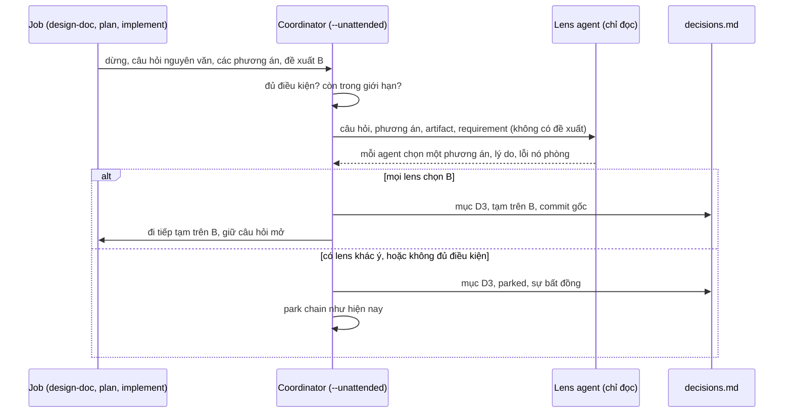

Approved by Lam Ngoc Khuong on 2026-11-08, by instruction to the agent.

# Một lần chạy không người trực của atk:orchestrate đi qua tạm các cổng đủ điều kiện và giao chúng cho một người trong một hàng đợi quyết định

Requirement: `docs/records/requirements/261105-0310-auto-run-with-batched-decisions.md`, `APPROVED`
ngày 2026-11-05. Reviewer bắt buộc: Tech Lead, Lam Ngoc Khuong, người duyệt. Việc BrSE/BA kiểm tra
thiết kế còn phục vụ đúng requirement cũng thuộc người này, vì profile không có dòng BrSE/BA; cũng
không có dòng SRE, và không phần nào ở đây đụng tới deploy hay dữ liệu.

## Tóm tắt

`atk:orchestrate` hiện đã đưa các phần việc qua bộ kit trong worktree, chuyển từng cổng tới đúng
người, và cho chain dừng chờ (park) khi người đó vắng mặt. Điều nó chưa làm được là xây tiếp bất cứ
thứ gì khi không ai ở đó để trả lời. Thiết kế này thêm `--unattended` cho nó. Với cờ này, một cổng
thuộc một danh sách ngắn và cố định sẽ không phải chờ: skill của job nêu phương án nó đề xuất, hai
hoặc ba lens agent chỉ đọc chọn một phương án mà không thấy đề xuất đó, và chỉ khi tất cả cùng chọn
một phương án thì chain mới đi tiếp, trên phương án đó, một cách tạm thời. Câu hỏi vẫn để mở trong
artifact, đứng tên người sở hữu nó, và trở thành một mục của hàng đợi quyết định mà người đó đọc khi
quay lại. Mọi cổng khác vẫn park chain y như hiện nay.

Không điều gì thuộc quyền một người bị quyết thay. Không artifact nào lên `APPROVED` trong lúc chạy,
không gì vượt qua consent line, và một mục bị từ chối chỉ tốn công làm lại trên máy: branch xây trên
nó được giữ làm bằng chứng, và một proposal record mới đưa chain đi lại từ cổng bị từ chối, trên
phương án của người đó, khi record ấy được duyệt.

## Requirement

Các tiêu chí chấp nhận mà thiết kế này được đối chiếu, lấy từ mục 3 của requirement, coi sáu câu
trả lời ở mục 6 là đã chốt:

| AC | Diễn lại | Được đáp ứng bởi |
|----|----------|------------------|
| 1.1 | Một cổng đủ điều kiện được ghi lại và run đi tiếp không cần người | Phương án chọn, "Một cổng dưới `--unattended`", bước 1 đến 5 |
| 1.2 | Một cổng không đủ điều kiện chỉ dừng chain của chính nó | "Một cổng dưới `--unattended`", bước 1; `parked` như hiện nay |
| 1.3 | Không artifact nào kết thúc run ở `APPROVED` nếu lúc bắt đầu chưa như vậy | "Khi đóng run", phần kiểm tra status |
| 1.4 | Không gì vượt qua consent line | Luật sẵn có của `atk:orchestrate`, kiểm tra lại khi đóng run |
| 2.1 | Mỗi vai trò sở hữu cổng có một lens agent đọc các phương án từ đầu và đề xuất | "Các lens agent" |
| 2.2 | Bất đồng được ghi lại và không bao giờ được dùng để đi tiếp | "Một cổng dưới `--unattended`", bước 4 |
| 2.3 | Lens agent được gọi là agent kèm lens của nó, câu trả lời là đề xuất | "Cách gọi tên", và mọi hình dạng bên dưới |
| 3.1 | Mỗi cổng đi qua tạm có một mục trong hàng đợi với các trường đã liệt kê | "Hàng đợi quyết định" |
| 3.2 | Mục được chấp nhận ghi tên người và thời điểm, và dòng `gate` của trace ghi tên người đó | "Trả lời hàng đợi", chấp nhận |
| 3.3 | Công việc của mục bị từ chối được xác định và không mang tiếp cho tới khi làm lại | "Trả lời hàng đợi", từ chối |
| 3.4 | Mục chưa ai trả lời đọc là chưa trả lời, công việc của nó là tạm | "Hàng đợi quyết định", trạng thái; "Khi đóng run" |

Mỗi tiêu chí đều ứng với một mục. Không phần nào của thiết kế nằm ngoài tiêu chí, trừ hai giới hạn,
trả lời câu hỏi 6, và luật về permission prompt, mà câu hỏi 2 liệt vào loại không bao giờ đủ điều
kiện và cần một cơ chế để luật đó vẫn đúng khi không ai theo dõi.

## Hiện trạng

Một cổng được xử lý thế nào hôm nay, và vì sao cách hiển nhiên, "để coordinator trả lời", không mở:

- **Cổng được chuyển, không bao giờ được trả lời.** Skill gọi không bao giờ trả lời một cổng, không
  bao giờ chọn phương án của nó, và không bao giờ đổi state của artifact:
  `plugins/atk/shared/host-capabilities.md:413`. Đây là luật duy nhất chế độ này phải đổi, và câu hỏi
  1 đặt thay đổi vào `orchestrate` vì lý do đó.
- **Duyệt là hành động của người duyệt.** Không skill nào tự đổi state:
  `plugins/atk/shared/team-roles.md:41`, luật 2. Luật 3 ở dòng 58 cấm ghi một quyết định mà team chưa
  đưa ra.
- **Một người không có trong session.** Luật 5 đã cho phép run ghi trường hợp đó thành câu hỏi mở
  mang tên người ấy và đi tiếp "với những gì không phụ thuộc vào nó":
  `plugins/atk/shared/team-roles.md:68`. Chế độ này đi xa thêm một bước, với cả những gì phụ thuộc
  vào nó, một cách tạm thời, và luật 5 cần một mệnh đề nói như vậy.
- **Cổng tới coordinator như thế nào.** Job ghi mỗi điểm dừng thành một dòng `stop:` trong result
  file, nguyên văn, kèm người cần trả lời:
  `plugins/atk/skills/orchestrate/references/job-prompt.md:67`. Một subagent trả về ở `needs-person`,
  và coordinator tiếp tục chính agent đó với câu trả lời nguyên văn:
  `plugins/atk/skills/orchestrate/references/ways-to-run.md:117`. Hiện nay điểm dừng không mang
  phương án đề xuất nào, nên coordinator không có gì để so với lựa chọn của lens agent.
- **Park.** Một câu hỏi cho người không có trong session sẽ park chain của nó, agent bị dừng để không
  giữ chỗ, và các chain khác đi tiếp: `plugins/atk/skills/orchestrate/references/proposal.md:255`.
  Đó đã là AC 1.2, cho mọi cổng.
- **Việc duyệt có hiệu lực tới đâu.** Duyệt một proposal record bao trùm mỗi chain tới job đầu tiên
  tạo ra artifact gating; các job sau đó là `re-confirm` và chỉ chạy dưới một record mới đã duyệt:
  `plugins/atk/skills/orchestrate/references/proposal.md:142`. Trong chế độ này, cổng đủ điều kiện (c)
  của câu hỏi 2 thay đổi phạm vi đó, trong giới hạn độ sâu của câu hỏi 6.
- **Artifact nào gating.** Plan thì không; requirement, design và breakdown thì có:
  `plugins/atk/shared/state-signals.md:19`.
- **Người đọc từ đầu.** Các agent đọc bản nháp mà không biết gì về cuộc hội thoại, trả về tối đa năm
  phản biện mỗi agent, và được tạo dưới dạng `atk:read-only-reviewer`:
  `plugins/atk/shared/independent-challenge.md:22`. Các lens theo vai trò và câu hỏi của chúng cho một
  design nằm ở `plugins/atk/skills/design-doc/references/role-challenge.md:19`.
- **Chỗ `atk:implement` tự dừng.** Job được giao đường dẫn plan thì chạy thẳng qua gate của nó, nhưng
  fix job của `orchestrate` nhận một mô tả, nên plan gate chấm điểm nó: mức medium gửi xác nhận
  `atk:plan --inline` tới người như một cổng, mức large thì escalate:
  `plugins/atk/skills/orchestrate/references/proposal.md:137`,
  `plugins/atk/skills/implement/SKILL.md:87`. Xác nhận mức medium là cổng (b) của câu hỏi 2.
- **Không gì rời repository.** Không job nào push, comment hay merge, và các lời mời được từ chối để
  dành cho lúc đóng run: `plugins/atk/skills/orchestrate/references/job-prompt.md:46`. AC 1.4 đã đúng.
- **Trace.** Sáu loại sự kiện và không loại nào khác; một dòng `gate` ghi ai được hỏi, thời gian chờ,
  và `answered`, `unanswered` hoặc `refused`: `plugins/atk/shared/run-trace.md:181`.
- **Giới hạn của `SKILL.md`.** `plugins/atk/skills/orchestrate/SKILL.md` dài 298 dòng so với giới hạn
  dưới 300, theo `CLAUDE.md`, "Skill folder layout". Chế độ này không thể nằm ở đó; nó có một file
  reference riêng, và `SKILL.md` tăng tối đa một dòng.
- **Permission prompt.** Prompt của subagent tới người trong harness, coordinator không thấy, nên job
  subagent không có timeout: `plugins/atk/skills/orchestrate/references/ways-to-run.md:127`. Khi không
  ai ngồi ở harness, job đó sẽ chờ mãi.

## Các phương án

Câu hỏi 1 đã chốt chỗ đặt chế độ này, một cờ của `atk:orchestrate`. Điều còn phải chọn là việc đi
qua tạm diễn ra ở đâu và ai mang luật của nó.

Tiêu chí, theo thứ tự trọng số: **giữ luật**, không ghi là đã quyết điều mà người chưa quyết; **phạm
vi**, bao nhiêu file và skill thay đổi; **khả năng đảo ngược**, một lần từ chối hay việc gỡ tính
năng tốn gì; **quan sát được**, người đọc về sau có biết điều gì là tạm không; **tính di động**, có
chạy giống nhau trên pane, subagent và session, và trên Claude Code, Cursor, Codex không; **chi
phí**, số agent nó tạo ra.

### A. Coordinator cho cổng đi qua; skill của job ghi nó là câu hỏi mở (được chọn)

Job dừng ở cổng như hiện nay, thêm một trường: phương án skill của nó đề xuất. Coordinator, dưới
`--unattended`, tra cổng trong một bảng đủ điều kiện cố định, tạo lens agent, so sánh, và khi đồng
thuận thì tiếp tục job bằng một chỉ dẫn tạm cố định thay vì một câu trả lời. Skill của job ghi câu
hỏi trong artifact là còn mở, đứng tên người sở hữu, kèm phương án tạm bên cạnh. Hàng đợi, các giới
hạn và đường từ chối nằm trong một file reference mới của `orchestrate`; phần thay đổi dùng chung là
một gạch đầu dòng trong `host-capabilities.md`, một mệnh đề trong luật 5, một trường của dòng `stop:`
của job, và một giá trị của dòng `gate` trong trace.



- Giữ luật: cao. Không skill nào tự chọn; job chỉ nêu phương án nó vốn đã đề xuất trong văn bản, và
  coordinator chuyển một câu cố định, không bao giờ là câu trả lời.
- Phạm vi: một reference mới, sửa nhỏ năm file có sẵn, bề mặt của cờ.
- Đảo ngược: cao. Gỡ cờ là gỡ chế độ; phần còn lại của kit không bao giờ đọc hàng đợi.
- Quan sát được: hàng đợi, câu hỏi mở trong artifact, và dòng trace.
- Di động: như nhau trên mọi cách chạy, vì coordinator làm việc này trong lượt của chính nó; giới hạn
  về permission prompt bên dưới tùy cách chạy, và được nêu trong proposal.
- Chi phí: tối đa ba lens agent cho mỗi cổng đủ điều kiện, tối đa tám cổng: trường hợp xấu nhất 24
  agent, nêu trước khi chạy.

### B. Mỗi skill có cổng thêm một cờ tạm

`atk:design-doc`, `atk:plan` và `atk:implement` mỗi skill nhận cờ `--provisional`, theo đó skill tự
chọn phương án nó đề xuất và ghi log; coordinator chỉ gom các log vào hàng đợi.

- Giữ luật: thấp. Một người có thể chạy `/atk:design-doc --provisional` ngoài mọi orchestration, và
  skill sẽ tự vượt qua cổng của chính nó mà không ai kiểm tra; đó là skill tự quyết, điều `CLAUDE.md`,
  "The team premise", gọi là regression.
- Phạm vi: ba file `SKILL.md`, file nào cũng sát giới hạn dòng, cộng mọi file bề mặt cờ cho từng skill.
- Lens agent sẽ phải do job tạo ra, điều subagent không làm được trên Claude Code, hoặc bị bỏ qua, làm
  hỏng AC 2.1.
- Thua chỉ riêng vì giữ luật.

### C. Park mọi thứ, chỉ gom hàng đợi (mặc định team sẽ chọn)

Giữ mọi cổng park chain của nó như hiện nay, chỉ thêm một báo cáo lúc đóng run liệt kê các câu hỏi
đang park ở một chỗ.

- Giữ luật: cao nhất; không gì thay đổi.
- Phạm vi: nhỏ nhất.
- Trượt hẳn AC 1.1: không gì được xây khi người vắng mặt, mà đó chính là nhu cầu requirement tồn tại
  để đáp ứng. Đây là mốc so sánh trung thực, và là điều team có hôm nay với `--resume`. Nó thua vì
  không đáp ứng requirement.

### D. Để đa số lens agent chọn

Như A, nhưng đi tiếp trên phương án được nhiều lens agent chọn nhất.

- Câu hỏi 3 đã loại: đa số giữa các agent chạy trên một model không mấy ý nghĩa, và nghiêng về một
  lens là coi agent như vai trò. Liệt kê để ADR ghi lại.

| Tiêu chí | A | B | C | D |
|----------|---|---|---|---|
| Giữ luật | cao | thấp | cao nhất | trung bình |
| Phạm vi | trung bình | lớn | nhỏ | trung bình |
| Đảo ngược | cao | trung bình | cao | cao |
| Quan sát được | cao | trung bình | cao | cao |
| Di động | cao | thấp (subagent không tạo được agent) | cao | cao |
| Đáp ứng mọi AC | có | không (2.1) | không (1.1) | không (2.2, Q3) |

## Phương án được chọn

Phương án A. Tech Lead sở hữu lựa chọn này; phần so sánh trên là lập luận cho nó.

### Cờ và những gì nó đổi ở proposal

`/atk:orchestrate <inputs> --unattended`. Nó đi cùng được với `--concurrency` và `--sequential`, và bị
từ chối khi đi với `--resume`, cờ không nhận input: run được resume giữ chế độ mà run state ghi.

Proposal record, viết và duyệt y như hiện nay, thêm bốn điều dưới `--unattended`:

1. **Một dòng `Mode: unattended`** dưới tiêu đề, và một mục **Provisional gates** nêu bảng đủ điều
   kiện bên dưới, hai giới hạn, các lens agent cho mỗi cổng và số agent trong trường hợp xấu nhất, để
   người duyệt duyệt chế độ này khi đã thấy chi phí, theo chính sách parallel agent của
   `plugins/atk/shared/host-capabilities.md`.
2. **Phạm vi duyệt.** Các job của mỗi chain sau artifact gating đầu tiên được đánh dấu `provisional`
   thay cho `re-confirm`, tới giới hạn độ sâu bên dưới. Job vượt giới hạn đó vẫn là `re-confirm`.
3. **Phần việc bị loại khỏi chế độ.** Một phần việc có requirement chưa `APPROVED`, kể cả phần bắt đầu
   ở `atk:intake`, không được chạy không người trực: câu hỏi 2 giữ phạm vi cho người quyết. Nó được
   liệt kê là đang chờ người duyệt requirement, và phần còn lại của run đi tiếp.
4. **Permission prompt.** Câu hỏi 2 coi mọi permission prompt là không đủ điều kiện, và không ai ở đó
   để trả lời. Vì vậy proposal nêu, cho từng job, cách chạy của nó có thể bật permission prompt không:
   một job pane ở chế độ hỏi trước khi ghi vào worktree sẽ chờ ở lần ghi đầu tiên cho tới khi timeout
   làm nó thất bại; một job subagent không có timeout và chỉ được đề xuất dưới `--unattended` khi
   người duyệt xác nhận trong record rằng harness cho subagent đó ghi vào worktree mà không hỏi, ngoài
   ra thì được đề xuất thành job pane hoặc bỏ ra. Chế độ classifier của
   `plugins/atk/shared/host-capabilities.md` vẫn dùng được với điều kiện như hiện nay. Một commit mà
   coordinator sẽ hỏi trước, vì repository chạy hook hay filter khi `git add`, sẽ park chain của nó,
   và proposal nói trước điều đó.

Việc duyệt record này là hành động người đó giao việc. Nó không bao giờ là tạm, và run không khởi
chạy gì trước nó, như hiện nay.

### Điều kiện

Một bảng, trong file reference mới, theo skill và loại cổng. Coordinator tra cổng; cổng nào không xếp
được vào bảng là không đủ điều kiện.

| Đủ điều kiện | Cổng | Ghi ở chỗ skill của job ghi |
|--------------|------|-----------------------------|
| (a) | Một câu hỏi phỏng vấn hoặc một lựa chọn phương án trong bản nháp, của `atk:design-doc` hoặc `atk:plan`, mà các phương án không đổi user story, tiêu chí chấp nhận hay mục out-of-scope nào của requirement | `## Open questions` của artifact, là câu hỏi mở |
| (b) | Xác nhận `atk:plan --inline` mức medium của plan gate trong `atk:implement`, ở một fix job | Implementation record, là câu hỏi mở |
| (c) | Việc chờ duyệt một artifact gating, chain xây trên nó khi nó vẫn ở `DRAFT` hoặc `IN REVIEW` | Artifact giữ nguyên state; mục trong hàng đợi mang nó |

Không bao giờ đủ điều kiện, và chain park như hiện nay: đổi bất kỳ state duyệt nào; phạm vi, độ ưu
tiên, giá, deadline, compliance; requirement chưa `APPROVED`; rủi ro còn lại trong `atk:security`;
escalation của review loop và một finding `BLOCKING` bị tranh chấp; bước `atk:fix` kiểm tra một hành
vi có phải chủ đích không; điểm plan gate mức large; permission prompt; một commit mà coordinator hỏi
trước; mọi hành động vượt consent line.

Với (a), "không đổi story, tiêu chí hay mục out-of-scope nào" do lens agent đánh giá, không phải
coordinator: mỗi agent được hỏi điều đó làm câu đầu tiên, và một câu `yes` bất kỳ làm cổng không đủ
điều kiện, nên coordinator không bao giờ tự đánh giá phạm vi.

Với (c), skill của job không đề xuất gì, nên đề xuất dùng để so là đề xuất mà proposal đã duyệt mang
sẵn: "build on the draft as written". Lens agent được hỏi chúng có xây tiếp trên bản nháp như đang
viết không.

### Một cổng dưới `--unattended`

Khi một job dừng:

1. **Tra bảng.** Không có trong bảng: park như hiện nay, và ghi một mục hàng đợi ở trạng thái
   `parked` với lý do `not eligible`. Đã chạm giới hạn: như vậy, lý do `ceiling`.
2. **Đề xuất của skill.** Dòng `stop:` phải mang `recommends: <option>`, phương án mà chính văn bản
   của skill đề xuất. Không có: park, lý do `no recommendation`. Coordinator không bao giờ tự đưa ra
   một đề xuất, trừ đề xuất cố định của (c).
3. **Lens agent.** Tạo chúng, như bên dưới. Agent nào chết hai lần thì coi như không chạy, và cổng
   park, lý do `lens not run`: thiếu một lens không phải là đồng thuận.
4. **So sánh.** Mọi lens chọn phương án của skill, và không lens nào trả lời `yes` cho câu hỏi phạm
   vi: đi tiếp. Mọi trường hợp khác: park, ghi lựa chọn và lý do của từng lens vào mục. Không theo đa
   số, không phá thế hòa.
5. **Đi tiếp.** Ghi mục ở trạng thái `provisional`, rồi tiếp tục job bằng đúng câu này và không gì
   khác, nguyên văn:
   `Unanswered. Continue provisionally on option <option>, decision queue entry <run-id> D<n>. Record
   the question as open for <owner>, with the line "Provisional: option <option>, recommended by the
   <lenses> lens agents, decision queue <run-id> D<n>". This is not an answer.`
   Với (c), không job nào được tiếp tục: job kế tiếp của chain, đã đánh dấu `provisional`, bắt đầu.

### Các lens agent

- **Những agent nào.** Các vai trò sở hữu cổng: người mà dòng `stop:` nêu tên, ánh xạ sang vai trò
  qua mục Team, và với (c) là vai trò của những người duyệt artifact như
  `plugins/atk/skills/design-doc/references/role-challenge.md` liệt kê cho một design. Tối đa ba; khi
  nhiều hơn, vai trò sở hữu trước, rồi theo thứ tự của role-challenge, và mục ghi tên những vai trò bị
  bỏ ra.
- **Mỗi agent nhận gì.** Theo What each agent gets trong
  `plugins/atk/shared/independent-challenge.md`: câu hỏi nguyên văn, các phương án, artifact trong
  worktree theo đường dẫn tuyệt đối, requirement, câu hỏi của vai trò nó, danh sách của luật 9; không
  gì từ lập luận của job và **không có đề xuất của skill**, để lựa chọn của nó là của riêng nó. Trên
  Claude Code được tạo dưới dạng `atk:read-only-reviewer`, với dòng `Review agent model`.
- **Mỗi agent trả về gì.** Câu trả lời về phạm vi, `yes` hoặc `no` kèm mục nó sẽ thay đổi; một phương
  án; tối đa ba lý do, mỗi lý do có bằng chứng, `path:line` hoặc một dòng của artifact; lỗi mà phương
  án đó phòng tránh. Câu trả về không nêu lỗi nào thì coi như không chọn.

### Cách gọi tên

Lens agent được viết là "the Tech Lead lens agent", không bao giờ là người đó hay "the Tech Lead". Câu
trả lời của nó là "recommendation". Một cổng đi qua tạm là "passed provisionally", không bao giờ là
"decided", "approved" hay "answered". Điều này áp dụng trong hàng đợi, proposal record, artifact,
trace và tin nhắn đóng run.

### Các giới hạn

- **Độ sâu.** Một chain xây trên tối đa một artifact gating chưa `APPROVED`. `atk:implement` có thể
  chạy trên design nháp và plan nháp, vì plan không gating; nhưng không trên design nháp cùng
  breakdown nháp. Job nào sẽ vượt qua cái thứ hai là `re-confirm`.
- **Số lượng.** Tối đa 8 mục ở `provisional` mỗi run. Cổng đủ điều kiện thứ chín park, lý do
  `ceiling`. Các mục parked không tính.
- Timeout của job trong `atk:orchestrate` giữ nguyên.

### Hàng đợi quyết định

`<docs root>/derived/orchestrate/<run-id>/decisions.md`, cạnh `progress.md`, được ignore file sẵn có
của run state giữ ngoài git. Mỗi cổng gặp phải có một mục, tạm hay parked, để người đó đọc mọi điểm
dừng của run ở một chỗ.

```
## D3 | provisional | r1-2 design-doc step 3 | for: Lam Ngoc Khuong (Tech Lead)
question: <verbatim, masked per rule 9>
options: A <one line> | B <one line>
skill recommends: B
lens agents: Tech Lead lens agent: B, <reasons, evidence>, guards <failure> | QA lens agent: B, ...
continued on: B | base: <commit before the gate> | built on it: <commits>, <files>
depends on: D1 | rejected costs: r1-3, r1-4 redone from <base> on the chosen option
answer: unanswered
```

- **Trạng thái.** `provisional`, `parked`, `accepted`, `rejected`, `void`. `void` là mục xây trên một
  mục bị từ chối: không bao giờ được hỏi, công việc của nó đi theo mục cha.
- **`built on it`** lớn dần khi các job sau của chain commit, nên đầy đủ lúc đóng run.
- **Thứ tự.** Mục được đánh số theo thứ tự gặp. Hàng đợi được hỏi theo thứ tự phụ thuộc, mục cha
  trước mục phụ thuộc nó.
- **Run state.** Mỗi mục tạm hoặc parked cũng thêm một dòng `<time> waiting:` vào `progress.md` nêu
  tên người, như lúc đóng run hiện làm cho một chain parked, để `atk:help` đưa người đó quay lại
  `--resume`.

### Trả lời hàng đợi

`/atk:orchestrate --resume` trên một run có mục chưa trả lời sẽ hỏi chúng trước, mọi mục độc lập trong
một lượt, mỗi mục nguyên văn kèm đề xuất của các lens, trước khi resume bất cứ gì. Người đó có thể trả
lời một số và để lại phần còn lại; ai đang trả lời được xác định như luật 2 của
`plugins/atk/shared/team-roles.md` xác định người duyệt, và một mục dành cho người khác được chuyển
tới họ, không do người đang có mặt trả lời.

- **Chấp nhận.** Mục nhận `answer: accepted by <name>, <YYYY-MM-DD HH:MM>`. Với (a), câu trả lời được
  ghi ở chỗ skill của nó ghi câu trả lời, `atk:design-doc <path> --answer` hoặc
  `atk:plan <path> --answer`, dưới dạng job hoặc trong session, giữ dòng provisional phía trên câu trả
  lời. Với (b), proposal record kế tiếp mang nó. Với (c), mục chỉ được chấp nhận khi artifact đã
  `APPROVED` bởi người duyệt của nó, và chỉ khi nội dung file được duyệt trùng với commit mà chain đã
  xây lên; một lần duyệt có sửa đổi được đưa cho người đó chọn, chấp nhận hay từ chối.
- **Từ chối.** Mục nhận `answer: rejected by <name>, option <their option>, <time>`. Mọi mục phụ thuộc
  nó thành `void`. Branch giữ các commit làm bằng chứng và run không bao giờ xóa nó; worktree bị gỡ
  theo luật dọn dẹp sau khi các file của nó đã được sao ra; và coordinator viết một proposal record
  mới có dòng `Follows:`, cho chain từ cổng bị từ chối trở đi, trên phương án của người đó, từ commit
  `base` của mục trên một branch mới. Nó chạy khi record đó `APPROVED`, như bước 6 làm hôm nay.
- **Bản ghi lâu dài.** Proposal record kế tiếp mang một mục **Decision queue** liệt kê mọi mục của
  run: cổng của nó, phương án đã đi tiếp, đề xuất của các lens trong một dòng, và ai chấp nhận hay từ
  chối nó, hoặc `unanswered`.

### Khi đóng run

Trước tin nhắn đóng run, coordinator đọc lại `status` của mọi artifact run đã đụng tới, so với giá trị
nó ghi lúc job bắt đầu, và báo artifact nào đã thành `APPROVED` mà không có mục (c) được chấp nhận là
một lỗi của run, theo đường dẫn. Tin nhắn đóng run liệt kê hàng đợi trước: số lượng theo trạng thái,
rồi mọi mục `provisional` kèm người của nó, và rằng công việc xây trên mỗi mục là tạm cho tới khi được
trả lời. Phần còn lại là bước đóng run ở bước 7 như hiện nay.

### Mô hình dữ liệu và migration

Hai hình dạng mới, đều là file của run state dưới `docs/derived/`, không bao giờ commit: các mục của
`decisions.md` ở trên, và trường tùy chọn của dòng `stop:` bên dưới. Không có migration: run state
không có `decisions.md` là một run không ở chế độ unattended, và result file có dòng stop thiếu
`recommends:` được đọc như hiện nay.

### Hợp đồng API

Các hợp đồng ở đây là những hình dạng mà skill và agent trao đổi.

- **Result file, dòng `stop:`.** `stop: <kind> | for: <person> | recommends: <option or none> | <the
  question, word for word>`. Mọi job dưới `--unattended` ghi trường này, `none` khi skill không đề
  xuất gì; ngoài chế độ này thì bỏ trường, và coordinator đọc dòng như hiện nay. Mục 6 của
  `job-prompt.md` nói như vậy.
- **Job prompt, mục 6.** Thêm, chỉ dưới `--unattended`, trường trên và câu mà job sẽ được tiếp tục
  bằng, để job biết việc đi tiếp tạm không phải là câu trả lời.
- **Dòng `gate` của trace.** Thêm một kết quả bên cạnh `answered`, `unanswered` và `refused`:
  `provisional, queued as <run-id> D<n>`, thời gian chờ `none`. Trace của coordinator ghi nó; trace
  riêng của job ghi cổng là `unanswered`, kèm `continued provisionally per <run-id> D<n>`. Việc chấp
  nhận hay từ chối về sau là một dòng `gate` của run `--resume`, nêu tên người, theo "Answers that
  arrive in a later session" trong `plugins/atk/shared/run-trace.md`. Không có loại sự kiện thứ bảy.
- **Prompt và câu trả về của lens agent.** Như "Các lens agent" ở trên.
- **Proposal record.** Dòng `Mode:`, mục Provisional gates, giá trị `provisional` của cột Approval, và
  mục Decision queue của record tiếp theo.

### Lỗi và trường hợp biên

- Một job bỏ qua câu đi tiếp tạm và ghi câu trả lời như thể đã có: coordinator đọc artifact sau job,
  như bằng chứng, và một câu hỏi được ghi là đã trả lời mà không ai trả lời sẽ được báo trong tin nhắn
  đóng run theo đường dẫn và dòng, và mục bị đánh dấu `parked`, lý do `recorded as answered`.
- Một lens agent trả về hai phương án, hoặc không phương án nào: không chọn; cổng park.
- Cổng đủ điều kiện thứ chín, một artifact gating chưa duyệt thứ hai, một người duyệt sửa artifact
  giữa run: lần lượt là park, `re-confirm`, và phép kiểm tra nội dung của (c).
- Người đó quay lại giữa run và trả lời trong session: cổng được trả lời như hiện nay, và từ đó run có
  người trực, mọi cổng sau hỏi thẳng họ. Khi người đó nói họ không còn trực nữa, run quay lại chế độ
  không người trực cho các cổng sau đó, và run state ghi cả hai lần chuyển kèm thời điểm và người nói.
  (Từ câu hỏi mở 3.)
- Một lần từ chối mà commit `base` không còn trên branch nào: coordinator hỏi người đó base, không
  bao giờ tự chọn.
- Run bị ngắt giữa lúc ghi mục và lúc tiếp tục job: `--resume` thấy mục ở `provisional` mà không có
  commit nào sau `base`, và tiếp tục job bằng đúng câu đó.

### Tương thích ngược

Không có cờ thì không gì thay đổi: bảng điều kiện không bao giờ được đọc, không lens agent nào được
tạo, dòng `stop:` không có trường mới, và không `decisions.md` nào được ghi. Run state viết trước thay
đổi này resume như một run có người trực. Thay đổi dùng chung duy nhất mà mọi skill đọc, mệnh đề của
luật 5, nêu rõ chỉ áp dụng cho `--unattended`.

### Triển khai

Cờ, không đặt sau gì khác. Nó được ghi là mới trong khối invocation của `README.md` và cả hai file
`skills-overview.md`. `description:` của `atk:orchestrate` thêm trigger tiếng Anh "run this
unattended", và `evals/trigger_evals.json` của nó thêm một positive cho chế độ này ở mỗi ngôn ngữ
Anh, Việt và Nhật, description vẫn dưới 1.024 ký tự; trigger vẫn chỉ tiếng Anh, theo `CLAUDE.md`,
"Trigger phrases are English". (Từ câu hỏi mở 2.) Lần dùng thật đầu tiên là một lần chạy thử nhỏ hai
phần việc trong repository này, đọc trace và hàng đợi sau đó; plan sẽ xếp lịch.

### Rollback

Gỡ dòng của cờ và file reference, hoàn lại mệnh đề của luật 5, gạch đầu dòng của
`host-capabilities.md`, mục 6 của job prompt và giá trị trong trace. Không gì trên đĩa trong dự án của
người dùng phụ thuộc vào nó ngoài `docs/derived/`, vốn xóa an toàn. Các branch tạm mà run để lại là
branch bình thường chưa push.

### Quan sát

Chính hàng đợi; các câu hỏi mở kèm dòng `Provisional:` trong mỗi artifact; các dòng `gate` của cả hai
trace; và phép kiểm tra status lúc đóng run. `atk:tailor --feedback orchestrate --runs` đếm được cổng
tạm so với cổng parked từ trace mà không cần loại sự kiện mới.

### Bảo mật và quyền

Không có ranh giới tin cậy mới. Lens agent chỉ đọc, nhận danh sách của luật 9, và chỉ thấy worktree.
Chế độ này không bỏ sự đồng ý nào: không gì được push hay gửi đi, và mọi permission prompt vẫn là của
người, đó là lý do proposal phải nêu cho từng job có thể bật prompt nào không. Rủi ro nới quyền duy
nhất là người duyệt chấp nhận cách chạy subagent trong khi harness của họ ghi mà không hỏi; record
ghi rõ lời xác nhận đó và ai đưa ra.

### Hiệu năng kỳ vọng

Mỗi cổng đủ điều kiện, tối đa ba lens agent chạy song song trong giới hạn của máy. Trường hợp xấu
nhất mỗi run: tám cổng tạm, 24 lens agent, cộng những agent dùng cho các cổng cuối cùng bị park, tối
đa ba cho mỗi cổng parked. Proposal nêu trường hợp xấu nhất trước khi chạy. Một cổng tốn thời gian
bằng lens agent chậm nhất của nó, và chain chỉ chờ chừng ấy.

### Các file phần triển khai đụng tới

| File | Thay đổi |
|------|----------|
| `plugins/atk/skills/orchestrate/references/unattended.md` | Mới: điều kiện, quy trình ở cổng, lens agent, giới hạn, hàng đợi, trả lời, đóng run |
| `plugins/atk/skills/orchestrate/SKILL.md` | `argument-hint`, một dòng `## Invocation`, một mệnh đề ở bước 2 và ở State and resuming trỏ tới file mới; tăng tối đa một dòng |
| `plugins/atk/skills/orchestrate/references/proposal.md` | Giá trị `provisional` của cột Approval, dòng Mode, hai mục mới |
| `plugins/atk/skills/orchestrate/references/job-prompt.md` | Mục 6 và hình dạng dòng `stop:` |
| `plugins/atk/skills/orchestrate/references/ways-to-run.md` | Điều kiện cho subagent dưới `--unattended` |
| `plugins/atk/shared/host-capabilities.md` | Một gạch đầu dòng sau "A gate is relayed, never answered": cổng đi qua tạm dưới `atk:orchestrate --unattended` |
| `plugins/atk/shared/team-roles.md` | Một mệnh đề trong luật 5 |
| `plugins/atk/shared/run-trace.md` | Kết quả `provisional` của dòng `gate` |
| `plugins/atk/skills/design-doc/references/answer-mode.md`, reference trả lời của `plugins/atk/skills/plan/` | Kiểm tra, và nếu cần thêm một dòng: dòng `Provisional:` được giữ phía trên câu trả lời |
| `description:` trong `plugins/atk/skills/orchestrate/SKILL.md`, `plugins/atk/skills/orchestrate/evals/trigger_evals.json` | Trigger "run this unattended", và ba positive, Anh, Việt, Nhật (từ câu hỏi mở 2) |
| `README.md`, `docs/skills-overview.md`, `docs/vi/skills-overview.md` | Cờ |
| `docs/codebase-summary.md`, `docs/vi/codebase-summary.md` | Một dòng cho reference mới và cho ADR 0016, điều `tests/verify.sh` yêu cầu |
| `docs/system-architecture.md`, `docs/flow/skill-chain.md` và bản mirror `docs/vi/` của chúng | Chế độ này và cạnh provisional |
| `docs/adr/0016-unattended-run-passes-gates-provisionally.md` | ADR |
| `docs/vi/records/design/261108-1246-orchestrate-unattended-run.md` | Bản tiếng Việt của thiết kế này, do tác giả viết trong cùng pull request |

`docs/artifact-lifecycle.md` không đổi, theo câu hỏi 5. Số skill vẫn là 25.

## Open questions

Không còn câu nào mở. Ba câu hỏi thiết kế được viết kèm đã được trả lời bên dưới.

### Answered

| Câu hỏi | Câu trả lời | Người trả lời | Ngày | Người chuyển lời |
|---------|-------------|---------------|------|------------------|
| 1. Dưới `--unattended` có nên đề xuất job subagent không, hay chỉ pane và session? Thiết kế đề xuất nó khi người duyệt xác nhận harness cho nó ghi vào worktree mà không hỏi. | "Theo bạn đề xuất". Thiết kế giữ nguyên; không mục nào thay đổi. | Lam Ngoc Khuong | 2026-11-08, ngày trả lời | |
| 2. `description:` của `atk:orchestrate` có nên thêm trigger cho chế độ này, kèm positive trigger eval ở tiếng Anh, Việt và Nhật không? | "Bạn đề xuất, description hình như chỉ còn tiếng anh thì phải". Với đề xuất được đưa lại, một trigger tiếng Anh "run this unattended" và mỗi ngôn ngữ một positive trong evals: "Chấp nhận". Đã sửa: Triển khai, Các file phần triển khai đụng tới. | Lam Ngoc Khuong | 2026-11-08, ngày trả lời | |
| 3. Khi người đó quay lại giữa run và trả lời một cổng trong session, run có nên mặc định tiếp tục không người trực cho các cổng sau không? | "Có, nhưng nếu tôi bảo tôi không còn thường trực thì phải tiếp tục auto". Với cách hiểu được đưa lại, có người trực từ lúc trả lời, không người trực trở lại khi người đó nói họ không còn trực: "Đúng". Đã sửa: Lỗi và trường hợp biên. | Lam Ngoc Khuong | 2026-11-08, ngày trả lời | |

## ADR

[ADR 0016](../../adr/0016-unattended-run-passes-gates-provisionally.md), `APPROVED`.
