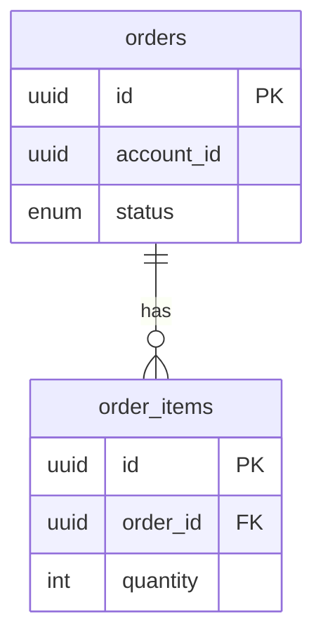

# Database spec template

Loaded by `atk:spec` in step 2, and only when `docs/database/` holds nothing to copy the shape from
and the profile names no template for the kind, and in step 4 whenever a run reaches the schema
index below. One file per table, named after the
table.

The reader is someone about to write a query, add a column, or delete a row, who needs to know what
they will break.

## Shape

````markdown
---
title: "<table_name>"
status: IN REVIEW
owner: <person>
approver: <Tech Lead>
created: YYYY-MM-DD
updated: YYYY-MM-DD
implemented: no | partial | yes   # only where the profile says Contract: first; delete otherwise
---

# `<table_name>`

One paragraph: what one row represents in the product's own words, and which module owns writes to
it. A table several modules write to says so here, because that is the fact that makes a change
dangerous.

## Columns

| Column | Type | Null | Default | Meaning |
|--------|------|------|---------|---------|
| `id` | uuid | no | generated | |
| `status` | enum | no | `pending` | See the state section below |
| `deleted_at` | timestamptz | yes | | Set instead of deleting the row |
| `account_id` | uuid | no | | No foreign key: accounts live in another service's database |

`Meaning` is for what the type cannot say. Leave it empty rather than restating the column name in
words.

## Keys, indexes, and constraints

Primary key, unique constraints, foreign keys with their delete behaviour, and each index with the
query it exists for. An index whose query nobody can name is a finding, not a row.

## Relationships

What points here and what this points at, with the cardinality, linked to the other tables'
documents.

## Lifecycle of a row

How a row is created, what moves it between states, and how it ends. Where the states form a machine
with more than three transitions, draw it as a Mermaid state diagram per
`shared/diagram-conventions.md`; below that, prose is shorter than a picture.

Say plainly whether deletion is a delete or a flag, because every query in the project depends on the
answer.

## Access rules

Row-level security, tenant scoping, or the application-side filter that stands in for them. Name the
column the scope is on. Where both a database rule and an application filter exist, say so: a reader
who finds only one will assume it is the only one.

## Open questions

Each with the name of the person who must answer it.
````

## The schema index

`docs/database/index.md` is the second shape this file holds: the whole schema on one page, for the
reader who needs the joins before any one table. It is a `db` document, approved by the Tech Lead,
and it is not a table.

````markdown
---
title: "Schema index"
status: IN REVIEW
owner: <person>
approver: <Tech Lead>
created: YYYY-MM-DD
updated: YYYY-MM-DD
implemented: no | partial | yes   # only where the profile says Contract: first; delete otherwise
---

# Schema index

One paragraph: which database this covers, and where its schema is defined, named as a module rather
than a file.

## Tables

| Table | Document | One row is |
|-------|----------|------------|
| `orders` | [`orders`](orders.md) | One order a customer placed |
| `order_items` | [`order_items`](order_items.md) | One product line of an order |

## Relationships



## Open questions

Each with the name of the person who must answer it.
````

- **When it exists.** Created only where this file is the shape of the `db` directory, table
  documents an earlier run wrote in it included, or where the project already keeps a schema index;
  a project shape without one is not given one, per The project's own shape wins in
  `shared/spec-docs.md`. It is created complete, with a row and edges for every table document
  already there, or not at all, so the next `--check` does not report the rest as missing. The run
  summary says which happened.
- **A file already there.** An `index.md` this shape did not write is not adopted: the run asks the
  Tech Lead whether it is the schema index, and writes neither it nor a new one until the answer
  comes. On yes, it keeps its own shape and is read as the schema index; on no, it is left alone,
  `--check` lists it as neither a table nor the index, and no schema index is created while it holds
  the path. The summary names the answer, and the answer is recorded in the Docs section of the
  profile, per `shared/project-profile.md`, so it is asked once.
- **Names match character for character.** Every table and column the diagram draws is spelled as
  its table document spells it, and the diagram follows `shared/diagram-conventions.md`. A diagram
  that renames `order_items` to `OrderItem` for looks is a second schema nobody maintains.
- **Kept level by the table writes.** A write of a table document brings that table's row and its
  edges here in the same run, and a change to a row or an edge sets this document back to
  `IN REVIEW`. `--sync` touches only the rows and edges of the tables the diff touched, as it does in
  a table document.
- **Its item is the table row.** A table row carries the not-implemented mark under
  `Contract: first`, at the start of its `One row is` cell, the way a column does below.

## Rules

- Read the schema definition and the migrations, not the entity class. The class is one client of
  the table; the schema is the table.
- A default that the application sets rather than the database is written as such, in the `Meaning`
  column. The two behave differently on a direct insert, and that difference is where data goes bad.
- A `*_id` column with no foreign key says why in its `Meaning` cell, per Rules that hold under any
  shape in `shared/spec-docs.md`.
- Enum values are listed with what each one means in the product. An enum documented as "one of
  five values" documents nothing.
- Do not name functions, sequences, or policies as the explanation of a rule. Describe the rule: a
  ten-digit number padded from a counter starting at 1, not the name of the sequence that produces
  it.
- Under `Contract: first` the unit that carries the not-implemented mark is the column, the index, or
  the constraint, per `shared/spec-docs.md`, since the document is one table, and only at `implemented: partial`. The mark goes at the
  start of the row's `Meaning` cell: `Not implemented yet.`, or `Not implemented yet: <what the
  contract changes>.` for one that exists and is changing. A table that does not exist at all marks
  its opening paragraph instead. Until the mark comes off, the row cites the design, or the ticket
  where the design cannot be reached, per Front matter in `shared/artifact-paths.md`, or the author
  who proposed a detail the design left open, not the schema.
